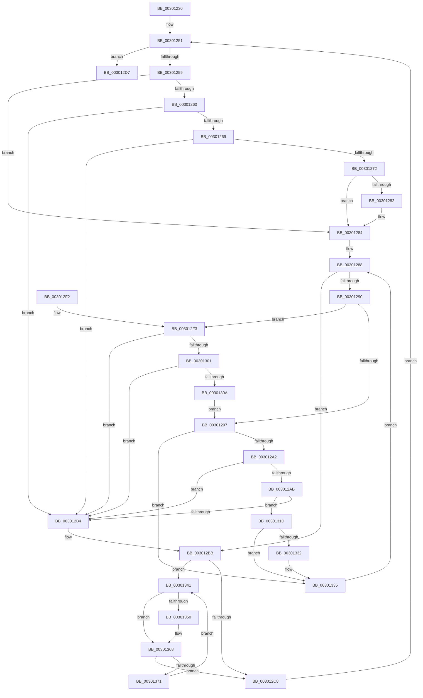

# AuthzBasepFreeSecurityAttributesList

- RVA: `0x00301230`–`0x00301373` (길이 `323` bytes)
- VA: `0x0000000140301230`
- 실행 섹션: `.text`
- PDB 이름 있음: `예`; PDB Function 태그: `아니요`
- unwind 정보 RVA: `0x00073100`
- 디코드: `98`개 명령, `323/323` bytes 표시
- 미해석 바이트: `0` (있으면 어셈블리에 `.byte`로 보존)

> 이 문서는 커널 이미지의 기계어와 PDB 기호를 분석해 생성했습니다. 4번과 5번은 함수 원형과 자료형을 바이너리 사용 방식에서 추정한 C 해석이며 원본 소스 복구 결과는 아닙니다.

## 1. Dependencies

- 직접 호출 지점: **4**; 고유 호출 대상: **2**
- 직접 호출자로 확인된 함수: **14**
- RIP 상대 이미지 참조: **0**

### Outgoing calls
- `0x003012CD` → [ExFreePoolWithTag](../../poolcode/B8/ExFreePoolWithTag_function_00B82870.md) (function, `0x00B82870`)
- `0x00301337` → [ExFreePoolWithTag](../../poolcode/B8/ExFreePoolWithTag_function_00B82870.md) (function, `0x00B82870`)
- `0x00301359` → [AuthzBasepRemoveSecurityAttributeValueFromLists](AuthzBasepRemoveSecurityAttributeValueFromLists_function_00302E00.md) (function, `0x00302E00`)
- `0x00301363` → [ExFreePoolWithTag](../../poolcode/B8/ExFreePoolWithTag_function_00B82870.md) (function, `0x00B82870`)

### Direct callers
- [SepCleanupMarkedForDeletionEntries](../2E/SepCleanupMarkedForDeletionEntries_function_002EEC84.md) at `0x002EEDBD`
- [AuthzBasepEvaluateAceCondition](../2F/AuthzBasepEvaluateAceCondition_function_002FEBD0.md) at `0x002FF575`
- [AuthzBasepInitializeResourceClaimsFromSacl](AuthzBasepInitializeResourceClaimsFromSacl_function_00302E84.md) at `0x00302FD5`
- [sub_003A7CA5](../3A/Unknown_function_003A7CA5.md) at `0x003A7CFD`
- [AuthzBasepSetSecurityAttributesToken](../3A/AuthzBasepSetSecurityAttributesToken_function_003A8D1C.md) at `0x003A8DFE`
- [SepVerifyDesktopAppxPackageName](../3A/SepVerifyDesktopAppxPackageName_function_003A9728.md) at `0x003A98D5`
- [AuthzBasepInitializeSystemSecurityAttributes](../../page/82/AuthzBasepInitializeSystemSecurityAttributes_function_00821E08.md) at `0x00821EC3`
- [SeExamineSacl](../../page/97/SeExamineSacl_function_00973A30.md) at `0x00973B82`
- [SepExamineSaclEx](../../page/A2/SepExamineSaclEx_function_00A2F39C.md) at `0x00A2F551`
- [SepDuplicateClaimAttributes](../../page/A7/SepDuplicateClaimAttributes_function_00A76334.md) at `0x00A76424`
- [SepDeleteClaimAttributes](../../page/A8/SepDeleteClaimAttributes_function_00A8F64C.md) at `0x00A8F68B`
- [SepDeleteClaimAttributes](../../page/A8/SepDeleteClaimAttributes_function_00A8F64C.md) at `0x00A8F6A8`
- [SepTokenDeleteMethod](../../page/AF/SepTokenDeleteMethod_function_00AF23D0.md) at `0x00AF2546`
- [sub_00B3F630](../../page/B3/Unknown_function_00B3F630.md) at `0x00B3F779`
- [sub_00B3F630](../../page/B3/Unknown_function_00B3F630.md) at `0x00B3F795`
- [sub_00B412E4](../../page/B4/Unknown_function_00B412E4.md) at `0x00B41303`

### Static image references
- 디코드된 RIP-relative 메모리 참조가 없습니다.

## 2. Other-region calls and transfers

- 다른 실행 섹션으로 향하는 call: **3**
  - `0x003012CD` → [ExFreePoolWithTag](../../poolcode/B8/ExFreePoolWithTag_function_00B82870.md) (`.text` → `POOLCODE`)
  - `0x00301337` → [ExFreePoolWithTag](../../poolcode/B8/ExFreePoolWithTag_function_00B82870.md) (`.text` → `POOLCODE`)
  - `0x00301363` → [ExFreePoolWithTag](../../poolcode/B8/ExFreePoolWithTag_function_00B82870.md) (`.text` → `POOLCODE`)
- 별도 외부 분기/꼬리 이동을 확인하지 못했습니다.

## 3. Assembly (complete function range)

```asm
00301230  48 89 5C 24 08                  mov qword ptr [rsp + 8], rbx
00301235  48 89 74 24 10                  mov qword ptr [rsp + 0x10], rsi
0030123A  48 89 7C 24 18                  mov qword ptr [rsp + 0x18], rdi
0030123F  4C 89 74 24 20                  mov qword ptr [rsp + 0x20], r14
00301244  41 57                           push r15
00301246  48 83 EC 20                     sub rsp, 0x20
0030124A  48 8B F1                        mov rsi, rcx
0030124D  4C 8D 79 08                     lea r15, [rcx + 8]
00301251  49 8B 1F                        mov rbx, qword ptr [r15]
00301254  49 3B DF                        cmp rbx, r15
00301257  74 7E                           je 0x1403012d7
00301259  8B 43 38                        mov eax, dword ptr [rbx + 0x38]
0030125C  A8 01                           test al, 1
0030125E  74 24                           je 0x140301284
00301260  48 8B 0B                        mov rcx, qword ptr [rbx]
00301263  48 39 59 08                     cmp qword ptr [rcx + 8], rbx
00301267  75 4B                           jne 0x1403012b4
00301269  48 8B 43 08                     mov rax, qword ptr [rbx + 8]
0030126D  48 39 18                        cmp qword ptr [rax], rbx
00301270  75 42                           jne 0x1403012b4
00301272  48 89 08                        mov qword ptr [rax], rcx
00301275  48 89 41 08                     mov qword ptr [rcx + 8], rax
00301279  83 63 38 FE                     and dword ptr [rbx + 0x38], 0xfffffffe
0030127D  48 85 F6                        test rsi, rsi
00301280  74 02                           je 0x140301284
00301282  FF 0E                           dec dword ptr [rsi]
00301284  48 8D 7B 48                     lea rdi, [rbx + 0x48]
00301288  48 8B 0F                        mov rcx, qword ptr [rdi]
0030128B  48 3B CF                        cmp rcx, rdi
0030128E  74 2B                           je 0x1403012bb
00301290  8B 41 20                        mov eax, dword ptr [rcx + 0x20]
00301293  A8 02                           test al, 2
00301295  75 5C                           jne 0x1403012f3
00301297  8B 41 20                        mov eax, dword ptr [rcx + 0x20]
0030129A  A8 01                           test al, 1
0030129C  0F 84 93 00 00 00               je 0x140301335
003012A2  48 8B 11                        mov rdx, qword ptr [rcx]
003012A5  48 39 4A 08                     cmp qword ptr [rdx + 8], rcx
003012A9  75 09                           jne 0x1403012b4
003012AB  48 8B 41 08                     mov rax, qword ptr [rcx + 8]
003012AF  48 39 08                        cmp qword ptr [rax], rcx
003012B2  74 69                           je 0x14030131d
003012B4  B9 03 00 00 00                  mov ecx, 3
003012B9  CD 29                           int 0x29
003012BB  4C 8B 73 60                     mov r14, qword ptr [rbx + 0x60]
003012BF  48 8D 7B 60                     lea rdi, [rbx + 0x60]
003012C3  4C 3B F7                        cmp r14, rdi
003012C6  75 79                           jne 0x140301341
003012C8  33 D2                           xor edx, edx
003012CA  48 8B CB                        mov rcx, rbx
003012CD  E8 9E 15 88 00                  call 0x140b82870
003012D2  E9 7A FF FF FF                  jmp 0x140301251
003012D7  48 8B 5C 24 30                  mov rbx, qword ptr [rsp + 0x30]
003012DC  48 8B 74 24 38                  mov rsi, qword ptr [rsp + 0x38]
003012E1  48 8B 7C 24 40                  mov rdi, qword ptr [rsp + 0x40]
003012E6  4C 8B 74 24 48                  mov r14, qword ptr [rsp + 0x48]
003012EB  48 83 C4 20                     add rsp, 0x20
003012EF  41 5F                           pop r15
003012F1  C3                              ret
003012F2  CC                              int3
003012F3  4C 8B 41 10                     mov r8, qword ptr [rcx + 0x10]
003012F7  48 8D 41 10                     lea rax, [rcx + 0x10]
003012FB  49 39 40 08                     cmp qword ptr [r8 + 8], rax
003012FF  75 B3                           jne 0x1403012b4
00301301  48 8B 50 08                     mov rdx, qword ptr [rax + 8]
00301305  48 39 02                        cmp qword ptr [rdx], rax
00301308  75 AA                           jne 0x1403012b4
0030130A  4C 89 02                        mov qword ptr [rdx], r8
0030130D  49 89 50 08                     mov qword ptr [r8 + 8], rdx
00301311  83 61 20 FD                     and dword ptr [rcx + 0x20], 0xfffffffd
00301315  FF 4B 58                        dec dword ptr [rbx + 0x58]
00301318  E9 7A FF FF FF                  jmp 0x140301297
0030131D  48 89 10                        mov qword ptr [rax], rdx
00301320  48 89 42 08                     mov qword ptr [rdx + 8], rax
00301324  83 61 20 FE                     and dword ptr [rcx + 0x20], 0xfffffffe
00301328  FF 4B 3C                        dec dword ptr [rbx + 0x3c]
0030132B  8B 41 20                        mov eax, dword ptr [rcx + 0x20]
0030132E  A8 04                           test al, 4
00301330  74 03                           je 0x140301335
00301332  FF 4B 40                        dec dword ptr [rbx + 0x40]
00301335  33 D2                           xor edx, edx
00301337  E8 34 15 88 00                  call 0x140b82870
0030133C  E9 47 FF FF FF                  jmp 0x140301288
00301341  41 8B 46 10                     mov eax, dword ptr [r14 + 0x10]
00301345  4D 8D 5E F0                     lea r11, [r14 - 0x10]
00301349  4D 8B 36                        mov r14, qword ptr [r14]
0030134C  A8 01                           test al, 1
0030134E  75 18                           jne 0x140301368
00301350  45 33 C0                        xor r8d, r8d
00301353  49 8B D3                        mov rdx, r11
00301356  48 8B CB                        mov rcx, rbx
00301359  E8 A2 1A 00 00                  call 0x140302e00
0030135E  49 8B CB                        mov rcx, r11
00301361  33 D2                           xor edx, edx
00301363  E8 08 15 88 00                  call 0x140b82870
00301368  4C 3B F7                        cmp r14, rdi
0030136B  0F 84 57 FF FF FF               je 0x1403012c8
00301371  EB CE                           jmp 0x140301341
```

## 4. C-style interpretation (structured pseudocode)

```c
__int64 __fastcall AuthzBasepFreeSecurityAttributesList(__int64 a1)
{
    __int64 result;
    __int64 v_rsp;
    unsigned __int64 v_stack_p10;
    unsigned __int64 v_stack_p18;
    unsigned __int64 v_stack_p20;
    unsigned __int64 v_stack_p8;

    v_stack_p8 = v_rbx;
    v_stack_p10 = v_rsi;
    v_stack_p18 = v_rdi;
    v_stack_p20 = v_r14;
    v_rsp = (v_rsp) - (32);
loc_00301251:
    if ((*(unsigned __int64 *)(a1 + 8)) == (a1 + 8)) goto loc_003012D7;
    if ((((unsigned __int8)((unsigned int)(*(unsigned int *)(*(unsigned __int64 *)(a1 + 8) + 56)))) & (1)) == 0) goto loc_00301284;
    if ((*(unsigned __int64 *)(*(unsigned __int64 *)(*(unsigned __int64 *)(a1 + 8)) + 8)) != (*(unsigned __int64 *)(a1 + 8))) goto loc_003012B4;
    if ((*(unsigned __int64 *)(*(unsigned __int64 *)(*(unsigned __int64 *)(a1 + 8) + 8))) != (*(unsigned __int64 *)(a1 + 8))) goto loc_003012B4;
    *(unsigned __int64 *)(*(unsigned __int64 *)(*(unsigned __int64 *)(a1 + 8) + 8)) = *(unsigned __int64 *)(*(unsigned __int64 *)(a1 + 8));
    *(unsigned __int64 *)(*(unsigned __int64 *)(*(unsigned __int64 *)(a1 + 8)) + 8) = *(unsigned __int64 *)(*(unsigned __int64 *)(a1 + 8) + 8);
    if (a1 != 0) {
    }
loc_00301288:
    if ((*(unsigned __int64 *)(*(unsigned __int64 *)(a1 + 8) + 72)) == (*(unsigned __int64 *)(a1 + 8) + 72)) goto loc_003012BB;
    if ((((unsigned __int8)((unsigned int)(*(unsigned int *)(*(unsigned __int64 *)(*(unsigned __int64 *)(a1 + 8) + 72) + 32)))) & (2)) != 0) goto loc_003012F3;
loc_00301297:
    if ((((unsigned __int8)((unsigned int)(*(unsigned int *)(*(unsigned __int64 *)(*(unsigned __int64 *)(a1 + 8) + 72) + 32)))) & (1)) == 0) goto loc_00301335;
    if ((*(unsigned __int64 *)(*(unsigned __int64 *)(*(unsigned __int64 *)(*(unsigned __int64 *)(a1 + 8) + 72)) + 8)) != (*(unsigned __int64 *)(*(unsigned __int64 *)(a1 + 8) + 72))) goto loc_003012B4;
    if ((*(unsigned __int64 *)(*(unsigned __int64 *)(*(unsigned __int64 *)(*(unsigned __int64 *)(a1 + 8) + 72) + 8))) == (*(unsigned __int64 *)(*(unsigned __int64 *)(a1 + 8) + 72))) goto loc_0030131D;
loc_003012B4:
loc_003012BB:
    if ((*(unsigned __int64 *)(*(unsigned __int64 *)(a1 + 8) + 96)) != (*(unsigned __int64 *)(a1 + 8) + 96)) goto loc_00301341;
loc_003012C8:
    a2 = 0;
    result = ExFreePoolWithTag(*(unsigned __int64 *)(a1 + 8), a2, a3, a4);
    goto loc_00301251;
loc_003012D7:
    v_rsp = (v_rsp) + (32);
    return result;
loc_003012F3:
    if ((*(unsigned __int64 *)(*(unsigned __int64 *)(*(unsigned __int64 *)(a1 + 8) + 16) + 8)) != (*(unsigned __int64 *)(a1 + 8) + 16)) goto loc_003012B4;
    if ((*(unsigned __int64 *)(*(unsigned __int64 *)(*(unsigned __int64 *)(a1 + 8) + 16 + 8))) != (*(unsigned __int64 *)(a1 + 8) + 16)) goto loc_003012B4;
    *(unsigned __int64 *)(*(unsigned __int64 *)(*(unsigned __int64 *)(a1 + 8) + 16 + 8)) = *(unsigned __int64 *)(*(unsigned __int64 *)(a1 + 8) + 16);
    *(unsigned __int64 *)(*(unsigned __int64 *)(*(unsigned __int64 *)(a1 + 8) + 16) + 8) = *(unsigned __int64 *)(*(unsigned __int64 *)(a1 + 8) + 16 + 8);
    goto loc_00301297;
loc_0030131D:
    *(unsigned __int64 *)(*(unsigned __int64 *)(a1 + 8) + 16) = *(unsigned __int64 *)(*(unsigned __int64 *)(a1 + 8) + 16 + 8);
    *(unsigned __int64 *)(*(unsigned __int64 *)(*(unsigned __int64 *)(a1 + 8) + 16 + 8) + 8) = *(unsigned __int64 *)(a1 + 8) + 16;
    if ((((unsigned __int8)((unsigned int)(*(unsigned int *)(*(unsigned __int64 *)(a1 + 8) + 32)))) & (4)) != 0) {
    }
    a2 = 0;
    result = ExFreePoolWithTag(*(unsigned __int64 *)(a1 + 8), a2, *(unsigned __int64 *)(*(unsigned __int64 *)(a1 + 8) + 16), a4);
    goto loc_00301288;
loc_00301341:
    result = (unsigned int)(*(unsigned int *)(v_stack_p20 + 16));
    if ((((unsigned __int8)((unsigned int)(*(unsigned int *)(v_stack_p20 + 16)))) & (1)) == 0) {
        a3 = 0;
        a2 = v_stack_p20 - 16;
        a1 = v_stack_p8;
        result = AuthzBasepRemoveSecurityAttributeValueFromLists(a1, a2, a3, a4);
        a1 = v_stack_p20 - 16;
        a2 = 0;
        result = ExFreePoolWithTag(a1, a2, a3, a4);
    }
    if ((*(unsigned __int64 *)(v_stack_p20)) == v_stack_p18) goto loc_003012C8;
    goto loc_00301341;
}
```

## 5. (Beta) C Style

```c
int64_t AuthzBasepFreeSecurityAttributesList(void *Arg1)
{
    uint8_t *arg1 = (uint8_t *)Arg1;

    int64_t result;
    int64_t local_rsp;
    uint64_t v_stack_p10;
    uint64_t v_stack_p18;
    uint64_t v_stack_p20;
    uint64_t v_stack_p8;

    v_stack_p8 = local_rbx;
    v_stack_p10 = local_rsi;
    v_stack_p18 = local_rdi;
    v_stack_p20 = local_r14;
    local_rsp = (local_rsp) - (32);
loc_00301251:
    if ((*(uint64_t *)(arg1 + 0x8)) == (Arg1 + 8)) goto loc_003012D7;
    if ((((uint8_t)((uint32_t)(*(uint32_t *)(*(uint64_t *)(arg1 + 0x8) + 0x38)))) & (1)) == 0) goto loc_00301284;
    if ((*(uint64_t *)(*(uint64_t *)(*(uint64_t *)(arg1 + 0x8)) + 0x8)) != (*(uint64_t *)(arg1 + 0x8))) goto loc_003012B4;
    if ((*(uint64_t *)(*(uint64_t *)(*(uint64_t *)(arg1 + 0x8) + 0x8))) != (*(uint64_t *)(arg1 + 0x8))) goto loc_003012B4;
    *(uint64_t *)(*(uint64_t *)(*(uint64_t *)(arg1 + 0x8) + 0x8)) = *(uint64_t *)(*(uint64_t *)(arg1 + 0x8));
    *(uint64_t *)(*(uint64_t *)(*(uint64_t *)(arg1 + 0x8)) + 0x8) = *(uint64_t *)(*(uint64_t *)(arg1 + 0x8) + 0x8);
    if (Arg1 != NULL) {
    }
loc_00301288:
    if ((*(uint64_t *)(*(uint64_t *)(arg1 + 0x8) + 0x48)) == (*(uint64_t *)(arg1 + 0x8) + 72)) goto loc_003012BB;
    if ((((uint8_t)((uint32_t)(*(uint32_t *)(*(uint64_t *)(*(uint64_t *)(arg1 + 0x8) + 0x48) + 0x20)))) & (2)) != 0) goto loc_003012F3;
loc_00301297:
    if ((((uint8_t)((uint32_t)(*(uint32_t *)(*(uint64_t *)(*(uint64_t *)(arg1 + 0x8) + 0x48) + 0x20)))) & (1)) == 0) goto loc_00301335;
    if ((*(uint64_t *)(*(uint64_t *)(*(uint64_t *)(*(uint64_t *)(arg1 + 0x8) + 0x48)) + 0x8)) != (*(uint64_t *)(*(uint64_t *)(arg1 + 0x8) + 0x48))) goto loc_003012B4;
    if ((*(uint64_t *)(*(uint64_t *)(*(uint64_t *)(*(uint64_t *)(arg1 + 0x8) + 0x48) + 0x8))) == (*(uint64_t *)(*(uint64_t *)(arg1 + 0x8) + 0x48))) goto loc_0030131D;
loc_003012B4:
loc_003012BB:
    if ((*(uint64_t *)(*(uint64_t *)(arg1 + 0x8) + 0x60)) != (*(uint64_t *)(arg1 + 0x8) + 96)) goto loc_00301341;
loc_003012C8:
    a2 = 0;
    result = ExFreePoolWithTag(*(uint64_t *)(arg1 + 0x8), a2, a3, a4);
    goto loc_00301251;
loc_003012D7:
    local_rsp = (local_rsp) + (32);
    return result;
loc_003012F3:
    if ((*(uint64_t *)(*(uint64_t *)(*(uint64_t *)(arg1 + 0x8) + 0x10) + 0x8)) != (*(uint64_t *)(arg1 + 0x8) + 16)) goto loc_003012B4;
    if ((*(uint64_t *)(*(uint64_t *)(*(uint64_t *)(arg1 + 0x8) + 0x10 + 0x8))) != (*(uint64_t *)(arg1 + 0x8) + 16)) goto loc_003012B4;
    *(uint64_t *)(*(uint64_t *)(*(uint64_t *)(arg1 + 0x8) + 0x10 + 0x8)) = *(uint64_t *)(*(uint64_t *)(arg1 + 0x8) + 0x10);
    *(uint64_t *)(*(uint64_t *)(*(uint64_t *)(arg1 + 0x8) + 0x10) + 0x8) = *(uint64_t *)(*(uint64_t *)(arg1 + 0x8) + 0x10 + 0x8);
    goto loc_00301297;
loc_0030131D:
    *(uint64_t *)(*(uint64_t *)(arg1 + 0x8) + 0x10) = *(uint64_t *)(*(uint64_t *)(arg1 + 0x8) + 0x10 + 0x8);
    *(uint64_t *)(*(uint64_t *)(*(uint64_t *)(arg1 + 0x8) + 0x10 + 0x8) + 0x8) = *(uint64_t *)(arg1 + 0x8) + 16;
    if ((((uint8_t)((uint32_t)(*(uint32_t *)(*(uint64_t *)(arg1 + 0x8) + 0x20)))) & (4)) != 0) {
    }
    a2 = 0;
    result = ExFreePoolWithTag(*(uint64_t *)(arg1 + 0x8), a2, *(uint64_t *)(*(uint64_t *)(arg1 + 0x8) + 0x10), a4);
    goto loc_00301288;
loc_00301341:
    result = (uint32_t)(*(uint32_t *)(v_stack_p20 + 0x10));
    if ((((uint8_t)((uint32_t)(*(uint32_t *)(v_stack_p20 + 0x10)))) & (1)) == 0) {
        a3 = 0;
        a2 = v_stack_p20 - 16;
        Arg1 = v_stack_p8;
        result = AuthzBasepRemoveSecurityAttributeValueFromLists(Arg1, a2, a3, a4);
        Arg1 = v_stack_p20 - 16;
        a2 = 0;
        result = ExFreePoolWithTag(Arg1, a2, a3, a4);
    }
    if ((*(uint64_t *)(v_stack_p20)) == v_stack_p18) goto loc_003012C8;
    goto loc_00301341;
}
```

### 관측된 메모리 오프셋

구조체 형식이 확인되지 않은 접근은 인자 기준의 오프셋으로만 기록했습니다.

| 기준 인자 | 오프셋 표현 | 폭 (bit) | 접근 |
|---|---:|---:|---|
| `Arg1` | `+ 0x0` | `64` | `R` |
| `Arg1` | `+ 0x8` | `64` | `R` |

## 6. Execution-region graph

[열기: 2D/3D 그래프와 함수 탐색 컨트롤 패널](../../../control-panel.html?section=text&rva=0x00301230&view=graph)

- 2D 그래프는 위에서 아래로 흐르고, 3D 그래프는 빈 공간을 드래그해 회전합니다. Shift+드래그는 이동, 휠은 확대·축소, 함수 노드 선택은 대상 보고서 이동입니다.

### Static fallback


