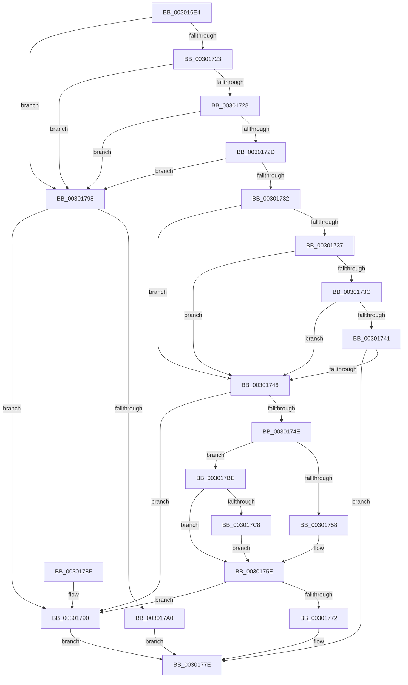

# AuthzBasepGetConstantOperand

- RVA: `0x003016E4`–`0x003017CE` (길이 `234` bytes)
- VA: `0x00000001403016E4`
- 실행 섹션: `.text`
- PDB 이름 있음: `예`; PDB Function 태그: `아니요`
- unwind 정보 RVA: `0x00073150`
- 디코드: `69`개 명령, `234/234` bytes 표시
- 미해석 바이트: `0` (있으면 어셈블리에 `.byte`로 보존)

> 이 문서는 커널 이미지의 기계어와 PDB 기호를 분석해 생성했습니다. 4번과 5번은 함수 원형과 자료형을 바이너리 사용 방식에서 추정한 C 해석이며 원본 소스 복구 결과는 아닙니다.

## 1. Dependencies

- 직접 호출 지점: **0**; 고유 호출 대상: **0**
- 직접 호출자로 확인된 함수: **2**
- RIP 상대 이미지 참조: **0**

### Outgoing calls
- 직접 디코드된 call 명령이 없습니다.

### Direct callers
- [AuthzBasepGetNextValue](AuthzBasepGetNextValue_function_003007E0.md) at `0x003008D0`
- [AuthzBasepCompareFQBNOperands](AuthzBasepCompareFQBNOperands_function_00301444.md) at `0x00301512`
- [AuthzBasepCompareFQBNOperands](AuthzBasepCompareFQBNOperands_function_00301444.md) at `0x00301580`

### Static image references
- 디코드된 RIP-relative 메모리 참조가 없습니다.

## 2. Other-region calls and transfers

- 다른 실행 섹션으로 향하는 call: **0**
- 별도 외부 분기/꼬리 이동을 확인하지 못했습니다.

## 3. Assembly (complete function range)

```asm
003016E4  48 89 5C 24 08                  mov qword ptr [rsp + 8], rbx
003016E9  48 89 7C 24 10                  mov qword ptr [rsp + 0x10], rdi
003016EE  45 33 D2                        xor r10d, r10d
003016F1  48 8B D9                        mov rbx, rcx
003016F4  49 8B F9                        mov rdi, r9
003016F7  66 45 89 10                     mov word ptr [r8], r10w
003016FB  45 88 50 04                     mov byte ptr [r8 + 4], r10b
003016FF  45 89 50 08                     mov dword ptr [r8 + 8], r10d
00301703  45 8D 5A 01                     lea r11d, [r10 + 1]
00301707  4D 89 50 10                     mov qword ptr [r8 + 0x10], r10
0030170B  45 89 58 0C                     mov dword ptr [r8 + 0xc], r11d
0030170F  45 89 50 18                     mov dword ptr [r8 + 0x18], r10d
00301713  4D 89 50 20                     mov qword ptr [r8 + 0x20], r10
00301717  44 0F B6 09                     movzx r9d, byte ptr [rcx]
0030171B  41 8B C9                        mov ecx, r9d
0030171E  41 2B CB                        sub ecx, r11d
00301721  74 75                           je 0x140301798
00301723  41 2B CB                        sub ecx, r11d
00301726  74 70                           je 0x140301798
00301728  41 2B CB                        sub ecx, r11d
0030172B  74 6B                           je 0x140301798
0030172D  41 2B CB                        sub ecx, r11d
00301730  74 66                           je 0x140301798
00301732  83 E9 0C                        sub ecx, 0xc
00301735  74 0F                           je 0x140301746
00301737  83 E9 08                        sub ecx, 8
0030173A  74 0A                           je 0x140301746
0030173C  83 E9 38                        sub ecx, 0x38
0030173F  74 05                           je 0x140301746
00301741  41 3B CB                        cmp ecx, r11d
00301744  75 38                           jne 0x14030177e
00301746  8D 42 FF                        lea eax, [rdx - 1]
00301749  83 F8 04                        cmp eax, 4
0030174C  72 42                           jb 0x140301790
0030174E  B8 10 00 00 00                  mov eax, 0x10
00301753  44 3A C8                        cmp r9b, al
00301756  75 66                           jne 0x1403017be
00301758  66 41 C7 00 03 00               mov word ptr [r8], 3
0030175E  8B 4B 01                        mov ecx, dword ptr [rbx + 1]
00301761  8D 42 FB                        lea eax, [rdx - 5]
00301764  41 89 48 18                     mov dword ptr [r8 + 0x18], ecx
00301768  41 BB 05 00 00 00               mov r11d, 5
0030176E  3B C1                           cmp eax, ecx
00301770  72 1E                           jb 0x140301790
00301772  48 8D 43 05                     lea rax, [rbx + 5]
00301776  49 89 40 20                     mov qword ptr [r8 + 0x20], rax
0030177A  44 8D 59 05                     lea r11d, [rcx + 5]
0030177E  48 8B 5C 24 08                  mov rbx, qword ptr [rsp + 8]
00301783  41 8B C2                        mov eax, r10d
00301786  44 89 1F                        mov dword ptr [rdi], r11d
00301789  48 8B 7C 24 10                  mov rdi, qword ptr [rsp + 0x10]
0030178E  C3                              ret
0030178F  CC                              int3
00301790  41 BA A2 01 00 C0               mov r10d, 0xc00001a2
00301796  EB E6                           jmp 0x14030177e
00301798  8D 42 FF                        lea eax, [rdx - 1]
0030179B  83 F8 0A                        cmp eax, 0xa
0030179E  72 F0                           jb 0x140301790
003017A0  48 8D 4B 01                     lea rcx, [rbx + 1]
003017A4  66 41 C7 00 02 00               mov word ptr [r8], 2
003017AA  49 89 48 20                     mov qword ptr [r8 + 0x20], rcx
003017AE  41 BB 0B 00 00 00               mov r11d, 0xb
003017B4  41 C7 40 18 0A 00 00 00         mov dword ptr [r8 + 0x18], 0xa
003017BC  EB C0                           jmp 0x14030177e
003017BE  66 41 89 00                     mov word ptr [r8], ax
003017C2  41 80 F9 50                     cmp r9b, 0x50
003017C6  75 96                           jne 0x14030175e
003017C8  45 88 58 04                     mov byte ptr [r8 + 4], r11b
003017CC  EB 90                           jmp 0x14030175e
```

## 4. C-style interpretation (structured pseudocode)

```c
__int64 __fastcall AuthzBasepGetConstantOperand(__int64 a1, __int64 a2, __int64 a3, __int64 a4)
{
    __int64 v_r10;
    unsigned __int64 v_stack_p10;
    unsigned __int64 v_stack_p8;

    v_stack_p8 = v_rbx;
    v_stack_p10 = v_rdi;
    v_r10 = 0;
    *(unsigned __int16 *)(a3) = 0;
    *(unsigned __int8 *)(a3 + 4) = 0;
    *(unsigned int *)(a3 + 8) = 0;
    *(unsigned __int64 *)(a3 + 16) = 0;
    *(unsigned int *)(a3 + 12) = (unsigned int)(v_r10 + 1);
    *(unsigned int *)(a3 + 24) = 0;
    *(unsigned __int64 *)(a3 + 32) = 0;
    a1 = (unsigned int)(((unsigned int)((unsigned int)(*(unsigned __int8 *)(a1)))) - ((unsigned int)(v_r10 + 1)));
    if (condition_is_equal) goto loc_00301798;
    a1 = (unsigned int)((a1) - ((unsigned int)(v_r10 + 1)));
    if (condition_is_equal) goto loc_00301798;
    a1 = (unsigned int)((a1) - ((unsigned int)(v_r10 + 1)));
    if (condition_is_equal) goto loc_00301798;
    a1 = (unsigned int)((a1) - ((unsigned int)(v_r10 + 1)));
    if (condition_is_equal) goto loc_00301798;
    a1 = (unsigned int)((a1) - (12));
    if (condition_is_equal) goto loc_00301746;
    a1 = (unsigned int)((a1) - (8));
    if (condition_is_equal) goto loc_00301746;
    a1 = (unsigned int)((a1) - (56));
    if (condition_is_equal) goto loc_00301746;
    if (((unsigned int)(a1)) != ((unsigned int)(v_r10 + 1))) goto loc_0030177E;
loc_00301746:
    if (((unsigned int)(a2 - 1)) < 4) goto loc_00301790;
    if (((unsigned __int8)(*(unsigned __int8 *)(a1))) != 16) goto loc_003017BE;
    *(unsigned __int16 *)(a3) = 3;
loc_0030175E:
    *(unsigned int *)(a3 + 24) = (unsigned int)((unsigned int)(*(unsigned int *)(a1 + 1)));
    if (((unsigned int)(a2 - 5)) < ((unsigned int)((unsigned int)(*(unsigned int *)(a1 + 1))))) goto loc_00301790;
    *(unsigned __int64 *)(a3 + 32) = a1 + 5;
loc_0030177E:
    *(unsigned int *)(a4) = (unsigned int)((unsigned int)(*(unsigned int *)(a1 + 1)) + 5);
    return 0;
loc_00301790:
    goto loc_0030177E;
loc_00301798:
    if (((unsigned int)(a2 - 1)) < 10) goto loc_00301790;
    *(unsigned __int16 *)(a3) = 2;
    *(unsigned __int64 *)(a3 + 32) = v_stack_p8 + 1;
    *(unsigned int *)(a3 + 24) = 10;
    goto loc_0030177E;
loc_003017BE:
    *(unsigned __int16 *)(a3) = (unsigned __int16)(a2 - 1);
    if (((unsigned __int8)(*(unsigned __int8 *)(a1))) != 80) goto loc_0030175E;
    *(unsigned __int8 *)(a3 + 4) = 11;
    goto loc_0030175E;
}
```

## 5. (Beta) C Style

```c
int64_t AuthzBasepGetConstantOperand(void *Arg1, void *Arg2, void *Arg3, void *Arg4)
{
    uint8_t *arg1 = (uint8_t *)Arg1;
    uint8_t *arg2 = (uint8_t *)Arg2;
    uint8_t *arg3 = (uint8_t *)Arg3;
    uint8_t *arg4 = (uint8_t *)Arg4;

    int64_t local_r10;
    uint64_t v_stack_p10;
    uint64_t v_stack_p8;

    v_stack_p8 = local_rbx;
    v_stack_p10 = local_rdi;
    local_r10 = 0;
    *(uint16_t *)(arg3) = 0;
    *(uint8_t *)(arg3 + 0x4) = 0;
    *(uint32_t *)(arg3 + 0x8) = 0;
    *(uint64_t *)(arg3 + 0x10) = 0;
    *(uint32_t *)(arg3 + 0xC) = (uint32_t)(local_r10 + 1);
    *(uint32_t *)(arg3 + 0x18) = 0;
    *(uint64_t *)(arg3 + 0x20) = 0;
    Arg1 = (uint32_t)(((uint32_t)((uint32_t)(*(uint8_t *)(arg1)))) - ((uint32_t)(local_r10 + 1)));
    if (condition_is_equal) goto loc_00301798;
    Arg1 = (uint32_t)((Arg1) - ((uint32_t)(local_r10 + 1)));
    if (condition_is_equal) goto loc_00301798;
    Arg1 = (uint32_t)((Arg1) - ((uint32_t)(local_r10 + 1)));
    if (condition_is_equal) goto loc_00301798;
    Arg1 = (uint32_t)((Arg1) - ((uint32_t)(local_r10 + 1)));
    if (condition_is_equal) goto loc_00301798;
    Arg1 = (uint32_t)((Arg1) - (12));
    if (condition_is_equal) goto loc_00301746;
    Arg1 = (uint32_t)((Arg1) - (8));
    if (condition_is_equal) goto loc_00301746;
    Arg1 = (uint32_t)((Arg1) - (56));
    if (condition_is_equal) goto loc_00301746;
    if (((uint32_t)(Arg1)) != ((uint32_t)(local_r10 + 1))) goto loc_0030177E;
loc_00301746:
    if (((uint32_t)(Arg2 - 1)) < 4) goto loc_00301790;
    if (((uint8_t)(*(uint8_t *)(arg1))) != 16) goto loc_003017BE;
    *(uint16_t *)(arg3) = 3;
loc_0030175E:
    *(uint32_t *)(arg3 + 0x18) = (uint32_t)((uint32_t)(*(uint32_t *)(arg1 + 0x1)));
    if (((uint32_t)(Arg2 - 5)) < ((uint32_t)((uint32_t)(*(uint32_t *)(arg1 + 0x1))))) goto loc_00301790;
    *(void **)(arg3 + 0x20) = Arg1 + 5;
loc_0030177E:
    *(uint32_t *)(arg4) = (uint32_t)((uint32_t)(*(uint32_t *)(arg1 + 0x1)) + 5);
    return 0;
loc_00301790:
    goto loc_0030177E;
loc_00301798:
    if (((uint32_t)(Arg2 - 1)) < 10) goto loc_00301790;
    *(uint16_t *)(arg3) = 2;
    *(uint64_t *)(arg3 + 0x20) = v_stack_p8 + 1;
    *(uint32_t *)(arg3 + 0x18) = 10;
    goto loc_0030177E;
loc_003017BE:
    *(uint16_t *)(arg3) = (uint16_t)(Arg2 - 1);
    if (((uint8_t)(*(uint8_t *)(arg1))) != 80) goto loc_0030175E;
    *(uint8_t *)(arg3 + 0x4) = 11;
    goto loc_0030175E;
}
```

### 관측된 메모리 오프셋

구조체 형식이 확인되지 않은 접근은 인자 기준의 오프셋으로만 기록했습니다.

| 기준 인자 | 오프셋 표현 | 폭 (bit) | 접근 |
|---|---:|---:|---|
| `Arg1` | `+ 0x0` | `8` | `R` |
| `Arg1` | `+ 0x1` | `32` | `R` |
| `Arg1` | `+ 0x1` | `64` | `R` |
| `Arg1` | `+ 0x5` | `64` | `R` |
| `Arg2` | `- 0x5` | `32` | `R` |
| `Arg2` | `- 0x1` | `32` | `R` |
| `Arg3` | `+ 0x0` | `16` | `W` |
| `Arg3` | `+ 0x4` | `8` | `W` |
| `Arg3` | `+ 0x8` | `32` | `W` |
| `Arg3` | `+ 0xC` | `32` | `W` |
| `Arg3` | `+ 0x10` | `64` | `W` |
| `Arg3` | `+ 0x18` | `32` | `W` |
| `Arg3` | `+ 0x20` | `64` | `W` |
| `Arg4` | `+ 0x0` | `32` | `W` |

## 6. Execution-region graph

[열기: 2D/3D 그래프와 함수 탐색 컨트롤 패널](../../../control-panel.html?section=text&rva=0x003016E4&view=graph)

- 2D 그래프는 위에서 아래로 흐르고, 3D 그래프는 빈 공간을 드래그해 회전합니다. Shift+드래그는 이동, 휠은 확대·축소, 함수 노드 선택은 대상 보고서 이동입니다.

### Static fallback


