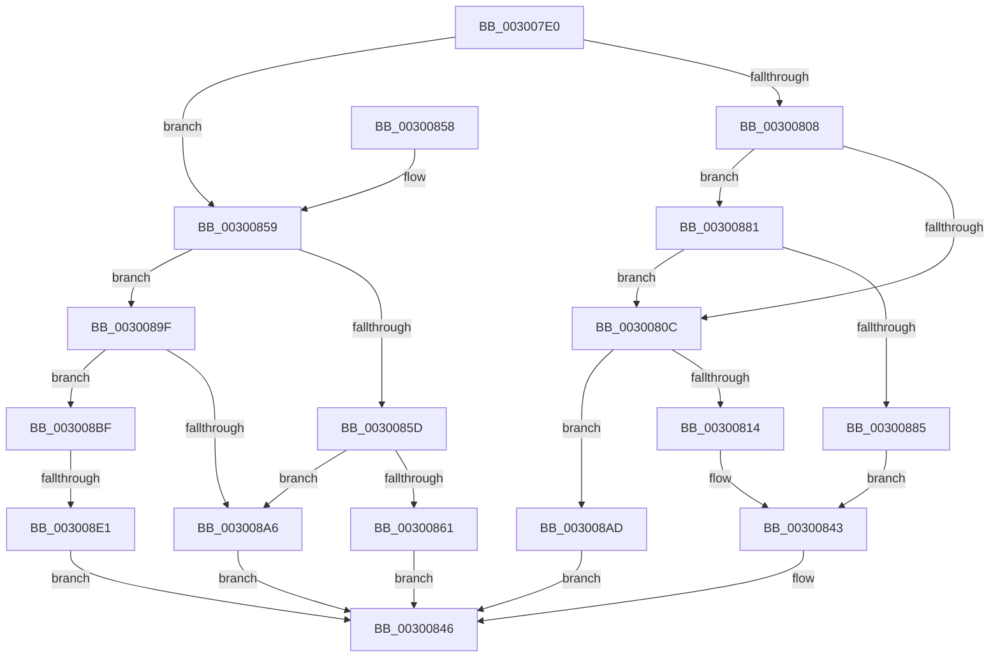

# AuthzBasepGetNextValue

- RVA: `0x003007E0`–`0x003008EB` (길이 `267` bytes)
- VA: `0x00000001403007E0`
- 실행 섹션: `.text`
- PDB 이름 있음: `예`; PDB Function 태그: `예`
- unwind 정보 RVA: `0x00073054`
- 디코드: `81`개 명령, `267/267` bytes 표시
- 미해석 바이트: `0` (있으면 어셈블리에 `.byte`로 보존)

> 이 문서는 커널 이미지의 기계어와 PDB 기호를 분석해 생성했습니다. 4번과 5번은 함수 원형과 자료형을 바이너리 사용 방식에서 추정한 C 해석이며 원본 소스 복구 결과는 아닙니다.

## 1. Dependencies

- 직접 호출 지점: **2**; 고유 호출 대상: **2**
- 직접 호출자로 확인된 함수: **5**
- RIP 상대 이미지 참조: **0**

### Outgoing calls
- `0x00300818` → [AuthzBasepQuerySecurityAttributeAndValues](AuthzBasepQuerySecurityAttributeAndValues_function_00300090.md) (function, `0x00300090`)
- `0x003008D0` → [AuthzBasepGetConstantOperand](AuthzBasepGetConstantOperand_function_003016E4.md) (function, `0x003016E4`)

### Direct callers
- [AuthzBasepValueInSet](../2F/AuthzBasepValueInSet_function_002FE9B0.md) at `0x002FEA17`
- [AuthzBasepValueInSet](../2F/AuthzBasepValueInSet_function_002FE9B0.md) at `0x002FEAF0`
- [AuthzBasepEvaluateSetRelationship](AuthzBasepEvaluateSetRelationship_function_003008F4.md) at `0x00300973`
- [AuthzBasepEvaluateSetRelationship](AuthzBasepEvaluateSetRelationship_function_003008F4.md) at `0x003009D7`
- [AuthzBasepEvaluateSetRelationship](AuthzBasepEvaluateSetRelationship_function_003008F4.md) at `0x003009FF`
- [AuthzBasepMemberOf](../4E/AuthzBasepMemberOf_function_004E3584.md) at `0x004E35F0`
- [AuthzBasepDeviceMemberOf](../4E/AuthzBasepDeviceMemberOf_function_004E3694.md) at `0x004E3701`
- [sub_006DFF8E](../6D/Unknown_function_006DFF8E.md) at `0x006DFFA4`
- [sub_006DFF8E](../6D/Unknown_function_006DFF8E.md) at `0x006E0013`
- [sub_006DFF8E](../6D/Unknown_function_006DFF8E.md) at `0x006E0037`
- [sub_006DFF8E](../6D/Unknown_function_006DFF8E.md) at `0x006E00EC`
- [sub_006DFF8E](../6D/Unknown_function_006DFF8E.md) at `0x006E010F`

### Static image references
- 디코드된 RIP-relative 메모리 참조가 없습니다.

## 2. Other-region calls and transfers

- 다른 실행 섹션으로 향하는 call: **0**
- call이 아닌 외부 분기/꼬리 이동: **1**
  - `0x003008DB` → [sub_006DFF82](../6D/Unknown_function_006DFF82.md) (`tail-transfer`)

## 3. Assembly (complete function range)

```asm
003007E0  48 89 5C 24 10                  mov qword ptr [rsp + 0x10], rbx
003007E5  48 89 74 24 18                  mov qword ptr [rsp + 0x18], rsi
003007EA  57                              push rdi
003007EB  48 83 EC 20                     sub rsp, 0x20
003007EF  48 8B D9                        mov rbx, rcx
003007F2  48 8B FA                        mov rdi, rdx
003007F5  33 C9                           xor ecx, ecx
003007F7  21 4C 24 30                     and dword ptr [rsp + 0x30], ecx
003007FB  83 7B 0C 01                     cmp dword ptr [rbx + 0xc], 1
003007FF  48 8D 73 04                     lea rsi, [rbx + 4]
00300803  8B 43 08                        mov eax, dword ptr [rbx + 8]
00300806  74 51                           je 0x140300859
00300808  85 C0                           test eax, eax
0030080A  74 75                           je 0x140300881
0030080C  3B 06                           cmp eax, dword ptr [rsi]
0030080E  0F 83 99 00 00 00               jae 0x1403008ad
00300814  48 8B 4B 10                     mov rcx, qword ptr [rbx + 0x10]
00300818  E8 73 F8 FF FF                  call 0x140300090
0030081D  8B C8                           mov ecx, eax
0030081F  0F B7 03                        movzx eax, word ptr [rbx]
00300822  66 89 07                        mov word ptr [rdi], ax
00300825  8A 06                           mov al, byte ptr [rsi]
00300827  88 47 04                        mov byte ptr [rdi + 4], al
0030082A  8B 43 18                        mov eax, dword ptr [rbx + 0x18]
0030082D  89 47 18                        mov dword ptr [rdi + 0x18], eax
00300830  48 8B 43 10                     mov rax, qword ptr [rbx + 0x10]
00300834  48 83 67 20 00                  and qword ptr [rdi + 0x20], 0
00300839  48 89 47 10                     mov qword ptr [rdi + 0x10], rax
0030083D  8B 43 0C                        mov eax, dword ptr [rbx + 0xc]
00300840  89 47 0C                        mov dword ptr [rdi + 0xc], eax
00300843  FF 43 08                        inc dword ptr [rbx + 8]
00300846  48 8B 5C 24 38                  mov rbx, qword ptr [rsp + 0x38]
0030084B  8B C1                           mov eax, ecx
0030084D  48 8B 74 24 40                  mov rsi, qword ptr [rsp + 0x40]
00300852  48 83 C4 20                     add rsp, 0x20
00300856  5F                              pop rdi
00300857  C3                              ret
00300858  CC                              int3
00300859  38 0E                           cmp byte ptr [rsi], cl
0030085B  75 42                           jne 0x14030089f
0030085D  85 C0                           test eax, eax
0030085F  75 45                           jne 0x1403008a6
00300861  8B 43 18                        mov eax, dword ptr [rbx + 0x18]
00300864  89 43 08                        mov dword ptr [rbx + 8], eax
00300867  0F 10 03                        movups xmm0, xmmword ptr [rbx]
0030086A  0F 11 02                        movups xmmword ptr [rdx], xmm0
0030086D  0F 10 4B 10                     movups xmm1, xmmword ptr [rbx + 0x10]
00300871  0F 11 4A 10                     movups xmmword ptr [rdx + 0x10], xmm1
00300875  F2 0F 10 43 20                  movsd xmm0, qword ptr [rbx + 0x20]
0030087A  F2 0F 11 42 20                  movsd qword ptr [rdx + 0x20], xmm0
0030087F  EB C5                           jmp 0x140300846
00300881  39 0E                           cmp dword ptr [rsi], ecx
00300883  76 87                           jbe 0x14030080c
00300885  0F 10 03                        movups xmm0, xmmword ptr [rbx]
00300888  0F 11 02                        movups xmmword ptr [rdx], xmm0
0030088B  0F 10 4B 10                     movups xmm1, xmmword ptr [rbx + 0x10]
0030088F  0F 11 4A 10                     movups xmmword ptr [rdx + 0x10], xmm1
00300893  F2 0F 10 43 20                  movsd xmm0, qword ptr [rbx + 0x20]
00300898  F2 0F 11 42 20                  movsd qword ptr [rdx + 0x20], xmm0
0030089D  EB A4                           jmp 0x140300843
0030089F  8B 53 18                        mov edx, dword ptr [rbx + 0x18]
003008A2  3B C2                           cmp eax, edx
003008A4  72 19                           jb 0x1403008bf
003008A6  B9 1A 00 00 80                  mov ecx, 0x8000001a
003008AB  EB 99                           jmp 0x140300846
003008AD  F7 D8                           neg eax
003008AF  1B C9                           sbb ecx, ecx
003008B1  81 E1 F5 FD FF BF               and ecx, 0xbffffdf5
003008B7  81 C1 25 02 00 C0               add ecx, 0xc0000225
003008BD  EB 87                           jmp 0x140300846
003008BF  48 8B C8                        mov rcx, rax
003008C2  4C 8D 4C 24 30                  lea r9, [rsp + 0x30]
003008C7  48 03 4B 20                     add rcx, qword ptr [rbx + 0x20]
003008CB  2B D0                           sub edx, eax
003008CD  4C 8B C7                        mov r8, rdi
003008D0  E8 0F 0E 00 00                  call 0x1403016e4
003008D5  80 7F 04 00                     cmp byte ptr [rdi + 4], 0
003008D9  8B C8                           mov ecx, eax
003008DB  0F 84 A1 F6 3D 00               je 0x1406dff82
003008E1  B9 A2 01 00 C0                  mov ecx, 0xc00001a2
003008E6  E9 5B FF FF FF                  jmp 0x140300846
```

## 4. C-style interpretation (structured pseudocode)

```c
__int64 __fastcall AuthzBasepGetNextValue(__int64 a1, __int64 a2)
{
    __int64 result;
    __int64 v_rsp;
    unsigned __int64 v_stack_p10;
    unsigned __int64 v_stack_p18;
    unsigned __int64 v_stack_p30;
    unsigned int v_stack_p8;

    v_stack_p10 = v_rbx;
    v_stack_p18 = v_rsi;
    v_rsp = (v_rsp) - (32);
    a1 = 0;
    if ((*(unsigned int *)(a1 + 12)) == 1) goto loc_00300859;
    if ((unsigned int)((unsigned int)(*(unsigned int *)(a1 + 8))) == 0) goto loc_00300881;
loc_0030080C:
    if (((unsigned int)((unsigned int)(*(unsigned int *)(a1 + 8)))) >= (*(unsigned int *)(a1 + 4))) goto loc_003008AD;
    result = AuthzBasepQuerySecurityAttributeAndValues(*(unsigned __int64 *)(a1 + 16), a2, a3, a4);
    *(unsigned __int16 *)(a2) = (unsigned __int16)(*(unsigned __int16 *)(a1));
    *(unsigned __int8 *)(a2 + 4) = (unsigned __int8)(*(unsigned __int8 *)(a1 + 4));
    *(unsigned int *)(a2 + 24) = (unsigned int)((unsigned int)(*(unsigned int *)(a1 + 24)));
    *(unsigned __int64 *)(a2 + 16) = *(unsigned __int64 *)(a1 + 16);
    *(unsigned int *)(a2 + 12) = (unsigned int)((unsigned int)(*(unsigned int *)(a1 + 12)));
loc_00300843:
loc_00300846:
    v_rsp = (v_rsp) + (32);
    return (unsigned int)((unsigned int)((unsigned int)((unsigned int)(result))));
loc_00300859:
    if ((*(unsigned __int8 *)(v_stack_p18)) != ((unsigned __int8)((unsigned int)((unsigned int)(result))))) goto loc_0030089F;
    if ((unsigned int)((unsigned int)((unsigned int)((unsigned int)((unsigned int)(result))))) != 0) goto loc_003008A6;
    *(unsigned int *)(v_stack_p10 + 8) = (unsigned int)((unsigned int)(*(unsigned int *)(v_stack_p10 + 24)));
    *(unsigned __int64 *)(a2) = v_xmm0;
    *(unsigned __int64 *)(a2 + 16) = v_xmm1;
    *(unsigned __int64 *)(a2 + 32) = v_xmm0;
    goto loc_00300846;
loc_00300881:
    if ((*(unsigned int *)(v_stack_p18)) <= ((unsigned int)((unsigned int)((unsigned int)(result))))) goto loc_0030080C;
    *(unsigned __int64 *)(a2) = v_xmm0;
    *(unsigned __int64 *)(a2 + 16) = v_xmm1;
    *(unsigned __int64 *)(a2 + 32) = v_xmm0;
    goto loc_00300843;
loc_0030089F:
    if (((unsigned int)((unsigned int)(*(unsigned int *)(v_stack_p10 + 24)))) < ((unsigned int)((unsigned int)(*(unsigned int *)(v_stack_p10 + 24))))) goto loc_003008BF;
loc_003008A6:
    goto loc_00300846;
loc_003008AD:
    result = (unsigned int)(-((unsigned int)(*(unsigned int *)(v_stack_p10 + 24))));
    a1 = (unsigned int)(((unsigned int)(0x8000001AULL)) & (0xBFFFFDF5ULL));
    a1 = (unsigned int)((a1) + (0xC0000225ULL));
    goto loc_00300846;
loc_003008BF:
    a1 = (result) + (*(unsigned __int64 *)(v_stack_p10 + 32));
    a2 = (unsigned int)(((unsigned int)(*(unsigned int *)(v_stack_p10 + 24))) - ((unsigned int)(result)));
    result = AuthzBasepGetConstantOperand(a1, a2, a2, v_stack_p30);
    goto loc_00300846;
}
```

## 5. (Beta) C Style

```c
int64_t AuthzBasepGetNextValue(void *Arg1, void *Arg2)
{
    uint8_t *arg1 = (uint8_t *)Arg1;
    uint8_t *arg2 = (uint8_t *)Arg2;

    int64_t result;
    int64_t local_rsp;
    uint64_t v_stack_p10;
    uint64_t v_stack_p18;
    uint64_t v_stack_p30;
    uint32_t v_stack_p8;

    v_stack_p10 = local_rbx;
    v_stack_p18 = local_rsi;
    local_rsp = (local_rsp) - (32);
    Arg1 = 0;
    if ((*(uint32_t *)(arg1 + 0xC)) == 1) goto loc_00300859;
    if ((uint32_t)((uint32_t)(*(uint32_t *)(arg1 + 0x8))) == 0) goto loc_00300881;
loc_0030080C:
    if (((uint32_t)((uint32_t)(*(uint32_t *)(arg1 + 0x8)))) >= (*(uint32_t *)(arg1 + 0x4))) goto loc_003008AD;
    result = AuthzBasepQuerySecurityAttributeAndValues(*(uint64_t *)(arg1 + 0x10), Arg2, a3, a4);
    *(uint16_t *)(arg2) = (uint16_t)(*(uint16_t *)(arg1));
    *(uint8_t *)(arg2 + 0x4) = (uint8_t)(*(uint8_t *)(arg1 + 0x4));
    *(uint32_t *)(arg2 + 0x18) = (uint32_t)((uint32_t)(*(uint32_t *)(arg1 + 0x18)));
    *(uint64_t *)(arg2 + 0x10) = *(uint64_t *)(arg1 + 0x10);
    *(uint32_t *)(arg2 + 0xC) = (uint32_t)((uint32_t)(*(uint32_t *)(arg1 + 0xC)));
loc_00300843:
loc_00300846:
    local_rsp = (local_rsp) + (32);
    return (uint32_t)((uint32_t)((uint32_t)((uint32_t)(result))));
loc_00300859:
    if ((*(uint8_t *)(v_stack_p18)) != ((uint8_t)((uint32_t)((uint32_t)(result))))) goto loc_0030089F;
    if ((uint32_t)((uint32_t)((uint32_t)((uint32_t)((uint32_t)(result))))) != 0) goto loc_003008A6;
    *(uint32_t *)(v_stack_p10 + 0x8) = (uint32_t)((uint32_t)(*(uint32_t *)(v_stack_p10 + 0x18)));
    *(uint64_t *)(arg2) = v_xmm0;
    *(uint64_t *)(arg2 + 0x10) = v_xmm1;
    *(uint64_t *)(arg2 + 0x20) = v_xmm0;
    goto loc_00300846;
loc_00300881:
    if ((*(uint32_t *)(v_stack_p18)) <= ((uint32_t)((uint32_t)((uint32_t)(result))))) goto loc_0030080C;
    *(uint64_t *)(arg2) = v_xmm0;
    *(uint64_t *)(arg2 + 0x10) = v_xmm1;
    *(uint64_t *)(arg2 + 0x20) = v_xmm0;
    goto loc_00300843;
loc_0030089F:
    if (((uint32_t)((uint32_t)(*(uint32_t *)(v_stack_p10 + 0x18)))) < ((uint32_t)((uint32_t)(*(uint32_t *)(v_stack_p10 + 0x18))))) goto loc_003008BF;
loc_003008A6:
    goto loc_00300846;
loc_003008AD:
    result = (uint32_t)(-((uint32_t)(*(uint32_t *)(v_stack_p10 + 0x18))));
    Arg1 = (uint32_t)(((uint32_t)(0x8000001AULL)) & (0xBFFFFDF5ULL));
    Arg1 = (uint32_t)((Arg1) + (0xC0000225ULL));
    goto loc_00300846;
loc_003008BF:
    Arg1 = (result) + (*(uint64_t *)(v_stack_p10 + 0x20));
    Arg2 = (uint32_t)(((uint32_t)(*(uint32_t *)(v_stack_p10 + 0x18))) - ((uint32_t)(result)));
    result = AuthzBasepGetConstantOperand(Arg1, Arg2, Arg2, v_stack_p30);
    goto loc_00300846;
}
```

### 관측된 메모리 오프셋

구조체 형식이 확인되지 않은 접근은 인자 기준의 오프셋으로만 기록했습니다.

| 기준 인자 | 오프셋 표현 | 폭 (bit) | 접근 |
|---|---:|---:|---|
| `Arg1` | `+ 0x0` | `8` | `R` |
| `Arg1` | `+ 0x0` | `16` | `R` |
| `Arg1` | `+ 0x0` | `32` | `R` |
| `Arg1` | `+ 0x0` | `128` | `R` |
| `Arg1` | `+ 0x4` | `64` | `R` |
| `Arg1` | `+ 0x8` | `32` | `R` |
| `Arg1` | `+ 0x8` | `32` | `R/W` |
| `Arg1` | `+ 0x8` | `32` | `W` |
| `Arg1` | `+ 0xC` | `32` | `R` |
| `Arg1` | `+ 0x10` | `64` | `R` |
| `Arg1` | `+ 0x10` | `128` | `R` |
| `Arg1` | `+ 0x18` | `32` | `R` |
| `Arg1` | `+ 0x20` | `64` | `R` |
| `Arg2` | `+ 0x0` | `16` | `W` |
| `Arg2` | `+ 0x0` | `128` | `R` |
| `Arg2` | `+ 0x4` | `8` | `R` |
| `Arg2` | `+ 0x4` | `8` | `W` |
| `Arg2` | `+ 0xC` | `32` | `W` |
| `Arg2` | `+ 0x10` | `64` | `W` |
| `Arg2` | `+ 0x10` | `128` | `R` |
| `Arg2` | `+ 0x18` | `32` | `W` |
| `Arg2` | `+ 0x20` | `64` | `R/W` |
| `Arg2` | `+ 0x20` | `64` | `W` |

## 6. Execution-region graph

[열기: 2D/3D 그래프와 함수 탐색 컨트롤 패널](../../../control-panel.html?section=text&rva=0x003007E0&view=graph)

- 2D 그래프는 위에서 아래로 흐르고, 3D 그래프는 빈 공간을 드래그해 회전합니다. Shift+드래그는 이동, 휠은 확대·축소, 함수 노드 선택은 대상 보고서 이동입니다.

### Static fallback


