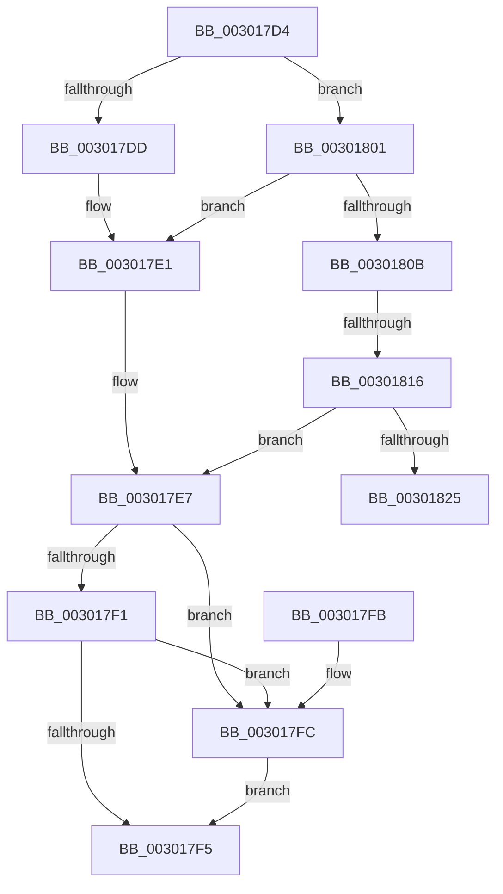

# AuthzBasepGetOperandStringCaseForEvaluation

- RVA: `0x003017D4`–`0x0030182A` (길이 `86` bytes)
- VA: `0x00000001403017D4`
- 실행 섹션: `.text`
- PDB 이름 있음: `예`; PDB Function 태그: `예`
- unwind 정보 RVA: `0x000DB714`
- 디코드: `30`개 명령, `86/86` bytes 표시
- 미해석 바이트: `0` (있으면 어셈블리에 `.byte`로 보존)

> 이 문서는 커널 이미지의 기계어와 PDB 기호를 분석해 생성했습니다. 4번과 5번은 함수 원형과 자료형을 바이너리 사용 방식에서 추정한 C 해석이며 원본 소스 복구 결과는 아닙니다.

## 1. Dependencies

- 직접 호출 지점: **0**; 고유 호출 대상: **0**
- 직접 호출자로 확인된 함수: **1**
- RIP 상대 이미지 참조: **0**

### Outgoing calls
- 직접 디코드된 call 명령이 없습니다.

### Direct callers
- [AuthzBasepCompareFQBNOperands](AuthzBasepCompareFQBNOperands_function_00301444.md) at `0x003014C1`

### Static image references
- 디코드된 RIP-relative 메모리 참조가 없습니다.

## 2. Other-region calls and transfers

- 다른 실행 섹션으로 향하는 call: **0**
- call이 아닌 외부 분기/꼬리 이동: **2**
  - `0x00301810` → `0x006E0412` (`tail-transfer`)
  - `0x00301825` → `0x006E0412` (`tail-transfer`)

## 3. Assembly (complete function range)

```asm
003017D4  45 32 C0                        xor r8b, r8b
003017D7  83 79 0C 01                     cmp dword ptr [rcx + 0xc], 1
003017DB  75 24                           jne 0x140301801
003017DD  48 8B 41 38                     mov rax, qword ptr [rcx + 0x38]
003017E1  8A 48 24                        mov cl, byte ptr [rax + 0x24]
003017E4  80 E1 02                        and cl, 2
003017E7  88 0A                           mov byte ptr [rdx], cl
003017E9  44 0F 20 C0                     mov rax, cr8
003017ED  84 C9                           test cl, cl
003017EF  75 0B                           jne 0x1403017fc
003017F1  3C 02                           cmp al, 2
003017F3  73 07                           jae 0x1403017fc
003017F5  44 88 02                        mov byte ptr [rdx], r8b
003017F8  33 C0                           xor eax, eax
003017FA  C3                              ret
003017FB  CC                              int3
003017FC  41 B0 01                        mov r8b, 1
003017FF  EB F4                           jmp 0x1403017f5
00301801  83 79 34 01                     cmp dword ptr [rcx + 0x34], 1
00301805  48 8B 41 10                     mov rax, qword ptr [rcx + 0x10]
00301809  74 D6                           je 0x1403017e1
0030180B  8B 40 24                        mov eax, dword ptr [rax + 0x24]
0030180E  A8 02                           test al, 2
00301810  0F 85 FC EB 3D 00               jne 0x1406e0412
00301816  48 8B 41 38                     mov rax, qword ptr [rcx + 0x38]
0030181A  8B 48 24                        mov ecx, dword ptr [rax + 0x24]
0030181D  F6 C1 02                        test cl, 2
00301820  41 8A C8                        mov cl, r8b
00301823  74 C2                           je 0x1403017e7
00301825  E9 E8 EB 3D 00                  jmp 0x1406e0412
```

## 4. C-style interpretation (structured pseudocode)

```c
__int64 __fastcall AuthzBasepGetOperandStringCaseForEvaluation(__int64 a1, __int64 a2, unsigned __int8 a3)
{
    __int64 result;

    a3 = 0;
    if ((*(unsigned int *)(a1 + 12)) != 1) goto loc_00301801;
loc_003017E1:
    a1 = (unsigned __int8)((*(unsigned __int8 *)(*(unsigned __int64 *)(a1 + 56) + 36)) & (2));
loc_003017E7:
    *(unsigned __int8 *)(a2) = (unsigned __int8)(a1);
    if ((unsigned __int8)(a1) != 0) goto loc_003017FC;
    if (((unsigned __int8)(v_cr8)) >= 2) goto loc_003017FC;
loc_003017F5:
    *(unsigned __int8 *)(a2) = 0;
    result = 0;
    return result;
loc_003017FC:
    goto loc_003017F5;
loc_00301801:
    if ((*(unsigned int *)(a1 + 52)) == 1) goto loc_003017E1;
    if ((((unsigned __int8)((unsigned int)(*(unsigned int *)(*(unsigned __int64 *)(a1 + 56) + 36)))) & (2)) == 0) goto loc_003017E7;
}
```

## 5. (Beta) C Style

```c
int64_t AuthzBasepGetOperandStringCaseForEvaluation(void *Arg1, void *Arg2, uint8_t Arg3)
{
    uint8_t *arg1 = (uint8_t *)Arg1;
    uint8_t *arg2 = (uint8_t *)Arg2;

    int64_t result;

    Arg3 = 0;
    if ((*(uint32_t *)(arg1 + 0xC)) != 1) goto loc_00301801;
loc_003017E1:
    Arg1 = (uint8_t)((*(uint8_t *)(*(uint64_t *)(arg1 + 0x38) + 0x24)) & (2));
loc_003017E7:
    *(uint8_t *)(arg2) = (uint8_t)(Arg1);
    if ((uint8_t)(Arg1) != 0) goto loc_003017FC;
    if (((uint8_t)(v_cr8)) >= 2) goto loc_003017FC;
loc_003017F5:
    *(uint8_t *)(arg2) = 0;
    result = 0;
    return result;
loc_003017FC:
    goto loc_003017F5;
loc_00301801:
    if ((*(uint32_t *)(arg1 + 0x34)) == 1) goto loc_003017E1;
    if ((((uint8_t)((uint32_t)(*(uint32_t *)(*(uint64_t *)(arg1 + 0x38) + 0x24)))) & (2)) == 0) goto loc_003017E7;
}
```

### 관측된 메모리 오프셋

구조체 형식이 확인되지 않은 접근은 인자 기준의 오프셋으로만 기록했습니다.

| 기준 인자 | 오프셋 표현 | 폭 (bit) | 접근 |
|---|---:|---:|---|
| `Arg1` | `+ 0xC` | `32` | `R` |
| `Arg1` | `+ 0x10` | `64` | `R` |
| `Arg1` | `+ 0x34` | `32` | `R` |
| `Arg1` | `+ 0x38` | `64` | `R` |
| `Arg2` | `+ 0x0` | `8` | `W` |

## 6. Execution-region graph

[열기: 2D/3D 그래프와 함수 탐색 컨트롤 패널](../../../control-panel.html?section=text&rva=0x003017D4&view=graph)

- 2D 그래프는 위에서 아래로 흐르고, 3D 그래프는 빈 공간을 드래그해 회전합니다. Shift+드래그는 이동, 휠은 확대·축소, 함수 노드 선택은 대상 보고서 이동입니다.

### Static fallback


