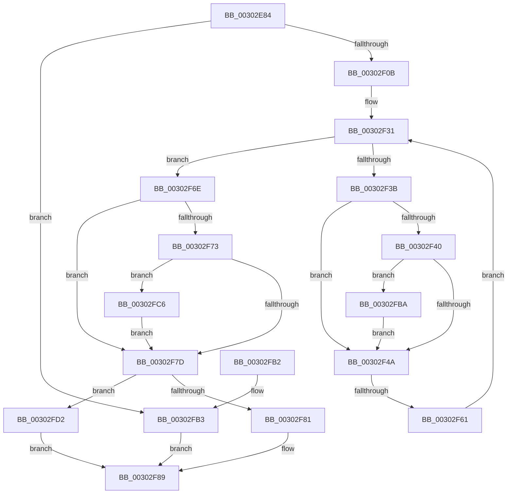

# AuthzBasepInitializeResourceClaimsFromSacl

- RVA: `0x00302E84`–`0x00302FE6` (길이 `354` bytes)
- VA: `0x0000000140302E84`
- 실행 섹션: `.text`
- PDB 이름 있음: `예`; PDB Function 태그: `예`
- unwind 정보 RVA: `0x00073394`
- 디코드: `101`개 명령, `354/354` bytes 표시
- 미해석 바이트: `0` (있으면 어셈블리에 `.byte`로 보존)

> 이 문서는 커널 이미지의 기계어와 PDB 기호를 분석해 생성했습니다. 4번과 5번은 함수 원형과 자료형을 바이너리 사용 방식에서 추정한 C 해석이며 원본 소스 복구 결과는 아닙니다.

## 1. Dependencies

- 직접 호출 지점: **6**; 고유 호출 대상: **4**
- 직접 호출자로 확인된 함수: **11**
- RIP 상대 이미지 참조: **1**

### Outgoing calls
- `0x00302EFA` → [ExAllocatePool2](../../poolcode/B8/ExAllocatePool2_function_00B820F0.md) (function, `0x00B820F0`)
- `0x00302F92` → [_security_check_cookie](../6A/_security_check_cookie_function_006AC640.md) (function, `0x006AC640`)
- `0x00302FBF` → [ExFreePoolWithTag](../../poolcode/B8/ExFreePoolWithTag_function_00B82870.md) (function, `0x00B82870`)
- `0x00302FCB` → [ExFreePoolWithTag](../../poolcode/B8/ExFreePoolWithTag_function_00B82870.md) (function, `0x00B82870`)
- `0x00302FD5` → [AuthzBasepFreeSecurityAttributesList](AuthzBasepFreeSecurityAttributesList_function_00301230.md) (function, `0x00301230`)
- `0x00302FDF` → [ExFreePoolWithTag](../../poolcode/B8/ExFreePoolWithTag_function_00B82870.md) (function, `0x00B82870`)

### Direct callers
- [SepMaximumAccessCheck](SepMaximumAccessCheck_function_00300BF0.md) at `0x003010F8`
- [sub_00302042](Unknown_function_00302042.md) at `0x003020A3`
- [SeAccessCheckWithHint](../3A/SeAccessCheckWithHint_function_003A6C30.md) at `0x003A7264`
- [SepNormalAccessCheckEx](../3C/SepNormalAccessCheckEx_function_003CFD8C.md) at `0x003D032B`
- [SepNormalAccessCheckEx](../3C/SepNormalAccessCheckEx_function_003CFD8C.md) at `0x003D0417`
- [SepNormalAccessCheck](../3D/SepNormalAccessCheck_function_003D0688.md) at `0x003D0B74`
- [SeAccessCheckByType](../44/SeAccessCheckByType_function_00440BC8.md) at `0x00441DF2`
- [SepCommonAccessCheckEx](../47/SepCommonAccessCheckEx_function_0047602C.md) at `0x00476A6B`
- [SepMaximumAccessCheckEx](../60/SepMaximumAccessCheckEx_function_00606D78.md) at `0x00607226`
- [SepMaximumAccessCheckEx](../60/SepMaximumAccessCheckEx_function_00606D78.md) at `0x006073B0`
- [SeExamineSacl](../../page/97/SeExamineSacl_function_00973A30.md) at `0x00973C7A`
- [SepAccessCheckAndAuditAlarm](../../page/A1/SepAccessCheckAndAuditAlarm_function_00A1AF4C.md) at `0x00A1C063`
- [SepAccessCheckAndAuditAlarm](../../page/A1/SepAccessCheckAndAuditAlarm_function_00A1AF4C.md) at `0x00A1C916`
- [SepExamineSaclEx](../../page/A2/SepExamineSaclEx_function_00A2F39C.md) at `0x00A2F7FF`

### Static image references
- `0x00302EA0` → RVA `0x00E0A740` (`.data`; read)

## 2. Other-region calls and transfers

- 다른 실행 섹션으로 향하는 call: **4**
  - `0x00302EFA` → [ExAllocatePool2](../../poolcode/B8/ExAllocatePool2_function_00B820F0.md) (`.text` → `POOLCODE`)
  - `0x00302FBF` → [ExFreePoolWithTag](../../poolcode/B8/ExFreePoolWithTag_function_00B82870.md) (`.text` → `POOLCODE`)
  - `0x00302FCB` → [ExFreePoolWithTag](../../poolcode/B8/ExFreePoolWithTag_function_00B82870.md) (`.text` → `POOLCODE`)
  - `0x00302FDF` → [ExFreePoolWithTag](../../poolcode/B8/ExFreePoolWithTag_function_00B82870.md) (`.text` → `POOLCODE`)
- call이 아닌 외부 분기/꼬리 이동: **1**
  - `0x00302F5B` → [sub_006E041A](../6E/Unknown_function_006E041A.md) (`tail-transfer`)

## 3. Assembly (complete function range)

```asm
00302E84  48 89 5C 24 18                  mov qword ptr [rsp + 0x18], rbx
00302E89  55                              push rbp
00302E8A  56                              push rsi
00302E8B  57                              push rdi
00302E8C  41 54                           push r12
00302E8E  41 55                           push r13
00302E90  41 56                           push r14
00302E92  41 57                           push r15
00302E94  48 8D 6C 24 90                  lea rbp, [rsp - 0x70]
00302E99  48 81 EC 70 01 00 00            sub rsp, 0x170
00302EA0  48 8B 05 99 78 B0 00            mov rax, qword ptr [rip + 0xb07899]
00302EA7  48 33 C4                        xor rax, rsp
00302EAA  48 89 45 60                     mov qword ptr [rbp + 0x60], rax
00302EAE  33 DB                           xor ebx, ebx
00302EB0  48 89 54 24 58                  mov qword ptr [rsp + 0x58], rdx
00302EB5  21 5C 24 34                     and dword ptr [rsp + 0x34], ebx
00302EB9  48 8D 7C 24 60                  lea rdi, [rsp + 0x60]
00302EBE  0F 57 C0                        xorps xmm0, xmm0
00302EC1  48 89 4C 24 40                  mov qword ptr [rsp + 0x40], rcx
00302EC6  0F 11 44 24 48                  movups xmmword ptr [rsp + 0x48], xmm0
00302ECB  4C 8B E9                        mov r13, rcx
00302ECE  C7 44 24 38 02 00 00 00         mov dword ptr [rsp + 0x38], 2
00302ED6  C7 44 24 30 00 01 00 00         mov dword ptr [rsp + 0x30], 0x100
00302EDE  44 0F 20 C0                     mov rax, cr8
00302EE2  3C 02                           cmp al, 2
00302EE4  8D 53 30                        lea edx, [rbx + 0x30]
00302EE7  41 B8 53 65 41 74               mov r8d, 0x74416553
00302EED  48 1B C9                        sbb rcx, rcx
00302EF0  81 E1 C0 00 00 00               and ecx, 0xc0
00302EF6  48 83 C1 40                     add rcx, 0x40
00302EFA  E8 F1 F1 87 00                  call 0x140b820f0
00302EFF  48 8B F0                        mov rsi, rax
00302F02  48 85 C0                        test rax, rax
00302F05  0F 84 A8 00 00 00               je 0x140302fb3
00302F0B  21 18                           and dword ptr [rax], ebx
00302F0D  4D 8D 75 08                     lea r14, [r13 + 8]
00302F11  48 83 C0 08                     add rax, 8
00302F15  44 8D 63 01                     lea r12d, [rbx + 1]
00302F19  48 89 40 08                     mov qword ptr [rax + 8], rax
00302F1D  48 89 00                        mov qword ptr [rax], rax
00302F20  48 8D 46 20                     lea rax, [rsi + 0x20]
00302F24  21 5E 18                        and dword ptr [rsi + 0x18], ebx
00302F27  48 89 40 08                     mov qword ptr [rax + 8], rax
00302F2B  45 33 FF                        xor r15d, r15d
00302F2E  48 89 00                        mov qword ptr [rax], rax
00302F31  41 0F B7 45 04                  movzx eax, word ptr [r13 + 4]
00302F36  44 3B F8                        cmp r15d, eax
00302F39  73 33                           jae 0x140302f6e
00302F3B  48 85 FF                        test rdi, rdi
00302F3E  74 0A                           je 0x140302f4a
00302F40  48 8D 44 24 60                  lea rax, [rsp + 0x60]
00302F45  48 3B F8                        cmp rdi, rax
00302F48  75 70                           jne 0x140302fba
00302F4A  C7 44 24 30 00 01 00 00         mov dword ptr [rsp + 0x30], 0x100
00302F52  48 8D 7C 24 60                  lea rdi, [rsp + 0x60]
00302F57  41 80 3E 12                     cmp byte ptr [r14], 0x12
00302F5B  0F 84 B9 D4 3D 00               je 0x1406e041a
00302F61  41 0F B7 46 02                  movzx eax, word ptr [r14 + 2]
00302F66  45 03 FC                        add r15d, r12d
00302F69  4C 03 F0                        add r14, rax
00302F6C  EB C3                           jmp 0x140302f31
00302F6E  48 85 FF                        test rdi, rdi
00302F71  74 0A                           je 0x140302f7d
00302F73  48 8D 44 24 60                  lea rax, [rsp + 0x60]
00302F78  48 3B F8                        cmp rdi, rax
00302F7B  75 49                           jne 0x140302fc6
00302F7D  85 DB                           test ebx, ebx
00302F7F  78 51                           js 0x140302fd2
00302F81  48 8B 44 24 58                  mov rax, qword ptr [rsp + 0x58]
00302F86  48 89 30                        mov qword ptr [rax], rsi
00302F89  8B C3                           mov eax, ebx
00302F8B  48 8B 4D 60                     mov rcx, qword ptr [rbp + 0x60]
00302F8F  48 33 CC                        xor rcx, rsp
00302F92  E8 A9 96 3A 00                  call 0x1406ac640
00302F97  48 8B 9C 24 C0 01 00 00         mov rbx, qword ptr [rsp + 0x1c0]
00302F9F  48 81 C4 70 01 00 00            add rsp, 0x170
00302FA6  41 5F                           pop r15
00302FA8  41 5E                           pop r14
00302FAA  41 5D                           pop r13
00302FAC  41 5C                           pop r12
00302FAE  5F                              pop rdi
00302FAF  5E                              pop rsi
00302FB0  5D                              pop rbp
00302FB1  C3                              ret
00302FB2  CC                              int3
00302FB3  BB 17 00 00 C0                  mov ebx, 0xc0000017
00302FB8  EB CF                           jmp 0x140302f89
00302FBA  33 D2                           xor edx, edx
00302FBC  48 8B CF                        mov rcx, rdi
00302FBF  E8 AC F8 87 00                  call 0x140b82870
00302FC4  EB 84                           jmp 0x140302f4a
00302FC6  33 D2                           xor edx, edx
00302FC8  48 8B CF                        mov rcx, rdi
00302FCB  E8 A0 F8 87 00                  call 0x140b82870
00302FD0  EB AB                           jmp 0x140302f7d
00302FD2  48 8B CE                        mov rcx, rsi
00302FD5  E8 56 E2 FF FF                  call 0x140301230
00302FDA  33 D2                           xor edx, edx
00302FDC  48 8B CE                        mov rcx, rsi
00302FDF  E8 8C F8 87 00                  call 0x140b82870
00302FE4  EB A3                           jmp 0x140302f89
```

## 4. C-style interpretation (structured pseudocode)

```c
__int64 __fastcall AuthzBasepInitializeResourceClaimsFromSacl(__int64 a1, __int64 a2)
{
    __int64 result;
    __int64 v_r14;
    __int64 v_r15;
    __int64 v_rbx;
    __int64 v_rsp;
    unsigned __int64 v_stack_m148;
    unsigned __int64 v_stack_m150;
    unsigned __int64 v_stack_m160;
    unsigned __int64 v_stack_m168;
    unsigned int v_stack_m170;
    unsigned int v_stack_m174;
    unsigned int v_stack_m178;
    unsigned __int64 v_stack_m48;
    unsigned __int64 v_stack_mA8;
    unsigned __int64 v_stack_p18;

    v_stack_p18 = v_rbx;
    v_rsp = (v_rsp) - (368);
    result = (*(unsigned __int64 *)(v_rip + 11565209)) ^ (v_rsp);
    v_stack_m48 = result;
    v_rbx = 0;
    v_stack_m150 = a2;
    v_stack_m168 = a1;
    v_stack_m160 = v_xmm0;
    v_stack_m170 = 2;
    v_stack_m178 = 256;
    a1 = (unsigned int)((a1) & (192));
    a1 = (a1) + (64);
    result = ExAllocatePool2(a1, v_rbx + 48, (unsigned int)(0x74416553ULL), a4);
    if (result == 0) goto loc_00302FB3;
    result = (result) + (8);
    *(unsigned __int64 *)(result + 8) = result;
    *(unsigned __int64 *)(result) = result;
    *(unsigned __int64 *)(result + 32 + 8) = result + 32;
    v_r15 = 0;
    *(unsigned __int64 *)(result + 32) = result + 32;
loc_00302F31:
    if (0 >= ((unsigned int)(*(unsigned __int16 *)(a1 + 4)))) goto loc_00302F6E;
    if (v_stack_m148 == 0) goto loc_00302F4A;
    if (v_stack_m148 != v_stack_m148) goto loc_00302FBA;
loc_00302F4A:
    v_stack_m178 = 256;
    v_r15 = (unsigned int)((v_r15) + ((unsigned int)(v_rbx + 1)));
    v_r14 = (a1 + 8) + (*(unsigned __int16 *)(a1 + 8 + 2));
    goto loc_00302F31;
loc_00302F6E:
    if (v_stack_m148 == 0) goto loc_00302F7D;
    if (v_stack_m148 != v_stack_m148) goto loc_00302FC6;
loc_00302F7D:
    if (sign_flag) goto loc_00302FD2;
    *(unsigned __int64 *)(v_stack_m150) = result;
loc_00302F89:
    a1 = (v_stack_m48) ^ (v_rsp);
    result = _security_check_cookie(a1, v_rbx + 48, (unsigned int)(0x74416553ULL), a4);
    v_rsp = (v_rsp) + (368);
    return result;
loc_00302FB3:
    goto loc_00302F89;
loc_00302FBA:
    a2 = 0;
    result = ExFreePoolWithTag(v_stack_m148, a2, (unsigned int)(0x74416553ULL), a4);
    goto loc_00302F4A;
loc_00302FC6:
    a2 = 0;
    result = ExFreePoolWithTag(v_stack_m148, a2, (unsigned int)(0x74416553ULL), a4);
    goto loc_00302F7D;
loc_00302FD2:
    result = AuthzBasepFreeSecurityAttributesList(result, a2, (unsigned int)(0x74416553ULL), a4);
    a2 = 0;
    result = ExFreePoolWithTag(result, a2, (unsigned int)(0x74416553ULL), a4);
    goto loc_00302F89;
}
```

## 5. (Beta) C Style

```c
int64_t AuthzBasepInitializeResourceClaimsFromSacl(void *Arg1, int64_t Arg2)
{
    uint8_t *arg1 = (uint8_t *)Arg1;

    int64_t result;
    int64_t local_r14;
    int64_t local_r15;
    int64_t local_rbx;
    int64_t local_rsp;
    uint64_t v_stack_m148;
    uint64_t v_stack_m150;
    uint64_t v_stack_m160;
    uint64_t v_stack_m168;
    uint32_t v_stack_m170;
    uint32_t v_stack_m174;
    uint32_t v_stack_m178;
    uint64_t v_stack_m48;
    uint64_t v_stack_mA8;
    uint64_t v_stack_p18;

    v_stack_p18 = local_rbx;
    local_rsp = (local_rsp) - (368);
    result = (*(uint64_t *)(v_rip + 0xB07899)) ^ (local_rsp);
    v_stack_m48 = result;
    local_rbx = 0;
    v_stack_m150 = Arg2;
    v_stack_m168 = Arg1;
    v_stack_m160 = v_xmm0;
    v_stack_m170 = 2;
    v_stack_m178 = 256;
    Arg1 = (uint32_t)((Arg1) & (192));
    Arg1 = (Arg1) + (64);
    result = ExAllocatePool2(Arg1, local_rbx + 48, (uint32_t)(0x74416553ULL), a4);
    if (result == 0) goto loc_00302FB3;
    result = (result) + (8);
    *(uint64_t *)(result + 0x8) = result;
    *(uint64_t *)(result) = result;
    *(uint64_t *)(result + 0x20 + 0x8) = result + 32;
    local_r15 = 0;
    *(uint64_t *)(result + 0x20) = result + 32;
loc_00302F31:
    if (0 >= ((uint32_t)(*(uint16_t *)(arg1 + 0x4)))) goto loc_00302F6E;
    if (v_stack_m148 == 0) goto loc_00302F4A;
    if (v_stack_m148 != v_stack_m148) goto loc_00302FBA;
loc_00302F4A:
    v_stack_m178 = 256;
    local_r15 = (uint32_t)((local_r15) + ((uint32_t)(local_rbx + 1)));
    local_r14 = (Arg1 + 8) + (*(uint16_t *)(arg1 + 0x8 + 0x2));
    goto loc_00302F31;
loc_00302F6E:
    if (v_stack_m148 == 0) goto loc_00302F7D;
    if (v_stack_m148 != v_stack_m148) goto loc_00302FC6;
loc_00302F7D:
    if (sign_flag) goto loc_00302FD2;
    *(uint64_t *)(v_stack_m150) = result;
loc_00302F89:
    Arg1 = (v_stack_m48) ^ (local_rsp);
    result = _security_check_cookie(Arg1, local_rbx + 48, (uint32_t)(0x74416553ULL), a4);
    local_rsp = (local_rsp) + (368);
    return result;
loc_00302FB3:
    goto loc_00302F89;
loc_00302FBA:
    Arg2 = 0;
    result = ExFreePoolWithTag(v_stack_m148, Arg2, (uint32_t)(0x74416553ULL), a4);
    goto loc_00302F4A;
loc_00302FC6:
    Arg2 = 0;
    result = ExFreePoolWithTag(v_stack_m148, Arg2, (uint32_t)(0x74416553ULL), a4);
    goto loc_00302F7D;
loc_00302FD2:
    result = AuthzBasepFreeSecurityAttributesList(result, Arg2, (uint32_t)(0x74416553ULL), a4);
    Arg2 = 0;
    result = ExFreePoolWithTag(result, Arg2, (uint32_t)(0x74416553ULL), a4);
    goto loc_00302F89;
}
```

### 관측된 메모리 오프셋

구조체 형식이 확인되지 않은 접근은 인자 기준의 오프셋으로만 기록했습니다.

| 기준 인자 | 오프셋 표현 | 폭 (bit) | 접근 |
|---|---:|---:|---|
| `Arg1` | `+ 0x0` | `8` | `R` |
| `Arg1` | `+ 0x2` | `16` | `R` |
| `Arg1` | `+ 0x4` | `16` | `R` |
| `Arg1` | `+ 0x8` | `64` | `R` |

## 6. Execution-region graph

[열기: 2D/3D 그래프와 함수 탐색 컨트롤 패널](../../../control-panel.html?section=text&rva=0x00302E84&view=graph)

- 2D 그래프는 위에서 아래로 흐르고, 3D 그래프는 빈 공간을 드래그해 회전합니다. Shift+드래그는 이동, 휠은 확대·축소, 함수 노드 선택은 대상 보고서 이동입니다.

### Static fallback


