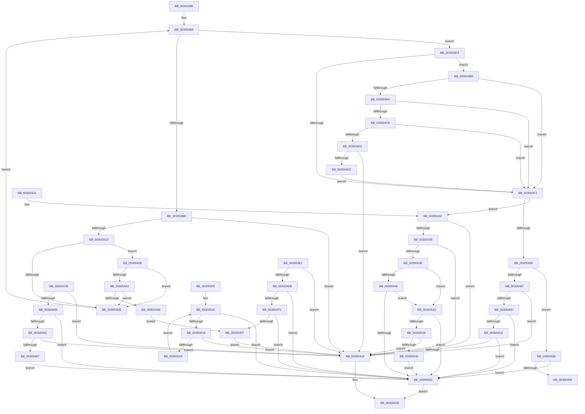

# AuthzBasepIsValidExpression

- RVA: `0x00300390`–`0x00300545` (길이 `437` bytes)
- VA: `0x0000000140300390`
- 실행 섹션: `.text`
- PDB 이름 있음: `예`; PDB Function 태그: `아니요`
- unwind 정보 RVA: `0x00073020`
- 디코드: `115`개 명령, `437/437` bytes 표시
- 미해석 바이트: `0` (있으면 어셈블리에 `.byte`로 보존)

> 이 문서는 커널 이미지의 기계어와 PDB 기호를 분석해 생성했습니다. 4번과 5번은 함수 원형과 자료형을 바이너리 사용 방식에서 추정한 C 해석이며 원본 소스 복구 결과는 아닙니다.

## 1. Dependencies

- 직접 호출 지점: **2**; 고유 호출 대상: **1**
- 직접 호출자로 확인된 함수: **1**
- RIP 상대 이미지 참조: **1**

### Outgoing calls
- `0x003003D1` → [AuthzBasepSupportSetOperation](AuthzBasepSupportSetOperation_function_0030054C.md) (function, `0x0030054C`)
- `0x003003E7` → [AuthzBasepSupportSetOperation](AuthzBasepSupportSetOperation_function_0030054C.md) (function, `0x0030054C`)

### Direct callers
- [AuthzBasepEvaluateAceCondition](../2F/AuthzBasepEvaluateAceCondition_function_002FEBD0.md) at `0x002FF4B5`
- [AuthzBasepEvaluateAceCondition](../2F/AuthzBasepEvaluateAceCondition_function_002FEBD0.md) at `0x002FF5D2`
- [AuthzBasepEvaluateAceCondition](../2F/AuthzBasepEvaluateAceCondition_function_002FEBD0.md) at `0x002FF80B`
- [AuthzBasepEvaluateAceCondition](../2F/AuthzBasepEvaluateAceCondition_function_002FEBD0.md) at `0x002FF848`
- [AuthzBasepEvaluateAceCondition](../2F/AuthzBasepEvaluateAceCondition_function_002FEBD0.md) at `0x002FFB10`

### Static image references
- `0x0030045E` → RVA `0x00000000` (`image boundary/outside`; read)

## 2. Other-region calls and transfers

- 다른 실행 섹션으로 향하는 call: **0**
- 별도 외부 분기/꼬리 이동을 확인하지 못했습니다.

## 3. Assembly (complete function range)

```asm
00300390  48 89 5C 24 10                  mov qword ptr [rsp + 0x10], rbx
00300395  48 89 74 24 18                  mov qword ptr [rsp + 0x18], rsi
0030039A  41 56                           push r14
0030039C  48 83 EC 20                     sub rsp, 0x20
003003A0  33 F6                           xor esi, esi
003003A2  44 0F B6 D9                     movzx r11d, cl
003003A6  44 8B D6                        mov r10d, esi
003003A9  41 C6 01 00                     mov byte ptr [r9], 0
003003AD  4D 8B F1                        mov r14, r9
003003B0  48 89 7C 24 30                  mov qword ptr [rsp + 0x30], rdi
003003B5  48 8B DA                        mov rbx, rdx
003003B8  45 3B D0                        cmp r10d, r8d
003003BB  73 26                           jae 0x1403003e3
003003BD  41 8B C2                        mov eax, r10d
003003C0  4C 8D 0C 80                     lea r9, [rax + rax*4]
003003C4  42 8B 7C CB 0C                  mov edi, dword ptr [rbx + r9*8 + 0xc]
003003C9  85 FF                           test edi, edi
003003CB  74 4C                           je 0x140300419
003003CD  41 0F B6 CB                     movzx ecx, r11b
003003D1  E8 76 01 00 00                  call 0x14030054c
003003D6  84 C0                           test al, al
003003D8  0F 84 BB 00 00 00               je 0x140300499
003003DE  41 FF C2                        inc r10d
003003E1  EB D5                           jmp 0x1403003b8
003003E3  41 0F B6 CB                     movzx ecx, r11b
003003E7  E8 60 01 00 00                  call 0x14030054c
003003EC  84 C0                           test al, al
003003EE  0F 84 BC 00 00 00               je 0x1403004b0
003003F4  41 8B C3                        mov eax, r11d
003003F7  41 81 FB A3 00 00 00            cmp r11d, 0xa3
003003FE  74 32                           je 0x140300432
00300400  3D A2 00 00 00                  cmp eax, 0xa2
00300405  75 4F                           jne 0x140300456
00300407  41 83 F8 02                     cmp r8d, 2
0030040B  74 0C                           je 0x140300419
0030040D  41 83 F8 01                     cmp r8d, 1
00300411  75 3F                           jne 0x140300452
00300413  44 39 43 0C                     cmp dword ptr [rbx + 0xc], r8d
00300417  75 39                           jne 0x140300452
00300419  32 C0                           xor al, al
0030041B  48 8B 7C 24 30                  mov rdi, qword ptr [rsp + 0x30]
00300420  48 8B 5C 24 38                  mov rbx, qword ptr [rsp + 0x38]
00300425  48 8B 74 24 40                  mov rsi, qword ptr [rsp + 0x40]
0030042A  48 83 C4 20                     add rsp, 0x20
0030042E  41 5E                           pop r14
00300430  C3                              ret
00300431  CC                              int3
00300432  41 83 F8 02                     cmp r8d, 2
00300436  75 E1                           jne 0x140300419
00300438  83 7B 0C 01                     cmp dword ptr [rbx + 0xc], 1
0030043C  74 DB                           je 0x140300419
0030043E  41 80 FB 88                     cmp r11b, 0x88
00300442  0F 84 E4 00 00 00               je 0x14030052c
00300448  41 80 FB 8F                     cmp r11b, 0x8f
0030044C  0F 84 DA 00 00 00               je 0x14030052c
00300452  B0 01                           mov al, 1
00300454  EB C5                           jmp 0x14030041b
00300456  83 C0 80                        add eax, -0x80
00300459  83 F8 21                        cmp eax, 0x21
0030045C  77 F4                           ja 0x140300452
0030045E  48 8D 15 9B FB CF FF            lea rdx, [rip - 0x300465]
00300465  48 98                           cdqe
00300467  0F B6 84 02 F0 30 04 00         movzx eax, byte ptr [rdx + rax + 0x430f0]
0030046F  8B 8C 82 DC 30 04 00            mov ecx, dword ptr [rdx + rax*4 + 0x430dc]
00300476  48 03 CA                        add rcx, rdx
00300479  FF E1                           jmp rcx
0030047B  CC                              int3
0030047C  CC                              int3
0030047D  CC                              int3
0030047E  CC                              int3
0030047F  41 83 F8 01                     cmp r8d, 1
00300483  75 94                           jne 0x140300419
00300485  8B 4B 0C                        mov ecx, dword ptr [rbx + 0xc]
00300488  8D 41 FF                        lea eax, [rcx - 1]
0030048B  A9 F9 FF FF FF                  test eax, 0xfffffff9
00300490  75 C0                           jne 0x140300452
00300492  83 F9 07                        cmp ecx, 7
00300495  75 82                           jne 0x140300419
00300497  EB B9                           jmp 0x140300452
00300499  83 FF 01                        cmp edi, 1
0030049C  0F 84 3C FF FF FF               je 0x1403003de
003004A2  42 83 7C CB 04 01               cmp dword ptr [rbx + r9*8 + 4], 1
003004A8  0F 86 30 FF FF FF               jbe 0x1403003de
003004AE  EB 4F                           jmp 0x1403004ff
003004B0  41 83 F8 02                     cmp r8d, 2
003004B4  0F 85 3A FF FF FF               jne 0x1403003f4
003004BA  B9 FB FF 00 00                  mov ecx, 0xfffb
003004BF  66 85 0B                        test word ptr [rbx], cx
003004C2  0F 84 2C FF FF FF               je 0x1403003f4
003004C8  83 7B 34 01                     cmp dword ptr [rbx + 0x34], 1
003004CC  0F 85 22 FF FF FF               jne 0x1403003f4
003004D2  40 38 73 2C                     cmp byte ptr [rbx + 0x2c], sil
003004D6  0F 85 3D FF FF FF               jne 0x140300419
003004DC  E9 13 FF FF FF                  jmp 0x1403003f4
003004E1  41 83 F8 01                     cmp r8d, 1
003004E5  0F 85 2E FF FF FF               jne 0x140300419
003004EB  44 39 43 0C                     cmp dword ptr [rbx + 0xc], r8d
003004EF  0F 84 5D FF FF FF               je 0x140300452
003004F5  66 83 3B 05                     cmp word ptr [rbx], 5
003004F9  0F 84 53 FF FF FF               je 0x140300452
003004FF  41 C6 06 01                     mov byte ptr [r14], 1
00300503  E9 11 FF FF FF                  jmp 0x140300419
00300508  0F 1F 84 00 00 00 00 00         nop dword ptr [rax + rax]
00300510  41 3B F0                        cmp esi, r8d
00300513  0F 83 39 FF FF FF               jae 0x140300452
00300519  48 8D 0C B6                     lea rcx, [rsi + rsi*4]
0030051D  83 7C CB 0C 01                  cmp dword ptr [rbx + rcx*8 + 0xc], 1
00300522  0F 84 F1 FE FF FF               je 0x140300419
00300528  FF C6                           inc esi
0030052A  EB E4                           jmp 0x140300510
0030052C  83 7B 34 01                     cmp dword ptr [rbx + 0x34], 1
00300530  0F 85 1C FF FF FF               jne 0x140300452
00300536  40 38 73 2C                     cmp byte ptr [rbx + 0x2c], sil
0030053A  0F 84 D9 FE FF FF               je 0x140300419
00300540  E9 0D FF FF FF                  jmp 0x140300452
```

## 4. C-style interpretation (structured pseudocode)

```c
__int64 __fastcall AuthzBasepIsValidExpression(unsigned __int8 a1, __int64 a2, int a3, __int64 a4)
{
    __int64 result;
    __int64 v_r10;
    __int64 v_rsi;
    __int64 v_rsp;
    unsigned __int64 v_stack_p10;
    unsigned __int64 v_stack_p18;
    unsigned __int64 v_stack_p8;

    v_stack_p10 = v_rbx;
    v_stack_p18 = v_rsi;
    v_rsp = (v_rsp) - (32);
    v_rsi = 0;
    *(unsigned __int8 *)(a4) = 0;
    v_stack_p8 = v_rdi;
loc_003003B8:
    if (0 >= a3) goto loc_003003E3;
    if ((unsigned int)((unsigned int)(*(unsigned int *)(a2 + 0 + 0 * 4 * 8 + 12))) == 0) goto loc_00300419;
    result = AuthzBasepSupportSetOperation(a1, a2, a3, 0 + 0 * 4);
    if ((unsigned __int8)(result) == 0) goto loc_00300499;
loc_003003DE:
    v_r10 = (unsigned int)((0) + 1);
    goto loc_003003B8;
loc_003003E3:
    result = AuthzBasepSupportSetOperation(a1, a2, a3, 0 + 0 * 4);
    if ((unsigned __int8)(result) == 0) goto loc_003004B0;
loc_003003F4:
    if (a1 == 163) goto loc_00300432;
    if (((unsigned int)((unsigned int)(a1))) != 162) goto loc_00300456;
    if (a3 == 2) goto loc_00300419;
    if (a3 != 1) goto loc_00300452;
    if ((*(unsigned int *)(a2 + 12)) != a3) goto loc_00300452;
loc_00300419:
    result = 0;
loc_0030041B:
    v_rsp = (v_rsp) + (32);
    return result;
loc_00300432:
    if (a3 != 2) goto loc_00300419;
    if ((*(unsigned int *)(v_stack_p10 + 12)) == 1) goto loc_00300419;
    if (a1 == 136) goto loc_0030052C;
    if (a1 == 143) goto loc_0030052C;
loc_00300452:
    goto loc_0030041B;
loc_00300456:
    result = (unsigned int)((1) + (-128));
    if (((unsigned int)(result)) > 33) goto loc_00300452;
    a1 = ((unsigned int)(*(unsigned int *)(v_rip - 3146853 + *(unsigned __int8 *)(v_rip - 3146853 + result * 1 + 274672) * 4 + 274652))) + (v_rip - 3146853);
loc_00300499:
    if (((unsigned int)(v_stack_p8)) == 1) goto loc_003003DE;
    if ((*(unsigned int *)(v_stack_p10 + 0 + 0 * 4 * 8 + 4)) <= 1) goto loc_003003DE;
    goto loc_003004FF;
loc_003004B0:
    if (a3 != 2) goto loc_003003F4;
    if (((*(unsigned __int16 *)(v_stack_p10)) & ((unsigned __int16)((unsigned int)(0xFFFBULL)))) == 0) goto loc_003003F4;
    if ((*(unsigned int *)(v_stack_p10 + 52)) != 1) goto loc_003003F4;
    if ((*(unsigned __int8 *)(v_stack_p10 + 44)) != ((unsigned __int8)(v_stack_p18))) goto loc_00300419;
    goto loc_003003F4;
loc_003004FF:
    *(unsigned __int8 *)(a4) = 1;
    goto loc_00300419;
loc_0030052C:
    if ((*(unsigned int *)(v_stack_p10 + 52)) != 1) goto loc_00300452;
    if ((*(unsigned __int8 *)(v_stack_p10 + 44)) == ((unsigned __int8)(v_stack_p18))) goto loc_00300419;
    goto loc_00300452;
}
```

## 5. (Beta) C Style

```c
int64_t AuthzBasepIsValidExpression(uint8_t Arg1, void *Arg2, int32_t Arg3, void *Arg4)
{
    uint8_t *arg2 = (uint8_t *)Arg2;
    uint8_t *arg4 = (uint8_t *)Arg4;

    int64_t result;
    int64_t local_r10;
    int64_t local_rsi;
    int64_t local_rsp;
    uint64_t v_stack_p10;
    uint64_t v_stack_p18;
    uint64_t v_stack_p8;

    v_stack_p10 = local_rbx;
    v_stack_p18 = local_rsi;
    local_rsp = (local_rsp) - (32);
    local_rsi = 0;
    *(uint8_t *)(arg4) = 0;
    v_stack_p8 = local_rdi;
loc_003003B8:
    if (0 >= Arg3) goto loc_003003E3;
    if ((uint32_t)((uint32_t)(*(uint32_t *)(arg2 + 0x0 + 0x0 * 4 * 8 + 0xC))) == 0) goto loc_00300419;
    result = AuthzBasepSupportSetOperation(Arg1, Arg2, Arg3, 0 + 0 * 4);
    if ((uint8_t)(result) == 0) goto loc_00300499;
loc_003003DE:
    local_r10 = (uint32_t)((0) + 1);
    goto loc_003003B8;
loc_003003E3:
    result = AuthzBasepSupportSetOperation(Arg1, Arg2, Arg3, 0 + 0 * 4);
    if ((uint8_t)(result) == 0) goto loc_003004B0;
loc_003003F4:
    if (Arg1 == 163) goto loc_00300432;
    if (((uint32_t)((uint32_t)(Arg1))) != 162) goto loc_00300456;
    if (Arg3 == 2) goto loc_00300419;
    if (Arg3 != 1) goto loc_00300452;
    if ((*(uint32_t *)(arg2 + 0xC)) != Arg3) goto loc_00300452;
loc_00300419:
    result = 0;
loc_0030041B:
    local_rsp = (local_rsp) + (32);
    return result;
loc_00300432:
    if (Arg3 != 2) goto loc_00300419;
    if ((*(uint32_t *)(v_stack_p10 + 0xC)) == 1) goto loc_00300419;
    if (Arg1 == 136) goto loc_0030052C;
    if (Arg1 == 143) goto loc_0030052C;
loc_00300452:
    goto loc_0030041B;
loc_00300456:
    result = (uint32_t)((1) + (-128));
    if (((uint32_t)(result)) > 33) goto loc_00300452;
    Arg1 = ((uint32_t)(*(uint32_t *)(v_rip - 0x300465 + *(uint8_t *)(v_rip - 0x300465 + result * 1 + 0x430F0) * 4 + 0x430DC))) + (v_rip - 3146853);
loc_00300499:
    if (((uint32_t)(v_stack_p8)) == 1) goto loc_003003DE;
    if ((*(uint32_t *)(v_stack_p10 + 0x0 + 0x0 * 4 * 8 + 0x4)) <= 1) goto loc_003003DE;
    goto loc_003004FF;
loc_003004B0:
    if (Arg3 != 2) goto loc_003003F4;
    if (((*(uint16_t *)(v_stack_p10)) & ((uint16_t)((uint32_t)(0xFFFBULL)))) == 0) goto loc_003003F4;
    if ((*(uint32_t *)(v_stack_p10 + 0x34)) != 1) goto loc_003003F4;
    if ((*(uint8_t *)(v_stack_p10 + 0x2C)) != ((uint8_t)(v_stack_p18))) goto loc_00300419;
    goto loc_003003F4;
loc_003004FF:
    *(uint8_t *)(arg4) = 1;
    goto loc_00300419;
loc_0030052C:
    if ((*(uint32_t *)(v_stack_p10 + 0x34)) != 1) goto loc_00300452;
    if ((*(uint8_t *)(v_stack_p10 + 0x2C)) == ((uint8_t)(v_stack_p18))) goto loc_00300419;
    goto loc_00300452;
}
```

### 관측된 메모리 오프셋

구조체 형식이 확인되지 않은 접근은 인자 기준의 오프셋으로만 기록했습니다.

| 기준 인자 | 오프셋 표현 | 폭 (bit) | 접근 |
|---|---:|---:|---|
| `Arg2` | `+ 0x0` | `16` | `R` |
| `Arg2` | `+ 0x4 + r9*8` | `32` | `R` |
| `Arg2` | `+ 0xC` | `32` | `R` |
| `Arg2` | `+ 0xC + r9*8` | `32` | `R` |
| `Arg2` | `+ 0x2C` | `8` | `R` |
| `Arg2` | `+ 0x34` | `32` | `R` |
| `Arg4` | `+ 0x0` | `8` | `W` |

## 6. Execution-region graph

[열기: 2D/3D 그래프와 함수 탐색 컨트롤 패널](../../../control-panel.html?section=text&rva=0x00300390&view=graph)

- 2D 그래프는 위에서 아래로 흐르고, 3D 그래프는 빈 공간을 드래그해 회전합니다. Shift+드래그는 이동, 휠은 확대·축소, 함수 노드 선택은 대상 보고서 이동입니다.

### Static fallback


