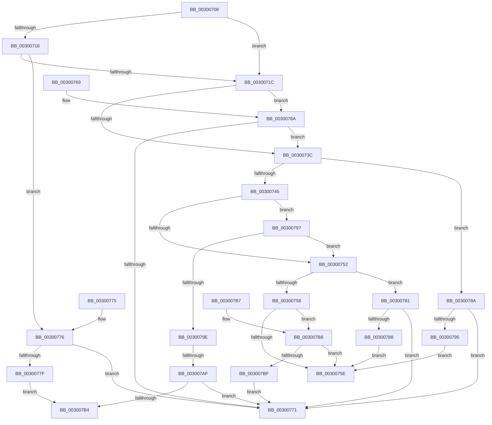

# AuthzBasepOperandValueTypesCompatible

- RVA: `0x00300708`–`0x003007C1` (길이 `185` bytes)
- VA: `0x0000000140300708`
- 실행 섹션: `.text`
- PDB 이름 있음: `예`; PDB Function 태그: `예`
- unwind 정보 RVA: `0x000DB714`
- 디코드: `61`개 명령, `185/185` bytes 표시
- 미해석 바이트: `0` (있으면 어셈블리에 `.byte`로 보존)

> 이 문서는 커널 이미지의 기계어와 PDB 기호를 분석해 생성했습니다. 4번과 5번은 함수 원형과 자료형을 바이너리 사용 방식에서 추정한 C 해석이며 원본 소스 복구 결과는 아닙니다.

## 1. Dependencies

- 직접 호출 지점: **0**; 고유 호출 대상: **0**
- 직접 호출자로 확인된 함수: **3**
- RIP 상대 이미지 참조: **0**

### Outgoing calls
- 직접 디코드된 call 명령이 없습니다.

### Direct callers
- [AuthzBasepValueInSet](../2F/AuthzBasepValueInSet_function_002FE9B0.md) at `0x002FEA46`
- [AuthzBasepEvaluateAceCondition](../2F/AuthzBasepEvaluateAceCondition_function_002FEBD0.md) at `0x002FFB3C`
- [AuthzBasepEvaluateExpression](AuthzBasepEvaluateExpression_function_00300578.md) at `0x003005AD`

### Static image references
- 디코드된 RIP-relative 메모리 참조가 없습니다.

## 2. Other-region calls and transfers

- 다른 실행 섹션으로 향하는 call: **0**
- call이 아닌 외부 분기/꼬리 이동: **1**
  - `0x003007A9` → `0x006DFF58` (`tail-transfer`)

## 3. Assembly (complete function range)

```asm
00300708  8B 41 0C                        mov eax, dword ptr [rcx + 0xc]
0030070B  41 BB 01 00 00 00               mov r11d, 1
00300711  41 3B C3                        cmp eax, r11d
00300714  74 06                           je 0x14030071c
00300716  44 39 59 34                     cmp dword ptr [rcx + 0x34], r11d
0030071A  75 5A                           jne 0x140300776
0030071C  41 3B C3                        cmp eax, r11d
0030071F  4C 8D 51 28                     lea r10, [rcx + 0x28]
00300723  4C 8B C9                        mov r9, rcx
00300726  49 8B D2                        mov rdx, r10
00300729  4D 0F 45 CA                     cmovne r9, r10
0030072D  48 0F 45 D1                     cmovne rdx, rcx
00300731  45 0F B7 01                     movzx r8d, word ptr [r9]
00300735  66 41 83 F8 10                  cmp r8w, 0x10
0030073A  74 2E                           je 0x14030076a
0030073C  0F B7 12                        movzx edx, word ptr [rdx]
0030073F  66 83 FA 10                     cmp dx, 0x10
00300743  74 45                           je 0x14030078a
00300745  0F B7 C2                        movzx eax, dx
00300748  66 41 2B C3                     sub ax, r11w
0030074C  66 41 3B C3                     cmp ax, r11w
00300750  76 45                           jbe 0x140300797
00300752  66 83 FA 06                     cmp dx, 6
00300756  74 29                           je 0x140300781
00300758  66 83 FA 05                     cmp dx, 5
0030075C  74 5A                           je 0x1403007b8
0030075E  41 0F B7 02                     movzx eax, word ptr [r10]
00300762  66 39 01                        cmp word ptr [rcx], ax
00300765  0F 94 C0                        sete al
00300768  C3                              ret
00300769  CC                              int3
0030076A  41 80 79 04 00                  cmp byte ptr [r9 + 4], 0
0030076F  74 CB                           je 0x14030073c
00300771  41 8A C3                        mov al, r11b
00300774  C3                              ret
00300775  CC                              int3
00300776  0F B7 41 28                     movzx eax, word ptr [rcx + 0x28]
0030077A  66 39 01                        cmp word ptr [rcx], ax
0030077D  74 F2                           je 0x140300771
0030077F  EB 33                           jmp 0x1403007b4
00300781  66 41 83 F8 02                  cmp r8w, 2
00300786  74 E9                           je 0x140300771
00300788  EB D4                           jmp 0x14030075e
0030078A  66 41 83 E8 02                  sub r8w, 2
0030078F  66 45 3B C3                     cmp r8w, r11w
00300793  76 DC                           jbe 0x140300771
00300795  EB C7                           jmp 0x14030075e
00300797  66 41 83 F8 02                  cmp r8w, 2
0030079C  75 B4                           jne 0x140300752
0030079E  49 8B 49 20                     mov rcx, qword ptr [r9 + 0x20]
003007A2  8A 41 08                        mov al, byte ptr [rcx + 8]
003007A5  66 41 3B D0                     cmp dx, r8w
003007A9  0F 85 A9 F7 3D 00               jne 0x1406dff58
003007AF  41 3A C0                        cmp al, r8b
003007B2  75 BD                           jne 0x140300771
003007B4  32 C0                           xor al, al
003007B6  C3                              ret
003007B7  CC                              int3
003007B8  66 41 83 F8 10                  cmp r8w, 0x10
003007BD  75 9F                           jne 0x14030075e
003007BF  EB B0                           jmp 0x140300771
```

## 4. C-style interpretation (structured pseudocode)

```c
__int64 __fastcall AuthzBasepOperandValueTypesCompatible(__int64 a1)
{
    __int64 result;

    if (((unsigned int)((unsigned int)(*(unsigned int *)(a1 + 12)))) == 1) goto loc_0030071C;
    if ((*(unsigned int *)(a1 + 52)) != 1) goto loc_00300776;
loc_0030071C:
    if (((unsigned int)((unsigned int)(*(unsigned int *)(a1 + 12)))) != 1) { a1 = a1 + 40; }
    a2 = a1 + 40;
    if (((unsigned int)((unsigned int)(*(unsigned int *)(a1 + 12)))) != 1) { a2 = a1; }
    if (((unsigned __int16)(*(unsigned __int16 *)(a1))) == 16) goto loc_0030076A;
loc_0030073C:
    if (((unsigned __int16)(*(unsigned __int16 *)(a2))) == 16) goto loc_0030078A;
    result = (unsigned __int16)(((unsigned __int16)(*(unsigned __int16 *)(a2))) - (1));
    if (((unsigned __int16)(result)) <= 1) goto loc_00300797;
loc_00300752:
    if (((unsigned __int16)(*(unsigned __int16 *)(a2))) == 6) goto loc_00300781;
    if (((unsigned __int16)(*(unsigned __int16 *)(a2))) == 5) goto loc_003007B8;
loc_0030075E:
    result = ((*(unsigned __int16 *)(a1)) == ((unsigned __int16)(*(unsigned __int16 *)(a1 + 40)))) ? 1 : 0;
    return result;
loc_0030076A:
    if ((*(unsigned __int8 *)(a1 + 4)) == 0) goto loc_0030073C;
loc_00300771:
    return 1;
loc_00300776:
    if ((*(unsigned __int16 *)(a1)) == ((unsigned __int16)(*(unsigned __int16 *)(a1 + 40)))) goto loc_00300771;
    goto loc_003007B4;
loc_00300781:
    if (((unsigned __int16)(*(unsigned __int16 *)(a1))) == 2) goto loc_00300771;
    goto loc_0030075E;
loc_0030078A:
    a3 = (unsigned __int16)((*(unsigned __int16 *)(a1)) - (2));
    if (((unsigned __int16)(a3)) <= 1) goto loc_00300771;
    goto loc_0030075E;
loc_00300797:
    if (((unsigned __int16)(a3)) != 2) goto loc_00300752;
    if (((unsigned __int8)(*(unsigned __int8 *)(*(unsigned __int64 *)(a1 + 32) + 8))) != ((unsigned __int8)(a3))) goto loc_00300771;
loc_003007B4:
    result = 0;
    return result;
loc_003007B8:
    if (((unsigned __int16)(a3)) != 16) goto loc_0030075E;
    goto loc_00300771;
}
```

## 5. (Beta) C Style

```c
int64_t AuthzBasepOperandValueTypesCompatible(void *Arg1)
{
    uint8_t *arg1 = (uint8_t *)Arg1;

    int64_t result;

    if (((uint32_t)((uint32_t)(*(uint32_t *)(arg1 + 0xC)))) == 1) goto loc_0030071C;
    if ((*(uint32_t *)(arg1 + 0x34)) != 1) goto loc_00300776;
loc_0030071C:
    if (((uint32_t)((uint32_t)(*(uint32_t *)(arg1 + 0xC)))) != 1) { Arg1 = Arg1 + 40; }
    a2 = Arg1 + 40;
    if (((uint32_t)((uint32_t)(*(uint32_t *)(arg1 + 0xC)))) != 1) { a2 = Arg1; }
    if (((uint16_t)(*(uint16_t *)(arg1))) == 16) goto loc_0030076A;
loc_0030073C:
    if (((uint16_t)(*(uint16_t *)(a2))) == 16) goto loc_0030078A;
    result = (uint16_t)(((uint16_t)(*(uint16_t *)(a2))) - (1));
    if (((uint16_t)(result)) <= 1) goto loc_00300797;
loc_00300752:
    if (((uint16_t)(*(uint16_t *)(a2))) == 6) goto loc_00300781;
    if (((uint16_t)(*(uint16_t *)(a2))) == 5) goto loc_003007B8;
loc_0030075E:
    result = ((*(uint16_t *)(arg1)) == ((uint16_t)(*(uint16_t *)(arg1 + 0x28)))) ? 1 : 0;
    return result;
loc_0030076A:
    if ((*(uint8_t *)(arg1 + 0x4)) == 0) goto loc_0030073C;
loc_00300771:
    return 1;
loc_00300776:
    if ((*(uint16_t *)(arg1)) == ((uint16_t)(*(uint16_t *)(arg1 + 0x28)))) goto loc_00300771;
    goto loc_003007B4;
loc_00300781:
    if (((uint16_t)(*(uint16_t *)(arg1))) == 2) goto loc_00300771;
    goto loc_0030075E;
loc_0030078A:
    a3 = (uint16_t)((*(uint16_t *)(arg1)) - (2));
    if (((uint16_t)(a3)) <= 1) goto loc_00300771;
    goto loc_0030075E;
loc_00300797:
    if (((uint16_t)(a3)) != 2) goto loc_00300752;
    if (((uint8_t)(*(uint8_t *)(*(uint64_t *)(arg1 + 0x20) + 0x8))) != ((uint8_t)(a3))) goto loc_00300771;
loc_003007B4:
    result = 0;
    return result;
loc_003007B8:
    if (((uint16_t)(a3)) != 16) goto loc_0030075E;
    goto loc_00300771;
}
```

### 관측된 메모리 오프셋

구조체 형식이 확인되지 않은 접근은 인자 기준의 오프셋으로만 기록했습니다.

| 기준 인자 | 오프셋 표현 | 폭 (bit) | 접근 |
|---|---:|---:|---|
| `Arg1` | `+ 0x0` | `16` | `R` |
| `Arg1` | `+ 0xC` | `32` | `R` |
| `Arg1` | `+ 0x28` | `16` | `R` |
| `Arg1` | `+ 0x28` | `64` | `R` |
| `Arg1` | `+ 0x34` | `32` | `R` |

## 6. Execution-region graph

[열기: 2D/3D 그래프와 함수 탐색 컨트롤 패널](../../../control-panel.html?section=text&rva=0x00300708&view=graph)

- 2D 그래프는 위에서 아래로 흐르고, 3D 그래프는 빈 공간을 드래그해 회전합니다. Shift+드래그는 이동, 휠은 확대·축소, 함수 노드 선택은 대상 보고서 이동입니다.

### Static fallback


