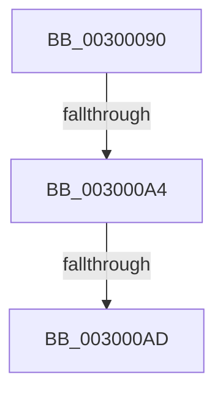

# AuthzBasepQuerySecurityAttributeAndValues

- RVA: `0x00300090`–`0x003000B1` (길이 `33` bytes)
- VA: `0x0000000140300090`
- 실행 섹션: `.text`
- PDB 이름 있음: `예`; PDB Function 태그: `아니요`
- unwind 정보 RVA: `0x00072ED8`
- 디코드: `9`개 명령, `33/33` bytes 표시
- 미해석 바이트: `0` (있으면 어셈블리에 `.byte`로 보존)

> 이 문서는 커널 이미지의 기계어와 PDB 기호를 분석해 생성했습니다. 4번과 5번은 함수 원형과 자료형을 바이너리 사용 방식에서 추정한 C 해석이며 원본 소스 복구 결과는 아닙니다.

## 1. Dependencies

- 직접 호출 지점: **0**; 고유 호출 대상: **0**
- 직접 호출자로 확인된 함수: **6**
- RIP 상대 이미지 참조: **0**

### Outgoing calls
- 직접 디코드된 call 명령이 없습니다.

### Direct callers
- [AuthzBasepRestartOperandValueEnumeration](../2F/AuthzBasepRestartOperandValueEnumeration_function_002FEB8C.md) at `0x002FEBBD`
- [AuthzBasepEvaluateAceCondition](../2F/AuthzBasepEvaluateAceCondition_function_002FEBD0.md) at `0x002FEFAA`
- [AuthzBasepEvaluateAceCondition](../2F/AuthzBasepEvaluateAceCondition_function_002FEBD0.md) at `0x002FEFF1`
- [AuthzBasepEvaluateAceCondition](../2F/AuthzBasepEvaluateAceCondition_function_002FEBD0.md) at `0x002FFD54`
- [SepCanTokenMatchAllPackageSid](../2F/SepCanTokenMatchAllPackageSid_function_002FFE90.md) at `0x002FFF45`
- [AuthzBasepGetNextValue](AuthzBasepGetNextValue_function_003007E0.md) at `0x00300818`
- [SepGetProcUniqueLuidAndIndexFromAttributeInfo](SepGetProcUniqueLuidAndIndexFromAttributeInfo_function_00300A78.md) at `0x00300AEC`
- [SepGetProcUniqueLuidAndIndexFromAttributeInfo](SepGetProcUniqueLuidAndIndexFromAttributeInfo_function_00300A78.md) at `0x00300B06`
- [SepGetAgentIdClaimValue](../../page/7A/SepGetAgentIdClaimValue_function_007A0FDC.md) at `0x007A106C`

### Static image references
- 디코드된 RIP-relative 메모리 참조가 없습니다.

## 2. Other-region calls and transfers

- 다른 실행 섹션으로 향하는 call: **0**
- call이 아닌 외부 분기/꼬리 이동: **2**
  - `0x0030009E` → [sub_00300199 + 0x1](Unknown_function_00300199.md) (`tail-transfer`)
  - `0x003000A7` → [sub_003001AE](Unknown_function_003001AE.md) (`tail-transfer`)

## 3. Assembly (complete function range)

```asm
00300090  40 53                           push rbx
00300092  48 83 EC 30                     sub rsp, 0x30
00300096  8B 01                           mov eax, dword ptr [rcx]
00300098  48 8B D9                        mov rbx, rcx
0030009B  83 F8 06                        cmp eax, 6
0030009E  0F 84 F6 00 00 00               je 0x14030019a
003000A4  83 F8 07                        cmp eax, 7
003000A7  0F 84 01 01 00 00               je 0x1403001ae
003000AD  48 8B 49 38                     mov rcx, qword ptr [rcx + 0x38]
```

## 4. C-style interpretation (structured pseudocode)

```c
__int64 __fastcall AuthzBasepQuerySecurityAttributeAndValues(__int64 a1)
{
    __int64 v_rsp;

    v_rsp = (v_rsp) - (48);
    return (unsigned int)(*(unsigned int *)(a1));
}
```

## 5. (Beta) C Style

```c
int64_t AuthzBasepQuerySecurityAttributeAndValues(void *Arg1)
{
    uint8_t *arg1 = (uint8_t *)Arg1;

    int64_t local_rsp;

    local_rsp = (local_rsp) - (48);
    return (uint32_t)(*(uint32_t *)(arg1));
}
```

### 관측된 메모리 오프셋

구조체 형식이 확인되지 않은 접근은 인자 기준의 오프셋으로만 기록했습니다.

| 기준 인자 | 오프셋 표현 | 폭 (bit) | 접근 |
|---|---:|---:|---|
| `Arg1` | `+ 0x0` | `32` | `R` |
| `Arg1` | `+ 0x38` | `64` | `R` |

## 6. Execution-region graph

[열기: 2D/3D 그래프와 함수 탐색 컨트롤 패널](../../../control-panel.html?section=text&rva=0x00300090&view=graph)

- 2D 그래프는 위에서 아래로 흐르고, 3D 그래프는 빈 공간을 드래그해 회전합니다. Shift+드래그는 이동, 휠은 확대·축소, 함수 노드 선택은 대상 보고서 이동입니다.

### Static fallback


