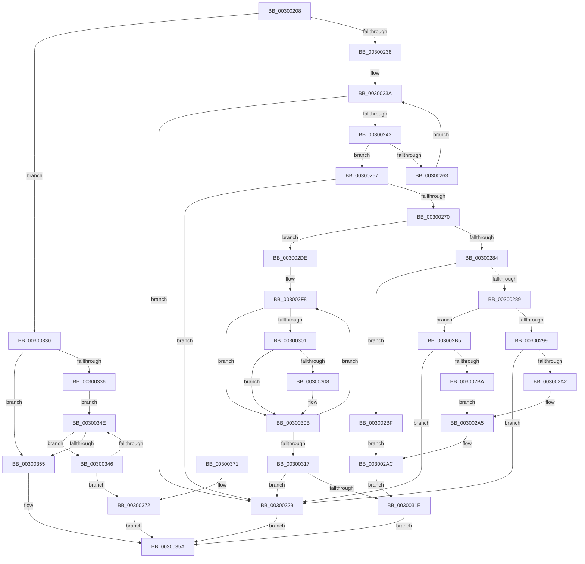

# AuthzBasepQueryTokenAttributeAndValues

- RVA: `0x00300208`–`0x0030037D` (길이 `373` bytes)
- VA: `0x0000000140300208`
- 실행 섹션: `.text`
- PDB 이름 있음: `예`; PDB Function 태그: `아니요`
- unwind 정보 RVA: `0x00073008`
- 디코드: `113`개 명령, `373/373` bytes 표시
- 미해석 바이트: `0` (있으면 어셈블리에 `.byte`로 보존)

> 이 문서는 커널 이미지의 기계어와 PDB 기호를 분석해 생성했습니다. 4번과 5번은 함수 원형과 자료형을 바이너리 사용 방식에서 추정한 C 해석이며 원본 소스 복구 결과는 아닙니다.

## 1. Dependencies

- 직접 호출 지점: **2**; 고유 호출 대상: **2**
- 직접 호출자로 확인된 함수: **1**
- RIP 상대 이미지 참조: **1**

### Outgoing calls
- `0x0030025A` → [AuthzBasepEqualUnicodeString](../3A/AuthzBasepEqualUnicodeString_function_003A8A80.md) (function, `0x003A8A80`)
- `0x003002C8` → [SepCopyTokenIntegrity](../41/SepCopyTokenIntegrity_function_00419D10.md) (function, `0x00419D10`)

### Direct callers
- [sub_00300199](Unknown_function_00300199.md) at `0x0030019A`

### Static image references
- `0x00300243` → RVA `0x00E0A260` (`.data`; read)

## 2. Other-region calls and transfers

- 다른 실행 섹션으로 향하는 call: **0**
- 별도 외부 분기/꼬리 이동을 확인하지 못했습니다.

## 3. Assembly (complete function range)

```asm
00300208  48 8B C4                        mov rax, rsp
0030020B  48 89 58 08                     mov qword ptr [rax + 8], rbx
0030020F  48 89 68 10                     mov qword ptr [rax + 0x10], rbp
00300213  48 89 70 18                     mov qword ptr [rax + 0x18], rsi
00300217  57                              push rdi
00300218  48 83 EC 30                     sub rsp, 0x30
0030021C  33 FF                           xor edi, edi
0030021E  0F 57 C0                        xorps xmm0, xmm0
00300221  0F 11 40 E8                     movups xmmword ptr [rax - 0x18], xmm0
00300225  48 8B 41 38                     mov rax, qword ptr [rcx + 0x38]
00300229  48 8B D9                        mov rbx, rcx
0030022C  89 79 24                        mov dword ptr [rcx + 0x24], edi
0030022F  48 85 C0                        test rax, rax
00300232  0F 85 F8 00 00 00               jne 0x140300330
00300238  8B EF                           mov ebp, edi
0030023A  83 FD 04                        cmp ebp, 4
0030023D  0F 83 E6 00 00 00               jae 0x140300329
00300243  48 8D 0D 16 A0 B0 00            lea rcx, [rip + 0xb0a016]
0030024A  8B F5                           mov esi, ebp
0030024C  48 C1 E6 04                     shl rsi, 4
00300250  48 03 F1                        add rsi, rcx
00300253  48 8D 4B 10                     lea rcx, [rbx + 0x10]
00300257  48 8B 16                        mov rdx, qword ptr [rsi]
0030025A  E8 21 88 0A 00                  call 0x1403a8a80
0030025F  84 C0                           test al, al
00300261  75 04                           jne 0x140300267
00300263  FF C5                           inc ebp
00300265  EB D3                           jmp 0x14030023a
00300267  48 85 F6                        test rsi, rsi
0030026A  0F 84 B9 00 00 00               je 0x140300329
00300270  48 89 73 38                     mov qword ptr [rbx + 0x38], rsi
00300274  0F B7 46 0C                     movzx eax, word ptr [rsi + 0xc]
00300278  66 89 43 20                     mov word ptr [rbx + 0x20], ax
0030027C  8B 4E 08                        mov ecx, dword ptr [rsi + 8]
0030027F  83 E9 01                        sub ecx, 1
00300282  74 5A                           je 0x1403002de
00300284  83 E9 01                        sub ecx, 1
00300287  74 36                           je 0x1403002bf
00300289  48 8B 43 08                     mov rax, qword ptr [rbx + 8]
0030028D  83 F9 01                        cmp ecx, 1
00300290  48 8B 88 50 04 00 00            mov rcx, qword ptr [rax + 0x450]
00300297  74 1C                           je 0x1403002b5
00300299  48 85 C9                        test rcx, rcx
0030029C  0F 84 87 00 00 00               je 0x140300329
003002A2  8B 41 0C                        mov eax, dword ptr [rcx + 0xc]
003002A5  48 8D 53 40                     lea rdx, [rbx + 0x40]
003002A9  48 89 02                        mov qword ptr [rdx], rax
003002AC  C7 43 28 01 00 00 00            mov dword ptr [rbx + 0x28], 1
003002B3  EB 69                           jmp 0x14030031e
003002B5  48 85 C9                        test rcx, rcx
003002B8  74 6F                           je 0x140300329
003002BA  8B 41 08                        mov eax, dword ptr [rcx + 8]
003002BD  EB E6                           jmp 0x1403002a5
003002BF  48 8B 4B 08                     mov rcx, qword ptr [rbx + 8]
003002C3  48 8D 54 24 20                  lea rdx, [rsp + 0x20]
003002C8  E8 43 9A 11 00                  call 0x140419d10
003002CD  48 8B 44 24 20                  mov rax, qword ptr [rsp + 0x20]
003002D2  48 8D 53 40                     lea rdx, [rbx + 0x40]
003002D6  8B 48 08                        mov ecx, dword ptr [rax + 8]
003002D9  48 89 0A                        mov qword ptr [rdx], rcx
003002DC  EB CE                           jmp 0x1403002ac
003002DE  48 8B 43 08                     mov rax, qword ptr [rbx + 8]
003002E2  48 8D 53 40                     lea rdx, [rbx + 0x40]
003002E6  41 B8 02 00 00 00               mov r8d, 2
003002EC  8B CF                           mov ecx, edi
003002EE  45 8B C8                        mov r9d, r8d
003002F1  4C 8B 50 48                     mov r10, qword ptr [rax + 0x48]
003002F5  48 89 3A                        mov qword ptr [rdx], rdi
003002F8  41 8B C0                        mov eax, r8d
003002FB  49 0F A3 C2                     bt r10, rax
003002FF  73 0A                           jae 0x14030030b
00300301  FF C1                           inc ecx
00300303  48 39 3A                        cmp qword ptr [rdx], rdi
00300306  75 03                           jne 0x14030030b
00300308  4C 89 0A                        mov qword ptr [rdx], r9
0030030B  41 FF C0                        inc r8d
0030030E  49 FF C1                        inc r9
00300311  41 83 F8 24                     cmp r8d, 0x24
00300315  76 E1                           jbe 0x1403002f8
00300317  89 4B 28                        mov dword ptr [rbx + 0x28], ecx
0030031A  85 C9                           test ecx, ecx
0030031C  74 0B                           je 0x140300329
0030031E  B8 30 00 00 00                  mov eax, 0x30
00300323  48 89 14 03                     mov qword ptr [rbx + rax], rdx
00300327  EB 31                           jmp 0x14030035a
00300329  BF 25 02 00 C0                  mov edi, 0xc0000225
0030032E  EB 2A                           jmp 0x14030035a
00300330  83 78 08 01                     cmp dword ptr [rax + 8], 1
00300334  75 1F                           jne 0x140300355
00300336  48 8B 41 08                     mov rax, qword ptr [rcx + 8]
0030033A  48 8D 51 40                     lea rdx, [rcx + 0x40]
0030033E  8B 0A                           mov ecx, dword ptr [rdx]
00300340  4C 8B 40 48                     mov r8, qword ptr [rax + 0x48]
00300344  EB 08                           jmp 0x14030034e
00300346  8B C1                           mov eax, ecx
00300348  49 0F A3 C0                     bt r8, rax
0030034C  72 24                           jb 0x140300372
0030034E  FF C1                           inc ecx
00300350  83 F9 24                        cmp ecx, 0x24
00300353  76 F1                           jbe 0x140300346
00300355  BF 1A 00 00 80                  mov edi, 0x8000001a
0030035A  48 8B 5C 24 40                  mov rbx, qword ptr [rsp + 0x40]
0030035F  8B C7                           mov eax, edi
00300361  48 8B 6C 24 48                  mov rbp, qword ptr [rsp + 0x48]
00300366  48 8B 74 24 50                  mov rsi, qword ptr [rsp + 0x50]
0030036B  48 83 C4 30                     add rsp, 0x30
0030036F  5F                              pop rdi
00300370  C3                              ret
00300371  CC                              int3
00300372  8B C1                           mov eax, ecx
00300374  48 89 02                        mov qword ptr [rdx], rax
00300377  48 89 53 30                     mov qword ptr [rbx + 0x30], rdx
0030037B  EB DD                           jmp 0x14030035a
```

## 4. C-style interpretation (structured pseudocode)

```c
__int64 __fastcall AuthzBasepQueryTokenAttributeAndValues(__int64 a1)
{
    __int64 result;
    __int64 v_rbp;
    __int64 v_rdi;
    __int64 v_rsi;
    __int64 v_rsp;
    unsigned __int64 v_stack_m18;
    unsigned __int64 v_stack_p10;
    unsigned __int64 v_stack_p18;
    unsigned __int64 v_stack_p8;

    *(unsigned __int64 *)(v_rsp + 8) = v_rbx;
    *(unsigned __int64 *)(v_rsp + 16) = v_rbp;
    *(unsigned __int64 *)(v_rsp + 24) = v_rsi;
    v_rsp = (v_rsp) - (48);
    v_rdi = 0;
    *(unsigned __int64 *)(v_rsp - 24) = v_xmm0;
    *(unsigned int *)(a1 + 36) = 0;
    if (*(unsigned __int64 *)(a1 + 56) != 0) goto loc_00300330;
loc_0030023A:
    if (0 >= 4) goto loc_00300329;
    v_rsi = (0) << (4);
    v_rsi = (v_rsi) + (v_rip + 11575318);
    result = AuthzBasepEqualUnicodeString(a1 + 16, *(unsigned __int64 *)(v_rsi), a3, a4);
    if ((unsigned __int8)(result) != 0) goto loc_00300267;
    v_rbp = (unsigned int)((0) + 1);
    goto loc_0030023A;
loc_00300267:
    if (v_rsi == 0) goto loc_00300329;
    *(unsigned __int64 *)(a1 + 56) = v_rsi;
    *(unsigned __int16 *)(a1 + 32) = (unsigned __int16)(*(unsigned __int16 *)(v_rsi + 12));
    a1 = (unsigned int)(((unsigned int)(*(unsigned int *)(v_rsi + 8))) - (1));
    if (condition_is_equal) goto loc_003002DE;
    a1 = (unsigned int)((a1) - (1));
    if (condition_is_equal) goto loc_003002BF;
    if (((unsigned int)(a1)) == 1) goto loc_003002B5;
    if (*(unsigned __int64 *)(*(unsigned __int64 *)(a1 + 8) + 1104) == 0) goto loc_00300329;
loc_003002A5:
    *(unsigned __int64 *)(a1 + 64) = (unsigned int)(*(unsigned int *)(*(unsigned __int64 *)(*(unsigned __int64 *)(a1 + 8) + 1104) + 12));
loc_003002AC:
    *(unsigned int *)(a1 + 40) = 1;
    goto loc_0030031E;
loc_003002B5:
    if (*(unsigned __int64 *)(*(unsigned __int64 *)(a1 + 8) + 1104) == 0) goto loc_00300329;
    goto loc_003002A5;
loc_003002BF:
    result = SepCopyTokenIntegrity(*(unsigned __int64 *)(a1 + 8), v_stack_m18, a3, a4);
    *(unsigned __int64 *)(a1 + 64) = (unsigned int)(*(unsigned int *)(v_stack_m18 + 8));
    goto loc_003002AC;
loc_003002DE:
    *(unsigned __int64 *)(a1 + 64) = 0;
loc_003002F8:
    if (condition_is_above_or_equal) goto loc_0030030B;
    a1 = (unsigned int)((0) + 1);
    if ((*(unsigned __int64 *)(a1 + 64)) == 0) {
        *(unsigned __int64 *)(a1 + 64) = 2;
    }
    a3 = (unsigned int)((2) + 1);
    a4 = (2) + 1;
    if (((unsigned int)(a3)) <= 36) goto loc_003002F8;
    *(unsigned int *)(a1 + 40) = (unsigned int)(a1);
    if ((unsigned int)(a1) == 0) goto loc_00300329;
loc_0030031E:
    *(unsigned __int64 *)(a1 + 48 * 1) = a1 + 64;
    goto loc_0030035A;
loc_00300329:
    goto loc_0030035A;
loc_00300330:
    if ((*(unsigned int *)(48 + 8)) != 1) goto loc_00300355;
    goto loc_0030034E;
loc_00300346:
    if ((*(unsigned int *)(48 + 8)) < 1) goto loc_00300372;
loc_0030034E:
    a1 = (unsigned int)(((unsigned int)(*(unsigned int *)(a1 + 64))) + 1);
    if (((unsigned int)(a1)) <= 36) goto loc_00300346;
loc_00300355:
loc_0030035A:
    v_rsp = (v_rsp) + (48);
    return (unsigned int)((unsigned int)((unsigned int)(0x8000001AULL)));
loc_00300372:
    *(unsigned __int64 *)(a1 + 64) = (unsigned int)((unsigned int)(a1));
    *(unsigned __int64 *)(v_stack_p8 + 48) = a1 + 64;
    goto loc_0030035A;
}
```

## 5. (Beta) C Style

```c
int64_t AuthzBasepQueryTokenAttributeAndValues(void *Arg1)
{
    uint8_t *arg1 = (uint8_t *)Arg1;

    int64_t result;
    int64_t local_rbp;
    int64_t local_rdi;
    int64_t local_rsi;
    int64_t local_rsp;
    uint64_t v_stack_m18;
    uint64_t v_stack_p10;
    uint64_t v_stack_p18;
    uint64_t v_stack_p8;

    *(uint64_t *)(local_rsp + 0x8) = local_rbx;
    *(uint64_t *)(local_rsp + 0x10) = local_rbp;
    *(uint64_t *)(local_rsp + 0x18) = local_rsi;
    local_rsp = (local_rsp) - (48);
    local_rdi = 0;
    *(uint64_t *)(local_rsp - 0x18) = v_xmm0;
    *(uint32_t *)(arg1 + 0x24) = 0;
    if (*(uint64_t *)(arg1 + 0x38) != 0) goto loc_00300330;
loc_0030023A:
    if (0 >= 4) goto loc_00300329;
    local_rsi = (0) << (4);
    local_rsi = (local_rsi) + (v_rip + 11575318);
    result = AuthzBasepEqualUnicodeString(Arg1 + 16, *(uint64_t *)(local_rsi), a3, a4);
    if ((uint8_t)(result) != 0) goto loc_00300267;
    local_rbp = (uint32_t)((0) + 1);
    goto loc_0030023A;
loc_00300267:
    if (local_rsi == 0) goto loc_00300329;
    *(uint64_t *)(arg1 + 0x38) = local_rsi;
    *(uint16_t *)(arg1 + 0x20) = (uint16_t)(*(uint16_t *)(local_rsi + 0xC));
    Arg1 = (uint32_t)(((uint32_t)(*(uint32_t *)(local_rsi + 0x8))) - (1));
    if (condition_is_equal) goto loc_003002DE;
    Arg1 = (uint32_t)((Arg1) - (1));
    if (condition_is_equal) goto loc_003002BF;
    if (((uint32_t)(Arg1)) == 1) goto loc_003002B5;
    if (*(uint64_t *)(*(uint64_t *)(arg1 + 0x8) + 0x450) == 0) goto loc_00300329;
loc_003002A5:
    *(uint64_t *)(arg1 + 0x40) = (uint32_t)(*(uint32_t *)(*(uint64_t *)(*(uint64_t *)(arg1 + 0x8) + 0x450) + 0xC));
loc_003002AC:
    *(uint32_t *)(arg1 + 0x28) = 1;
    goto loc_0030031E;
loc_003002B5:
    if (*(uint64_t *)(*(uint64_t *)(arg1 + 0x8) + 0x450) == 0) goto loc_00300329;
    goto loc_003002A5;
loc_003002BF:
    result = SepCopyTokenIntegrity(*(uint64_t *)(arg1 + 0x8), v_stack_m18, a3, a4);
    *(uint64_t *)(arg1 + 0x40) = (uint32_t)(*(uint32_t *)(v_stack_m18 + 0x8));
    goto loc_003002AC;
loc_003002DE:
    *(uint64_t *)(arg1 + 0x40) = 0;
loc_003002F8:
    if (condition_is_above_or_equal) goto loc_0030030B;
    Arg1 = (uint32_t)((0) + 1);
    if ((*(uint64_t *)(arg1 + 0x40)) == 0) {
        *(uint64_t *)(arg1 + 0x40) = 2;
    }
    a3 = (uint32_t)((2) + 1);
    a4 = (2) + 1;
    if (((uint32_t)(a3)) <= 36) goto loc_003002F8;
    *(uint32_t *)(arg1 + 0x28) = (uint32_t)(Arg1);
    if ((uint32_t)(Arg1) == 0) goto loc_00300329;
loc_0030031E:
    *(void **)(arg1 + 0x30 * 1) = Arg1 + 64;
    goto loc_0030035A;
loc_00300329:
    goto loc_0030035A;
loc_00300330:
    if ((*(uint32_t *)(48 + 0x8)) != 1) goto loc_00300355;
    goto loc_0030034E;
loc_00300346:
    if ((*(uint32_t *)(48 + 0x8)) < 1) goto loc_00300372;
loc_0030034E:
    Arg1 = (uint32_t)(((uint32_t)(*(uint32_t *)(arg1 + 0x40))) + 1);
    if (((uint32_t)(Arg1)) <= 36) goto loc_00300346;
loc_00300355:
loc_0030035A:
    local_rsp = (local_rsp) + (48);
    return (uint32_t)((uint32_t)((uint32_t)(0x8000001AULL)));
loc_00300372:
    *(uint64_t *)(arg1 + 0x40) = (uint32_t)((uint32_t)(Arg1));
    *(void **)(v_stack_p8 + 0x30) = Arg1 + 64;
    goto loc_0030035A;
}
```

### 관측된 메모리 오프셋

구조체 형식이 확인되지 않은 접근은 인자 기준의 오프셋으로만 기록했습니다.

| 기준 인자 | 오프셋 표현 | 폭 (bit) | 접근 |
|---|---:|---:|---|
| `Arg1` | `+ 0x0` | `32` | `R` |
| `Arg1` | `+ 0x0` | `64` | `R` |
| `Arg1` | `+ 0x0` | `64` | `W` |
| `Arg1` | `+ 0x0 + rax*1` | `64` | `W` |
| `Arg1` | `+ 0x8` | `64` | `R` |
| `Arg1` | `+ 0x10` | `64` | `R` |
| `Arg1` | `+ 0x20` | `16` | `W` |
| `Arg1` | `+ 0x24` | `32` | `W` |
| `Arg1` | `+ 0x28` | `32` | `W` |
| `Arg1` | `+ 0x30` | `64` | `W` |
| `Arg1` | `+ 0x38` | `64` | `R` |
| `Arg1` | `+ 0x38` | `64` | `W` |
| `Arg1` | `+ 0x40` | `64` | `R` |

## 6. Execution-region graph

[열기: 2D/3D 그래프와 함수 탐색 컨트롤 패널](../../../control-panel.html?section=text&rva=0x00300208&view=graph)

- 2D 그래프는 위에서 아래로 흐르고, 3D 그래프는 빈 공간을 드래그해 회전합니다. Shift+드래그는 이동, 휠은 확대·축소, 함수 노드 선택은 대상 보고서 이동입니다.

### Static fallback


