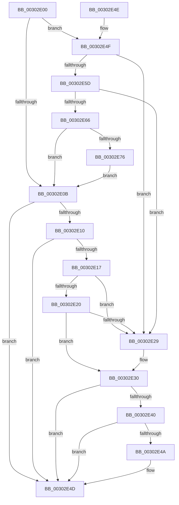

# AuthzBasepRemoveSecurityAttributeValueFromLists

- RVA: `0x00302E00`–`0x00302E7B` (길이 `123` bytes)
- VA: `0x0000000140302E00`
- 실행 섹션: `.text`
- PDB 이름 있음: `예`; PDB Function 태그: `아니요`
- unwind 정보 RVA: `0x000DB714`
- 디코드: `43`개 명령, `123/123` bytes 표시
- 미해석 바이트: `0` (있으면 어셈블리에 `.byte`로 보존)

> 이 문서는 커널 이미지의 기계어와 PDB 기호를 분석해 생성했습니다. 4번과 5번은 함수 원형과 자료형을 바이너리 사용 방식에서 추정한 C 해석이며 원본 소스 복구 결과는 아닙니다.

## 1. Dependencies

- 직접 호출 지점: **0**; 고유 호출 대상: **0**
- 직접 호출자로 확인된 함수: **9**
- RIP 상대 이미지 참조: **0**

### Outgoing calls
- 직접 디코드된 call 명령이 없습니다.

### Direct callers
- [AuthzBasepFreeSecurityAttributesList](AuthzBasepFreeSecurityAttributesList_function_00301230.md) at `0x00301359`
- [sub_00301AC8](Unknown_function_00301AC8.md) at `0x00301B38`
- [sub_00302010](Unknown_function_00302010.md) at `0x00302028`
- [AuthzBasepAddSecurityAttributeValues](AuthzBasepAddSecurityAttributeValues_function_003020EC.md) at `0x0030226A`
- [AuthzBasepDuplicateSecurityAttributes](AuthzBasepDuplicateSecurityAttributes_function_003023C0.md) at `0x00302A88`
- [AuthzBasepFinaliseSecurityAttributesList](../3A/AuthzBasepFinaliseSecurityAttributesList_function_003A8E20.md) at `0x003A90B9`
- [sub_003A96F0](../3A/Unknown_function_003A96F0.md) at `0x003A9707`
- [AuthzBasepDeleteSecurityAttributeValues](../4F/AuthzBasepDeleteSecurityAttributeValues_function_004F9B00.md) at `0x004F9BBE`
- [AuthzBasepRollbackSecurityAttributeChanges](../69/AuthzBasepRollbackSecurityAttributeChanges_function_0069D5C0.md) at `0x0069D625`

### Static image references
- 디코드된 RIP-relative 메모리 참조가 없습니다.

## 2. Other-region calls and transfers

- 다른 실행 섹션으로 향하는 call: **0**
- 별도 외부 분기/꼬리 이동을 확인하지 못했습니다.

## 3. Assembly (complete function range)

```asm
00302E00  8B 42 20                        mov eax, dword ptr [rdx + 0x20]
00302E03  45 0F B6 D0                     movzx r10d, r8b
00302E07  A8 02                           test al, 2
00302E09  75 44                           jne 0x140302e4f
00302E0B  45 84 D2                        test r10b, r10b
00302E0E  74 3D                           je 0x140302e4d
00302E10  8B 42 20                        mov eax, dword ptr [rdx + 0x20]
00302E13  A8 01                           test al, 1
00302E15  74 36                           je 0x140302e4d
00302E17  4C 8B 02                        mov r8, qword ptr [rdx]
00302E1A  49 39 50 08                     cmp qword ptr [r8 + 8], rdx
00302E1E  75 09                           jne 0x140302e29
00302E20  48 8B 42 08                     mov rax, qword ptr [rdx + 8]
00302E24  48 39 10                        cmp qword ptr [rax], rdx
00302E27  74 07                           je 0x140302e30
00302E29  B9 03 00 00 00                  mov ecx, 3
00302E2E  CD 29                           int 0x29
00302E30  4C 89 00                        mov qword ptr [rax], r8
00302E33  49 89 40 08                     mov qword ptr [r8 + 8], rax
00302E37  83 62 20 FE                     and dword ptr [rdx + 0x20], 0xfffffffe
00302E3B  48 85 C9                        test rcx, rcx
00302E3E  74 0D                           je 0x140302e4d
00302E40  FF 49 3C                        dec dword ptr [rcx + 0x3c]
00302E43  8B 42 20                        mov eax, dword ptr [rdx + 0x20]
00302E46  A8 04                           test al, 4
00302E48  74 03                           je 0x140302e4d
00302E4A  FF 49 40                        dec dword ptr [rcx + 0x40]
00302E4D  C3                              ret
00302E4E  CC                              int3
00302E4F  4C 8B 4A 10                     mov r9, qword ptr [rdx + 0x10]
00302E53  48 8D 42 10                     lea rax, [rdx + 0x10]
00302E57  49 39 41 08                     cmp qword ptr [r9 + 8], rax
00302E5B  75 CC                           jne 0x140302e29
00302E5D  4C 8B 40 08                     mov r8, qword ptr [rax + 8]
00302E61  49 39 00                        cmp qword ptr [r8], rax
00302E64  75 C3                           jne 0x140302e29
00302E66  4D 89 08                        mov qword ptr [r8], r9
00302E69  4D 89 41 08                     mov qword ptr [r9 + 8], r8
00302E6D  83 62 20 FD                     and dword ptr [rdx + 0x20], 0xfffffffd
00302E71  48 85 C9                        test rcx, rcx
00302E74  74 95                           je 0x140302e0b
00302E76  FF 49 58                        dec dword ptr [rcx + 0x58]
00302E79  EB 90                           jmp 0x140302e0b
```

## 4. C-style interpretation (structured pseudocode)

```c
__int64 __fastcall AuthzBasepRemoveSecurityAttributeValueFromLists(__int64 a1, __int64 a2, unsigned __int8 a3)
{
    if ((((unsigned __int8)((unsigned int)(*(unsigned int *)(a2 + 32)))) & (2)) != 0) goto loc_00302E4F;
loc_00302E0B:
    if (a3 == 0) goto loc_00302E4D;
    if ((((unsigned __int8)((unsigned int)(*(unsigned int *)(a2 + 32)))) & (1)) == 0) goto loc_00302E4D;
    if ((*(unsigned __int64 *)(*(unsigned __int64 *)(a2) + 8)) != a2) goto loc_00302E29;
    if ((*(unsigned __int64 *)(*(unsigned __int64 *)(a2 + 8))) != a2) {
        a1 = 3;
    }
    *(unsigned __int64 *)(*(unsigned __int64 *)(a2 + 8)) = *(unsigned __int64 *)(a2);
    *(unsigned __int64 *)(*(unsigned __int64 *)(a2) + 8) = *(unsigned __int64 *)(a2 + 8);
    if (a1 == 0) goto loc_00302E4D;
    if ((((unsigned __int8)((unsigned int)(*(unsigned int *)(a2 + 32)))) & (4)) != 0) {
    }
    return (unsigned int)(*(unsigned int *)(a2 + 32));
loc_00302E4F:
    if ((*(unsigned __int64 *)(*(unsigned __int64 *)(a2 + 16) + 8)) != (a2 + 16)) goto loc_00302E29;
    if ((*(unsigned __int64 *)(*(unsigned __int64 *)(a2 + 16 + 8))) != (a2 + 16)) goto loc_00302E29;
    *(unsigned __int64 *)(*(unsigned __int64 *)(a2 + 16 + 8)) = *(unsigned __int64 *)(a2 + 16);
    *(unsigned __int64 *)(*(unsigned __int64 *)(a2 + 16) + 8) = *(unsigned __int64 *)(a2 + 16 + 8);
    if (a1 == 0) goto loc_00302E0B;
    goto loc_00302E0B;
}
```

## 5. (Beta) C Style

```c
int64_t AuthzBasepRemoveSecurityAttributeValueFromLists(int64_t Arg1, void *Arg2, uint8_t Arg3)
{
    uint8_t *arg2 = (uint8_t *)Arg2;

    if ((((uint8_t)((uint32_t)(*(uint32_t *)(arg2 + 0x20)))) & (2)) != 0) goto loc_00302E4F;
loc_00302E0B:
    if (Arg3 == 0) goto loc_00302E4D;
    if ((((uint8_t)((uint32_t)(*(uint32_t *)(arg2 + 0x20)))) & (1)) == 0) goto loc_00302E4D;
    if ((*(uint64_t *)(*(uint64_t *)(arg2) + 0x8)) != Arg2) goto loc_00302E29;
    if ((*(uint64_t *)(*(uint64_t *)(arg2 + 0x8))) != Arg2) {
        Arg1 = 3;
    }
    *(uint64_t *)(*(uint64_t *)(arg2 + 0x8)) = *(uint64_t *)(arg2);
    *(uint64_t *)(*(uint64_t *)(arg2) + 0x8) = *(uint64_t *)(arg2 + 0x8);
    if (Arg1 == 0) goto loc_00302E4D;
    if ((((uint8_t)((uint32_t)(*(uint32_t *)(arg2 + 0x20)))) & (4)) != 0) {
    }
    return (uint32_t)(*(uint32_t *)(arg2 + 0x20));
loc_00302E4F:
    if ((*(uint64_t *)(*(uint64_t *)(arg2 + 0x10) + 0x8)) != (Arg2 + 16)) goto loc_00302E29;
    if ((*(uint64_t *)(*(uint64_t *)(arg2 + 0x10 + 0x8))) != (Arg2 + 16)) goto loc_00302E29;
    *(uint64_t *)(*(uint64_t *)(arg2 + 0x10 + 0x8)) = *(uint64_t *)(arg2 + 0x10);
    *(uint64_t *)(*(uint64_t *)(arg2 + 0x10) + 0x8) = *(uint64_t *)(arg2 + 0x10 + 0x8);
    if (Arg1 == 0) goto loc_00302E0B;
    goto loc_00302E0B;
}
```

### 관측된 메모리 오프셋

구조체 형식이 확인되지 않은 접근은 인자 기준의 오프셋으로만 기록했습니다.

| 기준 인자 | 오프셋 표현 | 폭 (bit) | 접근 |
|---|---:|---:|---|
| `Arg2` | `+ 0x0` | `64` | `R` |
| `Arg2` | `+ 0x8` | `64` | `R` |
| `Arg2` | `+ 0x10` | `64` | `R` |
| `Arg2` | `+ 0x20` | `32` | `R` |
| `Arg2` | `+ 0x20` | `32` | `R/W` |

## 6. Execution-region graph

[열기: 2D/3D 그래프와 함수 탐색 컨트롤 패널](../../../control-panel.html?section=text&rva=0x00302E00&view=graph)

- 2D 그래프는 위에서 아래로 흐르고, 3D 그래프는 빈 공간을 드래그해 회전합니다. Shift+드래그는 이동, 휠은 확대·축소, 함수 노드 선택은 대상 보고서 이동입니다.

### Static fallback


