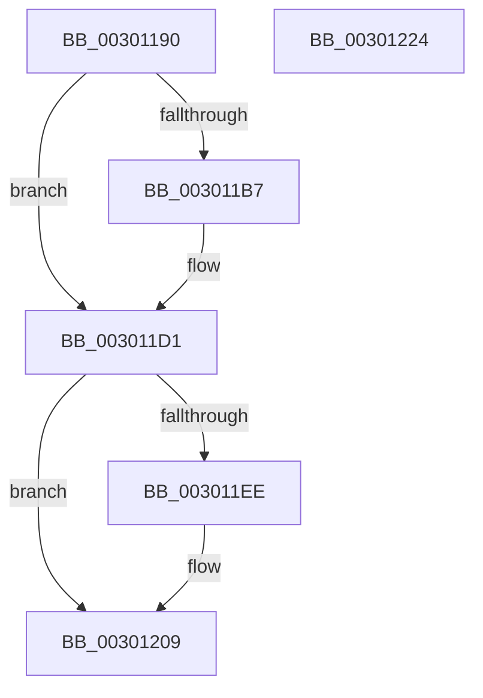

# AuthzBasepResetOperands

- RVA: `0x00301190`–`0x00301225` (길이 `149` bytes)
- VA: `0x0000000140301190`
- 실행 섹션: `.text`
- PDB 이름 있음: `예`; PDB Function 태그: `아니요`
- unwind 정보 RVA: `0x00060BC4`
- 디코드: `43`개 명령, `149/149` bytes 표시
- 미해석 바이트: `0` (있으면 어셈블리에 `.byte`로 보존)

> 이 문서는 커널 이미지의 기계어와 PDB 기호를 분석해 생성했습니다. 4번과 5번은 함수 원형과 자료형을 바이너리 사용 방식에서 추정한 C 해석이며 원본 소스 복구 결과는 아닙니다.

## 1. Dependencies

- 직접 호출 지점: **2**; 고유 호출 대상: **1**
- 직접 호출자로 확인된 함수: **1**
- RIP 상대 이미지 참조: **0**

### Outgoing calls
- `0x003011C1` → [ExFreePoolWithTag](../../poolcode/B8/ExFreePoolWithTag_function_00B82870.md) (function, `0x00B82870`)
- `0x003011F8` → [ExFreePoolWithTag](../../poolcode/B8/ExFreePoolWithTag_function_00B82870.md) (function, `0x00B82870`)

### Direct callers
- [AuthzBasepEvaluateAceCondition](../2F/AuthzBasepEvaluateAceCondition_function_002FEBD0.md) at `0x002FF505`
- [AuthzBasepEvaluateAceCondition](../2F/AuthzBasepEvaluateAceCondition_function_002FEBD0.md) at `0x002FFB7C`

### Static image references
- 디코드된 RIP-relative 메모리 참조가 없습니다.

## 2. Other-region calls and transfers

- 다른 실행 섹션으로 향하는 call: **2**
  - `0x003011C1` → [ExFreePoolWithTag](../../poolcode/B8/ExFreePoolWithTag_function_00B82870.md) (`.text` → `POOLCODE`)
  - `0x003011F8` → [ExFreePoolWithTag](../../poolcode/B8/ExFreePoolWithTag_function_00B82870.md) (`.text` → `POOLCODE`)
- 별도 외부 분기/꼬리 이동을 확인하지 못했습니다.

## 3. Assembly (complete function range)

```asm
00301190  48 89 5C 24 08                  mov qword ptr [rsp + 8], rbx
00301195  48 89 74 24 10                  mov qword ptr [rsp + 0x10], rsi
0030119A  57                              push rdi
0030119B  48 83 EC 20                     sub rsp, 0x20
0030119F  33 F6                           xor esi, esi
003011A1  48 8B FA                        mov rdi, rdx
003011A4  66 89 31                        mov word ptr [rcx], si
003011A7  48 8B D9                        mov rbx, rcx
003011AA  40 88 71 04                     mov byte ptr [rcx + 4], sil
003011AE  48 89 71 08                     mov qword ptr [rcx + 8], rsi
003011B2  40 38 32                        cmp byte ptr [rdx], sil
003011B5  74 1A                           je 0x1403011d1
003011B7  48 8B 49 10                     mov rcx, qword ptr [rcx + 0x10]
003011BB  33 D2                           xor edx, edx
003011BD  48 8B 49 18                     mov rcx, qword ptr [rcx + 0x18]
003011C1  E8 AA 16 88 00                  call 0x140b82870
003011C6  48 8B 43 10                     mov rax, qword ptr [rbx + 0x10]
003011CA  48 89 70 18                     mov qword ptr [rax + 0x18], rsi
003011CE  40 88 37                        mov byte ptr [rdi], sil
003011D1  48 89 73 10                     mov qword ptr [rbx + 0x10], rsi
003011D5  89 73 18                        mov dword ptr [rbx + 0x18], esi
003011D8  48 89 73 20                     mov qword ptr [rbx + 0x20], rsi
003011DC  66 89 73 28                     mov word ptr [rbx + 0x28], si
003011E0  40 88 73 2C                     mov byte ptr [rbx + 0x2c], sil
003011E4  48 89 73 30                     mov qword ptr [rbx + 0x30], rsi
003011E8  40 38 77 01                     cmp byte ptr [rdi + 1], sil
003011EC  74 1B                           je 0x140301209
003011EE  48 8B 4B 38                     mov rcx, qword ptr [rbx + 0x38]
003011F2  33 D2                           xor edx, edx
003011F4  48 8B 49 18                     mov rcx, qword ptr [rcx + 0x18]
003011F8  E8 73 16 88 00                  call 0x140b82870
003011FD  48 8B 43 38                     mov rax, qword ptr [rbx + 0x38]
00301201  48 89 70 18                     mov qword ptr [rax + 0x18], rsi
00301205  40 88 77 01                     mov byte ptr [rdi + 1], sil
00301209  48 89 73 38                     mov qword ptr [rbx + 0x38], rsi
0030120D  89 73 40                        mov dword ptr [rbx + 0x40], esi
00301210  48 89 73 48                     mov qword ptr [rbx + 0x48], rsi
00301214  48 8B 5C 24 30                  mov rbx, qword ptr [rsp + 0x30]
00301219  48 8B 74 24 38                  mov rsi, qword ptr [rsp + 0x38]
0030121E  48 83 C4 20                     add rsp, 0x20
00301222  5F                              pop rdi
00301223  C3                              ret
00301224  CC                              int3
```

## 4. C-style interpretation (structured pseudocode)

```c
__int64 __fastcall AuthzBasepResetOperands(__int64 a1, __int64 a2)
{
    __int64 result;
    __int64 v_rsi;
    __int64 v_rsp;
    unsigned __int64 v_stack_p10;
    unsigned __int64 v_stack_p8;

    v_stack_p8 = v_rbx;
    v_stack_p10 = v_rsi;
    v_rsp = (v_rsp) - (32);
    v_rsi = 0;
    *(unsigned __int16 *)(a1) = 0;
    *(unsigned __int8 *)(a1 + 4) = 0;
    *(unsigned __int64 *)(a1 + 8) = 0;
    if ((*(unsigned __int8 *)(a2)) != 0) {
        a1 = *(unsigned __int64 *)(a1 + 16);
        a2 = 0;
        a1 = *(unsigned __int64 *)(a1 + 24);
        result = ExFreePoolWithTag(a1, a2, a3, a4);
        result = *(unsigned __int64 *)(a1 + 16);
        *(unsigned __int64 *)(result + 24) = 0;
        *(unsigned __int8 *)(a2) = 0;
    }
    *(unsigned __int64 *)(a1 + 16) = 0;
    *(unsigned int *)(a1 + 24) = 0;
    *(unsigned __int64 *)(a1 + 32) = 0;
    *(unsigned __int16 *)(a1 + 40) = 0;
    *(unsigned __int8 *)(a1 + 44) = 0;
    *(unsigned __int64 *)(a1 + 48) = 0;
    if ((*(unsigned __int8 *)(a2 + 1)) != 0) {
        a1 = *(unsigned __int64 *)(a1 + 56);
        a2 = 0;
        a1 = *(unsigned __int64 *)(a1 + 24);
        result = ExFreePoolWithTag(a1, a2, a3, a4);
        result = *(unsigned __int64 *)(a1 + 56);
        *(unsigned __int64 *)(result + 24) = 0;
        *(unsigned __int8 *)(a2 + 1) = 0;
    }
    *(unsigned __int64 *)(a1 + 56) = 0;
    *(unsigned int *)(a1 + 64) = 0;
    *(unsigned __int64 *)(a1 + 72) = 0;
    v_rsp = (v_rsp) + (32);
    return result;
}
```

## 5. (Beta) C Style

```c
int64_t AuthzBasepResetOperands(void *Arg1, void *Arg2)
{
    uint8_t *arg1 = (uint8_t *)Arg1;
    uint8_t *arg2 = (uint8_t *)Arg2;

    int64_t result;
    int64_t local_rsi;
    int64_t local_rsp;
    uint64_t v_stack_p10;
    uint64_t v_stack_p8;

    v_stack_p8 = local_rbx;
    v_stack_p10 = local_rsi;
    local_rsp = (local_rsp) - (32);
    local_rsi = 0;
    *(uint16_t *)(arg1) = 0;
    *(uint8_t *)(arg1 + 0x4) = 0;
    *(uint64_t *)(arg1 + 0x8) = 0;
    if ((*(uint8_t *)(arg2)) != 0) {
        Arg1 = *(uint64_t *)(arg1 + 0x10);
        Arg2 = 0;
        Arg1 = *(uint64_t *)(arg1 + 0x18);
        result = ExFreePoolWithTag(Arg1, Arg2, a3, a4);
        result = *(uint64_t *)(arg1 + 0x10);
        *(uint64_t *)(result + 0x18) = 0;
        *(uint8_t *)(arg2) = 0;
    }
    *(uint64_t *)(arg1 + 0x10) = 0;
    *(uint32_t *)(arg1 + 0x18) = 0;
    *(uint64_t *)(arg1 + 0x20) = 0;
    *(uint16_t *)(arg1 + 0x28) = 0;
    *(uint8_t *)(arg1 + 0x2C) = 0;
    *(uint64_t *)(arg1 + 0x30) = 0;
    if ((*(uint8_t *)(arg2 + 0x1)) != 0) {
        Arg1 = *(uint64_t *)(arg1 + 0x38);
        Arg2 = 0;
        Arg1 = *(uint64_t *)(arg1 + 0x18);
        result = ExFreePoolWithTag(Arg1, Arg2, a3, a4);
        result = *(uint64_t *)(arg1 + 0x38);
        *(uint64_t *)(result + 0x18) = 0;
        *(uint8_t *)(arg2 + 0x1) = 0;
    }
    *(uint64_t *)(arg1 + 0x38) = 0;
    *(uint32_t *)(arg1 + 0x40) = 0;
    *(uint64_t *)(arg1 + 0x48) = 0;
    local_rsp = (local_rsp) + (32);
    return result;
}
```

### 관측된 메모리 오프셋

구조체 형식이 확인되지 않은 접근은 인자 기준의 오프셋으로만 기록했습니다.

| 기준 인자 | 오프셋 표현 | 폭 (bit) | 접근 |
|---|---:|---:|---|
| `Arg1` | `+ 0x0` | `16` | `W` |
| `Arg1` | `+ 0x4` | `8` | `W` |
| `Arg1` | `+ 0x8` | `64` | `W` |
| `Arg1` | `+ 0x10` | `64` | `R` |
| `Arg1` | `+ 0x10` | `64` | `W` |
| `Arg1` | `+ 0x18` | `32` | `W` |
| `Arg1` | `+ 0x20` | `64` | `W` |
| `Arg1` | `+ 0x28` | `16` | `W` |
| `Arg1` | `+ 0x2C` | `8` | `W` |
| `Arg1` | `+ 0x30` | `64` | `W` |
| `Arg1` | `+ 0x38` | `64` | `R` |
| `Arg1` | `+ 0x38` | `64` | `W` |
| `Arg1` | `+ 0x40` | `32` | `W` |
| `Arg1` | `+ 0x48` | `64` | `W` |
| `Arg2` | `+ 0x0` | `8` | `R` |
| `Arg2` | `+ 0x0` | `8` | `W` |
| `Arg2` | `+ 0x1` | `8` | `R` |
| `Arg2` | `+ 0x1` | `8` | `W` |

## 6. Execution-region graph

[열기: 2D/3D 그래프와 함수 탐색 컨트롤 패널](../../../control-panel.html?section=text&rva=0x00301190&view=graph)

- 2D 그래프는 위에서 아래로 흐르고, 3D 그래프는 빈 공간을 드래그해 회전합니다. Shift+드래그는 이동, 휠은 확대·축소, 함수 노드 선택은 대상 보고서 이동입니다.

### Static fallback


