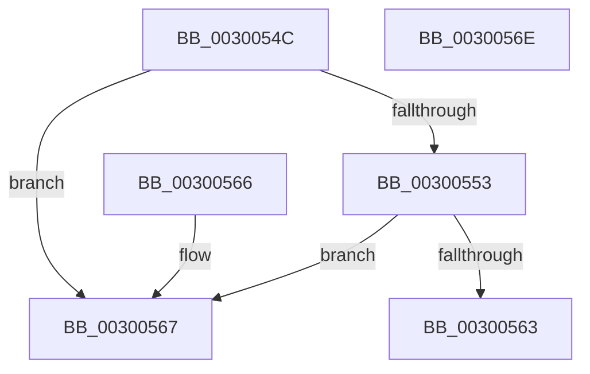

# AuthzBasepSupportSetOperation

- RVA: `0x0030054C`–`0x0030056F` (길이 `35` bytes)
- VA: `0x000000014030054C`
- 실행 섹션: `.text`
- PDB 이름 있음: `예`; PDB Function 태그: `아니요`
- unwind 정보 RVA: `0x000DB714`
- 디코드: `13`개 명령, `35/35` bytes 표시
- 미해석 바이트: `0` (있으면 어셈블리에 `.byte`로 보존)

> 이 문서는 커널 이미지의 기계어와 PDB 기호를 분석해 생성했습니다. 4번과 5번은 함수 원형과 자료형을 바이너리 사용 방식에서 추정한 C 해석이며 원본 소스 복구 결과는 아닙니다.

## 1. Dependencies

- 직접 호출 지점: **0**; 고유 호출 대상: **0**
- 직접 호출자로 확인된 함수: **2**
- RIP 상대 이미지 참조: **0**

### Outgoing calls
- 직접 디코드된 call 명령이 없습니다.

### Direct callers
- [AuthzBasepEvaluateAceCondition](../2F/AuthzBasepEvaluateAceCondition_function_002FEBD0.md) at `0x002FF099`
- [AuthzBasepEvaluateAceCondition](../2F/AuthzBasepEvaluateAceCondition_function_002FEBD0.md) at `0x002FF0AF`
- [AuthzBasepEvaluateAceCondition](../2F/AuthzBasepEvaluateAceCondition_function_002FEBD0.md) at `0x002FF232`
- [AuthzBasepEvaluateAceCondition](../2F/AuthzBasepEvaluateAceCondition_function_002FEBD0.md) at `0x002FF28D`
- [AuthzBasepIsValidExpression](AuthzBasepIsValidExpression_function_00300390.md) at `0x003003D1`
- [AuthzBasepIsValidExpression](AuthzBasepIsValidExpression_function_00300390.md) at `0x003003E7`

### Static image references
- 디코드된 RIP-relative 메모리 참조가 없습니다.

## 2. Other-region calls and transfers

- 다른 실행 섹션으로 향하는 call: **0**
- 별도 외부 분기/꼬리 이동을 확인하지 못했습니다.

## 3. Assembly (complete function range)

```asm
0030054C  8D 41 80                        lea eax, [rcx - 0x80]
0030054F  3C 22                           cmp al, 0x22
00300551  77 14                           ja 0x140300567
00300553  48 BA C3 DF 0F 00 07 00 00 00   movabs rdx, 0x7000fdfc3
0030055D  48 0F A3 C2                     bt rdx, rax
00300561  73 04                           jae 0x140300567
00300563  B0 01                           mov al, 1
00300565  C3                              ret
00300566  CC                              int3
00300567  80 F9 8D                        cmp cl, 0x8d
0030056A  0F 94 C0                        sete al
0030056D  C3                              ret
0030056E  CC                              int3
```

## 4. C-style interpretation (structured pseudocode)

```c
__int64 __fastcall AuthzBasepSupportSetOperation(__int64 a1)
{
    __int64 result;

    if (((unsigned __int8)(a1 - 128)) > 34) goto loc_00300567;
    if (((unsigned __int8)(a1 - 128)) >= 34) goto loc_00300567;
    return 1;
loc_00300567:
    result = (((unsigned __int8)(a1)) == 141) ? 1 : 0;
    return result;
}
```

## 5. (Beta) C Style

```c
int64_t AuthzBasepSupportSetOperation(void *Arg1)
{
    uint8_t *arg1 = (uint8_t *)Arg1;

    int64_t result;

    if (((uint8_t)(Arg1 - 128)) > 34) goto loc_00300567;
    if (((uint8_t)(Arg1 - 128)) >= 34) goto loc_00300567;
    return 1;
loc_00300567:
    result = (((uint8_t)(Arg1)) == 141) ? 1 : 0;
    return result;
}
```

### 관측된 메모리 오프셋

구조체 형식이 확인되지 않은 접근은 인자 기준의 오프셋으로만 기록했습니다.

| 기준 인자 | 오프셋 표현 | 폭 (bit) | 접근 |
|---|---:|---:|---|
| `Arg1` | `- 0x80` | `32` | `R` |

## 6. Execution-region graph

[열기: 2D/3D 그래프와 함수 탐색 컨트롤 패널](../../../control-panel.html?section=text&rva=0x0030054C&view=graph)

- 2D 그래프는 위에서 아래로 흐르고, 3D 그래프는 빈 공간을 드래그해 회전합니다. Shift+드래그는 이동, 휠은 확대·축소, 함수 노드 선택은 대상 보고서 이동입니다.

### Static fallback


