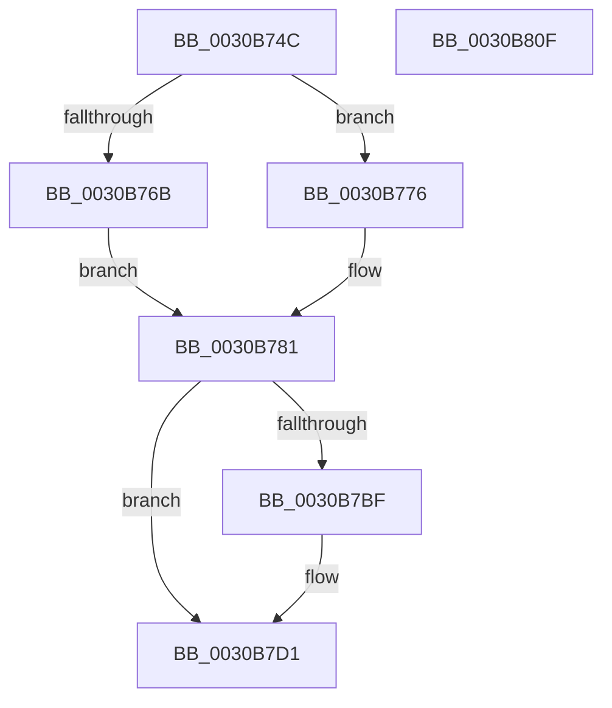

# EtwTraceScheduleThread

- RVA: `0x0030B74C`–`0x0030B810` (길이 `196` bytes)
- VA: `0x000000014030B74C`
- 실행 섹션: `.text`
- PDB 이름 있음: `예`; PDB Function 태그: `아니요`
- unwind 정보 RVA: `0x00073CB8`
- 디코드: `49`개 명령, `196/196` bytes 표시
- 미해석 바이트: `0` (있으면 어셈블리에 `.byte`로 보존)

> 이 문서는 커널 이미지의 기계어와 PDB 기호를 분석해 생성했습니다. 4번과 5번은 함수 원형과 자료형을 바이너리 사용 방식에서 추정한 C 해석이며 원본 소스 복구 결과는 아닙니다.

## 1. Dependencies

- 직접 호출 지점: **2**; 고유 호출 대상: **2**
- 직접 호출자로 확인된 함수: **11**
- RIP 상대 이미지 참조: **1**

### Outgoing calls
- `0x0030B7F8` → [EtwTraceSiloKernelEvent](../22/EtwTraceSiloKernelEvent_function_002242A0.md) (function, `0x002242A0`)
- `0x0030B804` → [_security_check_cookie](../6A/_security_check_cookie_function_006AC640.md) (function, `0x006AC640`)

### Direct callers
- [KiDeferGroupSchedulingPreemption](../20/KiDeferGroupSchedulingPreemption_function_0020076C.md) at `0x00200DCB`
- [sub_0021D7F8](../21/Unknown_function_0021D7F8.md) at `0x0021E82C`
- [sub_0025308F](../25/Unknown_function_0025308F.md) at `0x00253FFA`
- [KiAttemptToScheduleThreadToBusyIsolationUnit](../25/KiAttemptToScheduleThreadToBusyIsolationUnit_function_00259B00.md) at `0x0025A142`
- [KiExecuteAllDpcs](../25/KiExecuteAllDpcs_function_0025B740.md) at `0x0025C3B9`
- [KiGroupSchedulingGenerationEnd](KiGroupSchedulingGenerationEnd_function_0030A9B4.md) at `0x0030AEC0`
- [KiSoftParkElectionUnparkProcessor](KiSoftParkElectionUnparkProcessor_function_0030B818.md) at `0x0030BBFF`
- [KiRescheduleThreadAfterAffinityChange](KiRescheduleThreadAfterAffinityChange_function_0030C9E8.md) at `0x0030CE5B`
- [KiSearchForNewThreadsOnTarget](KiSearchForNewThreadsOnTarget_function_0030F500.md) at `0x003107F6`
- [KiSearchForNewThreadsOnTarget](KiSearchForNewThreadsOnTarget_function_0030F500.md) at `0x0031080A`
- [KiSearchForNewThreadsOnTarget](KiSearchForNewThreadsOnTarget_function_0030F500.md) at `0x00311089`
- [sub_003564B9](../35/Unknown_function_003564B9.md) at `0x003564C8`
- [KiSetSystemAffinityThread](../39/KiSetSystemAffinityThread_function_003993E0.md) at `0x003999E1`

### Static image references
- `0x0030B755` → RVA `0x00E0A740` (`.data`; read)

## 2. Other-region calls and transfers

- 다른 실행 섹션으로 향하는 call: **0**
- 별도 외부 분기/꼬리 이동을 확인하지 못했습니다.

## 3. Assembly (complete function range)

```asm
0030B74C  40 55                           push rbp
0030B74E  48 8B EC                        mov rbp, rsp
0030B751  48 83 EC 70                     sub rsp, 0x70
0030B755  48 8B 05 E4 EF AF 00            mov rax, qword ptr [rip + 0xafefe4]
0030B75C  48 33 C4                        xor rax, rsp
0030B75F  48 89 45 F0                     mov qword ptr [rbp - 0x10], rax
0030B763  45 33 DB                        xor r11d, r11d
0030B766  4D 85 C0                        test r8, r8
0030B769  75 0B                           jne 0x14030b776
0030B76B  45 8B D3                        mov r10d, r11d
0030B76E  45 8B CB                        mov r9d, r11d
0030B771  45 8A C3                        mov r8b, r11b
0030B774  EB 0B                           jmp 0x14030b781
0030B776  4D 8B 10                        mov r10, qword ptr [r8]
0030B779  45 8B 48 08                     mov r9d, dword ptr [r8 + 8]
0030B77D  45 8A 40 0C                     mov r8b, byte ptr [r8 + 0xc]
0030B781  8B 81 10 05 00 00               mov eax, dword ptr [rcx + 0x510]
0030B787  45 85 C9                        test r9d, r9d
0030B78A  89 45 C0                        mov dword ptr [rbp - 0x40], eax
0030B78D  8B 42 24                        mov eax, dword ptr [rdx + 0x24]
0030B790  89 45 C4                        mov dword ptr [rbp - 0x3c], eax
0030B793  41 0F B6 C3                     movzx eax, r11b
0030B797  44 88 45 C8                     mov byte ptr [rbp - 0x38], r8b
0030B79B  41 B8 01 00 00 00               mov r8d, 1
0030B7A1  41 0F 45 C0                     cmovne eax, r8d
0030B7A5  66 44 89 5D CA                  mov word ptr [rbp - 0x36], r11w
0030B7AA  88 45 C9                        mov byte ptr [rbp - 0x37], al
0030B7AD  48 8D 45 C0                     lea rax, [rbp - 0x40]
0030B7B1  48 89 45 D0                     mov qword ptr [rbp - 0x30], rax
0030B7B5  48 C7 45 D8 0C 00 00 00         mov qword ptr [rbp - 0x28], 0xc
0030B7BD  74 12                           je 0x14030b7d1
0030B7BF  4C 89 55 E0                     mov qword ptr [rbp - 0x20], r10
0030B7C3  41 B8 02 00 00 00               mov r8d, 2
0030B7C9  44 89 4D E8                     mov dword ptr [rbp - 0x18], r9d
0030B7CD  44 89 5D EC                     mov dword ptr [rbp - 0x14], r11d
0030B7D1  48 8B 89 20 02 00 00            mov rcx, qword ptr [rcx + 0x220]
0030B7D8  48 8D 55 D0                     lea rdx, [rbp - 0x30]
0030B7DC  C7 44 24 28 02 0E 60 00         mov dword ptr [rsp + 0x28], 0x600e02
0030B7E4  41 B9 00 04 00 A0               mov r9d, 0xa0000400
0030B7EA  66 C7 44 24 20 4B 05            mov word ptr [rsp + 0x20], 0x54b
0030B7F1  48 8B 89 F0 05 00 00            mov rcx, qword ptr [rcx + 0x5f0]
0030B7F8  E8 A3 8A F1 FF                  call 0x1402242a0
0030B7FD  48 8B 4D F0                     mov rcx, qword ptr [rbp - 0x10]
0030B801  48 33 CC                        xor rcx, rsp
0030B804  E8 37 0E 3A 00                  call 0x1406ac640
0030B809  48 83 C4 70                     add rsp, 0x70
0030B80D  5D                              pop rbp
0030B80E  C3                              ret
0030B80F  CC                              int3
```

## 4. C-style interpretation (structured pseudocode)

```c
__int64 __fastcall EtwTraceScheduleThread(__int64 a1, __int64 a2, __int64 a3)
{
    __int64 result;
    __int64 v_r11;
    __int64 v_rsp;
    unsigned __int64 v_stack_m18;
    unsigned int v_stack_m1C;
    unsigned int v_stack_m20;
    unsigned __int64 v_stack_m28;
    unsigned __int64 v_stack_m30;
    unsigned __int64 v_stack_m38;
    unsigned __int16 v_stack_m3E;
    unsigned __int8 v_stack_m3F;
    unsigned __int8 v_stack_m40;
    unsigned int v_stack_m44;
    unsigned int v_stack_m48;
    unsigned int v_stack_m50;
    unsigned __int16 v_stack_m58;

    v_rsp = (v_rsp) - (112);
    result = (*(unsigned __int64 *)(v_rip + 11530212)) ^ (v_rsp);
    v_stack_m18 = result;
    v_r11 = 0;
    if (a3 != 0) goto loc_0030B776;
    goto loc_0030B781;
loc_0030B776:
loc_0030B781:
    v_stack_m48 = (unsigned int)((unsigned int)(*(unsigned int *)(a1 + 1296)));
    v_stack_m44 = (unsigned int)((unsigned int)(*(unsigned int *)(a2 + 36)));
    v_stack_m40 = (unsigned __int8)(*(unsigned __int8 *)(0 + 12));
    result = 0;
    if ((unsigned int)((unsigned int)(*(unsigned int *)(0 + 8))) != 0) { result = 1; }
    v_stack_m3E = 0;
    v_stack_m3F = (unsigned __int8)(result);
    v_stack_m38 = v_stack_m48;
    v_stack_m30 = 12;
    if ((unsigned int)((unsigned int)(*(unsigned int *)(0 + 8))) != 0) {
        v_stack_m28 = *(unsigned __int64 *)(0);
        a3 = 2;
        v_stack_m20 = (unsigned int)((unsigned int)(*(unsigned int *)(0 + 8)));
        v_stack_m1C = 0;
    }
    v_stack_m50 = 0x600E02ULL;
    v_stack_m58 = 0x54BULL;
    result = EtwTraceSiloKernelEvent(*(unsigned __int64 *)(*(unsigned __int64 *)(a1 + 544) + 1520), v_stack_m38, a3, (unsigned int)(0xA0000400ULL));
    a1 = (v_stack_m18) ^ (v_rsp);
    result = _security_check_cookie(a1, v_stack_m38, a3, (unsigned int)(0xA0000400ULL));
    v_rsp = (v_rsp) + (112);
    return result;
}
```

## 5. (Beta) C Style

```c
int64_t EtwTraceScheduleThread(void *Arg1, void *Arg2, int64_t Arg3)
{
    uint8_t *arg1 = (uint8_t *)Arg1;
    uint8_t *arg2 = (uint8_t *)Arg2;

    int64_t result;
    int64_t local_r11;
    int64_t local_rsp;
    uint64_t v_stack_m18;
    uint32_t v_stack_m1C;
    uint32_t v_stack_m20;
    uint64_t v_stack_m28;
    uint64_t v_stack_m30;
    uint64_t v_stack_m38;
    uint16_t v_stack_m3E;
    uint8_t v_stack_m3F;
    uint8_t v_stack_m40;
    uint32_t v_stack_m44;
    uint32_t v_stack_m48;
    uint32_t v_stack_m50;
    uint16_t v_stack_m58;

    local_rsp = (local_rsp) - (112);
    result = (*(uint64_t *)(v_rip + 0xAFEFE4)) ^ (local_rsp);
    v_stack_m18 = result;
    local_r11 = 0;
    if (Arg3 != 0) goto loc_0030B776;
    goto loc_0030B781;
loc_0030B776:
loc_0030B781:
    v_stack_m48 = (uint32_t)((uint32_t)(*(uint32_t *)(arg1 + 0x510)));
    v_stack_m44 = (uint32_t)((uint32_t)(*(uint32_t *)(arg2 + 0x24)));
    v_stack_m40 = (uint8_t)(*(uint8_t *)(0 + 0xC));
    result = 0;
    if ((uint32_t)((uint32_t)(*(uint32_t *)(0 + 0x8))) != 0) { result = 1; }
    v_stack_m3E = 0;
    v_stack_m3F = (uint8_t)(result);
    v_stack_m38 = v_stack_m48;
    v_stack_m30 = 12;
    if ((uint32_t)((uint32_t)(*(uint32_t *)(0 + 0x8))) != 0) {
        v_stack_m28 = *(uint64_t *)(0);
        Arg3 = 2;
        v_stack_m20 = (uint32_t)((uint32_t)(*(uint32_t *)(0 + 0x8)));
        v_stack_m1C = 0;
    }
    v_stack_m50 = 0x600E02ULL;
    v_stack_m58 = 0x54BULL;
    result = EtwTraceSiloKernelEvent(*(uint64_t *)(*(uint64_t *)(arg1 + 0x220) + 0x5F0), v_stack_m38, Arg3, (uint32_t)(0xA0000400ULL));
    Arg1 = (v_stack_m18) ^ (local_rsp);
    result = _security_check_cookie(Arg1, v_stack_m38, Arg3, (uint32_t)(0xA0000400ULL));
    local_rsp = (local_rsp) + (112);
    return result;
}
```

### 관측된 메모리 오프셋

구조체 형식이 확인되지 않은 접근은 인자 기준의 오프셋으로만 기록했습니다.

| 기준 인자 | 오프셋 표현 | 폭 (bit) | 접근 |
|---|---:|---:|---|
| `Arg1` | `+ 0x220` | `64` | `R` |
| `Arg1` | `+ 0x510` | `32` | `R` |
| `Arg2` | `+ 0x24` | `32` | `R` |

## 6. Execution-region graph

[열기: 2D/3D 그래프와 함수 탐색 컨트롤 패널](../../../control-panel.html?section=text&rva=0x0030B74C&view=graph)

- 2D 그래프는 위에서 아래로 흐르고, 3D 그래프는 빈 공간을 드래그해 회전합니다. Shift+드래그는 이동, 휠은 확대·축소, 함수 노드 선택은 대상 보고서 이동입니다.

### Static fallback


