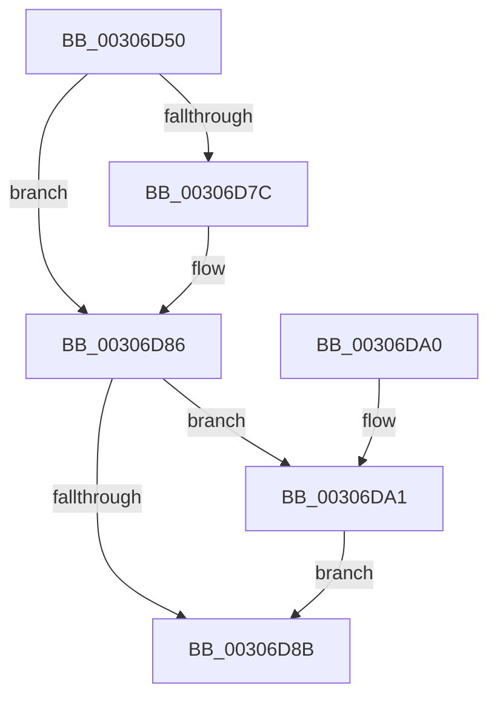

# HalPutScatterGatherListDmarThin

- RVA: `0x00306D50`–`0x00306DAB` (길이 `91` bytes)
- VA: `0x0000000140306D50`
- 실행 섹션: `.text`
- PDB 이름 있음: `예`; PDB Function 태그: `아니요`
- unwind 정보 RVA: `0x00073808`
- 디코드: `27`개 명령, `91/91` bytes 표시
- 미해석 바이트: `0` (있으면 어셈블리에 `.byte`로 보존)

> 이 문서는 커널 이미지의 기계어와 PDB 기호를 분석해 생성했습니다. 4번과 5번은 함수 원형과 자료형을 바이너리 사용 방식에서 추정한 C 해석이며 원본 소스 복구 결과는 아닙니다.

## 1. Dependencies

- 직접 호출 지점: **3**; 고유 호출 대상: **3**
- 직접 호출자로 확인된 함수: **0**
- RIP 상대 이미지 참조: **0**

### Outgoing calls
- `0x00306D6E` → [HalpPutScatterGatherListDmarThin](HalpPutScatterGatherListDmarThin_function_00306DB4.md) (function, `0x00306DB4`)
- `0x00306D81` → [ExFreePoolWithTag](../../poolcode/B8/ExFreePoolWithTag_function_00B82870.md) (function, `0x00B82870`)
- `0x00306DA4` → [HalpDmaReturnEmergencyLogicalAddressResources](../53/HalpDmaReturnEmergencyLogicalAddressResources_function_0053E4E8.md) (function, `0x0053E4E8`)

### Direct callers
- 이 함수 시작 RVA로 연결되는 직접 call은 확인되지 않았습니다. 간접 호출은 완전히 역산할 수 없습니다.

### Static image references
- 디코드된 RIP-relative 메모리 참조가 없습니다.

## 2. Other-region calls and transfers

- 다른 실행 섹션으로 향하는 call: **1**
  - `0x00306D81` → [ExFreePoolWithTag](../../poolcode/B8/ExFreePoolWithTag_function_00B82870.md) (`.text` → `POOLCODE`)
- 별도 외부 분기/꼬리 이동을 확인하지 못했습니다.

## 3. Assembly (complete function range)

```asm
00306D50  48 89 5C 24 08                  mov qword ptr [rsp + 8], rbx
00306D55  48 89 6C 24 10                  mov qword ptr [rsp + 0x10], rbp
00306D5A  48 89 74 24 18                  mov qword ptr [rsp + 0x18], rsi
00306D5F  57                              push rdi
00306D60  48 83 EC 20                     sub rsp, 0x20
00306D64  48 8B 5A 08                     mov rbx, qword ptr [rdx + 8]
00306D68  48 8B FA                        mov rdi, rdx
00306D6B  48 8B F1                        mov rsi, rcx
00306D6E  E8 41 00 00 00                  call 0x140306db4
00306D73  80 7B 61 00                     cmp byte ptr [rbx + 0x61], 0
00306D77  40 8A E8                        mov bpl, al
00306D7A  74 0A                           je 0x140306d86
00306D7C  33 D2                           xor edx, edx
00306D7E  48 8B CF                        mov rcx, rdi
00306D81  E8 EA BA 87 00                  call 0x140b82870
00306D86  40 84 ED                        test bpl, bpl
00306D89  75 16                           jne 0x140306da1
00306D8B  48 8B 5C 24 30                  mov rbx, qword ptr [rsp + 0x30]
00306D90  48 8B 6C 24 38                  mov rbp, qword ptr [rsp + 0x38]
00306D95  48 8B 74 24 40                  mov rsi, qword ptr [rsp + 0x40]
00306D9A  48 83 C4 20                     add rsp, 0x20
00306D9E  5F                              pop rdi
00306D9F  C3                              ret
00306DA0  CC                              int3
00306DA1  48 8B CE                        mov rcx, rsi
00306DA4  E8 3F 77 23 00                  call 0x14053e4e8
00306DA9  EB E0                           jmp 0x140306d8b
```

## 4. C-style interpretation (structured pseudocode)

```c
__int64 __fastcall HalPutScatterGatherListDmarThin(__int64 a1, __int64 a2)
{
    __int64 result;
    __int64 v_rsp;
    unsigned __int64 v_stack_p10;
    unsigned __int64 v_stack_p18;
    unsigned __int64 v_stack_p8;

    v_stack_p8 = v_rbx;
    v_stack_p10 = v_rbp;
    v_stack_p18 = v_rsi;
    v_rsp = (v_rsp) - (32);
    result = HalpPutScatterGatherListDmarThin(a1, a2, a3, a4);
    if ((*(unsigned __int8 *)(*(unsigned __int64 *)(a2 + 8) + 97)) != 0) {
        a2 = 0;
        a1 = 0;
        result = ExFreePoolWithTag(a1, a2, a3, a4);
    }
    if ((unsigned __int8)((unsigned __int8)(result)) != 0) goto loc_00306DA1;
loc_00306D8B:
    v_rsp = (v_rsp) + (32);
    return result;
loc_00306DA1:
    result = HalpDmaReturnEmergencyLogicalAddressResources(v_stack_p18, a2, a3, a4);
    goto loc_00306D8B;
}
```

## 5. (Beta) C Style

```c
int64_t HalPutScatterGatherListDmarThin(int64_t Arg1, void *Arg2)
{
    uint8_t *arg2 = (uint8_t *)Arg2;

    int64_t result;
    int64_t local_rsp;
    uint64_t v_stack_p10;
    uint64_t v_stack_p18;
    uint64_t v_stack_p8;

    v_stack_p8 = local_rbx;
    v_stack_p10 = local_rbp;
    v_stack_p18 = local_rsi;
    local_rsp = (local_rsp) - (32);
    result = HalpPutScatterGatherListDmarThin(Arg1, Arg2, a3, a4);
    if ((*(uint8_t *)(*(uint64_t *)(arg2 + 0x8) + 0x61)) != 0) {
        Arg2 = 0;
        Arg1 = 0;
        result = ExFreePoolWithTag(Arg1, Arg2, a3, a4);
    }
    if ((uint8_t)((uint8_t)(result)) != 0) goto loc_00306DA1;
loc_00306D8B:
    local_rsp = (local_rsp) + (32);
    return result;
loc_00306DA1:
    result = HalpDmaReturnEmergencyLogicalAddressResources(v_stack_p18, Arg2, a3, a4);
    goto loc_00306D8B;
}
```

### 관측된 메모리 오프셋

구조체 형식이 확인되지 않은 접근은 인자 기준의 오프셋으로만 기록했습니다.

| 기준 인자 | 오프셋 표현 | 폭 (bit) | 접근 |
|---|---:|---:|---|
| `Arg2` | `+ 0x8` | `64` | `R` |

## 6. Execution-region graph

[열기: 2D/3D 그래프와 함수 탐색 컨트롤 패널](../../../control-panel.html?section=text&rva=0x00306D50&view=graph)

- 2D 그래프는 위에서 아래로 흐르고, 3D 그래프는 빈 공간을 드래그해 회전합니다. Shift+드래그는 이동, 휠은 확대·축소, 함수 노드 선택은 대상 보고서 이동입니다.

### Static fallback


