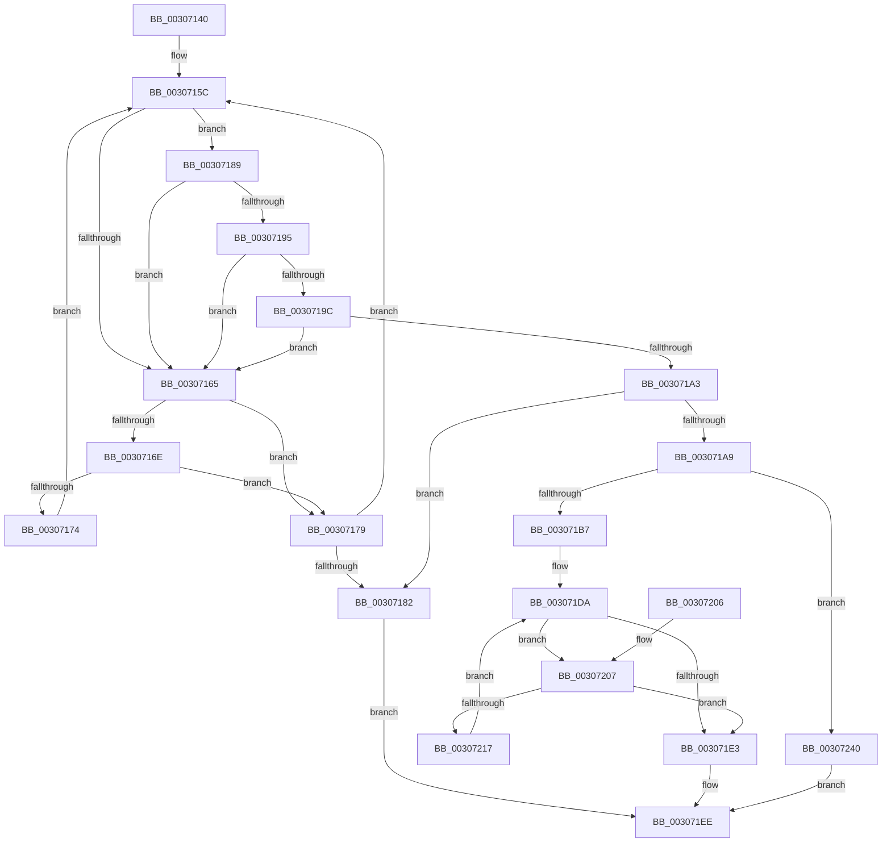

# HalpBuddyAllocatorFreeLogicalAddress

- RVA: `0x00307140`–`0x00307252` (길이 `274` bytes)
- VA: `0x0000000140307140`
- 실행 섹션: `.text`
- PDB 이름 있음: `예`; PDB Function 태그: `아니요`
- unwind 정보 RVA: `0x00073870`
- 디코드: `80`개 명령, `274/274` bytes 표시
- 미해석 바이트: `0` (있으면 어셈블리에 `.byte`로 보존)

> 이 문서는 커널 이미지의 기계어와 PDB 기호를 분석해 생성했습니다. 4번과 5번은 함수 원형과 자료형을 바이너리 사용 방식에서 추정한 C 해석이며 원본 소스 복구 결과는 아닙니다.

## 1. Dependencies

- 직접 호출 지점: **4**; 고유 호출 대상: **3**
- 직접 호출자로 확인된 함수: **2**
- RIP 상대 이미지 참조: **0**

### Outgoing calls
- `0x003071E9` → [HalpBuddyAllocatorBltAdd](../47/HalpBuddyAllocatorBltAdd_function_0047A968.md) (function, `0x0047A968`)
- `0x0030720D` → [HalpBuddyAllocatorBltPopBuddy](../46/HalpBuddyAllocatorBltPopBuddy_function_0046754C.md) (function, `0x0046754C`)
- `0x0030721E` → [HalpMmAllocCtxFree](../3E/HalpMmAllocCtxFree_function_003E1904.md) (function, `0x003E1904`)
- `0x00307227` → [HalpMmAllocCtxFree](../3E/HalpMmAllocCtxFree_function_003E1904.md) (function, `0x003E1904`)

### Direct callers
- [IommuUnmapIdentityRangeEx](IommuUnmapIdentityRangeEx_function_00306F80.md) at `0x00307028`
- [HalpIommuDomainFreeLogicalAddressRange](HalpIommuDomainFreeLogicalAddressRange_function_003070EC.md) at `0x00307122`

### Static image references
- 디코드된 RIP-relative 메모리 참조가 없습니다.

## 2. Other-region calls and transfers

- 다른 실행 섹션으로 향하는 call: **0**
- 별도 외부 분기/꼬리 이동을 확인하지 못했습니다.

## 3. Assembly (complete function range)

```asm
00307140  48 89 5C 24 08                  mov qword ptr [rsp + 8], rbx
00307145  48 89 74 24 10                  mov qword ptr [rsp + 0x10], rsi
0030714A  48 89 7C 24 18                  mov qword ptr [rsp + 0x18], rdi
0030714F  41 56                           push r14
00307151  48 83 EC 20                     sub rsp, 0x20
00307155  48 8B 59 58                     mov rbx, qword ptr [rcx + 0x58]
00307159  48 8B F1                        mov rsi, rcx
0030715C  48 8B 4B 30                     mov rcx, qword ptr [rbx + 0x30]
00307160  48 3B D1                        cmp rdx, rcx
00307163  73 24                           jae 0x140307189
00307165  48 8B 43 20                     mov rax, qword ptr [rbx + 0x20]
00307169  48 85 C0                        test rax, rax
0030716C  74 0B                           je 0x140307179
0030716E  48 3B 50 30                     cmp rdx, qword ptr [rax + 0x30]
00307172  72 05                           jb 0x140307179
00307174  48 8B D8                        mov rbx, rax
00307177  EB E3                           jmp 0x14030715c
00307179  48 8B 5B 18                     mov rbx, qword ptr [rbx + 0x18]
0030717D  48 85 DB                        test rbx, rbx
00307180  75 DA                           jne 0x14030715c
00307182  BF 0D 00 00 C0                  mov edi, 0xc000000d
00307187  EB 65                           jmp 0x1403071ee
00307189  4C 8B 43 38                     mov r8, qword ptr [rbx + 0x38]
0030718D  4C 03 C1                        add r8, rcx
00307190  49 3B D0                        cmp rdx, r8
00307193  73 D0                           jae 0x140307165
00307195  48 83 7B 18 00                  cmp qword ptr [rbx + 0x18], 0
0030719A  75 C9                           jne 0x140307165
0030719C  48 83 7B 20 00                  cmp qword ptr [rbx + 0x20], 0
003071A1  75 C2                           jne 0x140307165
003071A3  80 7B 48 00                     cmp byte ptr [rbx + 0x48], 0
003071A7  74 D9                           je 0x140307182
003071A9  48 8D 46 50                     lea rax, [rsi + 0x50]
003071AD  48 39 43 28                     cmp qword ptr [rbx + 0x28], rax
003071B1  0F 84 89 00 00 00               je 0x140307240
003071B7  48 8B 43 40                     mov rax, qword ptr [rbx + 0x40]
003071BB  48 F7 D8                        neg rax
003071BE  F0 48 01 46 38                  lock add qword ptr [rsi + 0x38], rax
003071C3  48 8B 43 38                     mov rax, qword ptr [rbx + 0x38]
003071C7  48 F7 D8                        neg rax
003071CA  F0 48 01 46 40                  lock add qword ptr [rsi + 0x40], rax
003071CF  48 83 63 40 00                  and qword ptr [rbx + 0x40], 0
003071D4  33 FF                           xor edi, edi
003071D6  C6 43 48 00                     mov byte ptr [rbx + 0x48], 0
003071DA  4C 8D 73 10                     lea r14, [rbx + 0x10]
003071DE  49 39 3E                        cmp qword ptr [r14], rdi
003071E1  75 24                           jne 0x140307207
003071E3  48 8B D6                        mov rdx, rsi
003071E6  48 8B CB                        mov rcx, rbx
003071E9  E8 7A 37 17 00                  call 0x14047a968
003071EE  48 8B 5C 24 30                  mov rbx, qword ptr [rsp + 0x30]
003071F3  8B C7                           mov eax, edi
003071F5  48 8B 7C 24 40                  mov rdi, qword ptr [rsp + 0x40]
003071FA  48 8B 74 24 38                  mov rsi, qword ptr [rsp + 0x38]
003071FF  48 83 C4 20                     add rsp, 0x20
00307203  41 5E                           pop r14
00307205  C3                              ret
00307206  CC                              int3
00307207  48 8B D6                        mov rdx, rsi
0030720A  48 8B CB                        mov rcx, rbx
0030720D  E8 3A 03 16 00                  call 0x14046754c
00307212  48 85 C0                        test rax, rax
00307215  74 CC                           je 0x1403071e3
00307217  49 8B 1E                        mov rbx, qword ptr [r14]
0030721A  48 8B 53 18                     mov rdx, qword ptr [rbx + 0x18]
0030721E  E8 E1 A6 0D 00                  call 0x1403e1904
00307223  48 8B 53 20                     mov rdx, qword ptr [rbx + 0x20]
00307227  E8 D8 A6 0D 00                  call 0x1403e1904
0030722C  48 21 7B 18                     and qword ptr [rbx + 0x18], rdi
00307230  48 21 7B 20                     and qword ptr [rbx + 0x20], rdi
00307234  40 88 7B 48                     mov byte ptr [rbx + 0x48], dil
00307238  F0 48 83 46 30 FE               lock add qword ptr [rsi + 0x30], -2
0030723E  EB 9A                           jmp 0x1403071da
00307240  8A 43 49                        mov al, byte ptr [rbx + 0x49]
00307243  BF 0D 00 00 C0                  mov edi, 0xc000000d
00307248  F6 D8                           neg al
0030724A  1B C9                           sbb ecx, ecx
0030724C  F7 D1                           not ecx
0030724E  23 F9                           and edi, ecx
00307250  EB 9C                           jmp 0x1403071ee
```

## 4. C-style interpretation (structured pseudocode)

```c
__int64 __fastcall HalpBuddyAllocatorFreeLogicalAddress(__int64 a1, __int64 a2)
{
    __int64 result;
    __int64 v_rdi;
    __int64 v_rsp;
    unsigned __int64 v_stack_p10;
    unsigned __int64 v_stack_p18;
    unsigned __int64 v_stack_p8;

    v_stack_p8 = v_rbx;
    v_stack_p10 = v_rsi;
    v_stack_p18 = v_rdi;
    v_rsp = (v_rsp) - (32);
loc_0030715C:
    if (a2 >= (*(unsigned __int64 *)(*(unsigned __int64 *)(a1 + 88) + 48))) goto loc_00307189;
loc_00307165:
    if (*(unsigned __int64 *)(*(unsigned __int64 *)(a1 + 88) + 32) == 0) goto loc_00307179;
    if (a2 < (*(unsigned __int64 *)(*(unsigned __int64 *)(*(unsigned __int64 *)(a1 + 88) + 32) + 48))) goto loc_00307179;
    goto loc_0030715C;
loc_00307179:
    if (*(unsigned __int64 *)(*(unsigned __int64 *)(*(unsigned __int64 *)(a1 + 88) + 32) + 24) != 0) goto loc_0030715C;
loc_00307182:
    goto loc_003071EE;
loc_00307189:
    a3 = (*(unsigned __int64 *)(*(unsigned __int64 *)(*(unsigned __int64 *)(*(unsigned __int64 *)(a1 + 88) + 32) + 24) + 56)) + (*(unsigned __int64 *)(*(unsigned __int64 *)(a1 + 88) + 48));
    if (a2 >= a3) goto loc_00307165;
    if ((*(unsigned __int64 *)(*(unsigned __int64 *)(*(unsigned __int64 *)(*(unsigned __int64 *)(a1 + 88) + 32) + 24) + 24)) != 0) goto loc_00307165;
    if ((*(unsigned __int64 *)(*(unsigned __int64 *)(*(unsigned __int64 *)(*(unsigned __int64 *)(a1 + 88) + 32) + 24) + 32)) != 0) goto loc_00307165;
    if ((*(unsigned __int8 *)(*(unsigned __int64 *)(*(unsigned __int64 *)(*(unsigned __int64 *)(a1 + 88) + 32) + 24) + 72)) == 0) goto loc_00307182;
    if ((*(unsigned __int64 *)(*(unsigned __int64 *)(*(unsigned __int64 *)(*(unsigned __int64 *)(a1 + 88) + 32) + 24) + 40)) == (a1 + 80)) goto loc_00307240;
    result = -(*(unsigned __int64 *)(*(unsigned __int64 *)(*(unsigned __int64 *)(*(unsigned __int64 *)(a1 + 88) + 32) + 24) + 64));
    result = -(*(unsigned __int64 *)(*(unsigned __int64 *)(*(unsigned __int64 *)(*(unsigned __int64 *)(a1 + 88) + 32) + 24) + 56));
    v_rdi = 0;
    *(unsigned __int8 *)(*(unsigned __int64 *)(*(unsigned __int64 *)(*(unsigned __int64 *)(a1 + 88) + 32) + 24) + 72) = 0;
loc_003071DA:
    if ((*(unsigned __int64 *)(*(unsigned __int64 *)(*(unsigned __int64 *)(*(unsigned __int64 *)(a1 + 88) + 32) + 24) + 16)) != 0) goto loc_00307207;
loc_003071E3:
    result = HalpBuddyAllocatorBltAdd(*(unsigned __int64 *)(*(unsigned __int64 *)(*(unsigned __int64 *)(a1 + 88) + 32) + 24), a1, a3, a4);
loc_003071EE:
    v_rsp = (v_rsp) + (32);
    return 0;
loc_00307207:
    result = HalpBuddyAllocatorBltPopBuddy(v_stack_p8, v_stack_p10, a3, a4);
    if (result == 0) goto loc_003071E3;
    result = HalpMmAllocCtxFree(v_stack_p8, *(unsigned __int64 *)(*(unsigned __int64 *)(*(unsigned __int64 *)(*(unsigned __int64 *)(*(unsigned __int64 *)(a1 + 88) + 32) + 24) + 16) + 24), a3, a4);
    result = HalpMmAllocCtxFree(v_stack_p8, *(unsigned __int64 *)(*(unsigned __int64 *)(*(unsigned __int64 *)(*(unsigned __int64 *)(*(unsigned __int64 *)(a1 + 88) + 32) + 24) + 16) + 32), a3, a4);
    *(unsigned __int8 *)(*(unsigned __int64 *)(*(unsigned __int64 *)(*(unsigned __int64 *)(*(unsigned __int64 *)(a1 + 88) + 32) + 24) + 16) + 72) = (unsigned __int8)(v_stack_p18);
    goto loc_003071DA;
loc_00307240:
    result = (unsigned __int8)(-(*(unsigned __int8 *)(*(unsigned __int64 *)(*(unsigned __int64 *)(*(unsigned __int64 *)(*(unsigned __int64 *)(a1 + 88) + 32) + 24) + 16) + 73)));
    a1 = (unsigned int)(~(v_stack_p8));
    v_rdi = (unsigned int)(((unsigned int)(0xC000000DULL)) & ((unsigned int)(a1)));
    goto loc_003071EE;
}
```

## 5. (Beta) C Style

```c
int64_t HalpBuddyAllocatorFreeLogicalAddress(void *Arg1, int64_t Arg2)
{
    uint8_t *arg1 = (uint8_t *)Arg1;

    int64_t result;
    int64_t local_rdi;
    int64_t local_rsp;
    uint64_t v_stack_p10;
    uint64_t v_stack_p18;
    uint64_t v_stack_p8;

    v_stack_p8 = local_rbx;
    v_stack_p10 = local_rsi;
    v_stack_p18 = local_rdi;
    local_rsp = (local_rsp) - (32);
loc_0030715C:
    if (Arg2 >= (*(uint64_t *)(*(uint64_t *)(arg1 + 0x58) + 0x30))) goto loc_00307189;
loc_00307165:
    if (*(uint64_t *)(*(uint64_t *)(arg1 + 0x58) + 0x20) == 0) goto loc_00307179;
    if (Arg2 < (*(uint64_t *)(*(uint64_t *)(*(uint64_t *)(arg1 + 0x58) + 0x20) + 0x30))) goto loc_00307179;
    goto loc_0030715C;
loc_00307179:
    if (*(uint64_t *)(*(uint64_t *)(*(uint64_t *)(arg1 + 0x58) + 0x20) + 0x18) != 0) goto loc_0030715C;
loc_00307182:
    goto loc_003071EE;
loc_00307189:
    a3 = (*(uint64_t *)(*(uint64_t *)(*(uint64_t *)(*(uint64_t *)(arg1 + 0x58) + 0x20) + 0x18) + 0x38)) + (*(uint64_t *)(*(uint64_t *)(arg1 + 0x58) + 0x30));
    if (Arg2 >= a3) goto loc_00307165;
    if ((*(uint64_t *)(*(uint64_t *)(*(uint64_t *)(*(uint64_t *)(arg1 + 0x58) + 0x20) + 0x18) + 0x18)) != 0) goto loc_00307165;
    if ((*(uint64_t *)(*(uint64_t *)(*(uint64_t *)(*(uint64_t *)(arg1 + 0x58) + 0x20) + 0x18) + 0x20)) != 0) goto loc_00307165;
    if ((*(uint8_t *)(*(uint64_t *)(*(uint64_t *)(*(uint64_t *)(arg1 + 0x58) + 0x20) + 0x18) + 0x48)) == 0) goto loc_00307182;
    if ((*(uint64_t *)(*(uint64_t *)(*(uint64_t *)(*(uint64_t *)(arg1 + 0x58) + 0x20) + 0x18) + 0x28)) == (Arg1 + 80)) goto loc_00307240;
    result = -(*(uint64_t *)(*(uint64_t *)(*(uint64_t *)(*(uint64_t *)(arg1 + 0x58) + 0x20) + 0x18) + 0x40));
    result = -(*(uint64_t *)(*(uint64_t *)(*(uint64_t *)(*(uint64_t *)(arg1 + 0x58) + 0x20) + 0x18) + 0x38));
    local_rdi = 0;
    *(uint8_t *)(*(uint64_t *)(*(uint64_t *)(*(uint64_t *)(arg1 + 0x58) + 0x20) + 0x18) + 0x48) = 0;
loc_003071DA:
    if ((*(uint64_t *)(*(uint64_t *)(*(uint64_t *)(*(uint64_t *)(arg1 + 0x58) + 0x20) + 0x18) + 0x10)) != 0) goto loc_00307207;
loc_003071E3:
    result = HalpBuddyAllocatorBltAdd(*(uint64_t *)(*(uint64_t *)(*(uint64_t *)(arg1 + 0x58) + 0x20) + 0x18), Arg1, a3, a4);
loc_003071EE:
    local_rsp = (local_rsp) + (32);
    return 0;
loc_00307207:
    result = HalpBuddyAllocatorBltPopBuddy(v_stack_p8, v_stack_p10, a3, a4);
    if (result == 0) goto loc_003071E3;
    result = HalpMmAllocCtxFree(v_stack_p8, *(uint64_t *)(*(uint64_t *)(*(uint64_t *)(*(uint64_t *)(*(uint64_t *)(arg1 + 0x58) + 0x20) + 0x18) + 0x10) + 0x18), a3, a4);
    result = HalpMmAllocCtxFree(v_stack_p8, *(uint64_t *)(*(uint64_t *)(*(uint64_t *)(*(uint64_t *)(*(uint64_t *)(arg1 + 0x58) + 0x20) + 0x18) + 0x10) + 0x20), a3, a4);
    *(uint8_t *)(*(uint64_t *)(*(uint64_t *)(*(uint64_t *)(*(uint64_t *)(arg1 + 0x58) + 0x20) + 0x18) + 0x10) + 0x48) = (uint8_t)(v_stack_p18);
    goto loc_003071DA;
loc_00307240:
    result = (uint8_t)(-(*(uint8_t *)(*(uint64_t *)(*(uint64_t *)(*(uint64_t *)(*(uint64_t *)(arg1 + 0x58) + 0x20) + 0x18) + 0x10) + 0x49)));
    Arg1 = (uint32_t)(~(v_stack_p8));
    local_rdi = (uint32_t)(((uint32_t)(0xC000000DULL)) & ((uint32_t)(Arg1)));
    goto loc_003071EE;
}
```

### 관측된 메모리 오프셋

구조체 형식이 확인되지 않은 접근은 인자 기준의 오프셋으로만 기록했습니다.

| 기준 인자 | 오프셋 표현 | 폭 (bit) | 접근 |
|---|---:|---:|---|
| `Arg1` | `+ 0x30` | `64` | `R/W` |
| `Arg1` | `+ 0x38` | `64` | `R/W` |
| `Arg1` | `+ 0x40` | `64` | `R/W` |
| `Arg1` | `+ 0x50` | `64` | `R` |
| `Arg1` | `+ 0x58` | `64` | `R` |

## 6. Execution-region graph

[열기: 2D/3D 그래프와 함수 탐색 컨트롤 패널](../../../control-panel.html?section=text&rva=0x00307140&view=graph)

- 2D 그래프는 위에서 아래로 흐르고, 3D 그래프는 빈 공간을 드래그해 회전합니다. Shift+드래그는 이동, 휠은 확대·축소, 함수 노드 선택은 대상 보고서 이동입니다.

### Static fallback


