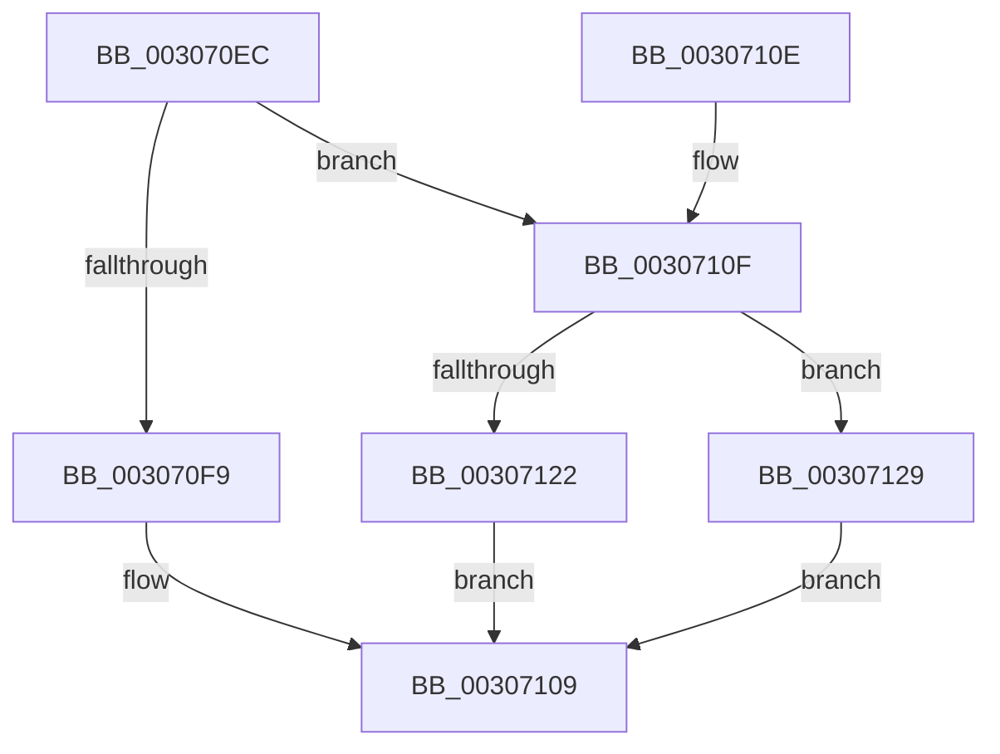

# HalpIommuDomainFreeLogicalAddressRange

- RVA: `0x003070EC`–`0x00307130` (길이 `68` bytes)
- VA: `0x00000001403070EC`
- 실행 섹션: `.text`
- PDB 이름 있음: `예`; PDB Function 태그: `아니요`
- unwind 정보 RVA: `0x00073864`
- 디코드: `20`개 명령, `68/68` bytes 표시
- 미해석 바이트: `0` (있으면 어셈블리에 `.byte`로 보존)

> 이 문서는 커널 이미지의 기계어와 PDB 기호를 분석해 생성했습니다. 4번과 5번은 함수 원형과 자료형을 바이너리 사용 방식에서 추정한 C 해석이며 원본 소스 복구 결과는 아닙니다.

## 1. Dependencies

- 직접 호출 지점: **2**; 고유 호출 대상: **2**
- 직접 호출자로 확인된 함수: **6**
- RIP 상대 이미지 참조: **1**

### Outgoing calls
- `0x00307122` → [HalpBuddyAllocatorFreeLogicalAddress](HalpBuddyAllocatorFreeLogicalAddress_function_00307140.md) (function, `0x00307140`)
- `0x00307129` → [guard_dispatch_icall](../6B/guard_dispatch_icall_function_006BAAD0.md) (function, `0x006BAAD0`)

### Direct callers
- [IommuUnmapLogicalRange](IommuUnmapLogicalRange_function_00306EC0.md) at `0x00306F29`
- [IommuUnmapIdentityRangeEx](IommuUnmapIdentityRangeEx_function_00306F80.md) at `0x0030705D`
- [IommuMapLogicalRangeEx](IommuMapLogicalRangeEx_function_003074B0.md) at `0x00307600`
- [IommuFreeReservedLogicalAddressRange](../56/IommuFreeReservedLogicalAddressRange_function_00567F80.md) at `0x00567FCC`
- [IommuReserveLogicalAddressRange](../56/IommuReserveLogicalAddressRange_function_00568400.md) at `0x005684FC`
- [sub_006E0B2E](../6E/Unknown_function_006E0B2E.md) at `0x006E0B3D`
- [sub_006E0B2E](../6E/Unknown_function_006E0B2E.md) at `0x006E0B54`

### Static image references
- `0x00307112` → RVA `0x00307140` (`HalpBuddyAllocatorFreeLogicalAddress`; read)

## 2. Other-region calls and transfers

- 다른 실행 섹션으로 향하는 call: **0**
- 별도 외부 분기/꼬리 이동을 확인하지 못했습니다.

## 3. Assembly (complete function range)

```asm
003070EC  48 83 EC 28                     sub rsp, 0x28
003070F0  48 8B 49 40                     mov rcx, qword ptr [rcx + 0x40]
003070F4  48 85 C9                        test rcx, rcx
003070F7  75 16                           jne 0x14030710f
003070F9  81 E2 FF 0F 00 00               and edx, 0xfff
003070FF  48 F7 DA                        neg rdx
00307102  1B C0                           sbb eax, eax
00307104  25 0D 00 00 C0                  and eax, 0xc000000d
00307109  48 83 C4 28                     add rsp, 0x28
0030710D  C3                              ret
0030710E  CC                              int3
0030710F  48 8B 01                        mov rax, qword ptr [rcx]
00307112  4C 8D 05 27 00 00 00            lea r8, [rip + 0x27]
00307119  48 8B 40 08                     mov rax, qword ptr [rax + 8]
0030711D  49 3B C0                        cmp rax, r8
00307120  75 07                           jne 0x140307129
00307122  E8 19 00 00 00                  call 0x140307140
00307127  EB E0                           jmp 0x140307109
00307129  E8 A2 39 3B 00                  call 0x1406baad0
0030712E  EB D9                           jmp 0x140307109
```

## 4. C-style interpretation (structured pseudocode)

```c
__int64 __fastcall HalpIommuDomainFreeLogicalAddressRange(__int64 a1, int a2)
{
    __int64 result;
    __int64 v_rsp;

    v_rsp = (v_rsp) - (40);
    if (*(unsigned __int64 *)(a1 + 64) != 0) goto loc_0030710F;
    a2 = (unsigned int)((a2) & (0xFFFULL));
    a2 = -(a2);
    result = (unsigned int)((result) & (0xC000000DULL));
loc_00307109:
    v_rsp = (v_rsp) + (40);
    return result;
loc_0030710F:
    if ((*(unsigned __int64 *)(*(unsigned __int64 *)(*(unsigned __int64 *)(a1 + 64)) + 8)) != (v_rip + 39)) goto loc_00307129;
    result = HalpBuddyAllocatorFreeLogicalAddress(*(unsigned __int64 *)(a1 + 64), a2, v_rip + 39, a4);
    goto loc_00307109;
loc_00307129:
    result = guard_dispatch_icall(*(unsigned __int64 *)(a1 + 64), a2, v_rip + 39, a4);
    goto loc_00307109;
}
```

## 5. (Beta) C Style

```c
int64_t HalpIommuDomainFreeLogicalAddressRange(void *Arg1, int32_t Arg2)
{
    uint8_t *arg1 = (uint8_t *)Arg1;

    int64_t result;
    int64_t local_rsp;

    local_rsp = (local_rsp) - (40);
    if (*(uint64_t *)(arg1 + 0x40) != 0) goto loc_0030710F;
    Arg2 = (uint32_t)((Arg2) & (0xFFFULL));
    Arg2 = -(Arg2);
    result = (uint32_t)((result) & (0xC000000DULL));
loc_00307109:
    local_rsp = (local_rsp) + (40);
    return result;
loc_0030710F:
    if ((*(uint64_t *)(*(uint64_t *)(*(uint64_t *)(arg1 + 0x40)) + 0x8)) != (v_rip + 39)) goto loc_00307129;
    result = HalpBuddyAllocatorFreeLogicalAddress(*(uint64_t *)(arg1 + 0x40), Arg2, v_rip + 39, a4);
    goto loc_00307109;
loc_00307129:
    result = guard_dispatch_icall(*(uint64_t *)(arg1 + 0x40), Arg2, v_rip + 39, a4);
    goto loc_00307109;
}
```

### 관측된 메모리 오프셋

구조체 형식이 확인되지 않은 접근은 인자 기준의 오프셋으로만 기록했습니다.

| 기준 인자 | 오프셋 표현 | 폭 (bit) | 접근 |
|---|---:|---:|---|
| `Arg1` | `+ 0x40` | `64` | `R` |

## 6. Execution-region graph

[열기: 2D/3D 그래프와 함수 탐색 컨트롤 패널](../../../control-panel.html?section=text&rva=0x003070EC&view=graph)

- 2D 그래프는 위에서 아래로 흐르고, 3D 그래프는 빈 공간을 드래그해 회전합니다. Shift+드래그는 이동, 휠은 확대·축소, 함수 노드 선택은 대상 보고서 이동입니다.

### Static fallback


