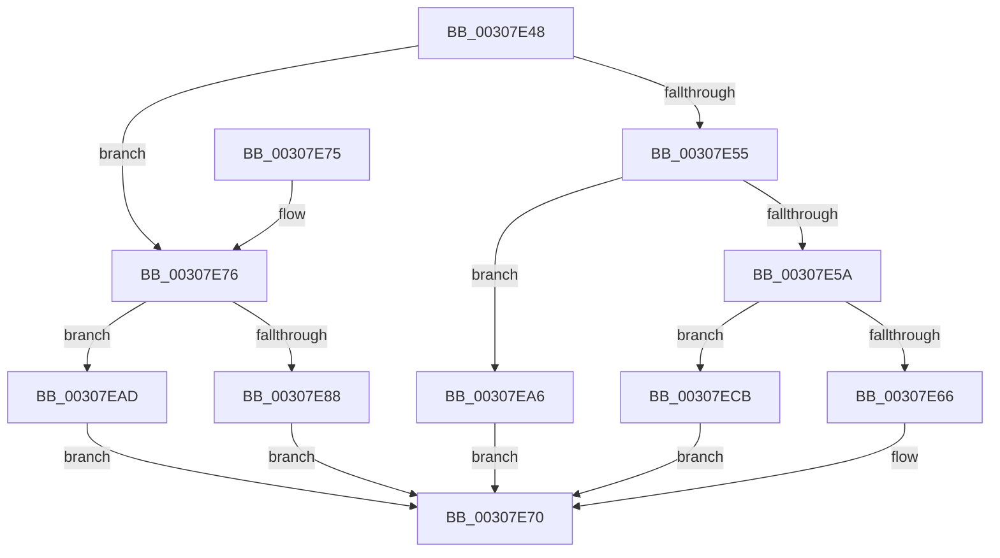

# HalpIommuDomainGetLogicalAddressRange

- RVA: `0x00307E48`–`0x00307ED2` (길이 `138` bytes)
- VA: `0x0000000140307E48`
- 실행 섹션: `.text`
- PDB 이름 있음: `예`; PDB Function 태그: `아니요`
- unwind 정보 RVA: `0x00073990`
- 디코드: `38`개 명령, `138/138` bytes 표시
- 미해석 바이트: `0` (있으면 어셈블리에 `.byte`로 보존)

> 이 문서는 커널 이미지의 기계어와 PDB 기호를 분석해 생성했습니다. 4번과 5번은 함수 원형과 자료형을 바이너리 사용 방식에서 추정한 C 해석이며 원본 소스 복구 결과는 아닙니다.

## 1. Dependencies

- 직접 호출 지점: **2**; 고유 호출 대상: **2**
- 직접 호출자로 확인된 함수: **2**
- RIP 상대 이미지 참조: **1**

### Outgoing calls
- `0x00307E9F` → [HalpBuddyAllocatorAllocateLogicalAddress](HalpBuddyAllocatorAllocateLogicalAddress_function_00307EE0.md) (function, `0x00307EE0`)
- `0x00307EC4` → [guard_dispatch_icall](../6B/guard_dispatch_icall_function_006BAAD0.md) (function, `0x006BAAD0`)

### Direct callers
- [IommuMapIdentityRangeEx](IommuMapIdentityRangeEx_function_00307C10.md) at `0x00307DE7`
- [IommuReserveLogicalAddressRange](../56/IommuReserveLogicalAddressRange_function_00568400.md) at `0x0056849B`

### Static image references
- `0x00307E79` → RVA `0x00307EE0` (`HalpBuddyAllocatorAllocateLogicalAddress`; read)

## 2. Other-region calls and transfers

- 다른 실행 섹션으로 향하는 call: **0**
- 별도 외부 분기/꼬리 이동을 확인하지 못했습니다.

## 3. Assembly (complete function range)

```asm
00307E48  48 83 EC 48                     sub rsp, 0x48
00307E4C  4C 8B 51 40                     mov r10, qword ptr [rcx + 0x40]
00307E50  4D 85 D2                        test r10, r10
00307E53  75 21                           jne 0x140307e76
00307E55  48 85 D2                        test rdx, rdx
00307E58  74 4C                           je 0x140307ea6
00307E5A  48 8B 0A                        mov rcx, qword ptr [rdx]
00307E5D  48 F7 C1 FF 0F 00 00            test rcx, 0xfff
00307E64  75 65                           jne 0x140307ecb
00307E66  48 8B 44 24 78                  mov rax, qword ptr [rsp + 0x78]
00307E6B  48 89 08                        mov qword ptr [rax], rcx
00307E6E  33 C0                           xor eax, eax
00307E70  48 83 C4 48                     add rsp, 0x48
00307E74  C3                              ret
00307E75  CC                              int3
00307E76  49 8B 02                        mov rax, qword ptr [r10]
00307E79  48 8D 0D 60 00 00 00            lea rcx, [rip + 0x60]
00307E80  48 8B 00                        mov rax, qword ptr [rax]
00307E83  48 3B C1                        cmp rax, rcx
00307E86  75 25                           jne 0x140307ead
00307E88  48 8B 44 24 78                  mov rax, qword ptr [rsp + 0x78]
00307E8D  49 8B CA                        mov rcx, r10
00307E90  48 89 44 24 28                  mov qword ptr [rsp + 0x28], rax
00307E95  48 8B 44 24 70                  mov rax, qword ptr [rsp + 0x70]
00307E9A  48 89 44 24 20                  mov qword ptr [rsp + 0x20], rax
00307E9F  E8 3C 00 00 00                  call 0x140307ee0
00307EA4  EB CA                           jmp 0x140307e70
00307EA6  B8 BB 00 00 C0                  mov eax, 0xc00000bb
00307EAB  EB C3                           jmp 0x140307e70
00307EAD  48 8B 4C 24 78                  mov rcx, qword ptr [rsp + 0x78]
00307EB2  48 89 4C 24 28                  mov qword ptr [rsp + 0x28], rcx
00307EB7  48 8B 4C 24 70                  mov rcx, qword ptr [rsp + 0x70]
00307EBC  48 89 4C 24 20                  mov qword ptr [rsp + 0x20], rcx
00307EC1  49 8B CA                        mov rcx, r10
00307EC4  E8 07 2C 3B 00                  call 0x1406baad0
00307EC9  EB A5                           jmp 0x140307e70
00307ECB  B8 F0 00 00 C0                  mov eax, 0xc00000f0
00307ED0  EB 9E                           jmp 0x140307e70
```

## 4. C-style interpretation (structured pseudocode)

```c
__int64 __fastcall HalpIommuDomainGetLogicalAddressRange(__int64 a1, __int64 a2, __int64 a3, __int64 a4, __int64 a5, __int64 a6)
{
    __int64 result;
    __int64 v_rsp;
    unsigned __int64 v_stack_p20;
    unsigned __int64 v_stack_p28;

    v_rsp = (v_rsp) - (72);
    if (*(unsigned __int64 *)(a1 + 64) != 0) goto loc_00307E76;
    if (a2 == 0) goto loc_00307EA6;
    if (((*(unsigned __int64 *)(a2)) & (0xFFFULL)) != 0) goto loc_00307ECB;
    *(unsigned __int64 *)(a6) = *(unsigned __int64 *)(a2);
    result = 0;
loc_00307E70:
    v_rsp = (v_rsp) + (72);
    return result;
loc_00307E76:
    if ((*(unsigned __int64 *)(*(unsigned __int64 *)(*(unsigned __int64 *)(a1 + 64)))) != (v_rip + 96)) goto loc_00307EAD;
    v_stack_p28 = a6;
    v_stack_p20 = a5;
    result = HalpBuddyAllocatorAllocateLogicalAddress(*(unsigned __int64 *)(a1 + 64), a2, a3, a4);
    goto loc_00307E70;
loc_00307EA6:
    goto loc_00307E70;
loc_00307EAD:
    v_stack_p28 = a6;
    v_stack_p20 = a5;
    result = guard_dispatch_icall(*(unsigned __int64 *)(a1 + 64), a2, a3, a4);
    goto loc_00307E70;
loc_00307ECB:
    goto loc_00307E70;
}
```

## 5. (Beta) C Style

```c
int64_t HalpIommuDomainGetLogicalAddressRange(void *Arg1, int64_t Arg2, int64_t Arg3, int64_t Arg4, int64_t Arg5, void *Arg6)
{
    uint8_t *arg1 = (uint8_t *)Arg1;
    uint8_t *arg6 = (uint8_t *)Arg6;

    int64_t result;
    int64_t local_rsp;
    uint64_t v_stack_p20;
    uint64_t v_stack_p28;

    local_rsp = (local_rsp) - (72);
    if (*(uint64_t *)(arg1 + 0x40) != 0) goto loc_00307E76;
    if (Arg2 == 0) goto loc_00307EA6;
    if (((*(uint64_t *)(Arg2)) & (0xFFFULL)) != 0) goto loc_00307ECB;
    *(uint64_t *)(arg6) = *(uint64_t *)(Arg2);
    result = 0;
loc_00307E70:
    local_rsp = (local_rsp) + (72);
    return result;
loc_00307E76:
    if ((*(uint64_t *)(*(uint64_t *)(*(uint64_t *)(arg1 + 0x40)))) != (v_rip + 96)) goto loc_00307EAD;
    v_stack_p28 = Arg6;
    v_stack_p20 = Arg5;
    result = HalpBuddyAllocatorAllocateLogicalAddress(*(uint64_t *)(arg1 + 0x40), Arg2, Arg3, Arg4);
    goto loc_00307E70;
loc_00307EA6:
    goto loc_00307E70;
loc_00307EAD:
    v_stack_p28 = Arg6;
    v_stack_p20 = Arg5;
    result = guard_dispatch_icall(*(uint64_t *)(arg1 + 0x40), Arg2, Arg3, Arg4);
    goto loc_00307E70;
loc_00307ECB:
    goto loc_00307E70;
}
```

### 관측된 메모리 오프셋

구조체 형식이 확인되지 않은 접근은 인자 기준의 오프셋으로만 기록했습니다.

| 기준 인자 | 오프셋 표현 | 폭 (bit) | 접근 |
|---|---:|---:|---|
| `Arg1` | `+ 0x40` | `64` | `R` |
| `Arg6` | `+ 0x0` | `64` | `W` |

## 6. Execution-region graph

[열기: 2D/3D 그래프와 함수 탐색 컨트롤 패널](../../../control-panel.html?section=text&rva=0x00307E48&view=graph)

- 2D 그래프는 위에서 아래로 흐르고, 3D 그래프는 빈 공간을 드래그해 회전합니다. Shift+드래그는 이동, 휠은 확대·축소, 함수 노드 선택은 대상 보고서 이동입니다.

### Static fallback


