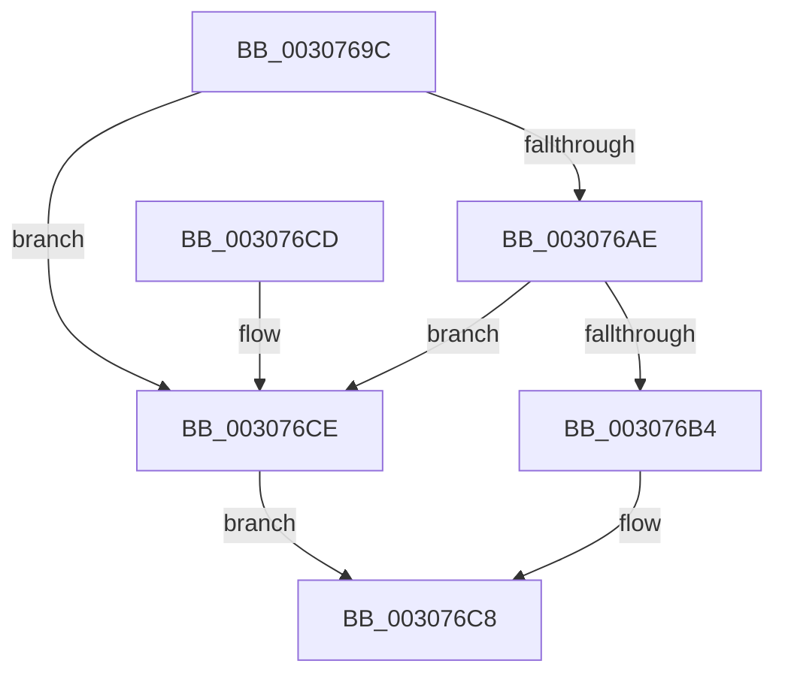

# HalpIommuDomainMapLogical

- RVA: `0x0030769C`–`0x003076EE` (길이 `82` bytes)
- VA: `0x000000014030769C`
- 실행 섹션: `.text`
- PDB 이름 있음: `예`; PDB Function 태그: `아니요`
- unwind 정보 RVA: `0x000738F4`
- 디코드: `21`개 명령, `82/82` bytes 표시
- 미해석 바이트: `0` (있으면 어셈블리에 `.byte`로 보존)

> 이 문서는 커널 이미지의 기계어와 PDB 기호를 분석해 생성했습니다. 4번과 5번은 함수 원형과 자료형을 바이너리 사용 방식에서 추정한 C 해석이며 원본 소스 복구 결과는 아닙니다.

## 1. Dependencies

- 직접 호출 지점: **2**; 고유 호출 대상: **2**
- 직접 호출자로 확인된 함수: **3**
- RIP 상대 이미지 참조: **1**

### Outgoing calls
- `0x003076C3` → [IommupHvMapDeviceLogical](IommupHvMapDeviceLogical_function_003076F4.md) (function, `0x003076F4`)
- `0x003076E7` → [HalpIommuMapLogical](HalpIommuMapLogical_function_00308290.md) (function, `0x00308290`)

### Direct callers
- [IommuMapLogicalRangeEx](IommuMapLogicalRangeEx_function_003074B0.md) at `0x003075B3`
- [IommuMapLogicalRange](../56/IommuMapLogicalRange_function_00568070.md) at `0x005680D0`
- [IommuMapReservedLogicalRange](../56/IommuMapReservedLogicalRange_function_005680F0.md) at `0x005681A5`

### Static image references
- `0x003076A5` → RVA `0x00FC1710` (`.data`; read)

## 2. Other-region calls and transfers

- 다른 실행 섹션으로 향하는 call: **0**
- 별도 외부 분기/꼬리 이동을 확인하지 못했습니다.

## 3. Assembly (complete function range)

```asm
0030769C  4C 89 4C 24 20                  mov qword ptr [rsp + 0x20], r9
003076A1  48 83 EC 38                     sub rsp, 0x38
003076A5  80 3D 64 A0 CB 00 00            cmp byte ptr [rip + 0xcba064], 0
003076AC  74 20                           je 0x1403076ce
003076AE  80 79 34 00                     cmp byte ptr [rcx + 0x34], 0
003076B2  75 1A                           jne 0x1403076ce
003076B4  48 8B 44 24 60                  mov rax, qword ptr [rsp + 0x60]
003076B9  4C 8D 4C 24 58                  lea r9, [rsp + 0x58]
003076BE  48 89 44 24 20                  mov qword ptr [rsp + 0x20], rax
003076C3  E8 2C 00 00 00                  call 0x1403076f4
003076C8  48 83 C4 38                     add rsp, 0x38
003076CC  C3                              ret
003076CD  CC                              int3
003076CE  48 8B 44 24 60                  mov rax, qword ptr [rsp + 0x60]
003076D3  48 89 44 24 28                  mov qword ptr [rsp + 0x28], rax
003076D8  4C 89 4C 24 20                  mov qword ptr [rsp + 0x20], r9
003076DD  4D 8B C8                        mov r9, r8
003076E0  44 8B C2                        mov r8d, edx
003076E3  48 8B 51 28                     mov rdx, qword ptr [rcx + 0x28]
003076E7  E8 A4 0B 00 00                  call 0x140308290
003076EC  EB DA                           jmp 0x1403076c8
```

## 4. C-style interpretation (structured pseudocode)

```c
__int64 __fastcall HalpIommuDomainMapLogical(__int64 a1, int a2, __int64 a3, __int64 a4, __int64 a5)
{
    __int64 result;
    __int64 v_rsp;
    unsigned __int64 v_stack_m18;
    unsigned __int64 v_stack_p20;
    unsigned __int64 v_stack_p28;

    v_stack_p20 = a4;
    v_rsp = (v_rsp) - (56);
    if ((*(unsigned __int8 *)(v_rip + 13344868)) == 0) goto loc_003076CE;
    if ((*(unsigned __int8 *)(a1 + 52)) != 0) goto loc_003076CE;
    v_stack_m18 = a5;
    result = IommupHvMapDeviceLogical(a1, a2, a3, v_stack_p20);
loc_003076C8:
    v_rsp = (v_rsp) + (56);
    return result;
loc_003076CE:
    v_stack_p28 = a5;
    v_stack_p20 = v_stack_p20;
    result = HalpIommuMapLogical(a1, *(unsigned __int64 *)(a1 + 40), (unsigned int)(a2), a3);
    goto loc_003076C8;
}
```

## 5. (Beta) C Style

```c
int64_t HalpIommuDomainMapLogical(void *Arg1, int32_t Arg2, int64_t Arg3, int64_t Arg4, int64_t Arg5)
{
    uint8_t *arg1 = (uint8_t *)Arg1;

    int64_t result;
    int64_t local_rsp;
    uint64_t v_stack_m18;
    uint64_t v_stack_p20;
    uint64_t v_stack_p28;

    v_stack_p20 = Arg4;
    local_rsp = (local_rsp) - (56);
    if ((*(uint8_t *)(v_rip + 0xCBA064)) == 0) goto loc_003076CE;
    if ((*(uint8_t *)(arg1 + 0x34)) != 0) goto loc_003076CE;
    v_stack_m18 = Arg5;
    result = IommupHvMapDeviceLogical(Arg1, Arg2, Arg3, v_stack_p20);
loc_003076C8:
    local_rsp = (local_rsp) + (56);
    return result;
loc_003076CE:
    v_stack_p28 = Arg5;
    v_stack_p20 = v_stack_p20;
    result = HalpIommuMapLogical(Arg1, *(uint64_t *)(arg1 + 0x28), (uint32_t)(Arg2), Arg3);
    goto loc_003076C8;
}
```

### 관측된 메모리 오프셋

구조체 형식이 확인되지 않은 접근은 인자 기준의 오프셋으로만 기록했습니다.

| 기준 인자 | 오프셋 표현 | 폭 (bit) | 접근 |
|---|---:|---:|---|
| `Arg1` | `+ 0x28` | `64` | `R` |
| `Arg1` | `+ 0x34` | `8` | `R` |

## 6. Execution-region graph

[열기: 2D/3D 그래프와 함수 탐색 컨트롤 패널](../../../control-panel.html?section=text&rva=0x0030769C&view=graph)

- 2D 그래프는 위에서 아래로 흐르고, 3D 그래프는 빈 공간을 드래그해 회전합니다. Shift+드래그는 이동, 휠은 확대·축소, 함수 노드 선택은 대상 보고서 이동입니다.

### Static fallback


