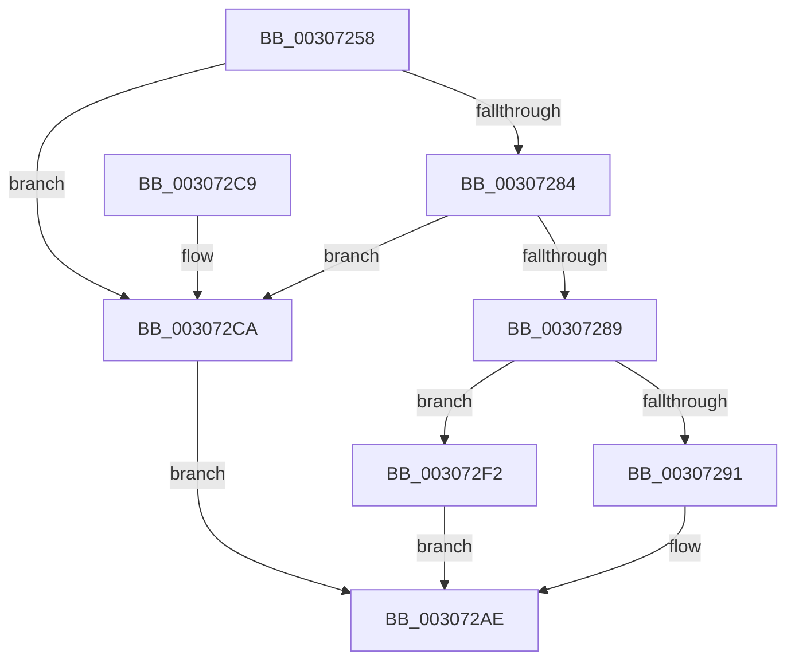

# HalpIommuDomainUnmapLogicalRange

- RVA: `0x00307258`–`0x00307306` (길이 `174` bytes)
- VA: `0x0000000140307258`
- 실행 섹션: `.text`
- PDB 이름 있음: `예`; PDB Function 태그: `아니요`
- unwind 정보 RVA: `0x00073888`
- 디코드: `52`개 명령, `174/174` bytes 표시
- 미해석 바이트: `0` (있으면 어셈블리에 `.byte`로 보존)

> 이 문서는 커널 이미지의 기계어와 PDB 기호를 분석해 생성했습니다. 4번과 5번은 함수 원형과 자료형을 바이너리 사용 방식에서 추정한 C 해석이며 원본 소스 복구 결과는 아닙니다.

## 1. Dependencies

- 직접 호출 지점: **4**; 고유 호출 대상: **4**
- 직접 호출자로 확인된 함수: **4**
- RIP 상대 이미지 참조: **1**

### Outgoing calls
- `0x003072A9` → [IommupHvUnmapDeviceLogicalRange](IommupHvUnmapDeviceLogicalRange_function_0030730C.md) (function, `0x0030730C`)
- `0x003072D4` → [HalpIommuUnmapLogicalRange](HalpIommuUnmapLogicalRange_function_00308660.md) (function, `0x00308660`)
- `0x003072E4` → [HalpIommuFlushDomainTbs](HalpIommuFlushDomainTbs_function_003085C0.md) (function, `0x003085C0`)
- `0x003072FF` → [IommupHvMapDeviceLogicalRange](IommupHvMapDeviceLogicalRange_function_00306C94.md) (function, `0x00306C94`)

### Direct callers
- [IommuUnmapIdentityRangeEx](IommuUnmapIdentityRangeEx_function_00306F80.md) at `0x00307079`
- [HalpIommuAllocateDmaDomain](../55/HalpIommuAllocateDmaDomain_function_00554904.md) at `0x00554C8E`
- [IommuFreeReservedLogicalAddressRange](../56/IommuFreeReservedLogicalAddressRange_function_00567F80.md) at `0x00567FBA`
- [IommuUnmapReservedLogicalRange](../56/IommuUnmapReservedLogicalRange_function_005686C0.md) at `0x005686F9`

### Static image references
- `0x00307276` → RVA `0x00FC1710` (`.data`; read)

## 2. Other-region calls and transfers

- 다른 실행 섹션으로 향하는 call: **0**
- 별도 외부 분기/꼬리 이동을 확인하지 못했습니다.

## 3. Assembly (complete function range)

```asm
00307258  4C 8B DC                        mov r11, rsp
0030725B  49 89 5B 08                     mov qword ptr [r11 + 8], rbx
0030725F  49 89 6B 10                     mov qword ptr [r11 + 0x10], rbp
00307263  49 89 73 18                     mov qword ptr [r11 + 0x18], rsi
00307267  49 89 7B 20                     mov qword ptr [r11 + 0x20], rdi
0030726B  41 56                           push r14
0030726D  48 83 EC 40                     sub rsp, 0x40
00307271  33 DB                           xor ebx, ebx
00307273  4D 8B F0                        mov r14, r8
00307276  38 1D 94 A4 CB 00               cmp byte ptr [rip + 0xcba494], bl
0030727C  48 8B EA                        mov rbp, rdx
0030727F  48 8B F1                        mov rsi, rcx
00307282  74 46                           je 0x1403072ca
00307284  38 59 34                        cmp byte ptr [rcx + 0x34], bl
00307287  75 41                           jne 0x1403072ca
00307289  49 8B 00                        mov rax, qword ptr [r8]
0030728C  45 84 C9                        test r9b, r9b
0030728F  75 61                           jne 0x1403072f2
00307291  48 A9 FF 0F 00 00               test rax, 0xfff
00307297  4D 8D 43 E8                     lea r8, [r11 - 0x18]
0030729B  0F 95 C3                        setne bl
0030729E  48 C1 E8 0C                     shr rax, 0xc
003072A2  48 03 D8                        add rbx, rax
003072A5  49 89 5B E8                     mov qword ptr [r11 - 0x18], rbx
003072A9  E8 5E 00 00 00                  call 0x14030730c
003072AE  48 8B 5C 24 50                  mov rbx, qword ptr [rsp + 0x50]
003072B3  48 8B 6C 24 58                  mov rbp, qword ptr [rsp + 0x58]
003072B8  48 8B 74 24 60                  mov rsi, qword ptr [rsp + 0x60]
003072BD  48 8B 7C 24 68                  mov rdi, qword ptr [rsp + 0x68]
003072C2  48 83 C4 40                     add rsp, 0x40
003072C6  41 5E                           pop r14
003072C8  C3                              ret
003072C9  CC                              int3
003072CA  48 8B 49 28                     mov rcx, qword ptr [rcx + 0x28]
003072CE  4C 8B C5                        mov r8, rbp
003072D1  49 8B D6                        mov rdx, r14
003072D4  E8 87 13 00 00                  call 0x140308660
003072D9  4D 8B 06                        mov r8, qword ptr [r14]
003072DC  48 8B D5                        mov rdx, rbp
003072DF  48 8B CE                        mov rcx, rsi
003072E2  8B F8                           mov edi, eax
003072E4  E8 D7 12 00 00                  call 0x1403085c0
003072E9  85 FF                           test edi, edi
003072EB  0F 49 F8                        cmovns edi, eax
003072EE  8B C7                           mov eax, edi
003072F0  EB BC                           jmp 0x1403072ae
003072F2  4C 8B C8                        mov r9, rax
003072F5  48 89 6C 24 20                  mov qword ptr [rsp + 0x20], rbp
003072FA  4C 8B C3                        mov r8, rbx
003072FD  33 D2                           xor edx, edx
003072FF  E8 90 F9 FF FF                  call 0x140306c94
00307304  EB A8                           jmp 0x1403072ae
```

## 4. C-style interpretation (structured pseudocode)

```c
__int64 __fastcall HalpIommuDomainUnmapLogicalRange(__int64 a1, __int64 a2, __int64 a3, unsigned __int8 a4)
{
    __int64 result;
    __int64 v_rbx;
    __int64 v_rdi;
    __int64 v_rsp;
    unsigned __int64 v_stack_p10;
    unsigned __int64 v_stack_p18;
    unsigned __int64 v_stack_p20;
    unsigned __int64 v_stack_p8;

    *(unsigned __int64 *)(v_rsp + 8) = v_rbx;
    *(unsigned __int64 *)(v_rsp + 16) = v_rbp;
    *(unsigned __int64 *)(v_rsp + 24) = v_rsi;
    *(unsigned __int64 *)(v_rsp + 32) = v_rdi;
    v_rsp = (v_rsp) - (64);
    v_rbx = 0;
    if ((*(unsigned __int8 *)(v_rip + 13345940)) == 0) goto loc_003072CA;
    if ((*(unsigned __int8 *)(a1 + 52)) != 0) goto loc_003072CA;
    if (a4 != 0) goto loc_003072F2;
    v_rbx = (((*(unsigned __int64 *)(a3)) & (0xFFFULL)) != 0) ? 1 : 0;
    result = (*(unsigned __int64 *)(a3)) >> (12);
    v_rbx = (v_rbx) + (result);
    *(unsigned __int64 *)(v_rsp - 24) = v_rbx;
    result = IommupHvUnmapDeviceLogicalRange(a1, a2, v_rsp - 24, a4);
loc_003072AE:
    v_rsp = (v_rsp) + (64);
    return result;
loc_003072CA:
    result = HalpIommuUnmapLogicalRange(*(unsigned __int64 *)(a1 + 40), a3, v_stack_p10, a4);
    result = HalpIommuFlushDomainTbs(v_stack_p18, v_stack_p10, *(unsigned __int64 *)(a3), a4);
    v_rdi = (unsigned int)((unsigned int)(result));
    if (!sign_flag) { v_rdi = (unsigned int)(result); }
    goto loc_003072AE;
loc_003072F2:
    v_stack_p20 = v_stack_p10;
    a2 = 0;
    result = IommupHvMapDeviceLogicalRange(v_stack_p18, a2, v_stack_p8, (unsigned int)((unsigned int)(v_rdi)));
    goto loc_003072AE;
}
```

## 5. (Beta) C Style

```c
int64_t HalpIommuDomainUnmapLogicalRange(void *Arg1, int64_t Arg2, void *Arg3, uint8_t Arg4)
{
    uint8_t *arg1 = (uint8_t *)Arg1;
    uint8_t *arg3 = (uint8_t *)Arg3;

    int64_t result;
    int64_t local_rbx;
    int64_t local_rdi;
    int64_t local_rsp;
    uint64_t v_stack_p10;
    uint64_t v_stack_p18;
    uint64_t v_stack_p20;
    uint64_t v_stack_p8;

    *(uint64_t *)(local_rsp + 0x8) = local_rbx;
    *(uint64_t *)(local_rsp + 0x10) = local_rbp;
    *(uint64_t *)(local_rsp + 0x18) = local_rsi;
    *(uint64_t *)(local_rsp + 0x20) = local_rdi;
    local_rsp = (local_rsp) - (64);
    local_rbx = 0;
    if ((*(uint8_t *)(v_rip + 0xCBA494)) == 0) goto loc_003072CA;
    if ((*(uint8_t *)(arg1 + 0x34)) != 0) goto loc_003072CA;
    if (Arg4 != 0) goto loc_003072F2;
    local_rbx = (((*(uint64_t *)(arg3)) & (0xFFFULL)) != 0) ? 1 : 0;
    result = (*(uint64_t *)(arg3)) >> (12);
    local_rbx = (local_rbx) + (result);
    *(uint64_t *)(local_rsp - 0x18) = local_rbx;
    result = IommupHvUnmapDeviceLogicalRange(Arg1, Arg2, local_rsp - 24, Arg4);
loc_003072AE:
    local_rsp = (local_rsp) + (64);
    return result;
loc_003072CA:
    result = HalpIommuUnmapLogicalRange(*(uint64_t *)(arg1 + 0x28), Arg3, v_stack_p10, Arg4);
    result = HalpIommuFlushDomainTbs(v_stack_p18, v_stack_p10, *(uint64_t *)(arg3), Arg4);
    local_rdi = (uint32_t)((uint32_t)(result));
    if (!sign_flag) { local_rdi = (uint32_t)(result); }
    goto loc_003072AE;
loc_003072F2:
    v_stack_p20 = v_stack_p10;
    Arg2 = 0;
    result = IommupHvMapDeviceLogicalRange(v_stack_p18, Arg2, v_stack_p8, (uint32_t)((uint32_t)(local_rdi)));
    goto loc_003072AE;
}
```

### 관측된 메모리 오프셋

구조체 형식이 확인되지 않은 접근은 인자 기준의 오프셋으로만 기록했습니다.

| 기준 인자 | 오프셋 표현 | 폭 (bit) | 접근 |
|---|---:|---:|---|
| `Arg1` | `+ 0x28` | `64` | `R` |
| `Arg1` | `+ 0x34` | `8` | `R` |
| `Arg3` | `+ 0x0` | `64` | `R` |

## 6. Execution-region graph

[열기: 2D/3D 그래프와 함수 탐색 컨트롤 패널](../../../control-panel.html?section=text&rva=0x00307258&view=graph)

- 2D 그래프는 위에서 아래로 흐르고, 3D 그래프는 빈 공간을 드래그해 회전합니다. Shift+드래그는 이동, 휠은 확대·축소, 함수 노드 선택은 대상 보고서 이동입니다.

### Static fallback


