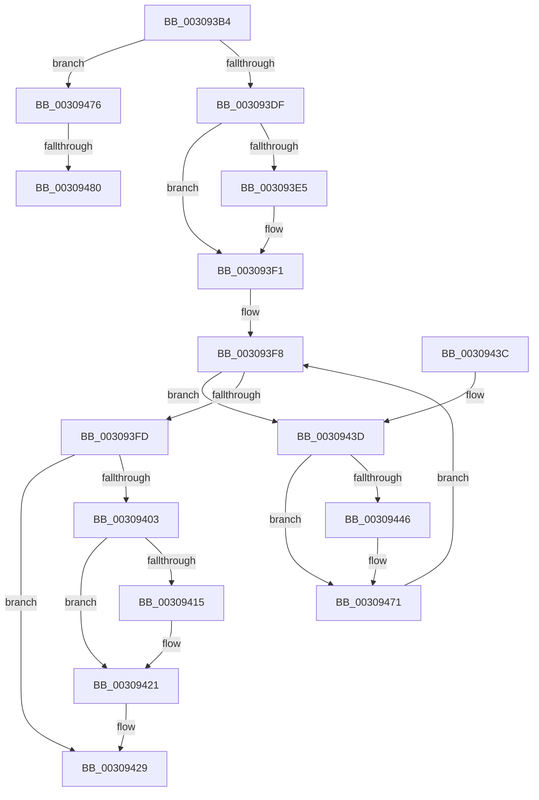

# HalpIommuFlushDmaDomain

- RVA: `0x003093B4`–`0x00309491` (길이 `221` bytes)
- VA: `0x00000001403093B4`
- 실행 섹션: `.text`
- PDB 이름 있음: `예`; PDB Function 태그: `예`
- unwind 정보 RVA: `0x00073B4C`
- 디코드: `59`개 명령, `221/221` bytes 표시
- 미해석 바이트: `0` (있으면 어셈블리에 `.byte`로 보존)

> 이 문서는 커널 이미지의 기계어와 PDB 기호를 분석해 생성했습니다. 4번과 5번은 함수 원형과 자료형을 바이너리 사용 방식에서 추정한 C 해석이며 원본 소스 복구 결과는 아닙니다.

## 1. Dependencies

- 직접 호출 지점: **5**; 고유 호출 대상: **5**
- 직접 호출자로 확인된 함수: **1**
- RIP 상대 이미지 참조: **2**

### Outgoing calls
- `0x003093E9` → [KeAcquireSpinLockRaiseToDpc](../20/KeAcquireSpinLockRaiseToDpc_function_00208470.md) (function, `0x00208470`)
- `0x00309407` → [KxReleaseSpinLock](../20/KxReleaseSpinLock_function_00206670.md) (function, `0x00206670`)
- `0x0030941C` → [KiLowerIrqlProcessIrqlFlags](../4F/KiLowerIrqlProcessIrqlFlags_function_004F5698.md) (function, `0x004F5698`)
- `0x0030946C` → [guard_dispatch_icall](../6B/guard_dispatch_icall_function_006BAAD0.md) (function, `0x006BAAD0`)
- `0x00309484` → [ExAcquireSpinLockShared](../24/ExAcquireSpinLockShared_function_0024DCE0.md) (function, `0x0024DCE0`)

### Direct callers
- [HalpIommuFlushDomainTbs](HalpIommuFlushDomainTbs_function_003085C0.md) at `0x00308626`

### Static image references
- `0x0030940C` → RVA `0x00FC6D20` (`ALMOSTRO`; read)
- `0x0030943D` → RVA `0x00FC1710` (`.data`; read)

## 2. Other-region calls and transfers

- 다른 실행 섹션으로 향하는 call: **0**
- call이 아닌 외부 분기/꼬리 이동: **2**
  - `0x0030947A` → [sub_006E0B80](../6E/Unknown_function_006E0B80.md) (`tail-transfer`)
  - `0x0030948C` → [sub_006E0B80](../6E/Unknown_function_006E0B80.md) (`tail-transfer`)

## 3. Assembly (complete function range)

```asm
003093B4  48 89 5C 24 08                  mov qword ptr [rsp + 8], rbx
003093B9  48 89 6C 24 18                  mov qword ptr [rsp + 0x18], rbp
003093BE  48 89 54 24 10                  mov qword ptr [rsp + 0x10], rdx
003093C3  56                              push rsi
003093C4  57                              push rdi
003093C5  41 56                           push r14
003093C7  48 83 EC 30                     sub rsp, 0x30
003093CB  48 8B D9                        mov rbx, rcx
003093CE  40 32 FF                        xor dil, dil
003093D1  44 0F 20 C5                     mov rbp, cr8
003093D5  83 79 08 00                     cmp dword ptr [rcx + 8], 0
003093D9  0F 85 97 00 00 00               jne 0x140309476
003093DF  40 80 FD 0F                     cmp bpl, 0xf
003093E3  74 0C                           je 0x1403093f1
003093E5  48 83 C1 20                     add rcx, 0x20
003093E9  E8 82 F0 EF FF                  call 0x140208470
003093EE  40 8A F8                        mov dil, al
003093F1  4C 8D 73 10                     lea r14, [rbx + 0x10]
003093F5  49 8B 36                        mov rsi, qword ptr [r14]
003093F8  49 3B F6                        cmp rsi, r14
003093FB  75 40                           jne 0x14030943d
003093FD  40 80 FD 0F                     cmp bpl, 0xf
00309401  74 26                           je 0x140309429
00309403  48 8D 4B 20                     lea rcx, [rbx + 0x20]
00309407  E8 64 D2 EF FF                  call 0x140206670
0030940C  83 3D 0D D9 CB 00 00            cmp dword ptr [rip + 0xcbd90d], 0
00309413  74 0C                           je 0x140309421
00309415  44 0F 20 C1                     mov rcx, cr8
00309419  40 8A D7                        mov dl, dil
0030941C  E8 77 C2 1E 00                  call 0x1404f5698
00309421  40 0F B6 C7                     movzx eax, dil
00309425  44 0F 22 C0                     mov cr8, rax
00309429  48 8B 5C 24 50                  mov rbx, qword ptr [rsp + 0x50]
0030942E  48 8B 6C 24 60                  mov rbp, qword ptr [rsp + 0x60]
00309433  48 83 C4 30                     add rsp, 0x30
00309437  41 5E                           pop r14
00309439  5F                              pop rdi
0030943A  5E                              pop rsi
0030943B  C3                              ret
0030943C  CC                              int3
0030943D  80 3D CC 82 CB 00 00            cmp byte ptr [rip + 0xcb82cc], 0
00309444  75 2B                           jne 0x140309471
00309446  48 8B 4E 18                     mov rcx, qword ptr [rsi + 0x18]
0030944A  4C 8D 44 24 58                  lea r8, [rsp + 0x58]
0030944F  4C 89 44 24 20                  mov qword ptr [rsp + 0x20], r8
00309454  48 8D 56 20                     lea rdx, [rsi + 0x20]
00309458  41 B9 01 00 00 00               mov r9d, 1
0030945E  45 33 C0                        xor r8d, r8d
00309461  48 8B 81 88 00 00 00            mov rax, qword ptr [rcx + 0x88]
00309468  48 8B 49 10                     mov rcx, qword ptr [rcx + 0x10]
0030946C  E8 5F 16 3B 00                  call 0x1406baad0
00309471  48 8B 36                        mov rsi, qword ptr [rsi]
00309474  EB 82                           jmp 0x1403093f8
00309476  40 80 FD 0F                     cmp bpl, 0xf
0030947A  0F 84 00 77 3D 00               je 0x1406e0b80
00309480  48 83 C1 58                     add rcx, 0x58
00309484  E8 57 48 F4 FF                  call 0x14024dce0
00309489  40 8A F8                        mov dil, al
0030948C  E9 EF 76 3D 00                  jmp 0x1406e0b80
```

## 4. C-style interpretation (structured pseudocode)

```c
__int64 __fastcall HalpIommuFlushDmaDomain(__int64 a1, __int64 a2)
{
    __int64 result;
    __int64 v_rdi;
    __int64 v_rsp;
    unsigned __int64 v_stack_p10;
    unsigned __int64 v_stack_p18;
    unsigned __int64 v_stack_p20;
    unsigned __int64 v_stack_p58;
    unsigned __int64 v_stack_p8;

    v_stack_p8 = v_rbx;
    v_stack_p18 = v_rbp;
    v_stack_p10 = a2;
    v_rsp = (v_rsp) - (48);
    v_rdi = 0;
    if ((*(unsigned int *)(a1 + 8)) != 0) goto loc_00309476;
    if (((unsigned __int8)(v_cr8)) != 15) {
        a1 = (a1) + (32);
        result = KeAcquireSpinLockRaiseToDpc(a1, a2, a3, a4);
        v_rdi = (unsigned __int8)(result);
    }
loc_003093F8:
    if ((*(unsigned __int64 *)(a1 + 16)) != (a1 + 16)) goto loc_0030943D;
    if (((unsigned __int8)(v_cr8)) == 15) goto loc_00309429;
    result = KxReleaseSpinLock(a1 + 32, a2, a3, a4);
    if ((*(unsigned int *)(v_rip + 13359373)) != 0) {
        a1 = v_cr8;
        a2 = (unsigned __int8)(v_rdi);
        result = KiLowerIrqlProcessIrqlFlags(a1, a2, a3, a4);
    }
loc_00309429:
    v_rsp = (v_rsp) + (48);
    return (unsigned __int8)(v_rdi);
loc_0030943D:
    result = (unsigned __int8)(v_rdi);
    if ((*(unsigned __int8 *)(v_rip + 13337292)) == 0) {
        a1 = *(unsigned __int64 *)(*(unsigned __int64 *)(a1 + 16) + 24);
        a3 = v_stack_p58;
        v_stack_p20 = a3;
        a2 = *(unsigned __int64 *)(a1 + 16) + 32;
        a4 = 1;
        a3 = 0;
        result = *(unsigned __int64 *)(a1 + 136);
        a1 = *(unsigned __int64 *)(a1 + 16);
        result = guard_dispatch_icall(a1, a2, a3, a4);
    }
    goto loc_003093F8;
loc_00309476:
    a1 = (a1) + (88);
    result = ExAcquireSpinLockShared(a1, a2, a3, a4);
}
```

## 5. (Beta) C Style

```c
int64_t HalpIommuFlushDmaDomain(void *Arg1, int64_t Arg2)
{
    uint8_t *arg1 = (uint8_t *)Arg1;

    int64_t result;
    int64_t local_rdi;
    int64_t local_rsp;
    uint64_t v_stack_p10;
    uint64_t v_stack_p18;
    uint64_t v_stack_p20;
    uint64_t v_stack_p58;
    uint64_t v_stack_p8;

    v_stack_p8 = local_rbx;
    v_stack_p18 = local_rbp;
    v_stack_p10 = Arg2;
    local_rsp = (local_rsp) - (48);
    local_rdi = 0;
    if ((*(uint32_t *)(arg1 + 0x8)) != 0) goto loc_00309476;
    if (((uint8_t)(v_cr8)) != 15) {
        Arg1 = (Arg1) + (32);
        result = KeAcquireSpinLockRaiseToDpc(Arg1, Arg2, a3, a4);
        local_rdi = (uint8_t)(result);
    }
loc_003093F8:
    if ((*(uint64_t *)(arg1 + 0x10)) != (Arg1 + 16)) goto loc_0030943D;
    if (((uint8_t)(v_cr8)) == 15) goto loc_00309429;
    result = KxReleaseSpinLock(Arg1 + 32, Arg2, a3, a4);
    if ((*(uint32_t *)(v_rip + 0xCBD90D)) != 0) {
        Arg1 = v_cr8;
        Arg2 = (uint8_t)(local_rdi);
        result = KiLowerIrqlProcessIrqlFlags(Arg1, Arg2, a3, a4);
    }
loc_00309429:
    local_rsp = (local_rsp) + (48);
    return (uint8_t)(local_rdi);
loc_0030943D:
    result = (uint8_t)(local_rdi);
    if ((*(uint8_t *)(v_rip + 0xCB82CC)) == 0) {
        Arg1 = *(uint64_t *)(*(uint64_t *)(arg1 + 0x10) + 0x18);
        a3 = v_stack_p58;
        v_stack_p20 = a3;
        Arg2 = *(uint64_t *)(arg1 + 0x10) + 32;
        a4 = 1;
        a3 = 0;
        result = *(uint64_t *)(arg1 + 0x88);
        Arg1 = *(uint64_t *)(arg1 + 0x10);
        result = guard_dispatch_icall(Arg1, Arg2, a3, a4);
    }
    goto loc_003093F8;
loc_00309476:
    Arg1 = (Arg1) + (88);
    result = ExAcquireSpinLockShared(Arg1, Arg2, a3, a4);
}
```

### 관측된 메모리 오프셋

구조체 형식이 확인되지 않은 접근은 인자 기준의 오프셋으로만 기록했습니다.

| 기준 인자 | 오프셋 표현 | 폭 (bit) | 접근 |
|---|---:|---:|---|
| `Arg1` | `+ 0x0` | `64` | `R` |
| `Arg1` | `+ 0x8` | `32` | `R` |
| `Arg1` | `+ 0x10` | `64` | `R` |
| `Arg1` | `+ 0x20` | `64` | `R` |

## 6. Execution-region graph

[열기: 2D/3D 그래프와 함수 탐색 컨트롤 패널](../../../control-panel.html?section=text&rva=0x003093B4&view=graph)

- 2D 그래프는 위에서 아래로 흐르고, 3D 그래프는 빈 공간을 드래그해 회전합니다. Shift+드래그는 이동, 휠은 확대·축소, 함수 노드 선택은 대상 보고서 이동입니다.

### Static fallback


