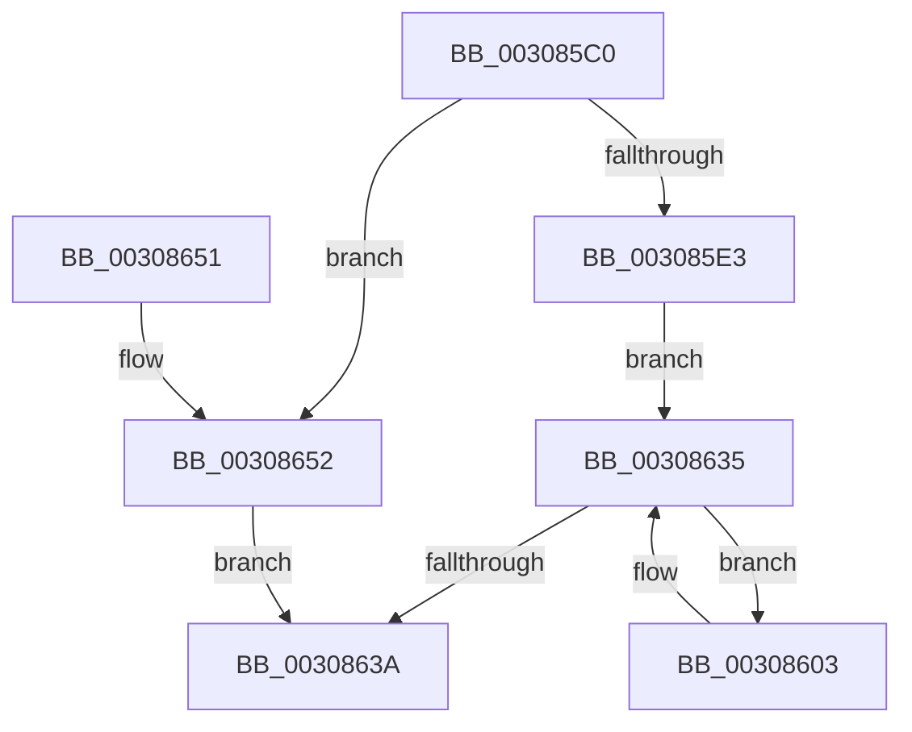

# HalpIommuFlushDomainTbs

- RVA: `0x003085C0`–`0x00308659` (길이 `153` bytes)
- VA: `0x00000001403085C0`
- 실행 섹션: `.text`
- PDB 이름 있음: `예`; PDB Function 태그: `아니요`
- unwind 정보 RVA: `0x00069AD0`
- 디코드: `41`개 명령, `153/153` bytes 표시
- 미해석 바이트: `0` (있으면 어셈블리에 `.byte`로 보존)

> 이 문서는 커널 이미지의 기계어와 PDB 기호를 분석해 생성했습니다. 4번과 5번은 함수 원형과 자료형을 바이너리 사용 방식에서 추정한 C 해석이며 원본 소스 복구 결과는 아닙니다.

## 1. Dependencies

- 직접 호출 지점: **2**; 고유 호출 대상: **2**
- 직접 호출자로 확인된 함수: **4**
- RIP 상대 이미지 참조: **1**

### Outgoing calls
- `0x00308626` → [HalpIommuFlushDmaDomain](HalpIommuFlushDmaDomain_function_003093B4.md) (function, `0x003093B4`)
- `0x00308652` → [IommupHvFlushDomainTbs](../4D/IommupHvFlushDomainTbs_function_004DADB0.md) (function, `0x004DADB0`)

### Direct callers
- [IommuUnmapLogicalRange](IommuUnmapLogicalRange_function_00306EC0.md) at `0x00306F5D`
- [HalpIommuDomainUnmapLogicalRange](HalpIommuDomainUnmapLogicalRange_function_00307258.md) at `0x003072E4`
- [sub_006F785E](../6F/Unknown_function_006F785E.md) at `0x006F791C`
- [sub_006F85EE](../6F/Unknown_function_006F85EE.md) at `0x006F864C`

### Static image references
- `0x003085D4` → RVA `0x00FC1710` (`.data`; read)

## 2. Other-region calls and transfers

- 다른 실행 섹션으로 향하는 call: **0**
- 별도 외부 분기/꼬리 이동을 확인하지 못했습니다.

## 3. Assembly (complete function range)

```asm
003085C0  48 89 5C 24 08                  mov qword ptr [rsp + 8], rbx
003085C5  48 89 6C 24 10                  mov qword ptr [rsp + 0x10], rbp
003085CA  48 89 74 24 18                  mov qword ptr [rsp + 0x18], rsi
003085CF  57                              push rdi
003085D0  48 83 EC 20                     sub rsp, 0x20
003085D4  80 3D 35 91 CB 00 00            cmp byte ptr [rip + 0xcb9135], 0
003085DB  48 8B FA                        mov rdi, rdx
003085DE  48 8B E9                        mov rbp, rcx
003085E1  75 6F                           jne 0x140308652
003085E3  48 8B F2                        mov rsi, rdx
003085E6  81 E6 FF 0F 00 00               and esi, 0xfff
003085EC  48 81 C6 FF 0F 00 00            add rsi, 0xfff
003085F3  49 03 F0                        add rsi, r8
003085F6  48 C1 EE 0C                     shr rsi, 0xc
003085FA  48 81 E7 00 F0 FF FF            and rdi, 0xfffffffffffff000
00308601  EB 32                           jmp 0x140308635
00308603  BB 00 04 00 00                  mov ebx, 0x400
00308608  48 8B CD                        mov rcx, rbp
0030860B  48 3B F3                        cmp rsi, rbx
0030860E  48 0F 42 DE                     cmovb rbx, rsi
00308612  48 8D 43 FF                     lea rax, [rbx - 1]
00308616  48 8B D0                        mov rdx, rax
00308619  48 33 D7                        xor rdx, rdi
0030861C  48 81 E2 00 FC FF FF            and rdx, 0xfffffffffffffc00
00308623  48 33 D0                        xor rdx, rax
00308626  E8 89 0D 00 00                  call 0x1403093b4
0030862B  48 2B F3                        sub rsi, rbx
0030862E  48 C1 E3 0C                     shl rbx, 0xc
00308632  48 03 FB                        add rdi, rbx
00308635  48 85 F6                        test rsi, rsi
00308638  75 C9                           jne 0x140308603
0030863A  48 8B 5C 24 30                  mov rbx, qword ptr [rsp + 0x30]
0030863F  33 C0                           xor eax, eax
00308641  48 8B 6C 24 38                  mov rbp, qword ptr [rsp + 0x38]
00308646  48 8B 74 24 40                  mov rsi, qword ptr [rsp + 0x40]
0030864B  48 83 C4 20                     add rsp, 0x20
0030864F  5F                              pop rdi
00308650  C3                              ret
00308651  CC                              int3
00308652  E8 59 27 1D 00                  call 0x1404dadb0
00308657  EB E1                           jmp 0x14030863a
```

## 4. C-style interpretation (structured pseudocode)

```c
__int64 __fastcall HalpIommuFlushDomainTbs(__int64 a1, __int64 a2, __int64 a3)
{
    __int64 result;
    __int64 v_rbx;
    __int64 v_rdi;
    __int64 v_rsi;
    __int64 v_rsp;
    unsigned __int64 v_stack_p10;
    unsigned __int64 v_stack_p18;
    unsigned __int64 v_stack_p8;

    v_stack_p8 = v_rbx;
    v_stack_p10 = v_rbp;
    v_stack_p18 = v_rsi;
    v_rsp = (v_rsp) - (32);
    if ((*(unsigned __int8 *)(v_rip + 13340981)) != 0) goto loc_00308652;
    v_rsi = (unsigned int)((a2) & (0xFFFULL));
    v_rsi = (v_rsi) + (0xFFFULL);
    v_rsi = (v_rsi) + (a3);
    v_rsi = (v_rsi) >> (12);
    v_rdi = (a2) & (0xFFFFFFFFFFFFF000ULL);
    goto loc_00308635;
loc_00308603:
    v_rbx = (unsigned int)(0x400ULL);
    if (v_rsi < ((unsigned int)(0x400ULL))) { v_rbx = v_rsi; }
    a2 = (v_rbx - 1) ^ (v_rdi);
    a2 = (a2) & (0xFFFFFFFFFFFFFC00ULL);
    a2 = (a2) ^ (v_rbx - 1);
    result = HalpIommuFlushDmaDomain(a1, a2, a3, a4);
    v_rsi = (v_rsi) - (v_rbx);
    v_rbx = (v_rbx) << (12);
    v_rdi = (v_rdi) + (v_rbx);
loc_00308635:
    if (v_rsi != 0) goto loc_00308603;
loc_0030863A:
    result = 0;
    v_rsp = (v_rsp) + (32);
    return result;
loc_00308652:
    result = IommupHvFlushDomainTbs(a1, a2, a3, a4);
    goto loc_0030863A;
}
```

## 5. (Beta) C Style

```c
int64_t HalpIommuFlushDomainTbs(int64_t Arg1, int64_t Arg2, int64_t Arg3)
{
    int64_t result;
    int64_t local_rbx;
    int64_t local_rdi;
    int64_t local_rsi;
    int64_t local_rsp;
    uint64_t v_stack_p10;
    uint64_t v_stack_p18;
    uint64_t v_stack_p8;

    v_stack_p8 = local_rbx;
    v_stack_p10 = local_rbp;
    v_stack_p18 = local_rsi;
    local_rsp = (local_rsp) - (32);
    if ((*(uint8_t *)(v_rip + 0xCB9135)) != 0) goto loc_00308652;
    local_rsi = (uint32_t)((Arg2) & (0xFFFULL));
    local_rsi = (local_rsi) + (0xFFFULL);
    local_rsi = (local_rsi) + (Arg3);
    local_rsi = (local_rsi) >> (12);
    local_rdi = (Arg2) & (0xFFFFFFFFFFFFF000ULL);
    goto loc_00308635;
loc_00308603:
    local_rbx = (uint32_t)(0x400ULL);
    if (local_rsi < ((uint32_t)(0x400ULL))) { local_rbx = local_rsi; }
    Arg2 = (local_rbx - 1) ^ (local_rdi);
    Arg2 = (Arg2) & (0xFFFFFFFFFFFFFC00ULL);
    Arg2 = (Arg2) ^ (local_rbx - 1);
    result = HalpIommuFlushDmaDomain(Arg1, Arg2, Arg3, a4);
    local_rsi = (local_rsi) - (local_rbx);
    local_rbx = (local_rbx) << (12);
    local_rdi = (local_rdi) + (local_rbx);
loc_00308635:
    if (local_rsi != 0) goto loc_00308603;
loc_0030863A:
    result = 0;
    local_rsp = (local_rsp) + (32);
    return result;
loc_00308652:
    result = IommupHvFlushDomainTbs(Arg1, Arg2, Arg3, a4);
    goto loc_0030863A;
}
```

## 6. Execution-region graph

[열기: 2D/3D 그래프와 함수 탐색 컨트롤 패널](../../../control-panel.html?section=text&rva=0x003085C0&view=graph)

- 2D 그래프는 위에서 아래로 흐르고, 3D 그래프는 빈 공간을 드래그해 회전합니다. Shift+드래그는 이동, 휠은 확대·축소, 함수 노드 선택은 대상 보고서 이동입니다.

### Static fallback


