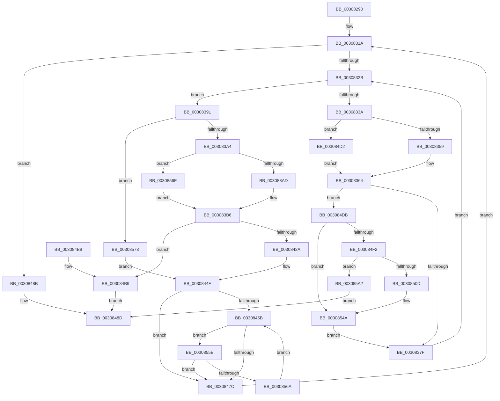

# HalpIommuMapLogical

- RVA: `0x00308290`–`0x003085B8` (길이 `808` bytes)
- VA: `0x0000000140308290`
- 실행 섹션: `.text`
- PDB 이름 있음: `예`; PDB Function 태그: `아니요`
- unwind 정보 RVA: `0x000739C4`
- 디코드: `219`개 명령, `808/808` bytes 표시
- 미해석 바이트: `0` (있으면 어셈블리에 `.byte`로 보존)

> 이 문서는 커널 이미지의 기계어와 PDB 기호를 분석해 생성했습니다. 4번과 5번은 함수 원형과 자료형을 바이너리 사용 방식에서 추정한 C 해석이며 원본 소스 복구 결과는 아닙니다.

## 1. Dependencies

- 직접 호출 지점: **11**; 고유 호출 대상: **8**
- 직접 호출자로 확인된 함수: **1**
- RIP 상대 이미지 참조: **1**

### Outgoing calls
- `0x00308406` → [guard_dispatch_icall](../6B/guard_dispatch_icall_function_006BAAD0.md) (function, `0x006BAAD0`)
- `0x00308434` → [HalpIommuFlushPhysicalPtesFromCacheSize](HalpIommuFlushPhysicalPtesFromCacheSize_function_0030885C.md) (function, `0x0030885C`)
- `0x00308498` → [_security_check_cookie](../6A/_security_check_cookie_function_006AC640.md) (function, `0x006AC640`)
- `0x003084C6` → [HalpIommuUnmapLogicalRange](HalpIommuUnmapLogicalRange_function_00308660.md) (function, `0x00308660`)
- `0x003084E2` → [KeAcquireSpinLockRaiseToDpc](../20/KeAcquireSpinLockRaiseToDpc_function_00208470.md) (function, `0x00208470`)
- `0x003084FB` → [HalpIommuAllocateAndZeroPageTable](../3F/HalpIommuAllocateAndZeroPageTable_function_003F8B30.md) (function, `0x003F8B30`)
- `0x00308510` → [MmGetPhysicalAddress](../23/MmGetPhysicalAddress_function_0023A500.md) (function, `0x0023A500`)
- `0x00308535` → [guard_dispatch_icall](../6B/guard_dispatch_icall_function_006BAAD0.md) (function, `0x006BAAD0`)
- `0x00308541` → [HalpIommuFlushPhysicalPtesFromCacheSize](HalpIommuFlushPhysicalPtesFromCacheSize_function_0030885C.md) (function, `0x0030885C`)
- `0x0030854F` → [KeReleaseSpinLock](../39/KeReleaseSpinLock_function_00392BA0.md) (function, `0x00392BA0`)
- `0x003085A9` → [KeReleaseSpinLock](../39/KeReleaseSpinLock_function_00392BA0.md) (function, `0x00392BA0`)

### Direct callers
- [HalpIommuDomainMapLogical](HalpIommuDomainMapLogical_function_0030769C.md) at `0x003076E7`

### Static image references
- `0x003082A9` → RVA `0x00E0A740` (`.data`; read)

## 2. Other-region calls and transfers

- 다른 실행 섹션으로 향하는 call: **0**
- 별도 외부 분기/꼬리 이동을 확인하지 못했습니다.

## 3. Assembly (complete function range)

```asm
00308290  4C 8B DC                        mov r11, rsp
00308293  49 89 5B 08                     mov qword ptr [r11 + 8], rbx
00308297  55                              push rbp
00308298  56                              push rsi
00308299  57                              push rdi
0030829A  41 54                           push r12
0030829C  41 55                           push r13
0030829E  41 56                           push r14
003082A0  41 57                           push r15
003082A2  48 81 EC A0 00 00 00            sub rsp, 0xa0
003082A9  48 8B 05 90 24 B0 00            mov rax, qword ptr [rip + 0xb02490]
003082B0  48 33 C4                        xor rax, rsp
003082B3  48 89 84 24 90 00 00 00         mov qword ptr [rsp + 0x90], rax
003082BB  44 8B 52 1C                     mov r10d, dword ptr [rdx + 0x1c]
003082BF  0F 57 C0                        xorps xmm0, xmm0
003082C2  4C 8B 7A 10                     mov r15, qword ptr [rdx + 0x10]
003082C6  45 33 F6                        xor r14d, r14d
003082C9  48 8B AC 24 08 01 00 00         mov rbp, qword ptr [rsp + 0x108]
003082D1  BB 01 00 00 00                  mov ebx, 1
003082D6  0F 11 44 24 60                  movups xmmword ptr [rsp + 0x60], xmm0
003082DB  44 8B E3                        mov r12d, ebx
003082DE  41 8B CA                        mov ecx, r10d
003082E1  41 D3 E4                        shl r12d, cl
003082E4  33 FF                           xor edi, edi
003082E6  48 21 7C 24 48                  and qword ptr [rsp + 0x48], rdi
003082EB  48 8B F2                        mov rsi, rdx
003082EE  0F 11 44 24 70                  movups xmmword ptr [rsp + 0x70], xmm0
003082F3  44 89 64 24 40                  mov dword ptr [rsp + 0x40], r12d
003082F8  4C 89 4C 24 50                  mov qword ptr [rsp + 0x50], r9
003082FD  44 89 44 24 44                  mov dword ptr [rsp + 0x44], r8d
00308302  44 89 54 24 34                  mov dword ptr [rsp + 0x34], r10d
00308307  41 0F 11 43 A8                  movups xmmword ptr [r11 - 0x58], xmm0
0030830C  4D 89 7B 88                     mov qword ptr [r11 - 0x78], r15
00308310  44 89 74 24 38                  mov dword ptr [rsp + 0x38], r14d
00308315  48 89 6C 24 58                  mov qword ptr [rsp + 0x58], rbp
0030831A  45 8B DE                        mov r11d, r14d
0030831D  4C 3B 9C 24 00 01 00 00         cmp r11, qword ptr [rsp + 0x100]
00308325  0F 83 60 01 00 00               jae 0x14030848b
0030832B  44 8B 4E 18                     mov r9d, dword ptr [rsi + 0x18]
0030832F  41 FF C9                        dec r9d
00308332  44 8B C7                        mov r8d, edi
00308335  41 3B F9                        cmp edi, r9d
00308338  73 57                           jae 0x140308391
0030833A  42 8B 54 86 24                  mov edx, dword ptr [rsi + r8*4 + 0x24]
0030833F  8B C3                           mov eax, ebx
00308341  8B CA                           mov ecx, edx
00308343  D3 E0                           shl eax, cl
00308345  41 8B CA                        mov ecx, r10d
00308348  D3 E0                           shl eax, cl
0030834A  4C 63 F0                        movsxd r14, eax
0030834D  4D 03 F7                        add r14, r15
00308350  83 FA 40                        cmp edx, 0x40
00308353  0F 83 79 01 00 00               jae 0x1403084d2
00308359  8B CA                           mov ecx, edx
0030835B  48 8B C3                        mov rax, rbx
0030835E  48 D3 E0                        shl rax, cl
00308361  48 2B C3                        sub rax, rbx
00308364  42 8B 4C 86 3C                  mov ecx, dword ptr [rsi + r8*4 + 0x3c]
00308369  48 8B DD                        mov rbx, rbp
0030836C  48 D3 EB                        shr rbx, cl
0030836F  23 D8                           and ebx, eax
00308371  44 8B E3                        mov r12d, ebx
00308374  49 83 3C DE 00                  cmp qword ptr [r14 + rbx*8], 0
00308379  0F 84 5C 01 00 00               je 0x1403084db
0030837F  4F 8B 3C E6                     mov r15, qword ptr [r14 + r12*8]
00308383  BB 01 00 00 00                  mov ebx, 1
00308388  03 FB                           add edi, ebx
0030838A  4C 89 7C FC 60                  mov qword ptr [rsp + rdi*8 + 0x60], r15
0030838F  EB 9A                           jmp 0x14030832b
00308391  44 8B 6C 24 44                  mov r13d, dword ptr [rsp + 0x44]
00308396  42 8B 4C 86 24                  mov ecx, dword ptr [rsi + r8*4 + 0x24]
0030839B  45 85 ED                        test r13d, r13d
0030839E  0F 84 D4 01 00 00               je 0x140308578
003083A4  83 F9 40                        cmp ecx, 0x40
003083A7  0F 83 C2 01 00 00               jae 0x14030856f
003083AD  48 8B C3                        mov rax, rbx
003083B0  48 D3 E0                        shl rax, cl
003083B3  48 2B C3                        sub rax, rbx
003083B6  42 8B 4C 86 3C                  mov ecx, dword ptr [rsi + r8*4 + 0x3c]
003083BB  48 8B D5                        mov rdx, rbp
003083BE  44 8B 74 24 38                  mov r14d, dword ptr [rsp + 0x38]
003083C3  45 8B C5                        mov r8d, r13d
003083C6  48 D3 EA                        shr rdx, cl
003083C9  41 8B CA                        mov ecx, r10d
003083CC  23 D0                           and edx, eax
003083CE  8B 84 24 00 01 00 00            mov eax, dword ptr [rsp + 0x100]
003083D5  44 8B E2                        mov r12d, edx
003083D8  41 2B C6                        sub eax, r14d
003083DB  41 D3 E4                        shl r12d, cl
003083DE  42 8B 4C 8E 24                  mov ecx, dword ptr [rsi + r9*4 + 0x24]
003083E3  4D 03 E7                        add r12, r15
003083E6  D3 E3                           shl ebx, cl
003083E8  49 8B CC                        mov rcx, r12
003083EB  2B DA                           sub ebx, edx
003083ED  48 8B 54 24 50                  mov rdx, qword ptr [rsp + 0x50]
003083F2  3B C3                           cmp eax, ebx
003083F4  0F 46 D8                        cmovbe ebx, eax
003083F7  48 8B 46 58                     mov rax, qword ptr [rsi + 0x58]
003083FB  4A 8D 14 F2                     lea rdx, [rdx + r14*8]
003083FF  44 8B CB                        mov r9d, ebx
00308402  48 8B 40 10                     mov rax, qword ptr [rax + 0x10]
00308406  E8 C5 26 3B 00                  call 0x1406baad0
0030840B  4C 8B 6C 24 48                  mov r13, qword ptr [rsp + 0x48]
00308410  8B C8                           mov ecx, eax
00308412  C1 E1 0C                        shl ecx, 0xc
00308415  4C 03 E9                        add r13, rcx
00308418  4C 89 6C 24 48                  mov qword ptr [rsp + 0x48], r13
0030841D  4C 89 6C 24 38                  mov qword ptr [rsp + 0x38], r13
00308422  3B C3                           cmp eax, ebx
00308424  0F 85 8F 00 00 00               jne 0x1403084b9
0030842A  8B D3                           mov edx, ebx
0030842C  49 8B CC                        mov rcx, r12
0030842F  0F AF 54 24 40                  imul edx, dword ptr [rsp + 0x40]
00308434  E8 23 04 00 00                  call 0x14030885c
00308439  44 8B 54 24 34                  mov r10d, dword ptr [rsp + 0x34]
0030843E  8B C3                           mov eax, ebx
00308440  44 8B C3                        mov r8d, ebx
00308443  BB 01 00 00 00                  mov ebx, 1
00308448  49 C1 E0 0C                     shl r8, 0xc
0030844C  4C 03 C5                        add r8, rbp
0030844F  44 03 F0                        add r14d, eax
00308452  44 89 74 24 38                  mov dword ptr [rsp + 0x38], r14d
00308457  85 FF                           test edi, edi
00308459  74 21                           je 0x14030847c
0030845B  44 8D 4F FF                     lea r9d, [rdi - 1]
0030845F  48 8B D3                        mov rdx, rbx
00308462  42 8B 4C 8E 3C                  mov ecx, dword ptr [rsi + r9*4 + 0x3c]
00308467  49 8B C0                        mov rax, r8
0030846A  48 D3 E2                        shl rdx, cl
0030846D  48 23 C2                        and rax, rdx
00308470  48 23 D5                        and rdx, rbp
00308473  48 3B C2                        cmp rax, rdx
00308476  0F 85 E2 00 00 00               jne 0x14030855e
0030847C  8B C7                           mov eax, edi
0030847E  49 8B E8                        mov rbp, r8
00308481  4C 8B 7C C4 60                  mov r15, qword ptr [rsp + rax*8 + 0x60]
00308486  E9 8F FE FF FF                  jmp 0x14030831a
0030848B  33 C0                           xor eax, eax
0030848D  48 8B 8C 24 90 00 00 00         mov rcx, qword ptr [rsp + 0x90]
00308495  48 33 CC                        xor rcx, rsp
00308498  E8 A3 41 3A 00                  call 0x1406ac640
0030849D  48 8B 9C 24 E0 00 00 00         mov rbx, qword ptr [rsp + 0xe0]
003084A5  48 81 C4 A0 00 00 00            add rsp, 0xa0
003084AC  41 5F                           pop r15
003084AE  41 5E                           pop r14
003084B0  41 5D                           pop r13
003084B2  41 5C                           pop r12
003084B4  5F                              pop rdi
003084B5  5E                              pop rsi
003084B6  5D                              pop rbp
003084B7  C3                              ret
003084B8  CC                              int3
003084B9  4C 8B 44 24 58                  mov r8, qword ptr [rsp + 0x58]
003084BE  48 8D 54 24 38                  lea rdx, [rsp + 0x38]
003084C3  48 8B CE                        mov rcx, rsi
003084C6  E8 95 01 00 00                  call 0x140308660
003084CB  B8 0D 00 00 C0                  mov eax, 0xc000000d
003084D0  EB BB                           jmp 0x14030848d
003084D2  48 83 C8 FF                     or rax, 0xffffffffffffffff
003084D6  E9 89 FE FF FF                  jmp 0x140308364
003084DB  4C 8D 6E 08                     lea r13, [rsi + 8]
003084DF  49 8B CD                        mov rcx, r13
003084E2  E8 89 FF EF FF                  call 0x140208470
003084E7  49 83 3C DE 00                  cmp qword ptr [r14 + rbx*8], 0
003084EC  88 44 24 30                     mov byte ptr [rsp + 0x30], al
003084F0  75 58                           jne 0x14030854a
003084F2  8D 57 01                        lea edx, [rdi + 1]
003084F5  45 33 C0                        xor r8d, r8d
003084F8  48 8B CE                        mov rcx, rsi
003084FB  E8 30 06 0F 00                  call 0x1403f8b30
00308500  49 89 04 DE                     mov qword ptr [r14 + rbx*8], rax
00308504  48 85 C0                        test rax, rax
00308507  0F 84 95 00 00 00               je 0x1403085a2
0030850D  48 8B C8                        mov rcx, rax
00308510  E8 EB 1F F3 FF                  call 0x14023a500
00308515  8B 4C 24 34                     mov ecx, dword ptr [rsp + 0x34]
00308519  4C 8B C0                        mov r8, rax
0030851C  8B 56 18                        mov edx, dword ptr [rsi + 0x18]
0030851F  D3 E3                           shl ebx, cl
00308521  2B D7                           sub edx, edi
00308523  48 8B 4E 58                     mov rcx, qword ptr [rsi + 0x58]
00308527  49 03 DF                        add rbx, r15
0030852A  FF CA                           dec edx
0030852C  4C 8B 09                        mov r9, qword ptr [rcx]
0030852F  48 8B CB                        mov rcx, rbx
00308532  49 8B C1                        mov rax, r9
00308535  E8 96 25 3B 00                  call 0x1406baad0
0030853A  8B 54 24 40                     mov edx, dword ptr [rsp + 0x40]
0030853E  48 8B CB                        mov rcx, rbx
00308541  E8 16 03 00 00                  call 0x14030885c
00308546  8A 44 24 30                     mov al, byte ptr [rsp + 0x30]
0030854A  8A D0                           mov dl, al
0030854C  49 8B CD                        mov rcx, r13
0030854F  E8 4C A6 08 00                  call 0x140392ba0
00308554  44 8B 54 24 34                  mov r10d, dword ptr [rsp + 0x34]
00308559  E9 21 FE FF FF                  jmp 0x14030837f
0030855E  41 8B F9                        mov edi, r9d
00308561  45 85 C9                        test r9d, r9d
00308564  0F 84 12 FF FF FF               je 0x14030847c
0030856A  E9 EC FE FF FF                  jmp 0x14030845b
0030856F  48 83 C8 FF                     or rax, 0xffffffffffffffff
00308573  E9 3E FE FF FF                  jmp 0x1403083b6
00308578  44 8B 74 24 38                  mov r14d, dword ptr [rsp + 0x38]
0030857D  83 C1 0C                        add ecx, 0xc
00308580  48 8B C3                        mov rax, rbx
00308583  48 D3 E0                        shl rax, cl
00308586  4C 8D 04 28                     lea r8, [rax + rbp]
0030858A  48 FF C8                        dec rax
0030858D  48 F7 D0                        not rax
00308590  4C 23 C0                        and r8, rax
00308593  49 8B C0                        mov rax, r8
00308596  48 2B C5                        sub rax, rbp
00308599  48 C1 E8 0C                     shr rax, 0xc
0030859D  E9 AD FE FF FF                  jmp 0x14030844f
003085A2  8A 54 24 30                     mov dl, byte ptr [rsp + 0x30]
003085A6  49 8B CD                        mov rcx, r13
003085A9  E8 F2 A5 08 00                  call 0x140392ba0
003085AE  B8 9A 00 00 C0                  mov eax, 0xc000009a
003085B3  E9 D5 FE FF FF                  jmp 0x14030848d
```

## 4. C-style interpretation (structured pseudocode)

```c
__int64 __fastcall HalpIommuMapLogical(__int64 a1, __int64 a2, int a3, __int64 a4, unsigned int a5, __int64 a6)
{
    __int64 result;
    __int64 v_r12;
    __int64 v_r13;
    __int64 v_r14;
    __int64 v_rbx;
    __int64 v_rdi;
    __int64 v_rsp;
    unsigned __int64 v_stack_m48;
    unsigned __int64 v_stack_m68;
    unsigned __int64 v_stack_m78;
    unsigned __int64 v_stack_m80;
    unsigned __int64 v_stack_m88;
    unsigned __int64 v_stack_m90;
    unsigned int v_stack_m94;
    unsigned int v_stack_m98;
    unsigned int v_stack_mA0;
    unsigned int v_stack_mA4;
    unsigned __int8 v_stack_p30;
    unsigned int v_stack_p34;
    unsigned __int64 v_stack_p38;
    unsigned int v_stack_p40;
    unsigned __int64 v_stack_p58;
    unsigned __int64 v_stack_p8;

    *(unsigned __int64 *)(v_rsp + 8) = v_rbx;
    v_rsp = (v_rsp) - (160);
    result = (*(unsigned __int64 *)(v_rip + 11543696)) ^ (v_rsp);
    v_stack_m48 = result;
    v_r14 = 0;
    v_stack_m78 = v_xmm0;
    v_r12 = (unsigned int)((1) << ((unsigned __int8)((unsigned int)((unsigned int)((unsigned int)(*(unsigned int *)(a2 + 28)))))));
    v_rdi = 0;
    v_stack_m68 = v_xmm0;
    v_stack_m98 = (unsigned int)(v_r12);
    v_stack_m88 = a4;
    v_stack_m94 = a3;
    v_stack_mA4 = (unsigned int)((unsigned int)(*(unsigned int *)(a2 + 28)));
    *(unsigned __int64 *)(v_rsp - 88) = v_xmm0;
    *(unsigned __int64 *)(v_rsp - 120) = *(unsigned __int64 *)(a2 + 16);
    v_stack_mA0 = 0;
    v_stack_m80 = a6;
loc_0030831A:
    if (0 >= a5) goto loc_0030848B;
loc_0030832B:
    a4 = (unsigned int)(((unsigned int)(*(unsigned int *)(a2 + 24))) - 1);
    if (0 >= ((unsigned int)(a4))) goto loc_00308391;
    result = (unsigned int)((1) << ((unsigned __int8)((unsigned int)((unsigned int)((unsigned int)(*(unsigned int *)(a2 + 0 * 4 + 36)))))));
    result = (unsigned int)((result) << ((unsigned __int8)((unsigned int)((unsigned int)((unsigned int)(*(unsigned int *)(a2 + 28)))))));
    v_r14 = ((int)((unsigned int)(result))) + (*(unsigned __int64 *)(a2 + 16));
    if (((unsigned int)((unsigned int)(*(unsigned int *)(a2 + 0 * 4 + 36)))) >= 64) goto loc_003084D2;
    result = (1) << ((unsigned __int8)((unsigned int)((unsigned int)((unsigned int)(*(unsigned int *)(a2 + 0 * 4 + 36))))));
    result = (result) - (1);
loc_00308364:
    v_rbx = (a6) >> ((unsigned __int8)((unsigned int)(*(unsigned int *)(a2 + 0 * 4 + 60))));
    v_rbx = (unsigned int)((v_rbx) & ((unsigned int)(result)));
    if ((*(unsigned __int64 *)(v_r14 + v_rbx * 8)) == 0) goto loc_003084DB;
loc_0030837F:
    v_rdi = (unsigned int)((v_rdi) + (1));
    *(unsigned __int64 *)(v_rsp + v_rdi * 8 + 96) = *(unsigned __int64 *)(v_r14 + (unsigned int)((unsigned int)(v_rbx)) * 8);
    goto loc_0030832B;
loc_00308391:
    if ((unsigned int)((unsigned int)(v_stack_m94)) == 0) goto loc_00308578;
    if (((unsigned int)((unsigned int)(*(unsigned int *)(a2 + 0 * 4 + 36)))) >= 64) goto loc_0030856F;
    result = (1) << ((unsigned __int8)((unsigned int)(*(unsigned int *)(a2 + 0 * 4 + 36))));
    result = (result) - (1);
loc_003083B6:
    a2 = (a6) >> ((unsigned __int8)((unsigned int)(*(unsigned int *)(a2 + 0 * 4 + 60))));
    a2 = (unsigned int)((a2) & ((unsigned int)(result)));
    result = (unsigned int)(((unsigned int)(a5)) - ((unsigned int)((unsigned int)(v_stack_mA0))));
    v_r12 = (unsigned int)(((unsigned int)((unsigned int)(a2))) << ((unsigned __int8)((unsigned int)((unsigned int)((unsigned int)(*(unsigned int *)(a2 + 28)))))));
    v_r12 = (v_r12) + (*(unsigned __int64 *)(v_r14 + (unsigned int)((unsigned int)(v_rbx)) * 8));
    v_rbx = (unsigned int)((1) << ((unsigned __int8)((unsigned int)(*(unsigned int *)(a2 + a4 * 4 + 36)))));
    v_rbx = (unsigned int)((v_rbx) - ((unsigned int)(a2)));
    if (((unsigned int)(result)) <= ((unsigned int)(v_rbx))) { v_rbx = (unsigned int)(result); }
    result = guard_dispatch_icall(v_r12, v_stack_m88 + (unsigned int)(v_stack_mA0) * 8, (unsigned int)((unsigned int)((unsigned int)(v_stack_m94))), (unsigned int)((unsigned int)(v_rbx)));
    a1 = (unsigned int)(((unsigned int)((unsigned int)(result))) << (12));
    v_r13 = (v_stack_m90) + (a1);
    v_stack_m90 = v_r13;
    v_stack_mA0 = v_r13;
    if (((unsigned int)(result)) != ((unsigned int)(v_rbx))) goto loc_003084B9;
    a2 = (unsigned int)(((unsigned int)((unsigned int)(v_rbx))) * (v_stack_m98));
    result = HalpIommuFlushPhysicalPtesFromCacheSize(v_r12, a2, (unsigned int)((unsigned int)((unsigned int)(v_stack_m94))), (unsigned int)((unsigned int)(v_rbx)));
    a3 = ((unsigned int)((unsigned int)(v_rbx))) << (12);
    a3 = (a3) + (a6);
loc_0030844F:
    v_r14 = (unsigned int)(((unsigned int)(v_stack_mA0)) + ((unsigned int)((unsigned int)((unsigned int)(v_rbx)))));
    v_stack_mA0 = (unsigned int)(v_r14);
    if ((unsigned int)(v_rdi) == 0) goto loc_0030847C;
loc_0030845B:
    a2 = (1) << ((unsigned __int8)((unsigned int)(*(unsigned int *)(a2 + v_rdi - 1 * 4 + 60))));
    result = (a3) & (a2);
    a2 = (a2) & (a6);
    if (result != a2) goto loc_0030855E;
loc_0030847C:
    goto loc_0030831A;
loc_0030848B:
    result = 0;
loc_0030848D:
    a1 = (v_stack_m48) ^ (v_rsp);
    result = _security_check_cookie(a1, a2, a3, v_rdi - 1);
    v_rsp = (v_rsp) + (160);
    return result;
loc_003084B9:
    result = HalpIommuUnmapLogicalRange(a2, v_stack_p38, v_stack_p58, v_rdi - 1);
    goto loc_0030848D;
loc_003084D2:
    result = ((unsigned int)(0xC000000DULL)) | (-1);
    goto loc_00308364;
loc_003084DB:
    result = KeAcquireSpinLockRaiseToDpc(a2 + 8, v_stack_p38, v_stack_p58, v_rdi - 1);
    v_stack_p30 = (unsigned __int8)(result);
    if ((*(unsigned __int64 *)(v_r14 + v_stack_p8 * 8)) != 0) goto loc_0030854A;
    a3 = 0;
    result = HalpIommuAllocateAndZeroPageTable(a2, v_rdi + 1, a3, v_rdi - 1);
    *(unsigned __int64 *)(v_r14 + v_stack_p8 * 8) = result;
    if (result == 0) goto loc_003085A2;
    result = MmGetPhysicalAddress(result, v_rdi + 1, a3, v_rdi - 1);
    v_rbx = (unsigned int)((v_stack_p8) << ((unsigned __int8)((unsigned int)(v_stack_p34))));
    a2 = (unsigned int)(((unsigned int)(*(unsigned int *)(a2 + 24))) - ((unsigned int)(v_rdi)));
    v_rbx = (v_rbx) + (*(unsigned __int64 *)(v_rsp + (unsigned int)((unsigned int)(v_rdi)) * 8 + 96));
    a2 = (unsigned int)((a2) - 1);
    result = guard_dispatch_icall(v_rbx, a2, result, *(unsigned __int64 *)(*(unsigned __int64 *)(a2 + 88)));
    result = HalpIommuFlushPhysicalPtesFromCacheSize(v_rbx, (unsigned int)(v_stack_p40), result, *(unsigned __int64 *)(*(unsigned __int64 *)(a2 + 88)));
loc_0030854A:
    result = KeReleaseSpinLock(a2 + 8, (unsigned __int8)(v_stack_p30), result, *(unsigned __int64 *)(*(unsigned __int64 *)(a2 + 88)));
    goto loc_0030837F;
loc_0030855E:
    if ((unsigned int)(*(unsigned __int64 *)(*(unsigned __int64 *)(a2 + 88))) == 0) goto loc_0030847C;
    goto loc_0030845B;
loc_0030856F:
    result = (result) | (-1);
    goto loc_003083B6;
loc_00308578:
    a1 = (unsigned int)((a2 + 8) + (12));
    result = (v_rbx) << ((unsigned __int8)(a1));
    result = (result) - 1;
    result = ~(result);
    a3 = (result + a3 * 1) & (result);
    result = (a3) - (a3);
    result = (result) >> (12);
    goto loc_0030844F;
loc_003085A2:
    result = KeReleaseSpinLock(a2 + 8, v_stack_p30, a3, *(unsigned __int64 *)(*(unsigned __int64 *)(a2 + 88)));
    goto loc_0030848D;
}
```

## 5. (Beta) C Style

```c
int64_t HalpIommuMapLogical(int64_t Arg1, void *Arg2, int32_t Arg3, int64_t Arg4, uint32_t Arg5, int64_t Arg6)
{
    uint8_t *arg2 = (uint8_t *)Arg2;

    int64_t result;
    int64_t local_r12;
    int64_t local_r13;
    int64_t local_r14;
    int64_t local_rbx;
    int64_t local_rdi;
    int64_t local_rsp;
    uint64_t v_stack_m48;
    uint64_t v_stack_m68;
    uint64_t v_stack_m78;
    uint64_t v_stack_m80;
    uint64_t v_stack_m88;
    uint64_t v_stack_m90;
    uint32_t v_stack_m94;
    uint32_t v_stack_m98;
    uint32_t v_stack_mA0;
    uint32_t v_stack_mA4;
    uint8_t v_stack_p30;
    uint32_t v_stack_p34;
    uint64_t v_stack_p38;
    uint32_t v_stack_p40;
    uint64_t v_stack_p58;
    uint64_t v_stack_p8;

    *(uint64_t *)(local_rsp + 0x8) = local_rbx;
    local_rsp = (local_rsp) - (160);
    result = (*(uint64_t *)(v_rip + 0xB02490)) ^ (local_rsp);
    v_stack_m48 = result;
    local_r14 = 0;
    v_stack_m78 = v_xmm0;
    local_r12 = (uint32_t)((1) << ((uint8_t)((uint32_t)((uint32_t)((uint32_t)(*(uint32_t *)(arg2 + 0x1C)))))));
    local_rdi = 0;
    v_stack_m68 = v_xmm0;
    v_stack_m98 = (uint32_t)(local_r12);
    v_stack_m88 = Arg4;
    v_stack_m94 = Arg3;
    v_stack_mA4 = (uint32_t)((uint32_t)(*(uint32_t *)(arg2 + 0x1C)));
    *(uint64_t *)(local_rsp - 0x58) = v_xmm0;
    *(uint64_t *)(local_rsp - 0x78) = *(uint64_t *)(arg2 + 0x10);
    v_stack_mA0 = 0;
    v_stack_m80 = Arg6;
loc_0030831A:
    if (0 >= Arg5) goto loc_0030848B;
loc_0030832B:
    Arg4 = (uint32_t)(((uint32_t)(*(uint32_t *)(arg2 + 0x18))) - 1);
    if (0 >= ((uint32_t)(Arg4))) goto loc_00308391;
    result = (uint32_t)((1) << ((uint8_t)((uint32_t)((uint32_t)((uint32_t)(*(uint32_t *)(arg2 + 0x0 * 4 + 0x24)))))));
    result = (uint32_t)((result) << ((uint8_t)((uint32_t)((uint32_t)((uint32_t)(*(uint32_t *)(arg2 + 0x1C)))))));
    local_r14 = ((int32_t)((uint32_t)(result))) + (*(uint64_t *)(arg2 + 0x10));
    if (((uint32_t)((uint32_t)(*(uint32_t *)(arg2 + 0x0 * 4 + 0x24)))) >= 64) goto loc_003084D2;
    result = (1) << ((uint8_t)((uint32_t)((uint32_t)((uint32_t)(*(uint32_t *)(arg2 + 0x0 * 4 + 0x24))))));
    result = (result) - (1);
loc_00308364:
    local_rbx = (Arg6) >> ((uint8_t)((uint32_t)(*(uint32_t *)(arg2 + 0x0 * 4 + 0x3C))));
    local_rbx = (uint32_t)((local_rbx) & ((uint32_t)(result)));
    if ((*(uint64_t *)(local_r14 + local_rbx * 8)) == 0) goto loc_003084DB;
loc_0030837F:
    local_rdi = (uint32_t)((local_rdi) + (1));
    *(uint64_t *)(local_rsp + local_rdi * 8 + 0x60) = *(uint64_t *)(local_r14 + (uint32_t)((uint32_t)(local_rbx)) * 8);
    goto loc_0030832B;
loc_00308391:
    if ((uint32_t)((uint32_t)(v_stack_m94)) == 0) goto loc_00308578;
    if (((uint32_t)((uint32_t)(*(uint32_t *)(arg2 + 0x0 * 4 + 0x24)))) >= 64) goto loc_0030856F;
    result = (1) << ((uint8_t)((uint32_t)(*(uint32_t *)(arg2 + 0x0 * 4 + 0x24))));
    result = (result) - (1);
loc_003083B6:
    Arg2 = (Arg6) >> ((uint8_t)((uint32_t)(*(uint32_t *)(arg2 + 0x0 * 4 + 0x3C))));
    Arg2 = (uint32_t)((Arg2) & ((uint32_t)(result)));
    result = (uint32_t)(((uint32_t)(Arg5)) - ((uint32_t)((uint32_t)(v_stack_mA0))));
    local_r12 = (uint32_t)(((uint32_t)((uint32_t)(Arg2))) << ((uint8_t)((uint32_t)((uint32_t)((uint32_t)(*(uint32_t *)(arg2 + 0x1C)))))));
    local_r12 = (local_r12) + (*(uint64_t *)(local_r14 + (uint32_t)((uint32_t)(local_rbx)) * 8));
    local_rbx = (uint32_t)((1) << ((uint8_t)((uint32_t)(*(uint32_t *)(arg2 + Arg4 * 4 + 0x24)))));
    local_rbx = (uint32_t)((local_rbx) - ((uint32_t)(Arg2)));
    if (((uint32_t)(result)) <= ((uint32_t)(local_rbx))) { local_rbx = (uint32_t)(result); }
    result = guard_dispatch_icall(local_r12, v_stack_m88 + (uint32_t)(v_stack_mA0) * 8, (uint32_t)((uint32_t)((uint32_t)(v_stack_m94))), (uint32_t)((uint32_t)(local_rbx)));
    Arg1 = (uint32_t)(((uint32_t)((uint32_t)(result))) << (12));
    local_r13 = (v_stack_m90) + (Arg1);
    v_stack_m90 = local_r13;
    v_stack_mA0 = local_r13;
    if (((uint32_t)(result)) != ((uint32_t)(local_rbx))) goto loc_003084B9;
    Arg2 = (uint32_t)(((uint32_t)((uint32_t)(local_rbx))) * (v_stack_m98));
    result = HalpIommuFlushPhysicalPtesFromCacheSize(local_r12, Arg2, (uint32_t)((uint32_t)((uint32_t)(v_stack_m94))), (uint32_t)((uint32_t)(local_rbx)));
    Arg3 = ((uint32_t)((uint32_t)(local_rbx))) << (12);
    Arg3 = (Arg3) + (Arg6);
loc_0030844F:
    local_r14 = (uint32_t)(((uint32_t)(v_stack_mA0)) + ((uint32_t)((uint32_t)((uint32_t)(local_rbx)))));
    v_stack_mA0 = (uint32_t)(local_r14);
    if ((uint32_t)(local_rdi) == 0) goto loc_0030847C;
loc_0030845B:
    Arg2 = (1) << ((uint8_t)((uint32_t)(*(uint32_t *)(arg2 + local_rdi - 0x1 * 4 + 0x3C))));
    result = (Arg3) & (Arg2);
    Arg2 = (Arg2) & (Arg6);
    if (result != Arg2) goto loc_0030855E;
loc_0030847C:
    goto loc_0030831A;
loc_0030848B:
    result = 0;
loc_0030848D:
    Arg1 = (v_stack_m48) ^ (local_rsp);
    result = _security_check_cookie(Arg1, Arg2, Arg3, local_rdi - 1);
    local_rsp = (local_rsp) + (160);
    return result;
loc_003084B9:
    result = HalpIommuUnmapLogicalRange(Arg2, v_stack_p38, v_stack_p58, local_rdi - 1);
    goto loc_0030848D;
loc_003084D2:
    result = ((uint32_t)(0xC000000DULL)) | (-1);
    goto loc_00308364;
loc_003084DB:
    result = KeAcquireSpinLockRaiseToDpc(Arg2 + 8, v_stack_p38, v_stack_p58, local_rdi - 1);
    v_stack_p30 = (uint8_t)(result);
    if ((*(uint64_t *)(local_r14 + v_stack_p8 * 8)) != 0) goto loc_0030854A;
    Arg3 = 0;
    result = HalpIommuAllocateAndZeroPageTable(Arg2, local_rdi + 1, Arg3, local_rdi - 1);
    *(uint64_t *)(local_r14 + v_stack_p8 * 8) = result;
    if (result == 0) goto loc_003085A2;
    result = MmGetPhysicalAddress(result, local_rdi + 1, Arg3, local_rdi - 1);
    local_rbx = (uint32_t)((v_stack_p8) << ((uint8_t)((uint32_t)(v_stack_p34))));
    Arg2 = (uint32_t)(((uint32_t)(*(uint32_t *)(arg2 + 0x18))) - ((uint32_t)(local_rdi)));
    local_rbx = (local_rbx) + (*(uint64_t *)(local_rsp + (uint32_t)((uint32_t)(local_rdi)) * 8 + 0x60));
    Arg2 = (uint32_t)((Arg2) - 1);
    result = guard_dispatch_icall(local_rbx, Arg2, result, *(uint64_t *)(*(uint64_t *)(arg2 + 0x58)));
    result = HalpIommuFlushPhysicalPtesFromCacheSize(local_rbx, (uint32_t)(v_stack_p40), result, *(uint64_t *)(*(uint64_t *)(arg2 + 0x58)));
loc_0030854A:
    result = KeReleaseSpinLock(Arg2 + 8, (uint8_t)(v_stack_p30), result, *(uint64_t *)(*(uint64_t *)(arg2 + 0x58)));
    goto loc_0030837F;
loc_0030855E:
    if ((uint32_t)(*(uint64_t *)(*(uint64_t *)(arg2 + 0x58))) == 0) goto loc_0030847C;
    goto loc_0030845B;
loc_0030856F:
    result = (result) | (-1);
    goto loc_003083B6;
loc_00308578:
    Arg1 = (uint32_t)((Arg2 + 8) + (12));
    result = (local_rbx) << ((uint8_t)(Arg1));
    result = (result) - 1;
    result = ~(result);
    Arg3 = (result + Arg3 * 1) & (result);
    result = (Arg3) - (Arg3);
    result = (result) >> (12);
    goto loc_0030844F;
loc_003085A2:
    result = KeReleaseSpinLock(Arg2 + 8, v_stack_p30, Arg3, *(uint64_t *)(*(uint64_t *)(arg2 + 0x58)));
    goto loc_0030848D;
}
```

### 관측된 메모리 오프셋

구조체 형식이 확인되지 않은 접근은 인자 기준의 오프셋으로만 기록했습니다.

| 기준 인자 | 오프셋 표현 | 폭 (bit) | 접근 |
|---|---:|---:|---|
| `Arg2` | `+ 0x8` | `64` | `R` |
| `Arg2` | `+ 0x10` | `64` | `R` |
| `Arg2` | `+ 0x18` | `32` | `R` |
| `Arg2` | `+ 0x1C` | `32` | `R` |
| `Arg2` | `+ 0x24 + r8*4` | `32` | `R` |
| `Arg2` | `+ 0x24 + r9*4` | `32` | `R` |
| `Arg2` | `+ 0x3C + r8*4` | `32` | `R` |
| `Arg2` | `+ 0x3C + r9*4` | `32` | `R` |
| `Arg2` | `+ 0x58` | `64` | `R` |

## 6. Execution-region graph

[열기: 2D/3D 그래프와 함수 탐색 컨트롤 패널](../../../control-panel.html?section=text&rva=0x00308290&view=graph)

- 2D 그래프는 위에서 아래로 흐르고, 3D 그래프는 빈 공간을 드래그해 회전합니다. Shift+드래그는 이동, 휠은 확대·축소, 함수 노드 선택은 대상 보고서 이동입니다.

### Static fallback


