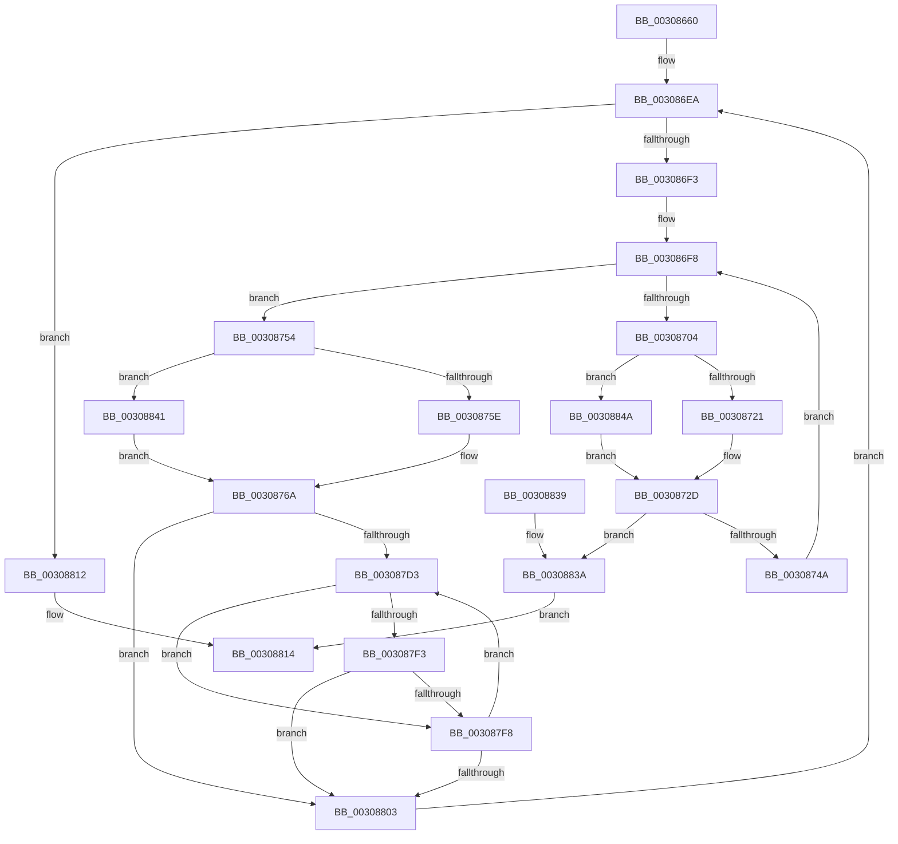

# HalpIommuUnmapLogicalRange

- RVA: `0x00308660`–`0x00308853` (길이 `499` bytes)
- VA: `0x0000000140308660`
- 실행 섹션: `.text`
- PDB 이름 있음: `예`; PDB Function 태그: `아니요`
- unwind 정보 RVA: `0x000739EC`
- 디코드: `151`개 명령, `499/499` bytes 표시
- 미해석 바이트: `0` (있으면 어셈블리에 `.byte`로 보존)

> 이 문서는 커널 이미지의 기계어와 PDB 기호를 분석해 생성했습니다. 4번과 5번은 함수 원형과 자료형을 바이너리 사용 방식에서 추정한 C 해석이며 원본 소스 복구 결과는 아닙니다.

## 1. Dependencies

- 직접 호출 지점: **3**; 고유 호출 대상: **3**
- 직접 호출자로 확인된 함수: **6**
- RIP 상대 이미지 참조: **1**

### Outgoing calls
- `0x003087A7` → [memset](../6C/memset_function_006C6C40.md) (function, `0x006C6C40`)
- `0x003087B2` → [HalpIommuFlushPhysicalPtesFromCacheSize](HalpIommuFlushPhysicalPtesFromCacheSize_function_0030885C.md) (function, `0x0030885C`)
- `0x0030881C` → [_security_check_cookie](../6A/_security_check_cookie_function_006AC640.md) (function, `0x006AC640`)

### Direct callers
- [IommuUnmapLogicalRange](IommuUnmapLogicalRange_function_00306EC0.md) at `0x00306F4B`
- [HalpIommuDomainUnmapLogicalRange](HalpIommuDomainUnmapLogicalRange_function_00307258.md) at `0x003072D4`
- [HalpIommuMapLogical](HalpIommuMapLogical_function_00308290.md) at `0x003084C6`
- [HalpIommuMapLogicalRange](../56/HalpIommuMapLogicalRange_function_005690DC.md) at `0x005693C0`
- [sub_006F785E](../6F/Unknown_function_006F785E.md) at `0x006F790E`
- [sub_006F85EE](../6F/Unknown_function_006F85EE.md) at `0x006F8636`

### Static image references
- `0x00308674` → RVA `0x00E0A740` (`.data`; read)

## 2. Other-region calls and transfers

- 다른 실행 섹션으로 향하는 call: **0**
- 별도 외부 분기/꼬리 이동을 확인하지 못했습니다.

## 3. Assembly (complete function range)

```asm
00308660  48 89 5C 24 20                  mov qword ptr [rsp + 0x20], rbx
00308665  55                              push rbp
00308666  56                              push rsi
00308667  57                              push rdi
00308668  41 54                           push r12
0030866A  41 55                           push r13
0030866C  41 56                           push r14
0030866E  41 57                           push r15
00308670  48 83 EC 60                     sub rsp, 0x60
00308674  48 8B 05 C5 20 B0 00            mov rax, qword ptr [rip + 0xb020c5]
0030867B  48 33 C4                        xor rax, rsp
0030867E  48 89 44 24 50                  mov qword ptr [rsp + 0x50], rax
00308683  44 8B 61 1C                     mov r12d, dword ptr [rcx + 0x1c]
00308687  48 8B E9                        mov rbp, rcx
0030868A  48 8B 32                        mov rsi, qword ptr [rdx]
0030868D  48 C7 C0 00 F0 FF FF            mov rax, 0xfffffffffffff000
00308694  48 81 C6 FF 0F 00 00            add rsi, 0xfff
0030869B  0F 57 C0                        xorps xmm0, xmm0
0030869E  41 8B CC                        mov ecx, r12d
003086A1  41 BD 01 00 00 00               mov r13d, 1
003086A7  45 8B CD                        mov r9d, r13d
003086AA  4D 8B F0                        mov r14, r8
003086AD  41 D3 E1                        shl r9d, cl
003086B0  4C 23 F0                        and r14, rax
003086B3  49 8B C8                        mov rcx, r8
003086B6  81 E1 FF 0F 00 00               and ecx, 0xfff
003086BC  48 03 F1                        add rsi, rcx
003086BF  48 23 F0                        and rsi, rax
003086C2  41 8B C1                        mov eax, r9d
003086C5  48 89 32                        mov qword ptr [rdx], rsi
003086C8  4C 8B 4D 10                     mov r9, qword ptr [rbp + 0x10]
003086CC  48 C1 EE 0C                     shr rsi, 0xc
003086D0  48 0F AF F0                     imul rsi, rax
003086D4  0F 11 44 24 20                  movups xmmword ptr [rsp + 0x20], xmm0
003086D9  0F 11 44 24 30                  movups xmmword ptr [rsp + 0x30], xmm0
003086DE  33 FF                           xor edi, edi
003086E0  4C 89 4C 24 20                  mov qword ptr [rsp + 0x20], r9
003086E5  0F 11 44 24 40                  movups xmmword ptr [rsp + 0x40], xmm0
003086EA  48 85 F6                        test rsi, rsi
003086ED  0F 84 1F 01 00 00               je 0x140308812
003086F3  8B 5D 18                        mov ebx, dword ptr [rbp + 0x18]
003086F6  FF CB                           dec ebx
003086F8  44 8B D7                        mov r10d, edi
003086FB  46 8B 44 95 24                  mov r8d, dword ptr [rbp + r10*4 + 0x24]
00308700  3B FB                           cmp edi, ebx
00308702  73 50                           jae 0x140308754
00308704  41 8B C8                        mov ecx, r8d
00308707  41 8B C5                        mov eax, r13d
0030870A  D3 E0                           shl eax, cl
0030870C  41 8B CC                        mov ecx, r12d
0030870F  D3 E0                           shl eax, cl
00308711  4C 63 D8                        movsxd r11, eax
00308714  4D 03 D9                        add r11, r9
00308717  41 83 F8 40                     cmp r8d, 0x40
0030871B  0F 83 29 01 00 00               jae 0x14030884a
00308721  41 8B C8                        mov ecx, r8d
00308724  49 8B D5                        mov rdx, r13
00308727  48 D3 E2                        shl rdx, cl
0030872A  49 2B D5                        sub rdx, r13
0030872D  42 8B 4C 95 3C                  mov ecx, dword ptr [rbp + r10*4 + 0x3c]
00308732  49 8B C6                        mov rax, r14
00308735  48 D3 E8                        shr rax, cl
00308738  8B C0                           mov eax, eax
0030873A  48 23 C2                        and rax, rdx
0030873D  4D 8B 0C C3                     mov r9, qword ptr [r11 + rax*8]
00308741  4D 85 C9                        test r9, r9
00308744  0F 84 F0 00 00 00               je 0x14030883a
0030874A  41 03 FD                        add edi, r13d
0030874D  4C 89 4C FC 20                  mov qword ptr [rsp + rdi*8 + 0x20], r9
00308752  EB A4                           jmp 0x1403086f8
00308754  41 83 F8 40                     cmp r8d, 0x40
00308758  0F 83 E3 00 00 00               jae 0x140308841
0030875E  41 8B C8                        mov ecx, r8d
00308761  49 8B D5                        mov rdx, r13
00308764  48 D3 E2                        shl rdx, cl
00308767  49 2B D5                        sub rdx, r13
0030876A  42 8B 4C 95 3C                  mov ecx, dword ptr [rbp + r10*4 + 0x3c]
0030876F  41 8B C5                        mov eax, r13d
00308772  49 8B DE                        mov rbx, r14
00308775  4C 8B FE                        mov r15, rsi
00308778  48 D3 EB                        shr rbx, cl
0030877B  41 8B CC                        mov ecx, r12d
0030877E  23 DA                           and ebx, edx
00308780  D3 E3                           shl ebx, cl
00308782  41 8B C8                        mov ecx, r8d
00308785  D3 E0                           shl eax, cl
00308787  49 03 D9                        add rbx, r9
0030878A  41 8B CC                        mov ecx, r12d
0030878D  D3 E0                           shl eax, cl
0030878F  48 8B CB                        mov rcx, rbx
00308792  48 63 D0                        movsxd rdx, eax
00308795  48 2B D3                        sub rdx, rbx
00308798  49 03 D1                        add rdx, r9
0030879B  48 3B D6                        cmp rdx, rsi
0030879E  4C 0F 46 FA                     cmovbe r15, rdx
003087A2  33 D2                           xor edx, edx
003087A4  4D 8B C7                        mov r8, r15
003087A7  E8 94 E4 3B 00                  call 0x1406c6c40
003087AC  41 8B D7                        mov edx, r15d
003087AF  48 8B CB                        mov rcx, rbx
003087B2  E8 A5 00 00 00                  call 0x14030885c
003087B7  44 8B 55 18                     mov r10d, dword ptr [rbp + 0x18]
003087BB  49 2B F7                        sub rsi, r15
003087BE  41 8B CC                        mov ecx, r12d
003087C1  45 33 C0                        xor r8d, r8d
003087C4  49 D3 EF                        shr r15, cl
003087C7  49 C1 E7 0C                     shl r15, 0xc
003087CB  4D 03 FE                        add r15, r14
003087CE  45 2B D5                        sub r10d, r13d
003087D1  74 30                           je 0x140308803
003087D3  44 8D 4F FF                     lea r9d, [rdi - 1]
003087D7  49 8B D5                        mov rdx, r13
003087DA  42 8B 4C 8D 3C                  mov ecx, dword ptr [rbp + r9*4 + 0x3c]
003087DF  49 8B C7                        mov rax, r15
003087E2  48 D3 E2                        shl rdx, cl
003087E5  49 8B CE                        mov rcx, r14
003087E8  48 23 CA                        and rcx, rdx
003087EB  48 23 C2                        and rax, rdx
003087EE  48 3B C1                        cmp rax, rcx
003087F1  75 05                           jne 0x1403087f8
003087F3  48 85 F6                        test rsi, rsi
003087F6  75 0B                           jne 0x140308803
003087F8  45 03 C5                        add r8d, r13d
003087FB  41 8B F9                        mov edi, r9d
003087FE  45 3B C2                        cmp r8d, r10d
00308801  72 D0                           jb 0x1403087d3
00308803  8B C7                           mov eax, edi
00308805  4D 8B F7                        mov r14, r15
00308808  4C 8B 4C C4 20                  mov r9, qword ptr [rsp + rax*8 + 0x20]
0030880D  E9 D8 FE FF FF                  jmp 0x1403086ea
00308812  33 C0                           xor eax, eax
00308814  48 8B 4C 24 50                  mov rcx, qword ptr [rsp + 0x50]
00308819  48 33 CC                        xor rcx, rsp
0030881C  E8 1F 3E 3A 00                  call 0x1406ac640
00308821  48 8B 9C 24 B8 00 00 00         mov rbx, qword ptr [rsp + 0xb8]
00308829  48 83 C4 60                     add rsp, 0x60
0030882D  41 5F                           pop r15
0030882F  41 5E                           pop r14
00308831  41 5D                           pop r13
00308833  41 5C                           pop r12
00308835  5F                              pop rdi
00308836  5E                              pop rsi
00308837  5D                              pop rbp
00308838  C3                              ret
00308839  CC                              int3
0030883A  B8 0D 00 00 C0                  mov eax, 0xc000000d
0030883F  EB D3                           jmp 0x140308814
00308841  48 83 CA FF                     or rdx, 0xffffffffffffffff
00308845  E9 20 FF FF FF                  jmp 0x14030876a
0030884A  48 83 CA FF                     or rdx, 0xffffffffffffffff
0030884E  E9 DA FE FF FF                  jmp 0x14030872d
```

## 4. C-style interpretation (structured pseudocode)

```c
__int64 __fastcall HalpIommuUnmapLogicalRange(__int64 a1, __int64 a2, __int64 a3)
{
    __int64 result;
    __int64 v_r10;
    __int64 v_r11;
    __int64 v_r14;
    __int64 v_r15;
    __int64 v_rbx;
    __int64 v_rdi;
    __int64 v_rsi;
    __int64 v_rsp;
    unsigned __int64 v_stack_m48;
    unsigned __int64 v_stack_m58;
    unsigned __int64 v_stack_m68;
    unsigned __int64 v_stack_m78;
    unsigned __int64 v_stack_p20;

    v_stack_p20 = v_rbx;
    v_rsp = (v_rsp) - (96);
    result = (*(unsigned __int64 *)(v_rip + 11542725)) ^ (v_rsp);
    v_stack_m48 = result;
    v_rsi = (*(unsigned __int64 *)(a2)) + (0xFFFULL);
    a4 = (unsigned int)((1) << ((unsigned __int8)((unsigned int)((unsigned int)((unsigned int)(*(unsigned int *)(a1 + 28)))))));
    v_r14 = (a3) & (0xFFFFFFFFFFFFF000ULL);
    a1 = (unsigned int)((a3) & (0xFFFULL));
    v_rsi = (v_rsi) + (a1);
    v_rsi = (v_rsi) & (0xFFFFFFFFFFFFF000ULL);
    *(unsigned __int64 *)(a2) = v_rsi;
    v_rsi = (v_rsi) >> (12);
    v_rsi = (v_rsi) * ((unsigned int)((unsigned int)(a4)));
    v_stack_m78 = v_xmm0;
    v_stack_m68 = v_xmm0;
    v_rdi = 0;
    v_stack_m78 = *(unsigned __int64 *)(a1 + 16);
    v_stack_m58 = v_xmm0;
loc_003086EA:
    if (v_rsi == 0) goto loc_00308812;
    v_rbx = (unsigned int)(((unsigned int)(*(unsigned int *)(a1 + 24))) - 1);
loc_003086F8:
    if (0 >= ((unsigned int)(v_rbx))) goto loc_00308754;
    result = (unsigned int)((1) << ((unsigned __int8)((unsigned int)((unsigned int)((unsigned int)(*(unsigned int *)(a1 + 0 * 4 + 36)))))));
    result = (unsigned int)((result) << ((unsigned __int8)((unsigned int)((unsigned int)((unsigned int)(*(unsigned int *)(a1 + 28)))))));
    v_r11 = ((int)((unsigned int)(result))) + (*(unsigned __int64 *)(a1 + 16));
    if (((unsigned int)((unsigned int)(*(unsigned int *)(a1 + 0 * 4 + 36)))) >= 64) goto loc_0030884A;
    a2 = (1) << ((unsigned __int8)((unsigned int)((unsigned int)((unsigned int)(*(unsigned int *)(a1 + 0 * 4 + 36))))));
    a2 = (a2) - (1);
loc_0030872D:
    result = (v_r14) >> ((unsigned __int8)((unsigned int)(*(unsigned int *)(a1 + 0 * 4 + 60))));
    result = ((unsigned int)((unsigned int)(result))) & (a2);
    if (*(unsigned __int64 *)(v_r11 + result * 8) == 0) goto loc_0030883A;
    v_rdi = (unsigned int)((v_rdi) + (1));
    *(unsigned __int64 *)(v_rsp + v_rdi * 8 + 32) = *(unsigned __int64 *)(v_r11 + result * 8);
    goto loc_003086F8;
loc_00308754:
    if (((unsigned int)((unsigned int)(*(unsigned int *)(a1 + 0 * 4 + 36)))) >= 64) goto loc_00308841;
    a2 = (1) << ((unsigned __int8)((unsigned int)((unsigned int)((unsigned int)(*(unsigned int *)(a1 + 0 * 4 + 36))))));
    a2 = (a2) - (1);
loc_0030876A:
    v_rbx = (v_r14) >> ((unsigned __int8)((unsigned int)(*(unsigned int *)(a1 + 0 * 4 + 60))));
    v_rbx = (unsigned int)((v_rbx) & ((unsigned int)(a2)));
    v_rbx = (unsigned int)((v_rbx) << ((unsigned __int8)((unsigned int)((unsigned int)((unsigned int)(*(unsigned int *)(a1 + 28)))))));
    result = (unsigned int)((1) << ((unsigned __int8)((unsigned int)((unsigned int)((unsigned int)(*(unsigned int *)(a1 + 0 * 4 + 36)))))));
    v_rbx = (v_rbx) + (*(unsigned __int64 *)(v_r11 + result * 8));
    result = (unsigned int)((result) << ((unsigned __int8)((unsigned int)((unsigned int)((unsigned int)(*(unsigned int *)(a1 + 28)))))));
    a2 = ((int)((unsigned int)(result))) - (v_rbx);
    a2 = (a2) + (*(unsigned __int64 *)(v_r11 + result * 8));
    v_r15 = v_rsi;
    if (a2 <= v_rsi) { v_r15 = a2; }
    a2 = 0;
    result = memset(v_rbx, a2, v_r15, *(unsigned __int64 *)(v_r11 + result * 8));
    result = HalpIommuFlushPhysicalPtesFromCacheSize(v_rbx, (unsigned int)((unsigned int)(v_r15)), v_r15, *(unsigned __int64 *)(v_r11 + result * 8));
    v_rsi = (v_rsi) - (v_r15);
    a3 = 0;
    v_r15 = (v_r15) >> ((unsigned __int8)((unsigned int)((unsigned int)((unsigned int)(*(unsigned int *)(a1 + 28))))));
    v_r15 = (v_r15) << (12);
    v_r15 = (v_r15) + (v_r14);
    v_r10 = (unsigned int)(((unsigned int)(*(unsigned int *)(a1 + 24))) - (1));
    if (condition_is_equal) goto loc_00308803;
loc_003087D3:
    a2 = (1) << ((unsigned __int8)((unsigned int)(*(unsigned int *)(a1 + v_rdi - 1 * 4 + 60))));
    a1 = (v_r14) & (a2);
    result = (v_r15) & (a2);
    if (result != a1) goto loc_003087F8;
    if (v_rsi != 0) goto loc_00308803;
loc_003087F8:
    a3 = (unsigned int)((a3) + (1));
    if (((unsigned int)(a3)) < ((unsigned int)(v_r10))) goto loc_003087D3;
loc_00308803:
    goto loc_003086EA;
loc_00308812:
    result = 0;
loc_00308814:
    a1 = (v_stack_m48) ^ (v_rsp);
    result = _security_check_cookie(a1, a2, a3, *(unsigned __int64 *)(v_rsp + (unsigned int)((unsigned int)((unsigned int)((unsigned int)(v_rdi - 1)))) * 8 + 32));
    v_rsp = (v_rsp) + (96);
    return result;
loc_0030883A:
    goto loc_00308814;
loc_00308841:
    a2 = (a2) | (-1);
    goto loc_0030876A;
loc_0030884A:
    a2 = (a2) | (-1);
    goto loc_0030872D;
}
```

## 5. (Beta) C Style

```c
int64_t HalpIommuUnmapLogicalRange(void *Arg1, void *Arg2, int64_t Arg3)
{
    uint8_t *arg1 = (uint8_t *)Arg1;
    uint8_t *arg2 = (uint8_t *)Arg2;

    int64_t result;
    int64_t local_r10;
    int64_t local_r11;
    int64_t local_r14;
    int64_t local_r15;
    int64_t local_rbx;
    int64_t local_rdi;
    int64_t local_rsi;
    int64_t local_rsp;
    uint64_t v_stack_m48;
    uint64_t v_stack_m58;
    uint64_t v_stack_m68;
    uint64_t v_stack_m78;
    uint64_t v_stack_p20;

    v_stack_p20 = local_rbx;
    local_rsp = (local_rsp) - (96);
    result = (*(uint64_t *)(v_rip + 0xB020C5)) ^ (local_rsp);
    v_stack_m48 = result;
    local_rsi = (*(uint64_t *)(arg2)) + (0xFFFULL);
    a4 = (uint32_t)((1) << ((uint8_t)((uint32_t)((uint32_t)((uint32_t)(*(uint32_t *)(arg1 + 0x1C)))))));
    local_r14 = (Arg3) & (0xFFFFFFFFFFFFF000ULL);
    Arg1 = (uint32_t)((Arg3) & (0xFFFULL));
    local_rsi = (local_rsi) + (Arg1);
    local_rsi = (local_rsi) & (0xFFFFFFFFFFFFF000ULL);
    *(uint64_t *)(arg2) = local_rsi;
    local_rsi = (local_rsi) >> (12);
    local_rsi = (local_rsi) * ((uint32_t)((uint32_t)(a4)));
    v_stack_m78 = v_xmm0;
    v_stack_m68 = v_xmm0;
    local_rdi = 0;
    v_stack_m78 = *(uint64_t *)(arg1 + 0x10);
    v_stack_m58 = v_xmm0;
loc_003086EA:
    if (local_rsi == 0) goto loc_00308812;
    local_rbx = (uint32_t)(((uint32_t)(*(uint32_t *)(arg1 + 0x18))) - 1);
loc_003086F8:
    if (0 >= ((uint32_t)(local_rbx))) goto loc_00308754;
    result = (uint32_t)((1) << ((uint8_t)((uint32_t)((uint32_t)((uint32_t)(*(uint32_t *)(arg1 + 0x0 * 4 + 0x24)))))));
    result = (uint32_t)((result) << ((uint8_t)((uint32_t)((uint32_t)((uint32_t)(*(uint32_t *)(arg1 + 0x1C)))))));
    local_r11 = ((int32_t)((uint32_t)(result))) + (*(uint64_t *)(arg1 + 0x10));
    if (((uint32_t)((uint32_t)(*(uint32_t *)(arg1 + 0x0 * 4 + 0x24)))) >= 64) goto loc_0030884A;
    Arg2 = (1) << ((uint8_t)((uint32_t)((uint32_t)((uint32_t)(*(uint32_t *)(arg1 + 0x0 * 4 + 0x24))))));
    Arg2 = (Arg2) - (1);
loc_0030872D:
    result = (local_r14) >> ((uint8_t)((uint32_t)(*(uint32_t *)(arg1 + 0x0 * 4 + 0x3C))));
    result = ((uint32_t)((uint32_t)(result))) & (Arg2);
    if (*(uint64_t *)(local_r11 + result * 8) == 0) goto loc_0030883A;
    local_rdi = (uint32_t)((local_rdi) + (1));
    *(uint64_t *)(local_rsp + local_rdi * 8 + 0x20) = *(uint64_t *)(local_r11 + result * 8);
    goto loc_003086F8;
loc_00308754:
    if (((uint32_t)((uint32_t)(*(uint32_t *)(arg1 + 0x0 * 4 + 0x24)))) >= 64) goto loc_00308841;
    Arg2 = (1) << ((uint8_t)((uint32_t)((uint32_t)((uint32_t)(*(uint32_t *)(arg1 + 0x0 * 4 + 0x24))))));
    Arg2 = (Arg2) - (1);
loc_0030876A:
    local_rbx = (local_r14) >> ((uint8_t)((uint32_t)(*(uint32_t *)(arg1 + 0x0 * 4 + 0x3C))));
    local_rbx = (uint32_t)((local_rbx) & ((uint32_t)(Arg2)));
    local_rbx = (uint32_t)((local_rbx) << ((uint8_t)((uint32_t)((uint32_t)((uint32_t)(*(uint32_t *)(arg1 + 0x1C)))))));
    result = (uint32_t)((1) << ((uint8_t)((uint32_t)((uint32_t)((uint32_t)(*(uint32_t *)(arg1 + 0x0 * 4 + 0x24)))))));
    local_rbx = (local_rbx) + (*(uint64_t *)(local_r11 + result * 8));
    result = (uint32_t)((result) << ((uint8_t)((uint32_t)((uint32_t)((uint32_t)(*(uint32_t *)(arg1 + 0x1C)))))));
    Arg2 = ((int32_t)((uint32_t)(result))) - (local_rbx);
    Arg2 = (Arg2) + (*(uint64_t *)(local_r11 + result * 8));
    local_r15 = local_rsi;
    if (Arg2 <= local_rsi) { local_r15 = Arg2; }
    Arg2 = 0;
    result = memset(local_rbx, Arg2, local_r15, *(uint64_t *)(local_r11 + result * 8));
    result = HalpIommuFlushPhysicalPtesFromCacheSize(local_rbx, (uint32_t)((uint32_t)(local_r15)), local_r15, *(uint64_t *)(local_r11 + result * 8));
    local_rsi = (local_rsi) - (local_r15);
    Arg3 = 0;
    local_r15 = (local_r15) >> ((uint8_t)((uint32_t)((uint32_t)((uint32_t)(*(uint32_t *)(arg1 + 0x1C))))));
    local_r15 = (local_r15) << (12);
    local_r15 = (local_r15) + (local_r14);
    local_r10 = (uint32_t)(((uint32_t)(*(uint32_t *)(arg1 + 0x18))) - (1));
    if (condition_is_equal) goto loc_00308803;
loc_003087D3:
    Arg2 = (1) << ((uint8_t)((uint32_t)(*(uint32_t *)(arg1 + local_rdi - 0x1 * 4 + 0x3C))));
    Arg1 = (local_r14) & (Arg2);
    result = (local_r15) & (Arg2);
    if (result != Arg1) goto loc_003087F8;
    if (local_rsi != 0) goto loc_00308803;
loc_003087F8:
    Arg3 = (uint32_t)((Arg3) + (1));
    if (((uint32_t)(Arg3)) < ((uint32_t)(local_r10))) goto loc_003087D3;
loc_00308803:
    goto loc_003086EA;
loc_00308812:
    result = 0;
loc_00308814:
    Arg1 = (v_stack_m48) ^ (local_rsp);
    result = _security_check_cookie(Arg1, Arg2, Arg3, *(uint64_t *)(local_rsp + (uint32_t)((uint32_t)((uint32_t)((uint32_t)(local_rdi - 0x1)))) * 8 + 0x20));
    local_rsp = (local_rsp) + (96);
    return result;
loc_0030883A:
    goto loc_00308814;
loc_00308841:
    Arg2 = (Arg2) | (-1);
    goto loc_0030876A;
loc_0030884A:
    Arg2 = (Arg2) | (-1);
    goto loc_0030872D;
}
```

### 관측된 메모리 오프셋

구조체 형식이 확인되지 않은 접근은 인자 기준의 오프셋으로만 기록했습니다.

| 기준 인자 | 오프셋 표현 | 폭 (bit) | 접근 |
|---|---:|---:|---|
| `Arg1` | `+ 0x10` | `64` | `R` |
| `Arg1` | `+ 0x18` | `32` | `R` |
| `Arg1` | `+ 0x1C` | `32` | `R` |
| `Arg1` | `+ 0x24 + r10*4` | `32` | `R` |
| `Arg1` | `+ 0x3C + r10*4` | `32` | `R` |
| `Arg1` | `+ 0x3C + r9*4` | `32` | `R` |
| `Arg2` | `+ 0x0` | `64` | `R` |
| `Arg2` | `+ 0x0` | `64` | `W` |

## 6. Execution-region graph

[열기: 2D/3D 그래프와 함수 탐색 컨트롤 패널](../../../control-panel.html?section=text&rva=0x00308660&view=graph)

- 2D 그래프는 위에서 아래로 흐르고, 3D 그래프는 빈 공간을 드래그해 회전합니다. Shift+드래그는 이동, 휠은 확대·축소, 함수 노드 선택은 대상 보고서 이동입니다.

### Static fallback


