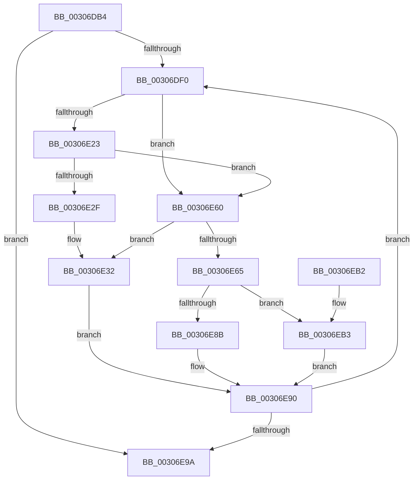

# HalpPutScatterGatherListDmarThin

- RVA: `0x00306DB4`–`0x00306EBA` (길이 `262` bytes)
- VA: `0x0000000140306DB4`
- 실행 섹션: `.text`
- PDB 이름 있음: `예`; PDB Function 태그: `아니요`
- unwind 정보 RVA: `0x00073820`
- 디코드: `63`개 명령, `262/262` bytes 표시
- 미해석 바이트: `0` (있으면 어셈블리에 `.byte`로 보존)

> 이 문서는 커널 이미지의 기계어와 PDB 기호를 분석해 생성했습니다. 4번과 5번은 함수 원형과 자료형을 바이너리 사용 방식에서 추정한 C 해석이며 원본 소스 복구 결과는 아닙니다.

## 1. Dependencies

- 직접 호출 지점: **3**; 고유 호출 대상: **2**
- 직접 호출자로 확인된 함수: **2**
- RIP 상대 이미지 참조: **2**

### Outgoing calls
- `0x00306E59` → [guard_dispatch_icall](../6B/guard_dispatch_icall_function_006BAAD0.md) (function, `0x006BAAD0`)
- `0x00306E8B` → [IommuUnmapLogicalRange](IommuUnmapLogicalRange_function_00306EC0.md) (function, `0x00306EC0`)
- `0x00306EB3` → [guard_dispatch_icall](../6B/guard_dispatch_icall_function_006BAAD0.md) (function, `0x006BAAD0`)

### Direct callers
- [HalPutScatterGatherListDmarThin](HalPutScatterGatherListDmarThin_function_00306D50.md) at `0x00306D6E`
- [HalpConstructScatterGatherListDmarThin](../46/HalpConstructScatterGatherListDmarThin_function_00467D30.md) at `0x00467EDD`

### Static image references
- `0x00306E39` → RVA `0x00FC1778` (`.data`; read)
- `0x00306E6C` → RVA `0x00306EC0` (`IommuUnmapLogicalRange`; read)

## 2. Other-region calls and transfers

- 다른 실행 섹션으로 향하는 call: **0**
- 별도 외부 분기/꼬리 이동을 확인하지 못했습니다.

## 3. Assembly (complete function range)

```asm
00306DB4  4C 8B DC                        mov r11, rsp
00306DB7  49 89 5B 08                     mov qword ptr [r11 + 8], rbx
00306DBB  49 89 6B 10                     mov qword ptr [r11 + 0x10], rbp
00306DBF  49 89 73 18                     mov qword ptr [r11 + 0x18], rsi
00306DC3  57                              push rdi
00306DC4  48 83 EC 40                     sub rsp, 0x40
00306DC8  49 83 63 E0 00                  and qword ptr [r11 - 0x20], 0
00306DCD  40 32 FF                        xor dil, dil
00306DD0  49 83 63 E8 00                  and qword ptr [r11 - 0x18], 0
00306DD5  33 DB                           xor ebx, ebx
00306DD7  48 8B F2                        mov rsi, rdx
00306DDA  48 8B 81 30 02 00 00            mov rax, qword ptr [rcx + 0x230]
00306DE1  48 8B E9                        mov rbp, rcx
00306DE4  49 89 43 D8                     mov qword ptr [r11 - 0x28], rax
00306DE8  39 1A                           cmp dword ptr [rdx], ebx
00306DEA  0F 86 AA 00 00 00               jbe 0x140306e9a
00306DF0  48 8D 0C 5B                     lea rcx, [rbx + rbx*2]
00306DF4  44 8B 44 CE 10                  mov r8d, dword ptr [rsi + rcx*8 + 0x10]
00306DF9  48 8B 54 CE 10                  mov rdx, qword ptr [rsi + rcx*8 + 0x10]
00306DFE  41 81 E0 FF 0F 00 00            and r8d, 0xfff
00306E05  44 03 44 CE 18                  add r8d, dword ptr [rsi + rcx*8 + 0x18]
00306E0A  48 81 E2 00 F0 FF FF            and rdx, 0xfffffffffffff000
00306E11  49 81 C0 FF 0F 00 00            add r8, 0xfff
00306E18  49 81 E0 00 F0 FF FF            and r8, 0xfffffffffffff000
00306E1F  85 DB                           test ebx, ebx
00306E21  75 3D                           jne 0x140306e60
00306E23  48 8B 85 30 02 00 00            mov rax, qword ptr [rbp + 0x230]
00306E2A  48 3B 10                        cmp rdx, qword ptr [rax]
00306E2D  75 31                           jne 0x140306e60
00306E2F  40 B7 01                        mov dil, 1
00306E32  48 8B 85 30 02 00 00            mov rax, qword ptr [rbp + 0x230]
00306E39  48 8B 0D 38 A9 CB 00            mov rcx, qword ptr [rip + 0xcba938]
00306E40  4C 89 44 24 30                  mov qword ptr [rsp + 0x30], r8
00306E45  48 2B 10                        sub rdx, qword ptr [rax]
00306E48  48 89 54 24 28                  mov qword ptr [rsp + 0x28], rdx
00306E4D  48 8B 81 98 00 00 00            mov rax, qword ptr [rcx + 0x98]
00306E54  48 8D 4C 24 20                  lea rcx, [rsp + 0x20]
00306E59  E8 72 3C 3B 00                  call 0x1406baad0
00306E5E  EB 30                           jmp 0x140306e90
00306E60  40 84 FF                        test dil, dil
00306E63  75 CD                           jne 0x140306e32
00306E65  48 8B 85 00 02 00 00            mov rax, qword ptr [rbp + 0x200]
00306E6C  4C 8D 0D 4D 00 00 00            lea r9, [rip + 0x4d]
00306E73  49 C1 E8 0C                     shr r8, 0xc
00306E77  48 8B 48 28                     mov rcx, qword ptr [rax + 0x28]
00306E7B  48 8B 05 F6 A8 CB 00            mov rax, qword ptr [rip + 0xcba8f6]
00306E82  48 8B 40 40                     mov rax, qword ptr [rax + 0x40]
00306E86  49 3B C1                        cmp rax, r9
00306E89  75 28                           jne 0x140306eb3
00306E8B  E8 30 00 00 00                  call 0x140306ec0
00306E90  FF C3                           inc ebx
00306E92  3B 1E                           cmp ebx, dword ptr [rsi]
00306E94  0F 82 56 FF FF FF               jb 0x140306df0
00306E9A  48 8B 5C 24 50                  mov rbx, qword ptr [rsp + 0x50]
00306E9F  40 8A C7                        mov al, dil
00306EA2  48 8B 6C 24 58                  mov rbp, qword ptr [rsp + 0x58]
00306EA7  48 8B 74 24 60                  mov rsi, qword ptr [rsp + 0x60]
00306EAC  48 83 C4 40                     add rsp, 0x40
00306EB0  5F                              pop rdi
00306EB1  C3                              ret
00306EB2  CC                              int3
00306EB3  E8 18 3C 3B 00                  call 0x1406baad0
00306EB8  EB D6                           jmp 0x140306e90
```

## 4. C-style interpretation (structured pseudocode)

```c
__int64 __fastcall HalpPutScatterGatherListDmarThin(__int64 a1, __int64 a2)
{
    __int64 result;
    __int64 v_rbx;
    __int64 v_rdi;
    __int64 v_rsp;
    unsigned __int64 v_stack_m18;
    unsigned __int64 v_stack_m20;
    unsigned __int64 v_stack_m28;
    unsigned __int64 v_stack_p10;
    unsigned __int64 v_stack_p18;
    unsigned __int64 v_stack_p8;

    *(unsigned __int64 *)(v_rsp + 8) = v_rbx;
    *(unsigned __int64 *)(v_rsp + 16) = v_rbp;
    *(unsigned __int64 *)(v_rsp + 24) = v_rsi;
    v_rsp = (v_rsp) - (64);
    v_rdi = 0;
    v_rbx = 0;
    *(unsigned __int64 *)(v_rsp - 40) = *(unsigned __int64 *)(a1 + 560);
    if ((*(unsigned int *)(a2)) <= 0) goto loc_00306E9A;
loc_00306DF0:
    a3 = (unsigned int)(((unsigned int)(*(unsigned int *)(a2 + v_rbx + v_rbx * 2 * 8 + 16))) & (0xFFFULL));
    a3 = (unsigned int)((a3) + (*(unsigned int *)(a2 + v_rbx + v_rbx * 2 * 8 + 24)));
    a2 = (*(unsigned __int64 *)(a2 + v_rbx + v_rbx * 2 * 8 + 16)) & (0xFFFFFFFFFFFFF000ULL);
    a3 = (a3) + (0xFFFULL);
    a3 = (a3) & (0xFFFFFFFFFFFFF000ULL);
    if (0 != 0) goto loc_00306E60;
    if (a2 != (*(unsigned __int64 *)(*(unsigned __int64 *)(a1 + 560)))) goto loc_00306E60;
loc_00306E32:
    v_stack_m18 = a3;
    a2 = (a2) - (*(unsigned __int64 *)(*(unsigned __int64 *)(a1 + 560)));
    v_stack_m20 = a2;
    result = guard_dispatch_icall(v_stack_m28, a2, a3, a4);
    goto loc_00306E90;
loc_00306E60:
    if (1 != 0) goto loc_00306E32;
    a3 = (a3) >> (12);
    if ((*(unsigned __int64 *)(*(unsigned __int64 *)(v_rip + 13347062) + 64)) != (v_rip + 77)) goto loc_00306EB3;
    result = IommuUnmapLogicalRange(*(unsigned __int64 *)(*(unsigned __int64 *)(a1 + 512) + 40), a2, a3, v_rip + 77);
loc_00306E90:
    v_rbx = (unsigned int)((v_rbx) + 1);
    if (((unsigned int)(v_rbx)) < (*(unsigned int *)(a2))) goto loc_00306DF0;
loc_00306E9A:
    v_rsp = (v_rsp) + (64);
    return 1;
loc_00306EB3:
    result = guard_dispatch_icall(*(unsigned __int64 *)(*(unsigned __int64 *)(a1 + 512) + 40), a2, a3, v_rip + 77);
    goto loc_00306E90;
}
```

## 5. (Beta) C Style

```c
int64_t HalpPutScatterGatherListDmarThin(void *Arg1, void *Arg2)
{
    uint8_t *arg1 = (uint8_t *)Arg1;
    uint8_t *arg2 = (uint8_t *)Arg2;

    int64_t result;
    int64_t local_rbx;
    int64_t local_rdi;
    int64_t local_rsp;
    uint64_t v_stack_m18;
    uint64_t v_stack_m20;
    uint64_t v_stack_m28;
    uint64_t v_stack_p10;
    uint64_t v_stack_p18;
    uint64_t v_stack_p8;

    *(uint64_t *)(local_rsp + 0x8) = local_rbx;
    *(uint64_t *)(local_rsp + 0x10) = local_rbp;
    *(uint64_t *)(local_rsp + 0x18) = local_rsi;
    local_rsp = (local_rsp) - (64);
    local_rdi = 0;
    local_rbx = 0;
    *(uint64_t *)(local_rsp - 0x28) = *(uint64_t *)(arg1 + 0x230);
    if ((*(uint32_t *)(arg2)) <= 0) goto loc_00306E9A;
loc_00306DF0:
    a3 = (uint32_t)(((uint32_t)(*(uint32_t *)(arg2 + local_rbx + local_rbx * 2 * 8 + 0x10))) & (0xFFFULL));
    a3 = (uint32_t)((a3) + (*(uint32_t *)(arg2 + local_rbx + local_rbx * 2 * 8 + 0x18)));
    Arg2 = (*(uint64_t *)(arg2 + local_rbx + local_rbx * 2 * 8 + 0x10)) & (0xFFFFFFFFFFFFF000ULL);
    a3 = (a3) + (0xFFFULL);
    a3 = (a3) & (0xFFFFFFFFFFFFF000ULL);
    if (0 != 0) goto loc_00306E60;
    if (Arg2 != (*(uint64_t *)(*(uint64_t *)(arg1 + 0x230)))) goto loc_00306E60;
loc_00306E32:
    v_stack_m18 = a3;
    Arg2 = (Arg2) - (*(uint64_t *)(*(uint64_t *)(arg1 + 0x230)));
    v_stack_m20 = Arg2;
    result = guard_dispatch_icall(v_stack_m28, Arg2, a3, a4);
    goto loc_00306E90;
loc_00306E60:
    if (1 != 0) goto loc_00306E32;
    a3 = (a3) >> (12);
    if ((*(uint64_t *)(*(uint64_t *)(v_rip + 0xCBA8F6) + 0x40)) != (v_rip + 77)) goto loc_00306EB3;
    result = IommuUnmapLogicalRange(*(uint64_t *)(*(uint64_t *)(arg1 + 0x200) + 0x28), Arg2, a3, v_rip + 77);
loc_00306E90:
    local_rbx = (uint32_t)((local_rbx) + 1);
    if (((uint32_t)(local_rbx)) < (*(uint32_t *)(arg2))) goto loc_00306DF0;
loc_00306E9A:
    local_rsp = (local_rsp) + (64);
    return 1;
loc_00306EB3:
    result = guard_dispatch_icall(*(uint64_t *)(*(uint64_t *)(arg1 + 0x200) + 0x28), Arg2, a3, v_rip + 77);
    goto loc_00306E90;
}
```

### 관측된 메모리 오프셋

구조체 형식이 확인되지 않은 접근은 인자 기준의 오프셋으로만 기록했습니다.

| 기준 인자 | 오프셋 표현 | 폭 (bit) | 접근 |
|---|---:|---:|---|
| `Arg1` | `+ 0x200` | `64` | `R` |
| `Arg1` | `+ 0x230` | `64` | `R` |
| `Arg2` | `+ 0x0` | `32` | `R` |
| `Arg2` | `+ 0x10 + rcx*8` | `32` | `R` |
| `Arg2` | `+ 0x10 + rcx*8` | `64` | `R` |
| `Arg2` | `+ 0x18 + rcx*8` | `32` | `R` |

## 6. Execution-region graph

[열기: 2D/3D 그래프와 함수 탐색 컨트롤 패널](../../../control-panel.html?section=text&rva=0x00306DB4&view=graph)

- 2D 그래프는 위에서 아래로 흐르고, 3D 그래프는 빈 공간을 드래그해 회전합니다. Shift+드래그는 이동, 휠은 확대·축소, 함수 노드 선택은 대상 보고서 이동입니다.

### Static fallback


