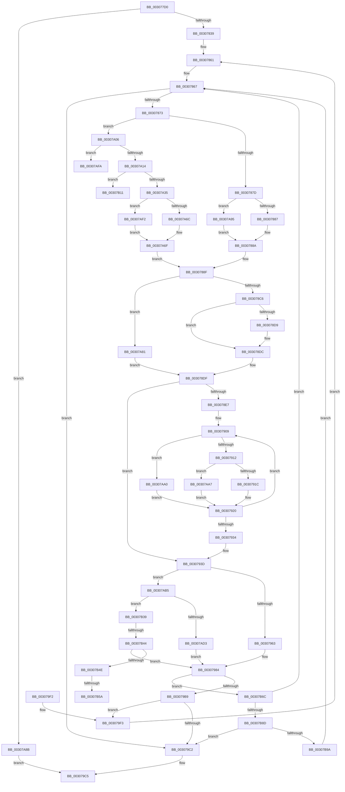

# HvlDmaMapDeviceLogicalRange

- RVA: `0x003077D0`–`0x00307BA7` (길이 `983` bytes)
- VA: `0x00000001403077D0`
- 실행 섹션: `.text`
- PDB 이름 있음: `예`; PDB Function 태그: `예`
- unwind 정보 RVA: `0x00073928`
- 디코드: `234`개 명령, `983/983` bytes 표시
- 미해석 바이트: `0` (있으면 어셈블리에 `.byte`로 보존)

> 이 문서는 커널 이미지의 기계어와 PDB 기호를 분석해 생성했습니다. 4번과 5번은 함수 원형과 자료형을 바이너리 사용 방식에서 추정한 C 해석이며 원본 소스 복구 결과는 아닙니다.

## 1. Dependencies

- 직접 호출 지점: **11**; 고유 호출 대상: **10**
- 직접 호출자로 확인된 함수: **1**
- RIP 상대 이미지 참조: **3**

### Outgoing calls
- `0x00307977` → [HvcallFastExtended](../31/HvcallFastExtended_function_003130E0.md) (function, `0x003130E0`)
- `0x003079A9` → [HvlpHvStatusIsInsufficientMemory](HvlpHvStatusIsInsufficientMemory_function_00307BB0.md) (function, `0x00307BB0`)
- `0x003079B9` → [HvlpHvToNtStatus](HvlpHvToNtStatus_function_00307BD8.md) (function, `0x00307BD8`)
- `0x003079CC` → [_security_check_cookie](../6A/_security_check_cookie_function_006AC640.md) (function, `0x006AC640`)
- `0x00307A24` → [ExpInterlockedPopEntrySList](../6B/ExpInterlockedPopEntrySList_function_006BA570.md) (function, `0x006BA570`)
- `0x00307ABB` → [HvcallInitiateHypercall](../31/HvcallInitiateHypercall_function_00313630.md) (function, `0x00313630`)
- `0x00307AE8` → [ExpInterlockedPushEntrySList](../6B/ExpInterlockedPushEntrySList_function_006BA5B0.md) (function, `0x006BA5B0`)
- `0x00307B02` → [KeDisableInterrupts](../21/KeDisableInterrupts_function_00217BE0.md) (function, `0x00217BE0`)
- `0x00307B19` → [KeDisableInterrupts](../21/KeDisableInterrupts_function_00217BE0.md) (function, `0x00217BE0`)
- `0x00307B61` → [KiLowerIrqlProcessIrqlFlags](../4F/KiLowerIrqlProcessIrqlFlags_function_004F5698.md) (function, `0x004F5698`)
- `0x00307B6C` → [HvlpHandleInsufficientMemory](../58/HvlpHandleInsufficientMemory_function_00584514.md) (function, `0x00584514`)

### Direct callers
- [IommupHvMapDeviceLogical](IommupHvMapDeviceLogical_function_003076F4.md) at `0x00307750`

### Static image references
- `0x003077F3` → RVA `0x00E0A740` (`.data`; read)
- `0x00307A06` → RVA `0x00FC6A90` (`ALMOSTRO`; read)
- `0x00307B4E` → RVA `0x00FC6D20` (`ALMOSTRO`; read)

## 2. Other-region calls and transfers

- 다른 실행 섹션으로 향하는 call: **0**
- call이 아닌 외부 분기/꼬리 이동: **5**
  - `0x00307B0C` → [sub_006E0A74](../6E/Unknown_function_006E0A74.md) (`tail-transfer`)
  - `0x00307B34` → [sub_006E0A74](../6E/Unknown_function_006E0A74.md) (`tail-transfer`)
  - `0x00307B3E` → [sub_006E0A74 + 0x2A](../6E/Unknown_function_006E0A74.md) (`tail-transfer`)
  - `0x00307B54` → [sub_006E0A74 + 0x1D](../6E/Unknown_function_006E0A74.md) (`tail-transfer`)
  - `0x00307B67` → [sub_006E0A74 + 0x1D](../6E/Unknown_function_006E0A74.md) (`tail-transfer`)

## 3. Assembly (complete function range)

```asm
003077D0  48 8B C4                        mov rax, rsp
003077D3  48 89 58 08                     mov qword ptr [rax + 8], rbx
003077D7  48 89 70 10                     mov qword ptr [rax + 0x10], rsi
003077DB  48 89 78 18                     mov qword ptr [rax + 0x18], rdi
003077DF  55                              push rbp
003077E0  41 54                           push r12
003077E2  41 55                           push r13
003077E4  41 56                           push r14
003077E6  41 57                           push r15
003077E8  48 8D 68 C8                     lea rbp, [rax - 0x38]
003077EC  48 81 EC 10 01 00 00            sub rsp, 0x110
003077F3  48 8B 05 46 2F B0 00            mov rax, qword ptr [rip + 0xb02f46]
003077FA  48 33 C4                        xor rax, rsp
003077FD  48 89 45 00                     mov qword ptr [rbp], rax
00307801  80 79 04 00                     cmp byte ptr [rcx + 4], 0
00307805  0F 57 C0                        xorps xmm0, xmm0
00307808  4C 8B 75 60                     mov r14, qword ptr [rbp + 0x60]
0030780C  44 8B D2                        mov r10d, edx
0030780F  4C 89 4C 24 78                  mov qword ptr [rsp + 0x78], r9
00307814  4C 8B C9                        mov r9, rcx
00307817  4C 89 75 80                     mov qword ptr [rbp - 0x80], r14
0030781B  0F 11 44 24 40                  movups xmmword ptr [rsp + 0x40], xmm0
00307820  4C 89 44 24 70                  mov qword ptr [rsp + 0x70], r8
00307825  0F 11 44 24 50                  movups xmmword ptr [rsp + 0x50], xmm0
0030782A  89 54 24 34                     mov dword ptr [rsp + 0x34], edx
0030782E  48 89 4C 24 60                  mov qword ptr [rsp + 0x60], rcx
00307833  0F 85 52 02 00 00               jne 0x140307a8b
00307839  48 8B 7C 24 58                  mov rdi, qword ptr [rsp + 0x58]
0030783E  33 C0                           xor eax, eax
00307840  40 8A 74 24 48                  mov sil, byte ptr [rsp + 0x48]
00307845  45 33 E4                        xor r12d, r12d
00307848  48 C7 44 24 38 B3 00 00 00      mov qword ptr [rsp + 0x38], 0xb3
00307851  45 33 ED                        xor r13d, r13d
00307854  8B 5C 24 3C                     mov ebx, dword ptr [rsp + 0x3c]
00307858  44 8B 7C 24 38                  mov r15d, dword ptr [rsp + 0x38]
0030785D  89 5C 24 30                     mov dword ptr [rsp + 0x30], ebx
00307861  41 BB 01 00 00 00               mov r11d, 1
00307867  49 8B 16                        mov rdx, qword ptr [r14]
0030786A  48 85 D2                        test rdx, rdx
0030786D  0F 84 4F 01 00 00               je 0x1403079c2
00307873  48 83 FA 09                     cmp rdx, 9
00307877  0F 87 89 01 00 00               ja 0x140307a06
0030787D  48 8D 4D 90                     lea rcx, [rbp - 0x70]
00307881  0F 83 0E 02 00 00               jae 0x140307a95
00307887  44 8B C2                        mov r8d, edx
0030788A  41 0F BA EF 10                  bts r15d, 0x10
0030788F  33 C0                           xor eax, eax
00307891  44 89 7C 24 38                  mov dword ptr [rsp + 0x38], r15d
00307896  48 89 41 08                     mov qword ptr [rcx + 8], rax
0030789A  48 89 41 10                     mov qword ptr [rcx + 0x10], rax
0030789E  48 89 41 18                     mov qword ptr [rcx + 0x18], rax
003078A2  48 89 41 20                     mov qword ptr [rcx + 0x20], rax
003078A6  48 83 09 FF                     or qword ptr [rcx], 0xffffffffffffffff
003078AA  83 61 10 F0                     and dword ptr [rcx + 0x10], 0xfffffff0
003078AE  41 8B 01                        mov eax, dword ptr [r9]
003078B1  89 41 14                        mov dword ptr [rcx + 0x14], eax
003078B4  48 8B 44 24 70                  mov rax, qword ptr [rsp + 0x70]
003078B9  48 89 41 20                     mov qword ptr [rcx + 0x20], rax
003078BD  45 85 D2                        test r10d, r10d
003078C0  0F 84 BB 01 00 00               je 0x140307a81
003078C6  33 C0                           xor eax, eax
003078C8  44 8D 48 01                     lea r9d, [rax + 1]
003078CC  45 84 D1                        test r9b, r10b
003078CF  41 0F 45 C1                     cmovne eax, r9d
003078D3  41 F6 C2 02                     test r10b, 2
003078D7  74 03                           je 0x1403078dc
003078D9  83 C8 02                        or eax, 2
003078DC  41 0B C4                        or eax, r12d
003078DF  89 41 1C                        mov dword ptr [rcx + 0x1c], eax
003078E2  45 85 C0                        test r8d, r8d
003078E5  74 56                           je 0x14030793d
003078E7  4C 8B 7C 24 78                  mov r15, qword ptr [rsp + 0x78]
003078EC  4E 8D 14 ED D8 FF FF FF         lea r10, [r13*8 - 0x28]
003078F4  44 8B 74 24 34                  mov r14d, dword ptr [rsp + 0x34]
003078F9  48 8D 51 28                     lea rdx, [rcx + 0x28]
003078FD  4C 2B D1                        sub r10, rcx
00307900  45 33 C9                        xor r9d, r9d
00307903  4D 03 D7                        add r10, r15
00307906  41 8B C8                        mov ecx, r8d
00307909  45 85 F6                        test r14d, r14d
0030790C  0F 84 8E 01 00 00               je 0x140307aa0
00307912  80 7D 68 00                     cmp byte ptr [rbp + 0x68], 0
00307916  0F 85 8B 01 00 00               jne 0x140307aa7
0030791C  49 8B 04 12                     mov rax, qword ptr [r10 + rdx]
00307920  48 89 02                        mov qword ptr [rdx], rax
00307923  B8 01 00 00 00                  mov eax, 1
00307928  4C 03 C8                        add r9, rax
0030792B  48 83 C2 08                     add rdx, 8
0030792F  48 2B C8                        sub rcx, rax
00307932  75 D5                           jne 0x140307909
00307934  4C 8B 75 80                     mov r14, qword ptr [rbp - 0x80]
00307938  44 8B 7C 24 38                  mov r15d, dword ptr [rsp + 0x38]
0030793D  81 E3 00 F0 FF FF               and ebx, 0xfffff000
00307943  41 8B C0                        mov eax, r8d
00307946  25 FF 0F 00 00                  and eax, 0xfff
0030794B  0B D8                           or ebx, eax
0030794D  89 5C 24 3C                     mov dword ptr [rsp + 0x3c], ebx
00307951  48 8B 4C 24 38                  mov rcx, qword ptr [rsp + 0x38]
00307956  89 5C 24 30                     mov dword ptr [rsp + 0x30], ebx
0030795A  45 84 DB                        test r11b, r11b
0030795D  0F 84 52 01 00 00               je 0x140307ab5
00307963  83 64 24 20 00                  and dword ptr [rsp + 0x20], 0
00307968  46 8D 04 C5 28 00 00 00         lea r8d, [r8*8 + 0x28]
00307970  45 33 C9                        xor r9d, r9d
00307973  48 8D 55 90                     lea rdx, [rbp - 0x70]
00307977  E8 64 B7 00 00                  call 0x1403130e0
0030797C  48 8B D8                        mov rbx, rax
0030797F  48 89 44 24 68                  mov qword ptr [rsp + 0x68], rax
00307984  8B 4C 24 6C                     mov ecx, dword ptr [rsp + 0x6c]
00307988  41 B8 FF 0F 00 00               mov r8d, 0xfff
0030798E  8B C1                           mov eax, ecx
00307990  41 23 C8                        and ecx, r8d
00307993  49 23 C0                        and rax, r8
00307996  C1 E1 0C                        shl ecx, 0xc
00307999  49 29 06                        sub qword ptr [r14], rax
0030799C  4C 03 E8                        add r13, rax
0030799F  8B C1                           mov eax, ecx
003079A1  0F B7 CB                        movzx ecx, bx
003079A4  48 01 44 24 70                  add qword ptr [rsp + 0x70], rax
003079A9  E8 02 02 00 00                  call 0x140307bb0
003079AE  0F B7 CB                        movzx ecx, bx
003079B1  84 C0                           test al, al
003079B3  0F 85 B3 01 00 00               jne 0x140307b6c
003079B9  E8 1A 02 00 00                  call 0x140307bd8
003079BE  85 C0                           test eax, eax
003079C0  79 31                           jns 0x1403079f3
003079C2  4D 89 2E                        mov qword ptr [r14], r13
003079C5  48 8B 4D 00                     mov rcx, qword ptr [rbp]
003079C9  48 33 CC                        xor rcx, rsp
003079CC  E8 6F 4C 3A 00                  call 0x1406ac640
003079D1  4C 8D 9C 24 10 01 00 00         lea r11, [rsp + 0x110]
003079D9  49 8B 5B 30                     mov rbx, qword ptr [r11 + 0x30]
003079DD  49 8B 73 38                     mov rsi, qword ptr [r11 + 0x38]
003079E1  49 8B 7B 40                     mov rdi, qword ptr [r11 + 0x40]
003079E5  49 8B E3                        mov rsp, r11
003079E8  41 5F                           pop r15
003079EA  41 5E                           pop r14
003079EC  41 5D                           pop r13
003079EE  41 5C                           pop r12
003079F0  5D                              pop rbp
003079F1  C3                              ret
003079F2  CC                              int3
003079F3  8B 5C 24 30                     mov ebx, dword ptr [rsp + 0x30]
003079F7  4C 8B 4C 24 60                  mov r9, qword ptr [rsp + 0x60]
003079FC  44 8B 54 24 34                  mov r10d, dword ptr [rsp + 0x34]
00307A01  E9 5B FE FF FF                  jmp 0x140307861
00307A06  8B 05 84 F0 CB 00               mov eax, dword ptr [rip + 0xcbf084]
00307A0C  A8 08                           test al, 8
00307A0E  0F 84 E6 00 00 00               je 0x140307afa
00307A14  65 48 8B 1C 25 20 00 00 00      mov rbx, qword ptr gs:[0x20]
00307A1D  48 8D 8B C0 8B 00 00            lea rcx, [rbx + 0x8bc0]
00307A24  E8 47 2B 3B 00                  call 0x1406ba570
00307A29  48 8B C8                        mov rcx, rax
00307A2C  48 85 C0                        test rax, rax
00307A2F  0F 84 DC 00 00 00               je 0x140307b11
00307A35  48 8B 78 10                     mov rdi, qword ptr [rax + 0x10]
00307A39  4C 8B 4C 24 60                  mov r9, qword ptr [rsp + 0x60]
00307A3E  44 8B 54 24 34                  mov r10d, dword ptr [rsp + 0x34]
00307A43  48 89 5C 24 48                  mov qword ptr [rsp + 0x48], rbx
00307A48  8B 5C 24 30                     mov ebx, dword ptr [rsp + 0x30]
00307A4C  C7 44 24 40 01 00 00 00         mov dword ptr [rsp + 0x40], 1
00307A54  48 89 44 24 50                  mov qword ptr [rsp + 0x50], rax
00307A59  B8 FB 01 00 00                  mov eax, 0x1fb
00307A5E  48 89 7C 24 58                  mov qword ptr [rsp + 0x58], rdi
00307A63  49 39 06                        cmp qword ptr [r14], rax
00307A66  0F 83 86 00 00 00               jae 0x140307af2
00307A6C  45 8B 06                        mov r8d, dword ptr [r14]
00307A6F  48 8B 74 24 48                  mov rsi, qword ptr [rsp + 0x48]
00307A74  45 32 DB                        xor r11b, r11b
00307A77  41 0F BA F7 10                  btr r15d, 0x10
00307A7C  E9 0E FE FF FF                  jmp 0x14030788f
00307A81  B8 00 00 01 00                  mov eax, 0x10000
00307A86  E9 54 FE FF FF                  jmp 0x1403078df
00307A8B  B8 BB 00 00 C0                  mov eax, 0xc00000bb
00307A90  E9 30 FF FF FF                  jmp 0x1403079c5
00307A95  41 B8 09 00 00 00               mov r8d, 9
00307A9B  E9 EA FD FF FF                  jmp 0x14030788a
00307AA0  33 C0                           xor eax, eax
00307AA2  E9 79 FE FF FF                  jmp 0x140307920
00307AA7  49 8B 07                        mov rax, qword ptr [r15]
00307AAA  49 03 C1                        add rax, r9
00307AAD  49 03 C5                        add rax, r13
00307AB0  E9 6B FE FF FF                  jmp 0x140307920
00307AB5  45 33 C0                        xor r8d, r8d
00307AB8  48 8B D7                        mov rdx, rdi
00307ABB  E8 70 BB 00 00                  call 0x140313630
00307AC0  48 8B D8                        mov rbx, rax
00307AC3  48 89 44 24 68                  mov qword ptr [rsp + 0x68], rax
00307AC8  33 C0                           xor eax, eax
00307ACA  8D 50 01                        lea edx, [rax + 1]
00307ACD  84 54 24 40                     test byte ptr [rsp + 0x40], dl
00307AD1  74 66                           je 0x140307b39
00307AD3  48 8B 54 24 50                  mov rdx, qword ptr [rsp + 0x50]
00307AD8  48 8B 4C 24 48                  mov rcx, qword ptr [rsp + 0x48]
00307ADD  48 81 C1 C0 8B 00 00            add rcx, 0x8bc0
00307AE4  48 89 7A 10                     mov qword ptr [rdx + 0x10], rdi
00307AE8  E8 C3 2A 3B 00                  call 0x1406ba5b0
00307AED  E9 92 FE FF FF                  jmp 0x140307984
00307AF2  44 8B C0                        mov r8d, eax
00307AF5  E9 75 FF FF FF                  jmp 0x140307a6f
00307AFA  C7 44 24 40 04 00 00 00         mov dword ptr [rsp + 0x40], 4
00307B02  E8 D9 00 F1 FF                  call 0x140217be0
00307B07  44 89 5C 24 4C                  mov dword ptr [rsp + 0x4c], r11d
00307B0C  E9 63 8F 3D 00                  jmp 0x1406e0a74
00307B11  C7 44 24 40 04 00 00 00         mov dword ptr [rsp + 0x40], 4
00307B19  E8 C2 00 F1 FF                  call 0x140217be0
00307B1E  8B 5C 24 30                     mov ebx, dword ptr [rsp + 0x30]
00307B22  4C 8B 4C 24 60                  mov r9, qword ptr [rsp + 0x60]
00307B27  44 8B 54 24 34                  mov r10d, dword ptr [rsp + 0x34]
00307B2C  C7 44 24 4C 01 00 00 00         mov dword ptr [rsp + 0x4c], 1
00307B34  E9 3B 8F 3D 00                  jmp 0x1406e0a74
00307B39  F6 44 24 40 02                  test byte ptr [rsp + 0x40], 2
00307B3E  0F 84 5A 8F 3D 00               je 0x1406e0a9e
00307B44  40 80 FE 02                     cmp sil, 2
00307B48  0F 83 36 FE FF FF               jae 0x140307984
00307B4E  39 05 CC F1 CB 00               cmp dword ptr [rip + 0xcbf1cc], eax
00307B54  0F 84 37 8F 3D 00               je 0x1406e0a91
00307B5A  44 0F 20 C1                     mov rcx, cr8
00307B5E  40 8A D6                        mov dl, sil
00307B61  E8 32 DB 1E 00                  call 0x1404f5698
00307B66  90                              nop
00307B67  E9 25 8F 3D 00                  jmp 0x1406e0a91
00307B6C  E8 A3 C9 27 00                  call 0x140584514
00307B71  8B 5C 24 30                     mov ebx, dword ptr [rsp + 0x30]
00307B75  41 BB 01 00 00 00               mov r11d, 1
00307B7B  4C 8B 4C 24 60                  mov r9, qword ptr [rsp + 0x60]
00307B80  44 8B 54 24 34                  mov r10d, dword ptr [rsp + 0x34]
00307B85  85 C0                           test eax, eax
00307B87  0F 89 DA FC FF FF               jns 0x140307867
00307B8D  41 81 FC 00 00 00 80            cmp r12d, 0x80000000
00307B94  0F 84 28 FE FF FF               je 0x1403079c2
00307B9A  33 C0                           xor eax, eax
00307B9C  41 BC 00 00 00 80               mov r12d, 0x80000000
00307BA2  E9 C0 FC FF FF                  jmp 0x140307867
```

## 4. C-style interpretation (structured pseudocode)

```c
__int64 __fastcall HvlDmaMapDeviceLogicalRange(__int64 a1, int a2, __int64 a3, __int64 a4)
{
    __int64 result;
    __int64 v_r10;
    __int64 v_r11;
    __int64 v_r12;
    __int64 v_r13;
    __int64 v_rbx;
    __int64 v_rsp;
    unsigned __int64 v_stack_m100;
    unsigned int v_stack_m104;
    unsigned int v_stack_m108;
    unsigned int v_stack_m118;
    unsigned __int64 v_stack_m28;
    unsigned __int64 v_stack_mA8;
    unsigned __int64 v_stack_mB0;
    unsigned __int64 v_stack_mB8;
    unsigned __int64 v_stack_mC0;
    unsigned int v_stack_mC4;
    unsigned __int64 v_stack_mC8;
    unsigned int v_stack_mCC;
    unsigned __int64 v_stack_mD0;
    unsigned __int64 v_stack_mD8;
    unsigned int v_stack_mDC;
    unsigned __int64 v_stack_mE0;
    unsigned __int64 v_stack_mE8;
    unsigned __int8 v_stack_mF0;
    unsigned __int64 v_stack_mF8;
    unsigned int v_stack_mFC;

    *(unsigned __int64 *)(v_rsp + 8) = v_rbx;
    *(unsigned __int64 *)(v_rsp + 16) = v_rsi;
    *(unsigned __int64 *)(v_rsp + 24) = v_rdi;
    v_rsp = (v_rsp) - (272);
    result = (*(unsigned __int64 *)(v_rip + 11546438)) ^ (v_rsp);
    *(unsigned __int64 *)(v_rsp - 56) = result;
    v_stack_mC0 = a4;
    *(unsigned __int64 *)(v_rsp - 56 - 128) = *(unsigned __int64 *)(v_rsp - 56 + 96);
    v_stack_mF8 = v_xmm0;
    v_stack_mC8 = a3;
    v_stack_mE8 = v_xmm0;
    v_stack_m104 = a2;
    v_stack_mD8 = a1;
    if ((*(unsigned __int8 *)(a1 + 4)) != 0) goto loc_00307A8B;
    result = 0;
    v_r12 = 0;
    v_stack_m100 = 179;
    v_r13 = 0;
    v_stack_m108 = (unsigned int)((unsigned int)(v_stack_mFC));
loc_00307861:
loc_00307867:
    if (*(unsigned __int64 *)(*(unsigned __int64 *)(v_rsp - 56 + 96)) == 0) goto loc_003079C2;
    if ((*(unsigned __int64 *)(*(unsigned __int64 *)(v_rsp - 56 + 96))) > 9) goto loc_00307A06;
    if ((*(unsigned __int64 *)(*(unsigned __int64 *)(v_rsp - 56 + 96))) >= 9) goto loc_00307A95;
loc_0030788A:
loc_0030788F:
    result = 0;
    v_stack_m100 = (unsigned int)((unsigned int)(v_stack_m100));
    *(unsigned __int64 *)(v_rsp - 56 - 112 + 8) = 0;
    *(unsigned __int64 *)(v_rsp - 56 - 112 + 16) = 0;
    *(unsigned __int64 *)(v_rsp - 56 - 112 + 24) = 0;
    *(unsigned __int64 *)(v_rsp - 56 - 112 + 32) = 0;
    *(unsigned int *)(v_rsp - 56 - 112 + 20) = (unsigned int)((unsigned int)(*(unsigned int *)(a1)));
    *(unsigned __int64 *)(v_rsp - 56 - 112 + 32) = v_stack_mC8;
    if ((unsigned int)((unsigned int)(a2)) == 0) goto loc_00307A81;
    result = 0;
    if ((((unsigned __int8)(result + 1)) & ((unsigned __int8)((unsigned int)(a2)))) != 0) { result = (unsigned int)(result + 1); }
    if ((((unsigned __int8)((unsigned int)(a2))) & (2)) != 0) {
        result = (unsigned int)((result) | (2));
    }
    result = (unsigned int)((result) | (0));
loc_003078DF:
    *(unsigned int *)(v_rsp - 56 - 112 + 28) = (unsigned int)(result);
    if ((unsigned int)((unsigned int)((unsigned int)(*(unsigned __int64 *)(*(unsigned __int64 *)(v_rsp - 56 + 96))))) == 0) goto loc_0030793D;
    v_r10 = (v_r13 * 8 - 40) - (v_rsp - 56 - 112);
    a4 = 0;
    v_r10 = (v_r10) + (v_stack_mC0);
loc_00307909:
    if ((unsigned int)((unsigned int)(v_stack_m104)) == 0) goto loc_00307AA0;
    if ((*(unsigned __int8 *)(v_rsp - 56 + 104)) != 0) goto loc_00307AA7;
loc_00307920:
    *(unsigned __int64 *)(v_rsp - 56 - 112 + 40) = *(unsigned __int64 *)(v_r10 + v_rsp - 56 - 112 + 40 * 1);
    a4 = (a4) + (1);
    a2 = (v_rsp - 56 - 112 + 40) + (8);
    a1 = ((unsigned int)((unsigned int)((unsigned int)((unsigned int)(*(unsigned __int64 *)(*(unsigned __int64 *)(v_rsp - 56 + 96))))))) - (1);
    if (condition_is_not_equal) goto loc_00307909;
loc_0030793D:
    v_rbx = (unsigned int)(((unsigned int)(v_stack_mFC)) & (0xFFFFF000ULL));
    result = (unsigned int)(((unsigned int)((unsigned int)((unsigned int)((unsigned int)(*(unsigned __int64 *)(*(unsigned __int64 *)(v_rsp - 56 + 96))))))) & (0xFFFULL));
    v_rbx = (unsigned int)((v_rbx) | ((unsigned int)(result)));
    v_stack_mFC = (unsigned int)(v_rbx);
    v_stack_m108 = (unsigned int)(v_rbx);
    if (1 == 0) goto loc_00307AB5;
    a4 = 0;
    result = HvcallFastExtended(v_stack_m100, v_rsp - 56 - 112, (unsigned int)((unsigned int)(*(unsigned __int64 *)(*(unsigned __int64 *)(v_rsp - 56 + 96)))) * 8 + 40, a4);
    v_stack_mD0 = result;
loc_00307984:
    a1 = (unsigned int)(((unsigned int)(v_stack_mCC)) & ((unsigned int)((unsigned int)(0xFFFULL))));
    result = ((unsigned int)((unsigned int)((unsigned int)(v_stack_mCC)))) & ((unsigned int)(0xFFFULL));
    a1 = (unsigned int)((a1) << (12));
    v_r13 = (v_r13) + (result);
    result = HvlpHvStatusIsInsufficientMemory((unsigned __int16)(result), v_rsp - 56 - 112, (unsigned int)(0xFFFULL), a4);
    if ((unsigned __int8)(result) != 0) goto loc_00307B6C;
    result = HvlpHvToNtStatus((unsigned __int16)(result), v_rsp - 56 - 112, (unsigned int)(0xFFFULL), a4);
    if (!sign_flag) goto loc_003079F3;
loc_003079C2:
    *(unsigned __int64 *)(*(unsigned __int64 *)(v_rsp - 56 - 128)) = v_r13;
loc_003079C5:
    a1 = (*(unsigned __int64 *)(v_rsp - 56)) ^ (v_rsp);
    result = _security_check_cookie(a1, v_rsp - 56 - 112, (unsigned int)(0xFFFULL), a4);
    return result;
loc_003079F3:
    goto loc_00307861;
loc_00307A06:
    if ((((unsigned __int8)((unsigned int)(*(unsigned int *)(v_rip + 13365380)))) & (8)) == 0) goto loc_00307AFA;
    result = ExpInterlockedPopEntrySList(*(unsigned __int64 *)(gs_base + (0 + 32)) + 35776, v_rsp - 56 - 112, (unsigned int)(0xFFFULL), v_stack_mB0);
    if (result == 0) goto loc_00307B11;
    v_stack_mC8 = *(unsigned __int64 *)(gs_base + (0 + 32));
    v_stack_mD0 = 1;
    v_stack_mC0 = result;
    v_stack_mB8 = *(unsigned __int64 *)(result + 16);
    if ((*(unsigned __int64 *)(*(unsigned __int64 *)(v_rsp - 56 - 128))) >= 507) goto loc_00307AF2;
loc_00307A6F:
    v_r11 = 0;
    goto loc_0030788F;
loc_00307A81:
    goto loc_003078DF;
loc_00307A8B:
    goto loc_003079C5;
loc_00307A95:
    goto loc_0030788A;
loc_00307AA0:
    result = 0;
    goto loc_00307920;
loc_00307AA7:
    result = (*(unsigned __int64 *)((unsigned int)(v_stack_m100))) + (v_stack_mB0);
    result = (result) + (v_r13);
    goto loc_00307920;
loc_00307AB5:
    a3 = 0;
    result = HvcallInitiateHypercall(result, *(unsigned __int64 *)(result + 16), a3, v_stack_mB0);
    v_stack_mA8 = result;
    result = 0;
    if (((v_stack_mD0) & ((unsigned __int8)(result + 1))) == 0) goto loc_00307B39;
    a1 = (v_stack_mC8) + (0x8BC0ULL);
    *(unsigned __int64 *)(v_stack_mC0 + 16) = *(unsigned __int64 *)(result + 16);
    result = ExpInterlockedPushEntrySList(a1, v_stack_mC0, a3, v_stack_mB0);
    goto loc_00307984;
loc_00307AF2:
    goto loc_00307A6F;
loc_00307AFA:
    v_stack_mD0 = 4;
    result = KeDisableInterrupts(a1, v_stack_mC0, (unsigned int)((unsigned int)(result)), v_stack_mB0);
    v_stack_mC4 = 0;
loc_00307B11:
    v_stack_mD0 = 4;
    result = KeDisableInterrupts(a1, v_stack_mC0, (unsigned int)((unsigned int)(result)), v_stack_mB0);
    v_stack_mC4 = 1;
loc_00307B39:
    if (((unsigned __int8)(v_stack_mC8)) >= 2) goto loc_00307984;
    result = KiLowerIrqlProcessIrqlFlags(v_cr8, (unsigned __int8)(v_stack_mC8), (unsigned int)((unsigned int)(result)), v_stack_mB0);
loc_00307B6C:
    result = HvlpHandleInsufficientMemory(v_cr8, (unsigned __int8)(v_stack_mC8), (unsigned int)((unsigned int)(result)), v_stack_mB0);
    if (!sign_flag) goto loc_00307867;
    if (0 == 0x80000000ULL) goto loc_003079C2;
    result = 0;
    goto loc_00307867;
}
```

## 5. (Beta) C Style

```c
int64_t HvlDmaMapDeviceLogicalRange(void *Arg1, int32_t Arg2, int64_t Arg3, int64_t Arg4)
{
    uint8_t *arg1 = (uint8_t *)Arg1;

    int64_t result;
    int64_t local_r10;
    int64_t local_r11;
    int64_t local_r12;
    int64_t local_r13;
    int64_t local_rbx;
    int64_t local_rsp;
    uint64_t v_stack_m100;
    uint32_t v_stack_m104;
    uint32_t v_stack_m108;
    uint32_t v_stack_m118;
    uint64_t v_stack_m28;
    uint64_t v_stack_mA8;
    uint64_t v_stack_mB0;
    uint64_t v_stack_mB8;
    uint64_t v_stack_mC0;
    uint32_t v_stack_mC4;
    uint64_t v_stack_mC8;
    uint32_t v_stack_mCC;
    uint64_t v_stack_mD0;
    uint64_t v_stack_mD8;
    uint32_t v_stack_mDC;
    uint64_t v_stack_mE0;
    uint64_t v_stack_mE8;
    uint8_t v_stack_mF0;
    uint64_t v_stack_mF8;
    uint32_t v_stack_mFC;

    *(uint64_t *)(local_rsp + 0x8) = local_rbx;
    *(uint64_t *)(local_rsp + 0x10) = local_rsi;
    *(uint64_t *)(local_rsp + 0x18) = local_rdi;
    local_rsp = (local_rsp) - (272);
    result = (*(uint64_t *)(v_rip + 0xB02F46)) ^ (local_rsp);
    *(uint64_t *)(local_rsp - 0x38) = result;
    v_stack_mC0 = Arg4;
    *(uint64_t *)(local_rsp - 0x38 - 0x80) = *(uint64_t *)(local_rsp - 0x38 + 0x60);
    v_stack_mF8 = v_xmm0;
    v_stack_mC8 = Arg3;
    v_stack_mE8 = v_xmm0;
    v_stack_m104 = Arg2;
    v_stack_mD8 = Arg1;
    if ((*(uint8_t *)(arg1 + 0x4)) != 0) goto loc_00307A8B;
    result = 0;
    local_r12 = 0;
    v_stack_m100 = 179;
    local_r13 = 0;
    v_stack_m108 = (uint32_t)((uint32_t)(v_stack_mFC));
loc_00307861:
loc_00307867:
    if (*(uint64_t *)(*(uint64_t *)(local_rsp - 0x38 + 0x60)) == 0) goto loc_003079C2;
    if ((*(uint64_t *)(*(uint64_t *)(local_rsp - 0x38 + 0x60))) > 9) goto loc_00307A06;
    if ((*(uint64_t *)(*(uint64_t *)(local_rsp - 0x38 + 0x60))) >= 9) goto loc_00307A95;
loc_0030788A:
loc_0030788F:
    result = 0;
    v_stack_m100 = (uint32_t)((uint32_t)(v_stack_m100));
    *(uint64_t *)(local_rsp - 0x38 - 0x70 + 0x8) = 0;
    *(uint64_t *)(local_rsp - 0x38 - 0x70 + 0x10) = 0;
    *(uint64_t *)(local_rsp - 0x38 - 0x70 + 0x18) = 0;
    *(uint64_t *)(local_rsp - 0x38 - 0x70 + 0x20) = 0;
    *(uint32_t *)(local_rsp - 0x38 - 0x70 + 0x14) = (uint32_t)((uint32_t)(*(uint32_t *)(arg1)));
    *(uint64_t *)(local_rsp - 0x38 - 0x70 + 0x20) = v_stack_mC8;
    if ((uint32_t)((uint32_t)(Arg2)) == 0) goto loc_00307A81;
    result = 0;
    if ((((uint8_t)(result + 1)) & ((uint8_t)((uint32_t)(Arg2)))) != 0) { result = (uint32_t)(result + 1); }
    if ((((uint8_t)((uint32_t)(Arg2))) & (2)) != 0) {
        result = (uint32_t)((result) | (2));
    }
    result = (uint32_t)((result) | (0));
loc_003078DF:
    *(uint32_t *)(local_rsp - 0x38 - 0x70 + 0x1C) = (uint32_t)(result);
    if ((uint32_t)((uint32_t)((uint32_t)(*(uint64_t *)(*(uint64_t *)(local_rsp - 0x38 + 0x60))))) == 0) goto loc_0030793D;
    local_r10 = (local_r13 * 8 - 40) - (local_rsp - 56 - 112);
    Arg4 = 0;
    local_r10 = (local_r10) + (v_stack_mC0);
loc_00307909:
    if ((uint32_t)((uint32_t)(v_stack_m104)) == 0) goto loc_00307AA0;
    if ((*(uint8_t *)(local_rsp - 0x38 + 0x68)) != 0) goto loc_00307AA7;
loc_00307920:
    *(uint64_t *)(local_rsp - 0x38 - 0x70 + 0x28) = *(uint64_t *)(local_r10 + local_rsp - 0x38 - 0x70 + 0x28 * 1);
    Arg4 = (Arg4) + (1);
    Arg2 = (local_rsp - 56 - 112 + 40) + (8);
    Arg1 = ((uint32_t)((uint32_t)((uint32_t)((uint32_t)(*(uint64_t *)(*(uint64_t *)(local_rsp - 0x38 + 0x60))))))) - (1);
    if (condition_is_not_equal) goto loc_00307909;
loc_0030793D:
    local_rbx = (uint32_t)(((uint32_t)(v_stack_mFC)) & (0xFFFFF000ULL));
    result = (uint32_t)(((uint32_t)((uint32_t)((uint32_t)((uint32_t)(*(uint64_t *)(*(uint64_t *)(local_rsp - 0x38 + 0x60))))))) & (0xFFFULL));
    local_rbx = (uint32_t)((local_rbx) | ((uint32_t)(result)));
    v_stack_mFC = (uint32_t)(local_rbx);
    v_stack_m108 = (uint32_t)(local_rbx);
    if (1 == 0) goto loc_00307AB5;
    Arg4 = 0;
    result = HvcallFastExtended(v_stack_m100, local_rsp - 56 - 112, (uint32_t)((uint32_t)(*(uint64_t *)(*(uint64_t *)(local_rsp - 0x38 + 0x60)))) * 8 + 40, Arg4);
    v_stack_mD0 = result;
loc_00307984:
    Arg1 = (uint32_t)(((uint32_t)(v_stack_mCC)) & ((uint32_t)((uint32_t)(0xFFFULL))));
    result = ((uint32_t)((uint32_t)((uint32_t)(v_stack_mCC)))) & ((uint32_t)(0xFFFULL));
    Arg1 = (uint32_t)((Arg1) << (12));
    local_r13 = (local_r13) + (result);
    result = HvlpHvStatusIsInsufficientMemory((uint16_t)(result), local_rsp - 56 - 112, (uint32_t)(0xFFFULL), Arg4);
    if ((uint8_t)(result) != 0) goto loc_00307B6C;
    result = HvlpHvToNtStatus((uint16_t)(result), local_rsp - 56 - 112, (uint32_t)(0xFFFULL), Arg4);
    if (!sign_flag) goto loc_003079F3;
loc_003079C2:
    *(uint64_t *)(*(uint64_t *)(local_rsp - 0x38 - 0x80)) = local_r13;
loc_003079C5:
    Arg1 = (*(uint64_t *)(local_rsp - 0x38)) ^ (local_rsp);
    result = _security_check_cookie(Arg1, local_rsp - 56 - 112, (uint32_t)(0xFFFULL), Arg4);
    return result;
loc_003079F3:
    goto loc_00307861;
loc_00307A06:
    if ((((uint8_t)((uint32_t)(*(uint32_t *)(v_rip + 0xCBF084)))) & (8)) == 0) goto loc_00307AFA;
    result = ExpInterlockedPopEntrySList(*(uint64_t *)(gs_base + (0 + 0x20)) + 35776, local_rsp - 56 - 112, (uint32_t)(0xFFFULL), v_stack_mB0);
    if (result == 0) goto loc_00307B11;
    v_stack_mC8 = *(uint64_t *)(gs_base + (0 + 0x20));
    v_stack_mD0 = 1;
    v_stack_mC0 = result;
    v_stack_mB8 = *(uint64_t *)(result + 0x10);
    if ((*(uint64_t *)(*(uint64_t *)(local_rsp - 0x38 - 0x80))) >= 507) goto loc_00307AF2;
loc_00307A6F:
    local_r11 = 0;
    goto loc_0030788F;
loc_00307A81:
    goto loc_003078DF;
loc_00307A8B:
    goto loc_003079C5;
loc_00307A95:
    goto loc_0030788A;
loc_00307AA0:
    result = 0;
    goto loc_00307920;
loc_00307AA7:
    result = (*(uint64_t *)((uint32_t)(v_stack_m100))) + (v_stack_mB0);
    result = (result) + (local_r13);
    goto loc_00307920;
loc_00307AB5:
    Arg3 = 0;
    result = HvcallInitiateHypercall(result, *(uint64_t *)(result + 0x10), Arg3, v_stack_mB0);
    v_stack_mA8 = result;
    result = 0;
    if (((v_stack_mD0) & ((uint8_t)(result + 1))) == 0) goto loc_00307B39;
    Arg1 = (v_stack_mC8) + (0x8BC0ULL);
    *(uint64_t *)(v_stack_mC0 + 0x10) = *(uint64_t *)(result + 0x10);
    result = ExpInterlockedPushEntrySList(Arg1, v_stack_mC0, Arg3, v_stack_mB0);
    goto loc_00307984;
loc_00307AF2:
    goto loc_00307A6F;
loc_00307AFA:
    v_stack_mD0 = 4;
    result = KeDisableInterrupts(Arg1, v_stack_mC0, (uint32_t)((uint32_t)(result)), v_stack_mB0);
    v_stack_mC4 = 0;
loc_00307B11:
    v_stack_mD0 = 4;
    result = KeDisableInterrupts(Arg1, v_stack_mC0, (uint32_t)((uint32_t)(result)), v_stack_mB0);
    v_stack_mC4 = 1;
loc_00307B39:
    if (((uint8_t)(v_stack_mC8)) >= 2) goto loc_00307984;
    result = KiLowerIrqlProcessIrqlFlags(v_cr8, (uint8_t)(v_stack_mC8), (uint32_t)((uint32_t)(result)), v_stack_mB0);
loc_00307B6C:
    result = HvlpHandleInsufficientMemory(v_cr8, (uint8_t)(v_stack_mC8), (uint32_t)((uint32_t)(result)), v_stack_mB0);
    if (!sign_flag) goto loc_00307867;
    if (0 == 0x80000000ULL) goto loc_003079C2;
    result = 0;
    goto loc_00307867;
}
```

### 관측된 메모리 오프셋

구조체 형식이 확인되지 않은 접근은 인자 기준의 오프셋으로만 기록했습니다.

| 기준 인자 | 오프셋 표현 | 폭 (bit) | 접근 |
|---|---:|---:|---|
| `Arg1` | `+ 0x4` | `8` | `R` |

## 6. Execution-region graph

[열기: 2D/3D 그래프와 함수 탐색 컨트롤 패널](../../../control-panel.html?section=text&rva=0x003077D0&view=graph)

- 2D 그래프는 위에서 아래로 흐르고, 3D 그래프는 빈 공간을 드래그해 회전합니다. Shift+드래그는 이동, 휠은 확대·축소, 함수 노드 선택은 대상 보고서 이동입니다.

### Static fallback


