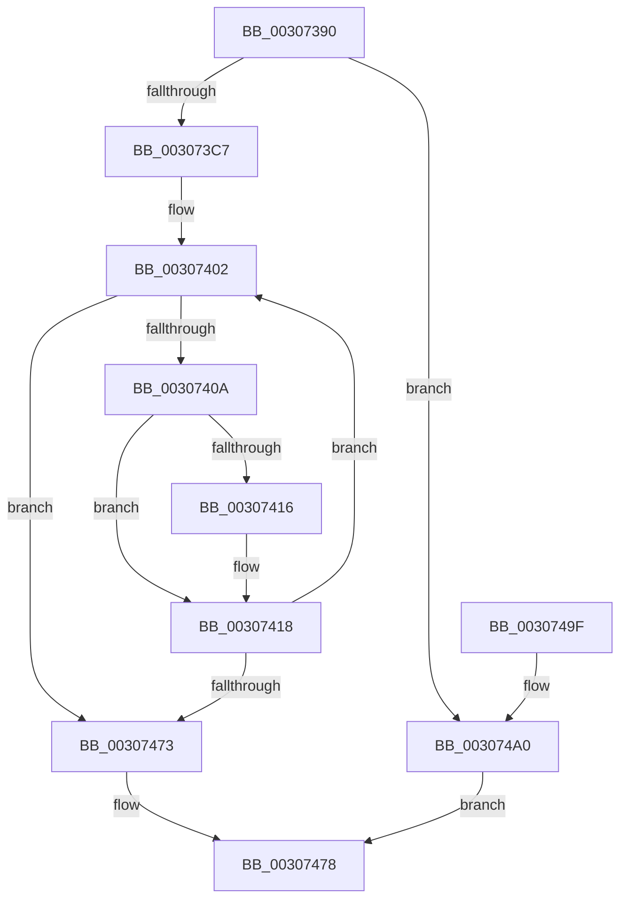

# HvlDmaUnmapDeviceLogicalRange

- RVA: `0x00307390`–`0x003074A7` (길이 `279` bytes)
- VA: `0x0000000140307390`
- 실행 섹션: `.text`
- PDB 이름 있음: `예`; PDB Function 태그: `아니요`
- unwind 정보 RVA: `0x000738B4`
- 디코드: `80`개 명령, `279/279` bytes 표시
- 미해석 바이트: `0` (있으면 어셈블리에 `.byte`로 보존)

> 이 문서는 커널 이미지의 기계어와 PDB 기호를 분석해 생성했습니다. 4번과 5번은 함수 원형과 자료형을 바이너리 사용 방식에서 추정한 C 해석이며 원본 소스 복구 결과는 아닙니다.

## 1. Dependencies

- 직접 호출 지점: **3**; 고유 호출 대상: **3**
- 직접 호출자로 확인된 함수: **1**
- RIP 상대 이미지 참조: **1**

### Outgoing calls
- `0x00307442` → [HvcallFastExtended](../31/HvcallFastExtended_function_003130E0.md) (function, `0x003130E0`)
- `0x00307468` → [HvlpHvToNtStatus](HvlpHvToNtStatus_function_00307BD8.md) (function, `0x00307BD8`)
- `0x00307480` → [_security_check_cookie](../6A/_security_check_cookie_function_006AC640.md) (function, `0x006AC640`)

### Direct callers
- [IommupHvUnmapDeviceLogicalRange](IommupHvUnmapDeviceLogicalRange_function_0030730C.md) at `0x00307346`

### Static image references
- `0x003073A8` → RVA `0x00E0A740` (`.data`; read)

## 2. Other-region calls and transfers

- 다른 실행 섹션으로 향하는 call: **0**
- 별도 외부 분기/꼬리 이동을 확인하지 못했습니다.

## 3. Assembly (complete function range)

```asm
00307390  4C 8B DC                        mov r11, rsp
00307393  49 89 5B 08                     mov qword ptr [r11 + 8], rbx
00307397  49 89 6B 10                     mov qword ptr [r11 + 0x10], rbp
0030739B  49 89 73 20                     mov qword ptr [r11 + 0x20], rsi
0030739F  57                              push rdi
003073A0  41 54                           push r12
003073A2  41 56                           push r14
003073A4  48 83 EC 70                     sub rsp, 0x70
003073A8  48 8B 05 91 33 B0 00            mov rax, qword ptr [rip + 0xb03391]
003073AF  48 33 C4                        xor rax, rsp
003073B2  48 89 44 24 60                  mov qword ptr [rsp + 0x60], rax
003073B7  80 79 04 00                     cmp byte ptr [rcx + 4], 0
003073BB  49 8B D8                        mov rbx, r8
003073BE  48 8B EA                        mov rbp, rdx
003073C1  0F 85 D9 00 00 00               jne 0x1403074a0
003073C7  49 83 4B B8 FF                  or qword ptr [r11 - 0x48], 0xffffffffffffffff
003073CC  33 D2                           xor edx, edx
003073CE  49 21 53 C0                     and qword ptr [r11 - 0x40], rdx
003073D2  33 C0                           xor eax, eax
003073D4  48 C7 44 24 30 B4 00 00 00      mov qword ptr [rsp + 0x30], 0xb4
003073DD  33 F6                           xor esi, esi
003073DF  44 8B 74 24 34                  mov r14d, dword ptr [rsp + 0x34]
003073E4  83 E0 F0                        and eax, 0xfffffff0
003073E7  89 44 24 50                     mov dword ptr [rsp + 0x50], eax
003073EB  41 BC FF 0F 00 00               mov r12d, 0xfff
003073F1  8B 01                           mov eax, dword ptr [rcx]
003073F3  41 8B FC                        mov edi, r12d
003073F6  89 44 24 54                     mov dword ptr [rsp + 0x54], eax
003073FA  C7 44 24 30 B4 00 01 00         mov dword ptr [rsp + 0x30], 0x100b4
00307402  48 8B 0B                        mov rcx, qword ptr [rbx]
00307405  48 85 C9                        test rcx, rcx
00307408  74 69                           je 0x140307473
0030740A  8B C7                           mov eax, edi
0030740C  48 89 6C 24 58                  mov qword ptr [rsp + 0x58], rbp
00307411  48 3B C1                        cmp rax, rcx
00307414  76 02                           jbe 0x140307418
00307416  8B F9                           mov edi, ecx
00307418  83 64 24 20 00                  and dword ptr [rsp + 0x20], 0
0030741D  48 8D 54 24 40                  lea rdx, [rsp + 0x40]
00307422  8B C7                           mov eax, edi
00307424  45 33 C9                        xor r9d, r9d
00307427  41 23 C4                        and eax, r12d
0030742A  41 81 E6 00 F0 FF FF            and r14d, 0xfffff000
00307431  44 0B F0                        or r14d, eax
00307434  44 89 74 24 34                  mov dword ptr [rsp + 0x34], r14d
00307439  48 8B 4C 24 30                  mov rcx, qword ptr [rsp + 0x30]
0030743E  45 8D 41 20                     lea r8d, [r9 + 0x20]
00307442  E8 99 BC 00 00                  call 0x1403130e0
00307447  48 8B D0                        mov rdx, rax
0030744A  48 C1 EA 20                     shr rdx, 0x20
0030744E  48 8B CA                        mov rcx, rdx
00307451  41 23 D4                        and edx, r12d
00307454  49 23 CC                        and rcx, r12
00307457  C1 E2 0C                        shl edx, 0xc
0030745A  48 29 0B                        sub qword ptr [rbx], rcx
0030745D  48 03 F1                        add rsi, rcx
00307460  8B CA                           mov ecx, edx
00307462  48 03 E9                        add rbp, rcx
00307465  0F B7 C8                        movzx ecx, ax
00307468  E8 6B 07 00 00                  call 0x140307bd8
0030746D  8B D0                           mov edx, eax
0030746F  85 C0                           test eax, eax
00307471  79 8F                           jns 0x140307402
00307473  48 89 33                        mov qword ptr [rbx], rsi
00307476  8B C2                           mov eax, edx
00307478  48 8B 4C 24 60                  mov rcx, qword ptr [rsp + 0x60]
0030747D  48 33 CC                        xor rcx, rsp
00307480  E8 BB 51 3A 00                  call 0x1406ac640
00307485  4C 8D 5C 24 70                  lea r11, [rsp + 0x70]
0030748A  49 8B 5B 20                     mov rbx, qword ptr [r11 + 0x20]
0030748E  49 8B 6B 28                     mov rbp, qword ptr [r11 + 0x28]
00307492  49 8B 73 38                     mov rsi, qword ptr [r11 + 0x38]
00307496  49 8B E3                        mov rsp, r11
00307499  41 5E                           pop r14
0030749B  41 5C                           pop r12
0030749D  5F                              pop rdi
0030749E  C3                              ret
0030749F  CC                              int3
003074A0  B8 BB 00 00 C0                  mov eax, 0xc00000bb
003074A5  EB D1                           jmp 0x140307478
```

## 4. C-style interpretation (structured pseudocode)

```c
__int64 __fastcall HvlDmaUnmapDeviceLogicalRange(__int64 a1, __int64 a2, __int64 a3, int a4)
{
    __int64 result;
    __int64 v_r14;
    __int64 v_rbp;
    __int64 v_rdi;
    __int64 v_rsi;
    __int64 v_rsp;
    unsigned __int64 v_stack_m18;
    unsigned __int64 v_stack_m28;
    unsigned __int64 v_stack_m30;
    unsigned int v_stack_m34;
    unsigned int v_stack_m38;
    unsigned __int64 v_stack_m48;
    unsigned int v_stack_m54;
    unsigned __int64 v_stack_m58;
    unsigned int v_stack_m68;

    *(unsigned __int64 *)(v_rsp + 8) = v_rbx;
    *(unsigned __int64 *)(v_rsp + 16) = v_rbp;
    *(unsigned __int64 *)(v_rsp + 32) = v_rsi;
    v_rsp = (v_rsp) - (112);
    result = (*(unsigned __int64 *)(v_rip + 11547537)) ^ (v_rsp);
    v_stack_m28 = result;
    if ((*(unsigned __int8 *)(a1 + 4)) != 0) goto loc_003074A0;
    a2 = 0;
    result = 0;
    v_stack_m58 = 180;
    v_rsi = 0;
    result = (unsigned int)((result) & (0xFFFFFFF0ULL));
    v_stack_m38 = (unsigned int)(result);
    v_stack_m34 = (unsigned int)((unsigned int)(*(unsigned int *)(a1)));
    v_stack_m58 = 0x100B4ULL;
loc_00307402:
    if (*(unsigned __int64 *)(a3) == 0) goto loc_00307473;
    v_stack_m30 = 0;
    v_rdi = (unsigned int)((unsigned int)((unsigned int)(0xFFFULL)));
    if (((unsigned int)((unsigned int)((unsigned int)((unsigned int)((unsigned int)(0xFFFULL)))))) >= = (*(unsigned __int64 *)(a3))) {
        v_rdi = (unsigned int)(*(unsigned __int64 *)(a3));
    }
    a4 = 0;
    result = (unsigned int)(((unsigned int)((unsigned int)(v_rdi))) & ((unsigned int)((unsigned int)(0xFFFULL))));
    v_r14 = (unsigned int)(((unsigned int)(v_stack_m54)) & (0xFFFFF000ULL));
    v_r14 = (unsigned int)((v_r14) | ((unsigned int)(result)));
    v_stack_m54 = (unsigned int)(v_r14);
    result = HvcallFastExtended(v_stack_m58, v_stack_m48, a4 + 32, a4);
    a2 = (result) >> (32);
    a2 = (unsigned int)((a2) & ((unsigned int)((unsigned int)(0xFFFULL))));
    a1 = (a2) & ((unsigned int)(0xFFFULL));
    a2 = (unsigned int)((a2) << (12));
    v_rsi = (v_rsi) + (a1);
    v_rbp = (a2) + ((unsigned int)((unsigned int)(a2)));
    result = HvlpHvToNtStatus((unsigned __int16)(result), a2, a4 + 32, a4);
    if (!sign_flag) goto loc_00307402;
loc_00307473:
    *(unsigned __int64 *)(a3) = v_rsi;
loc_00307478:
    a1 = (v_stack_m28) ^ (v_rsp);
    result = _security_check_cookie(a1, (unsigned int)((unsigned int)(result)), a4 + 32, a4);
    return result;
loc_003074A0:
    goto loc_00307478;
}
```

## 5. (Beta) C Style

```c
int64_t HvlDmaUnmapDeviceLogicalRange(void *Arg1, int64_t Arg2, void *Arg3, int32_t Arg4)
{
    uint8_t *arg1 = (uint8_t *)Arg1;
    uint8_t *arg3 = (uint8_t *)Arg3;

    int64_t result;
    int64_t local_r14;
    int64_t local_rbp;
    int64_t local_rdi;
    int64_t local_rsi;
    int64_t local_rsp;
    uint64_t v_stack_m18;
    uint64_t v_stack_m28;
    uint64_t v_stack_m30;
    uint32_t v_stack_m34;
    uint32_t v_stack_m38;
    uint64_t v_stack_m48;
    uint32_t v_stack_m54;
    uint64_t v_stack_m58;
    uint32_t v_stack_m68;

    *(uint64_t *)(local_rsp + 0x8) = local_rbx;
    *(uint64_t *)(local_rsp + 0x10) = local_rbp;
    *(uint64_t *)(local_rsp + 0x20) = local_rsi;
    local_rsp = (local_rsp) - (112);
    result = (*(uint64_t *)(v_rip + 0xB03391)) ^ (local_rsp);
    v_stack_m28 = result;
    if ((*(uint8_t *)(arg1 + 0x4)) != 0) goto loc_003074A0;
    Arg2 = 0;
    result = 0;
    v_stack_m58 = 180;
    local_rsi = 0;
    result = (uint32_t)((result) & (0xFFFFFFF0ULL));
    v_stack_m38 = (uint32_t)(result);
    v_stack_m34 = (uint32_t)((uint32_t)(*(uint32_t *)(arg1)));
    v_stack_m58 = 0x100B4ULL;
loc_00307402:
    if (*(uint64_t *)(arg3) == 0) goto loc_00307473;
    v_stack_m30 = 0;
    local_rdi = (uint32_t)((uint32_t)((uint32_t)(0xFFFULL)));
    if (((uint32_t)((uint32_t)((uint32_t)((uint32_t)((uint32_t)(0xFFFULL)))))) >= = (*(uint64_t *)(arg3))) {
        local_rdi = (uint32_t)(*(uint64_t *)(arg3));
    }
    Arg4 = 0;
    result = (uint32_t)(((uint32_t)((uint32_t)(local_rdi))) & ((uint32_t)((uint32_t)(0xFFFULL))));
    local_r14 = (uint32_t)(((uint32_t)(v_stack_m54)) & (0xFFFFF000ULL));
    local_r14 = (uint32_t)((local_r14) | ((uint32_t)(result)));
    v_stack_m54 = (uint32_t)(local_r14);
    result = HvcallFastExtended(v_stack_m58, v_stack_m48, Arg4 + 32, Arg4);
    Arg2 = (result) >> (32);
    Arg2 = (uint32_t)((Arg2) & ((uint32_t)((uint32_t)(0xFFFULL))));
    Arg1 = (Arg2) & ((uint32_t)(0xFFFULL));
    Arg2 = (uint32_t)((Arg2) << (12));
    local_rsi = (local_rsi) + (Arg1);
    local_rbp = (Arg2) + ((uint32_t)((uint32_t)(Arg2)));
    result = HvlpHvToNtStatus((uint16_t)(result), Arg2, Arg4 + 32, Arg4);
    if (!sign_flag) goto loc_00307402;
loc_00307473:
    *(uint64_t *)(arg3) = local_rsi;
loc_00307478:
    Arg1 = (v_stack_m28) ^ (local_rsp);
    result = _security_check_cookie(Arg1, (uint32_t)((uint32_t)(result)), Arg4 + 32, Arg4);
    return result;
loc_003074A0:
    goto loc_00307478;
}
```

### 관측된 메모리 오프셋

구조체 형식이 확인되지 않은 접근은 인자 기준의 오프셋으로만 기록했습니다.

| 기준 인자 | 오프셋 표현 | 폭 (bit) | 접근 |
|---|---:|---:|---|
| `Arg1` | `+ 0x0` | `32` | `R` |
| `Arg1` | `+ 0x4` | `8` | `R` |
| `Arg3` | `+ 0x0` | `64` | `R` |
| `Arg3` | `+ 0x0` | `64` | `R/W` |
| `Arg3` | `+ 0x0` | `64` | `W` |

## 6. Execution-region graph

[열기: 2D/3D 그래프와 함수 탐색 컨트롤 패널](../../../control-panel.html?section=text&rva=0x00307390&view=graph)

- 2D 그래프는 위에서 아래로 흐르고, 3D 그래프는 빈 공간을 드래그해 회전합니다. Shift+드래그는 이동, 휠은 확대·축소, 함수 노드 선택은 대상 보고서 이동입니다.

### Static fallback


