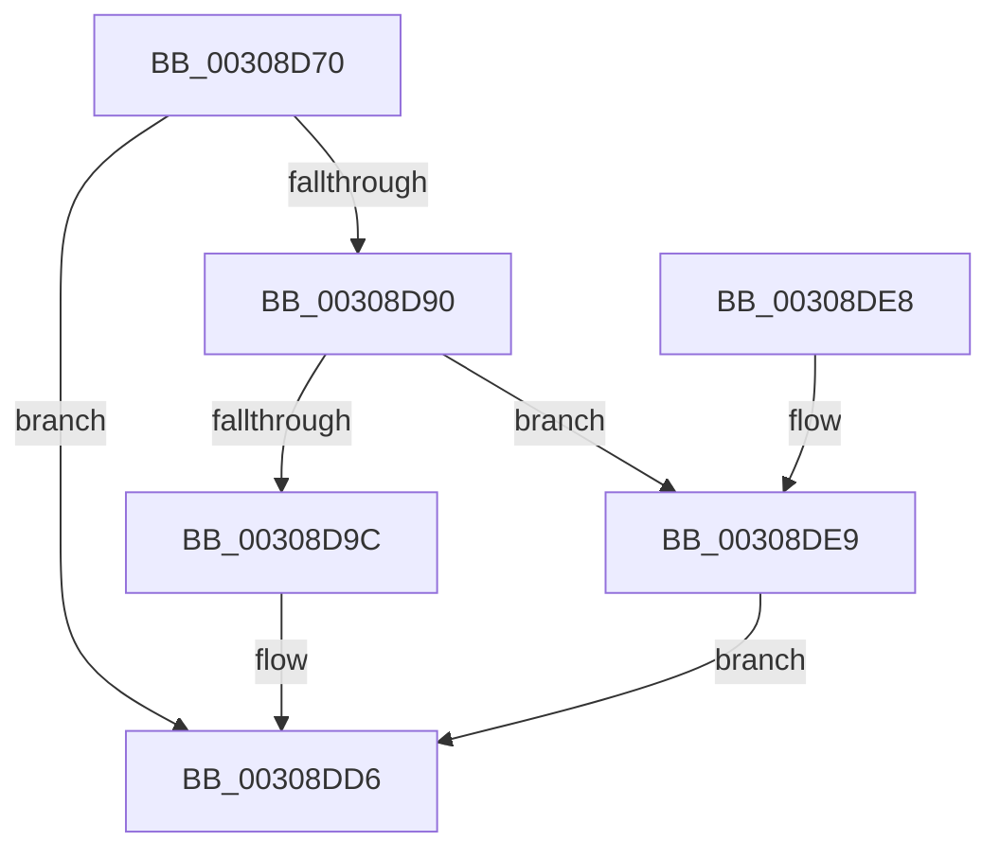

# HvlFlushTbAllPartitions

- RVA: `0x00308D70`–`0x00308DF0` (길이 `128` bytes)
- VA: `0x0000000140308D70`
- 실행 섹션: `.text`
- PDB 이름 있음: `예`; PDB Function 태그: `아니요`
- unwind 정보 RVA: `0x00073A84`
- 디코드: `29`개 명령, `128/128` bytes 표시
- 미해석 바이트: `0` (있으면 어셈블리에 `.byte`로 보존)

> 이 문서는 커널 이미지의 기계어와 PDB 기호를 분석해 생성했습니다. 4번과 5번은 함수 원형과 자료형을 바이너리 사용 방식에서 추정한 C 해석이며 원본 소스 복구 결과는 아닙니다.

## 1. Dependencies

- 직접 호출 지점: **3**; 고유 호출 대상: **3**
- 직접 호출자로 확인된 함수: **1**
- RIP 상대 이미지 참조: **3**

### Outgoing calls
- `0x00308DD1` → [HvcallFastExtended](../31/HvcallFastExtended_function_003130E0.md) (function, `0x003130E0`)
- `0x00308DDE` → [_security_check_cookie](../6A/_security_check_cookie_function_006AC640.md) (function, `0x006AC640`)
- `0x00308DE9` → [VslFlushEntireTb](../58/VslFlushEntireTb_function_0058E358.md) (function, `0x0058E358`)

### Direct callers
- [MiFlushEntireTbDueToAttributeChange](MiFlushEntireTbDueToAttributeChange_function_00308AE0.md) at `0x00308AF0`

### Static image references
- `0x00308D77` → RVA `0x00E0A740` (`.data`; read)
- `0x00308D88` → RVA `0x00FC6A84` (`ALMOSTRO`; read)
- `0x00308D90` → RVA `0x00FC6AB8` (`ALMOSTRO`; read)

## 2. Other-region calls and transfers

- 다른 실행 섹션으로 향하는 call: **0**
- 별도 외부 분기/꼬리 이동을 확인하지 못했습니다.

## 3. Assembly (complete function range)

```asm
00308D70  4C 8B DC                        mov r11, rsp
00308D73  48 83 EC 78                     sub rsp, 0x78
00308D77  48 8B 05 C2 19 B0 00            mov rax, qword ptr [rip + 0xb019c2]
00308D7E  48 33 C4                        xor rax, rsp
00308D81  48 89 44 24 60                  mov qword ptr [rsp + 0x60], rax
00308D86  33 C9                           xor ecx, ecx
00308D88  38 0D F6 DC CB 00               cmp byte ptr [rip + 0xcbdcf6], cl
00308D8E  74 46                           je 0x140308dd6
00308D90  F7 05 1E DD CB 00 00 00 00 04   test dword ptr [rip + 0xcbdd1e], 0x4000000
00308D9A  74 4D                           je 0x140308de9
00308D9C  48 C7 44 24 30 02 00 00 00      mov qword ptr [rsp + 0x30], 2
00308DA5  44 8D 41 18                     lea r8d, [rcx + 0x18]
00308DA9  49 89 4B C8                     mov qword ptr [r11 - 0x38], rcx
00308DAD  49 8D 53 C8                     lea rdx, [r11 - 0x38]
00308DB1  49 89 4B D8                     mov qword ptr [r11 - 0x28], rcx
00308DB5  45 33 C9                        xor r9d, r9d
00308DB8  89 4C 24 20                     mov dword ptr [rsp + 0x20], ecx
00308DBC  C7 44 24 30 02 00 01 00         mov dword ptr [rsp + 0x30], 0x10002
00308DC4  48 8B 4C 24 30                  mov rcx, qword ptr [rsp + 0x30]
00308DC9  49 C7 43 D0 13 02 00 00         mov qword ptr [r11 - 0x30], 0x213
00308DD1  E8 0A A3 00 00                  call 0x1403130e0
00308DD6  48 8B 4C 24 60                  mov rcx, qword ptr [rsp + 0x60]
00308DDB  48 33 CC                        xor rcx, rsp
00308DDE  E8 5D 38 3A 00                  call 0x1406ac640
00308DE3  48 83 C4 78                     add rsp, 0x78
00308DE7  C3                              ret
00308DE8  CC                              int3
00308DE9  E8 6A 55 28 00                  call 0x14058e358
00308DEE  EB E6                           jmp 0x140308dd6
```

## 4. C-style interpretation (structured pseudocode)

```c
__int64 __fastcall HvlFlushTbAllPartitions(int a1, __int64 a2, __int64 a3, int a4)
{
    __int64 result;
    __int64 v_rsp;
    unsigned __int64 v_stack_m18;
    unsigned __int64 v_stack_m48;
    unsigned int v_stack_m58;

    v_rsp = (v_rsp) - (120);
    result = (*(unsigned __int64 *)(v_rip + 11540930)) ^ (v_rsp);
    v_stack_m18 = result;
    a1 = 0;
    if ((*(unsigned __int8 *)(v_rip + 13360374)) == 0) goto loc_00308DD6;
    if (((*(unsigned int *)(v_rip + 13360414)) & (0x4000000ULL)) == 0) goto loc_00308DE9;
    v_stack_m48 = 2;
    *(unsigned __int64 *)(v_rsp - 56) = 0;
    *(unsigned __int64 *)(v_rsp - 40) = 0;
    a4 = 0;
    v_stack_m58 = 0;
    v_stack_m48 = 0x10002ULL;
    *(unsigned __int64 *)(v_rsp - 48) = 531;
    result = HvcallFastExtended(v_stack_m48, v_rsp - 56, a1 + 24, a4);
loc_00308DD6:
    a1 = (v_stack_m18) ^ (v_rsp);
    result = _security_check_cookie(a1, v_rsp - 56, a1 + 24, a4);
    v_rsp = (v_rsp) + (120);
    return result;
loc_00308DE9:
    result = VslFlushEntireTb(a1, v_rsp - 56, a1 + 24, a4);
    goto loc_00308DD6;
}
```

## 5. (Beta) C Style

```c
int64_t HvlFlushTbAllPartitions(int32_t Arg1, int64_t Arg2, int64_t Arg3, int32_t Arg4)
{
    int64_t result;
    int64_t local_rsp;
    uint64_t v_stack_m18;
    uint64_t v_stack_m48;
    uint32_t v_stack_m58;

    local_rsp = (local_rsp) - (120);
    result = (*(uint64_t *)(v_rip + 0xB019C2)) ^ (local_rsp);
    v_stack_m18 = result;
    Arg1 = 0;
    if ((*(uint8_t *)(v_rip + 0xCBDCF6)) == 0) goto loc_00308DD6;
    if (((*(uint32_t *)(v_rip + 0xCBDD1E)) & (0x4000000ULL)) == 0) goto loc_00308DE9;
    v_stack_m48 = 2;
    *(uint64_t *)(local_rsp - 0x38) = 0;
    *(uint64_t *)(local_rsp - 0x28) = 0;
    Arg4 = 0;
    v_stack_m58 = 0;
    v_stack_m48 = 0x10002ULL;
    *(uint64_t *)(local_rsp - 0x30) = 531;
    result = HvcallFastExtended(v_stack_m48, local_rsp - 56, Arg1 + 24, Arg4);
loc_00308DD6:
    Arg1 = (v_stack_m18) ^ (local_rsp);
    result = _security_check_cookie(Arg1, local_rsp - 56, Arg1 + 24, Arg4);
    local_rsp = (local_rsp) + (120);
    return result;
loc_00308DE9:
    result = VslFlushEntireTb(Arg1, local_rsp - 56, Arg1 + 24, Arg4);
    goto loc_00308DD6;
}
```

## 6. Execution-region graph

[열기: 2D/3D 그래프와 함수 탐색 컨트롤 패널](../../../control-panel.html?section=text&rva=0x00308D70&view=graph)

- 2D 그래프는 위에서 아래로 흐르고, 3D 그래프는 빈 공간을 드래그해 회전합니다. Shift+드래그는 이동, 휠은 확대·축소, 함수 노드 선택은 대상 보고서 이동입니다.

### Static fallback


