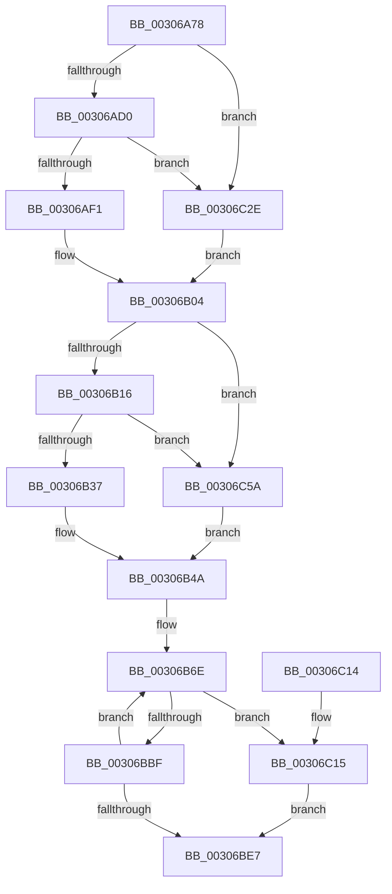

# HvlGetSparseGpaPagesAccessState

- RVA: `0x00306A78`–`0x00306C8D` (길이 `533` bytes)
- VA: `0x0000000140306A78`
- 실행 섹션: `.text`
- PDB 이름 있음: `예`; PDB Function 태그: `아니요`
- unwind 정보 RVA: `0x000737DC`
- 디코드: `136`개 명령, `533/533` bytes 표시
- 미해석 바이트: `0` (있으면 어셈블리에 `.byte`로 보존)

> 이 문서는 커널 이미지의 기계어와 PDB 기호를 분석해 생성했습니다. 4번과 5번은 함수 원형과 자료형을 바이너리 사용 방식에서 추정한 C 해석이며 원본 소스 복구 결과는 아닙니다.

## 1. Dependencies

- 직접 호출 지점: **10**; 고유 호출 대상: **6**
- 직접 호출자로 확인된 함수: **1**
- RIP 상대 이미지 참조: **1**

### Outgoing calls
- `0x00306AE0` → [ExpInterlockedPopEntrySList](../6B/ExpInterlockedPopEntrySList_function_006BA570.md) (function, `0x006BA570`)
- `0x00306B26` → [ExpInterlockedPopEntrySList](../6B/ExpInterlockedPopEntrySList_function_006BA570.md) (function, `0x006BA570`)
- `0x00306B8D` → [memcpy](../6C/memcpy_function_006C6840.md) (function, `0x006C6840`)
- `0x00306BB2` → [HvcallInitiateHypercall](../31/HvcallInitiateHypercall_function_00313630.md) (function, `0x00313630`)
- `0x00306BD6` → [memcpy](../6C/memcpy_function_006C6840.md) (function, `0x006C6840`)
- `0x00306BEB` → [HvlpReleaseHypercallPage](../31/HvlpReleaseHypercallPage_function_00313480.md) (function, `0x00313480`)
- `0x00306BF4` → [HvlpReleaseHypercallPage](../31/HvlpReleaseHypercallPage_function_00313480.md) (function, `0x00313480`)
- `0x00306C24` → [HvlpHvToNtStatus](HvlpHvToNtStatus_function_00307BD8.md) (function, `0x00307BD8`)
- `0x00306C32` → [KeDisableInterrupts](../21/KeDisableInterrupts_function_00217BE0.md) (function, `0x00217BE0`)
- `0x00306C5E` → [KeDisableInterrupts](../21/KeDisableInterrupts_function_00217BE0.md) (function, `0x00217BE0`)

### Direct callers
- [VmpProcessAccessedBatch](../42/VmpProcessAccessedBatch_function_0042A2DC.md) at `0x0042A3C4`

### Static image references
- `0x00306ABA` → RVA `0x00FC6A90` (`ALMOSTRO`; read)

## 2. Other-region calls and transfers

- 다른 실행 섹션으로 향하는 call: **0**
- 별도 외부 분기/꼬리 이동을 확인하지 못했습니다.

## 3. Assembly (complete function range)

```asm
00306A78  4C 89 4C 24 20                  mov qword ptr [rsp + 0x20], r9
00306A7D  4C 89 44 24 18                  mov qword ptr [rsp + 0x18], r8
00306A82  48 89 4C 24 08                  mov qword ptr [rsp + 8], rcx
00306A87  55                              push rbp
00306A88  53                              push rbx
00306A89  56                              push rsi
00306A8A  57                              push rdi
00306A8B  41 54                           push r12
00306A8D  41 55                           push r13
00306A8F  41 56                           push r14
00306A91  41 57                           push r15
00306A93  48 8B EC                        mov rbp, rsp
00306A96  48 83 EC 68                     sub rsp, 0x68
00306A9A  33 C0                           xor eax, eax
00306A9C  45 33 ED                        xor r13d, r13d
00306A9F  0F 57 C0                        xorps xmm0, xmm0
00306AA2  48 89 45 C8                     mov qword ptr [rbp - 0x38], rax
00306AA6  89 45 D0                        mov dword ptr [rbp - 0x30], eax
00306AA9  48 8B DA                        mov rbx, rdx
00306AAC  48 89 45 E8                     mov qword ptr [rbp - 0x18], rax
00306AB0  45 8B FD                        mov r15d, r13d
00306AB3  89 45 F0                        mov dword ptr [rbp - 0x10], eax
00306AB6  45 8D 65 04                     lea r12d, [r13 + 4]
00306ABA  8B 05 D0 FF CB 00               mov eax, dword ptr [rip + 0xcbffd0]
00306AC0  0F 11 45 B8                     movups xmmword ptr [rbp - 0x48], xmm0
00306AC4  0F 11 45 D8                     movups xmmword ptr [rbp - 0x28], xmm0
00306AC8  A8 08                           test al, 8
00306ACA  0F 84 5E 01 00 00               je 0x140306c2e
00306AD0  65 48 8B 3C 25 20 00 00 00      mov rdi, qword ptr gs:[0x20]
00306AD9  48 8D 8F C0 8B 00 00            lea rcx, [rdi + 0x8bc0]
00306AE0  E8 8B 3A 3B 00                  call 0x1406ba570
00306AE5  4C 8B F0                        mov r14, rax
00306AE8  48 85 C0                        test rax, rax
00306AEB  0F 84 3D 01 00 00               je 0x140306c2e
00306AF1  48 89 45 C8                     mov qword ptr [rbp - 0x38], rax
00306AF5  48 8B 40 10                     mov rax, qword ptr [rax + 0x10]
00306AF9  C7 45 B8 01 00 00 00            mov dword ptr [rbp - 0x48], 1
00306B00  48 89 7D C0                     mov qword ptr [rbp - 0x40], rdi
00306B04  48 89 45 D0                     mov qword ptr [rbp - 0x30], rax
00306B08  8B 05 82 FF CB 00               mov eax, dword ptr [rip + 0xcbff82]
00306B0E  A8 08                           test al, 8
00306B10  0F 84 44 01 00 00               je 0x140306c5a
00306B16  65 48 8B 3C 25 20 00 00 00      mov rdi, qword ptr gs:[0x20]
00306B1F  48 8D 8F C0 8B 00 00            lea rcx, [rdi + 0x8bc0]
00306B26  E8 45 3A 3B 00                  call 0x1406ba570
00306B2B  48 8B F0                        mov rsi, rax
00306B2E  48 85 C0                        test rax, rax
00306B31  0F 84 23 01 00 00               je 0x140306c5a
00306B37  4C 8B 60 10                     mov r12, qword ptr [rax + 0x10]
00306B3B  C7 45 D8 01 00 00 00            mov dword ptr [rbp - 0x28], 1
00306B42  48 89 7D E0                     mov qword ptr [rbp - 0x20], rdi
00306B46  48 89 45 E8                     mov qword ptr [rbp - 0x18], rax
00306B4A  48 8B 45 48                     mov rax, qword ptr [rbp + 0x48]
00306B4E  BF CA 00 00 00                  mov edi, 0xca
00306B53  49 89 06                        mov qword ptr [r14], rax
00306B56  49 8D 46 10                     lea rax, [r14 + 0x10]
00306B5A  49 89 5E 08                     mov qword ptr [r14 + 8], rbx
00306B5E  4C 8B 75 58                     mov r14, qword ptr [rbp + 0x58]
00306B62  48 89 45 50                     mov qword ptr [rbp + 0x50], rax
00306B66  4C 89 65 F0                     mov qword ptr [rbp - 0x10], r12
00306B6A  48 89 7D 48                     mov qword ptr [rbp + 0x48], rdi
00306B6E  48 8B 4D 60                     mov rcx, qword ptr [rbp + 0x60]
00306B72  BB FE 01 00 00                  mov ebx, 0x1fe
00306B77  4C 3B F3                        cmp r14, rbx
00306B7A  49 0F 42 DE                     cmovb rbx, r14
00306B7E  4A 8D 14 F9                     lea rdx, [rcx + r15*8]
00306B82  48 8B C8                        mov rcx, rax
00306B85  4C 8D 04 DD 00 00 00 00         lea r8, [rbx*8]
00306B8D  E8 AE FC 3B 00                  call 0x1406c6840
00306B92  48 8B 55 D0                     mov rdx, qword ptr [rbp - 0x30]
00306B96  4D 8B C4                        mov r8, r12
00306B99  48 C1 EF 20                     shr rdi, 0x20
00306B9D  8B C7                           mov eax, edi
00306B9F  33 C3                           xor eax, ebx
00306BA1  25 FF 0F 00 00                  and eax, 0xfff
00306BA6  33 C7                           xor eax, edi
00306BA8  89 45 4C                        mov dword ptr [rbp + 0x4c], eax
00306BAB  48 8B 7D 48                     mov rdi, qword ptr [rbp + 0x48]
00306BAF  48 8B CF                        mov rcx, rdi
00306BB2  E8 79 CA 00 00                  call 0x140313630
00306BB7  48 8B D8                        mov rbx, rax
00306BBA  66 85 C0                        test ax, ax
00306BBD  75 56                           jne 0x140306c15
00306BBF  48 8B 4D 70                     mov rcx, qword ptr [rbp + 0x70]
00306BC3  48 8B D6                        mov rdx, rsi
00306BC6  48 C1 EB 20                     shr rbx, 0x20
00306BCA  49 03 CF                        add rcx, r15
00306BCD  81 E3 FF 0F 00 00               and ebx, 0xfff
00306BD3  44 8B C3                        mov r8d, ebx
00306BD6  E8 65 FC 3B 00                  call 0x1406c6840
00306BDB  48 8B 45 50                     mov rax, qword ptr [rbp + 0x50]
00306BDF  4C 03 FB                        add r15, rbx
00306BE2  4C 2B F3                        sub r14, rbx
00306BE5  75 87                           jne 0x140306b6e
00306BE7  48 8D 4D D8                     lea rcx, [rbp - 0x28]
00306BEB  E8 90 C8 00 00                  call 0x140313480
00306BF0  48 8D 4D B8                     lea rcx, [rbp - 0x48]
00306BF4  E8 87 C8 00 00                  call 0x140313480
00306BF9  48 8B 4D 68                     mov rcx, qword ptr [rbp + 0x68]
00306BFD  41 8B C5                        mov eax, r13d
00306C00  4C 89 39                        mov qword ptr [rcx], r15
00306C03  48 83 C4 68                     add rsp, 0x68
00306C07  41 5F                           pop r15
00306C09  41 5E                           pop r14
00306C0B  41 5D                           pop r13
00306C0D  41 5C                           pop r12
00306C0F  5F                              pop rdi
00306C10  5E                              pop rsi
00306C11  5B                              pop rbx
00306C12  5D                              pop rbp
00306C13  C3                              ret
00306C14  CC                              int3
00306C15  48 C1 E8 20                     shr rax, 0x20
00306C19  0F B7 CB                        movzx ecx, bx
00306C1C  25 FF 0F 00 00                  and eax, 0xfff
00306C21  4C 03 F8                        add r15, rax
00306C24  E8 AF 0F 00 00                  call 0x140307bd8
00306C29  44 8B E8                        mov r13d, eax
00306C2C  EB B9                           jmp 0x140306be7
00306C2E  44 89 65 B8                     mov dword ptr [rbp - 0x48], r12d
00306C32  E8 A9 0F F1 FF                  call 0x140217be0
00306C37  88 45 C0                        mov byte ptr [rbp - 0x40], al
00306C3A  65 48 8B 04 25 20 00 00 00      mov rax, qword ptr gs:[0x20]
00306C43  C7 45 C4 01 00 00 00            mov dword ptr [rbp - 0x3c], 1
00306C4A  4C 8B B0 00 8C 00 00            mov r14, qword ptr [rax + 0x8c00]
00306C51  49 8B 46 10                     mov rax, qword ptr [r14 + 0x10]
00306C55  E9 AA FE FF FF                  jmp 0x140306b04
00306C5A  44 89 65 D8                     mov dword ptr [rbp - 0x28], r12d
00306C5E  E8 7D 0F F1 FF                  call 0x140217be0
00306C63  88 45 E0                        mov byte ptr [rbp - 0x20], al
00306C66  65 48 8B 04 25 20 00 00 00      mov rax, qword ptr gs:[0x20]
00306C6F  C7 45 E4 02 00 00 00            mov dword ptr [rbp - 0x1c], 2
00306C76  48 8B B0 00 8C 00 00            mov rsi, qword ptr [rax + 0x8c00]
00306C7D  48 81 C6 00 10 00 00            add rsi, 0x1000
00306C84  4C 8B 66 10                     mov r12, qword ptr [rsi + 0x10]
00306C88  E9 BD FE FF FF                  jmp 0x140306b4a
```

## 4. C-style interpretation (structured pseudocode)

```c
__int64 __fastcall HvlGetSparseGpaPagesAccessState(__int64 a1, __int64 a2, __int64 a3, __int64 a4, __int64 a5, __int64 a6)
{
    __int64 result;
    __int64 v_r13;
    __int64 v_r14;
    __int64 v_r15;
    __int64 v_rbx;
    __int64 v_rdi;
    __int64 v_rsi;
    __int64 v_rsp;
    unsigned int v_stack_m50;
    unsigned __int64 v_stack_m58;
    unsigned int v_stack_m5C;
    unsigned __int64 v_stack_m60;
    unsigned __int64 v_stack_m68;
    unsigned int v_stack_m70;
    unsigned __int64 v_stack_m78;
    unsigned int v_stack_m7C;
    unsigned __int64 v_stack_m80;
    unsigned __int64 v_stack_m88;
    unsigned __int64 v_stack_p10;
    unsigned __int64 v_stack_p18;
    unsigned __int64 v_stack_p20;
    unsigned __int64 v_stack_p8;
    unsigned int v_stack_pC;

    v_stack_p20 = a4;
    v_stack_p18 = a3;
    v_stack_p8 = a1;
    v_rsp = (v_rsp) - (104);
    result = 0;
    v_r13 = 0;
    v_stack_m78 = 0;
    v_stack_m70 = 0;
    v_stack_m58 = 0;
    v_stack_m50 = 0;
    v_stack_m88 = v_xmm0;
    v_stack_m68 = v_xmm0;
    if ((((unsigned __int8)((unsigned int)(*(unsigned int *)(v_rip + 13369296)))) & (8)) == 0) goto loc_00306C2E;
    result = ExpInterlockedPopEntrySList(*(unsigned __int64 *)(gs_base + (0 + 32)) + 35776, a2, a3, a4);
    if (result == 0) goto loc_00306C2E;
    v_stack_m78 = result;
    v_stack_m88 = 1;
    v_stack_m80 = *(unsigned __int64 *)(gs_base + (0 + 32));
loc_00306B04:
    v_stack_m70 = *(unsigned __int64 *)(result + 16);
    if ((((unsigned __int8)((unsigned int)(*(unsigned int *)(v_rip + 13369218)))) & (8)) == 0) goto loc_00306C5A;
    result = ExpInterlockedPopEntrySList(*(unsigned __int64 *)(gs_base + (0 + 32)) + 35776, a2, a3, a4);
    if (result == 0) goto loc_00306C5A;
    v_stack_m68 = 1;
    v_stack_m60 = *(unsigned __int64 *)(gs_base + (0 + 32));
    v_stack_m58 = result;
loc_00306B4A:
    *(unsigned __int64 *)(result) = v_stack_p8;
    *(unsigned __int64 *)(result + 8) = a2;
    v_stack_p10 = result + 16;
    v_stack_m50 = *(unsigned __int64 *)(result + 16);
    v_stack_p8 = 202;
loc_00306B6E:
    v_rbx = 510;
    if (v_stack_p18 < 510) { v_rbx = v_stack_p18; }
    result = memcpy(result + 16, v_stack_p20 + 0 * 8, v_rbx * 8, a4);
    v_rdi = (202) >> (32);
    result = (unsigned int)(((unsigned int)((unsigned int)(v_rdi))) ^ ((unsigned int)(v_rbx)));
    result = (unsigned int)((result) & (0xFFFULL));
    result = (unsigned int)((result) ^ ((unsigned int)(v_rdi)));
    v_stack_pC = (unsigned int)(result);
    result = HvcallInitiateHypercall(v_stack_p8, v_stack_m70, *(unsigned __int64 *)(result + 16), a4);
    if ((unsigned __int16)(result) != 0) goto loc_00306C15;
    v_rbx = (result) >> (32);
    a1 = (a6) + (0);
    v_rbx = (unsigned int)((v_rbx) & (0xFFFULL));
    result = memcpy(a1, result, (unsigned int)((unsigned int)(v_rbx)), a4);
    v_r15 = (0) + (v_rbx);
    v_r14 = (v_stack_p18) - (v_rbx);
    if (condition_is_not_equal) goto loc_00306B6E;
loc_00306BE7:
    result = HvlpReleaseHypercallPage(v_stack_m68, result, (unsigned int)((unsigned int)(v_rbx)), a4);
    result = HvlpReleaseHypercallPage(v_stack_m88, result, (unsigned int)((unsigned int)(v_rbx)), a4);
    *(unsigned __int64 *)(a5) = v_r15;
    v_rsp = (v_rsp) + (104);
    return 0;
loc_00306C15:
    result = (0) >> (32);
    result = (unsigned int)((result) & (0xFFFULL));
    v_r15 = (v_r15) + (result);
    result = HvlpHvToNtStatus((unsigned __int16)(v_rbx), result, (unsigned int)((unsigned int)(v_rbx)), a4);
    goto loc_00306BE7;
loc_00306C2E:
    v_stack_m88 = (unsigned int)(*(unsigned __int64 *)(result + 16));
    result = KeDisableInterrupts((unsigned __int16)(v_rbx), result, (unsigned int)((unsigned int)(v_rbx)), a4);
    v_stack_m80 = (unsigned __int8)(result);
    v_stack_m7C = 1;
    goto loc_00306B04;
loc_00306C5A:
    v_stack_m68 = (unsigned int)(*(unsigned __int64 *)(result + 16));
    result = KeDisableInterrupts((unsigned __int16)(v_rbx), result, (unsigned int)((unsigned int)(v_rbx)), a4);
    v_stack_m60 = (unsigned __int8)(result);
    v_stack_m5C = 2;
    v_rsi = (*(unsigned __int64 *)(*(unsigned __int64 *)(gs_base + (0 + 32)) + 35840)) + (0x1000ULL);
    goto loc_00306B4A;
}
```

## 5. (Beta) C Style

```c
int64_t HvlGetSparseGpaPagesAccessState(int64_t Arg1, int64_t Arg2, int64_t Arg3, int64_t Arg4, void *Arg5, int64_t Arg6)
{
    uint8_t *arg5 = (uint8_t *)Arg5;

    int64_t result;
    int64_t local_r13;
    int64_t local_r14;
    int64_t local_r15;
    int64_t local_rbx;
    int64_t local_rdi;
    int64_t local_rsi;
    int64_t local_rsp;
    uint32_t v_stack_m50;
    uint64_t v_stack_m58;
    uint32_t v_stack_m5C;
    uint64_t v_stack_m60;
    uint64_t v_stack_m68;
    uint32_t v_stack_m70;
    uint64_t v_stack_m78;
    uint32_t v_stack_m7C;
    uint64_t v_stack_m80;
    uint64_t v_stack_m88;
    uint64_t v_stack_p10;
    uint64_t v_stack_p18;
    uint64_t v_stack_p20;
    uint64_t v_stack_p8;
    uint32_t v_stack_pC;

    v_stack_p20 = Arg4;
    v_stack_p18 = Arg3;
    v_stack_p8 = Arg1;
    local_rsp = (local_rsp) - (104);
    result = 0;
    local_r13 = 0;
    v_stack_m78 = 0;
    v_stack_m70 = 0;
    v_stack_m58 = 0;
    v_stack_m50 = 0;
    v_stack_m88 = v_xmm0;
    v_stack_m68 = v_xmm0;
    if ((((uint8_t)((uint32_t)(*(uint32_t *)(v_rip + 0xCBFFD0)))) & (8)) == 0) goto loc_00306C2E;
    result = ExpInterlockedPopEntrySList(*(uint64_t *)(gs_base + (0 + 0x20)) + 35776, Arg2, Arg3, Arg4);
    if (result == 0) goto loc_00306C2E;
    v_stack_m78 = result;
    v_stack_m88 = 1;
    v_stack_m80 = *(uint64_t *)(gs_base + (0 + 0x20));
loc_00306B04:
    v_stack_m70 = *(uint64_t *)(result + 0x10);
    if ((((uint8_t)((uint32_t)(*(uint32_t *)(v_rip + 0xCBFF82)))) & (8)) == 0) goto loc_00306C5A;
    result = ExpInterlockedPopEntrySList(*(uint64_t *)(gs_base + (0 + 0x20)) + 35776, Arg2, Arg3, Arg4);
    if (result == 0) goto loc_00306C5A;
    v_stack_m68 = 1;
    v_stack_m60 = *(uint64_t *)(gs_base + (0 + 0x20));
    v_stack_m58 = result;
loc_00306B4A:
    *(uint64_t *)(result) = v_stack_p8;
    *(uint64_t *)(result + 0x8) = Arg2;
    v_stack_p10 = result + 16;
    v_stack_m50 = *(uint64_t *)(result + 0x10);
    v_stack_p8 = 202;
loc_00306B6E:
    local_rbx = 510;
    if (v_stack_p18 < 510) { local_rbx = v_stack_p18; }
    result = memcpy(result + 16, v_stack_p20 + 0 * 8, local_rbx * 8, Arg4);
    local_rdi = (202) >> (32);
    result = (uint32_t)(((uint32_t)((uint32_t)(local_rdi))) ^ ((uint32_t)(local_rbx)));
    result = (uint32_t)((result) & (0xFFFULL));
    result = (uint32_t)((result) ^ ((uint32_t)(local_rdi)));
    v_stack_pC = (uint32_t)(result);
    result = HvcallInitiateHypercall(v_stack_p8, v_stack_m70, *(uint64_t *)(result + 0x10), Arg4);
    if ((uint16_t)(result) != 0) goto loc_00306C15;
    local_rbx = (result) >> (32);
    Arg1 = (Arg6) + (0);
    local_rbx = (uint32_t)((local_rbx) & (0xFFFULL));
    result = memcpy(Arg1, result, (uint32_t)((uint32_t)(local_rbx)), Arg4);
    local_r15 = (0) + (local_rbx);
    local_r14 = (v_stack_p18) - (local_rbx);
    if (condition_is_not_equal) goto loc_00306B6E;
loc_00306BE7:
    result = HvlpReleaseHypercallPage(v_stack_m68, result, (uint32_t)((uint32_t)(local_rbx)), Arg4);
    result = HvlpReleaseHypercallPage(v_stack_m88, result, (uint32_t)((uint32_t)(local_rbx)), Arg4);
    *(uint64_t *)(arg5) = local_r15;
    local_rsp = (local_rsp) + (104);
    return 0;
loc_00306C15:
    result = (0) >> (32);
    result = (uint32_t)((result) & (0xFFFULL));
    local_r15 = (local_r15) + (result);
    result = HvlpHvToNtStatus((uint16_t)(local_rbx), result, (uint32_t)((uint32_t)(local_rbx)), Arg4);
    goto loc_00306BE7;
loc_00306C2E:
    v_stack_m88 = (uint32_t)(*(uint64_t *)(result + 0x10));
    result = KeDisableInterrupts((uint16_t)(local_rbx), result, (uint32_t)((uint32_t)(local_rbx)), Arg4);
    v_stack_m80 = (uint8_t)(result);
    v_stack_m7C = 1;
    goto loc_00306B04;
loc_00306C5A:
    v_stack_m68 = (uint32_t)(*(uint64_t *)(result + 0x10));
    result = KeDisableInterrupts((uint16_t)(local_rbx), result, (uint32_t)((uint32_t)(local_rbx)), Arg4);
    v_stack_m60 = (uint8_t)(result);
    v_stack_m5C = 2;
    local_rsi = (*(uint64_t *)(*(uint64_t *)(gs_base + (0 + 0x20)) + 0x8C00)) + (0x1000ULL);
    goto loc_00306B4A;
}
```

### 관측된 메모리 오프셋

구조체 형식이 확인되지 않은 접근은 인자 기준의 오프셋으로만 기록했습니다.

| 기준 인자 | 오프셋 표현 | 폭 (bit) | 접근 |
|---|---:|---:|---|
| `Arg5` | `+ 0x0` | `64` | `W` |

## 6. Execution-region graph

[열기: 2D/3D 그래프와 함수 탐색 컨트롤 패널](../../../control-panel.html?section=text&rva=0x00306A78&view=graph)

- 2D 그래프는 위에서 아래로 흐르고, 3D 그래프는 빈 공간을 드래그해 회전합니다. Shift+드래그는 이동, 휠은 확대·축소, 함수 노드 선택은 대상 보고서 이동입니다.

### Static fallback


