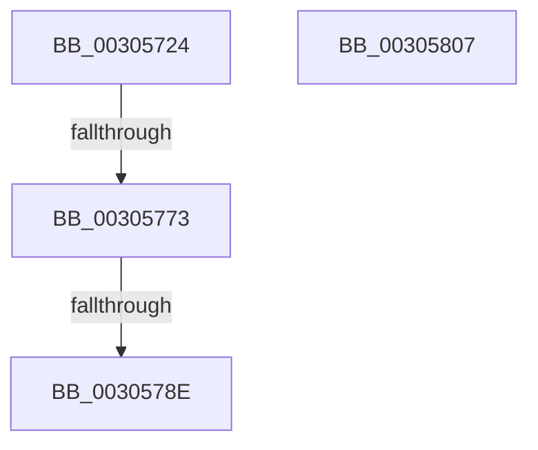

# HvlParkedVirtualProcessors

- RVA: `0x00305724`–`0x00305808` (길이 `228` bytes)
- VA: `0x0000000140305724`
- 실행 섹션: `.text`
- PDB 이름 있음: `예`; PDB Function 태그: `예`
- unwind 정보 RVA: `0x00073684`
- 디코드: `52`개 명령, `228/228` bytes 표시
- 미해석 바이트: `0` (있으면 어셈블리에 `.byte`로 보존)

> 이 문서는 커널 이미지의 기계어와 PDB 기호를 분석해 생성했습니다. 4번과 5번은 함수 원형과 자료형을 바이너리 사용 방식에서 추정한 C 해석이며 원본 소스 복구 결과는 아닙니다.

## 1. Dependencies

- 직접 호출 지점: **4**; 고유 호출 대상: **4**
- 직접 호출자로 확인된 함수: **1**
- RIP 상대 이미지 참조: **4**

### Outgoing calls
- `0x00305760` → [memset](../6C/memset_function_006C6C40.md) (function, `0x006C6C40`)
- `0x003057A0` → [HvlpAffinityToHvProcessorSet](HvlpAffinityToHvProcessorSet_function_003068F4.md) (function, `0x003068F4`)
- `0x003057ED` → [HvcallFastExtended](../31/HvcallFastExtended_function_003130E0.md) (function, `0x003130E0`)
- `0x003057F9` → [_security_check_cookie](../6A/_security_check_cookie_function_006AC640.md) (function, `0x006AC640`)

### Direct callers
- [PpmParkReportMask](PpmParkReportMask_function_00305190.md) at `0x003051E8`

### Static image references
- `0x00305732` → RVA `0x00E0A740` (`.data`; read)
- `0x00305765` → RVA `0x00FC6AB8` (`ALMOSTRO`; read)
- `0x00305773` → RVA `0x00FC6A90` (`ALMOSTRO`; read)
- `0x00305799` → RVA `0x00E0C0F0` (`.data`; read)

## 2. Other-region calls and transfers

- 다른 실행 섹션으로 향하는 call: **0**
- call이 아닌 외부 분기/꼬리 이동: **2**
  - `0x0030576D` → [sub_006E0708](../6E/Unknown_function_006E0708.md) (`tail-transfer`)
  - `0x00305788` → [sub_006E0708](../6E/Unknown_function_006E0708.md) (`tail-transfer`)

## 3. Assembly (complete function range)

```asm
00305724  40 55                           push rbp
00305726  48 8D 6C 24 F0                  lea rbp, [rsp - 0x10]
0030572B  48 81 EC 10 01 00 00            sub rsp, 0x110
00305732  48 8B 05 07 50 B0 00            mov rax, qword ptr [rip + 0xb05007]
00305739  48 33 C4                        xor rax, rsp
0030573C  48 89 45 00                     mov qword ptr [rbp], rax
00305740  33 C0                           xor eax, eax
00305742  48 8D 4C 24 60                  lea rcx, [rsp + 0x60]
00305747  0F 57 C0                        xorps xmm0, xmm0
0030574A  48 89 44 24 48                  mov qword ptr [rsp + 0x48], rax
0030574F  33 D2                           xor edx, edx
00305751  89 44 24 50                     mov dword ptr [rsp + 0x50], eax
00305755  41 B8 A0 00 00 00               mov r8d, 0xa0
0030575B  0F 11 44 24 38                  movups xmmword ptr [rsp + 0x38], xmm0
00305760  E8 DB 14 3C 00                  call 0x1406c6c40
00305765  8B 05 4D 13 CC 00               mov eax, dword ptr [rip + 0xcc134d]
0030576B  84 C0                           test al, al
0030576D  0F 89 95 AF 3D 00               jns 0x1406e0708
00305773  8B 05 17 13 CC 00               mov eax, dword ptr [rip + 0xcc1317]
00305779  48 C1 E8 08                     shr rax, 8
0030577D  83 E0 0F                        and eax, 0xf
00305780  48 83 C0 03                     add rax, 3
00305784  48 83 F8 0E                     cmp rax, 0xe
00305788  0F 83 7A AF 3D 00               jae 0x1406e0708
0030578E  41 B8 60 00 00 00               mov r8d, 0x60
00305794  48 8D 54 24 60                  lea rdx, [rsp + 0x60]
00305799  48 8D 0D 50 69 B0 00            lea rcx, [rip + 0xb06950]
003057A0  E8 4F 11 00 00                  call 0x1403068f4
003057A5  83 64 24 20 00                  and dword ptr [rsp + 0x20], 0
003057AA  45 33 C9                        xor r9d, r9d
003057AD  48 C7 44 24 30 09 00 00 00      mov qword ptr [rsp + 0x30], 9
003057B6  8D 50 07                        lea edx, [rax + 7]
003057B9  C1 E2 0E                        shl edx, 0xe
003057BC  44 8D 40 10                     lea r8d, [rax + 0x10]
003057C0  81 E2 00 00 FE 03               and edx, 0x3fe0000
003057C6  8B CA                           mov ecx, edx
003057C8  81 CA 09 00 01 00               or edx, 0x10009
003057CE  83 C9 09                        or ecx, 9
003057D1  89 4C 24 30                     mov dword ptr [rsp + 0x30], ecx
003057D5  48 8B 4C 24 30                  mov rcx, qword ptr [rsp + 0x30]
003057DA  48 89 4C 24 30                  mov qword ptr [rsp + 0x30], rcx
003057DF  89 54 24 30                     mov dword ptr [rsp + 0x30], edx
003057E3  48 8D 54 24 60                  lea rdx, [rsp + 0x60]
003057E8  48 8B 4C 24 30                  mov rcx, qword ptr [rsp + 0x30]
003057ED  E8 EE D8 00 00                  call 0x1403130e0
003057F2  48 8B 4D 00                     mov rcx, qword ptr [rbp]
003057F6  48 33 CC                        xor rcx, rsp
003057F9  E8 42 6E 3A 00                  call 0x1406ac640
003057FE  48 81 C4 10 01 00 00            add rsp, 0x110
00305805  5D                              pop rbp
00305806  C3                              ret
00305807  CC                              int3
```

## 4. C-style interpretation (structured pseudocode)

```c
__int64 __fastcall HvlParkedVirtualProcessors(__int64 a1, int a2, __int64 a3, int a4)
{
    __int64 result;
    __int64 v_rsp;
    unsigned __int64 v_stack_m18;
    unsigned __int64 v_stack_mB8;
    unsigned int v_stack_mC8;
    unsigned __int64 v_stack_mD0;
    unsigned __int64 v_stack_mE0;
    unsigned __int64 v_stack_mE8;
    unsigned int v_stack_mF8;

    v_rsp = (v_rsp) - (272);
    result = (*(unsigned __int64 *)(v_rip + 11554823)) ^ (v_rsp);
    v_stack_m18 = result;
    result = 0;
    v_stack_mD0 = 0;
    a2 = 0;
    v_stack_mC8 = 0;
    v_stack_mE0 = v_xmm0;
    result = memset(v_stack_mB8, a2, 160, a4);
    result = ((unsigned int)(*(unsigned int *)(v_rip + 13374231))) >> (8);
    result = (unsigned int)((result) & (15));
    result = (result) + (3);
    result = HvlpAffinityToHvProcessorSet(v_rip + 11561296, v_stack_mB8, 96, a4);
    a4 = 0;
    v_stack_mE8 = 9;
    a2 = (unsigned int)((result + 7) << (14));
    a2 = (unsigned int)((a2) & (0x3FE0000ULL));
    a2 = (unsigned int)((a2) | (0x10009ULL));
    a1 = (unsigned int)(((unsigned int)(a2)) | (9));
    v_stack_mE8 = (unsigned int)(a1);
    v_stack_mE8 = v_stack_mE8;
    v_stack_mE8 = a2;
    result = HvcallFastExtended(v_stack_mE8, v_stack_mB8, result + 16, a4);
    a1 = (v_stack_m18) ^ (v_rsp);
    result = _security_check_cookie(a1, v_stack_mB8, result + 16, a4);
    v_rsp = (v_rsp) + (272);
    return result;
}
```

## 5. (Beta) C Style

```c
int64_t HvlParkedVirtualProcessors(int64_t Arg1, int32_t Arg2, int64_t Arg3, int32_t Arg4)
{
    int64_t result;
    int64_t local_rsp;
    uint64_t v_stack_m18;
    uint64_t v_stack_mB8;
    uint32_t v_stack_mC8;
    uint64_t v_stack_mD0;
    uint64_t v_stack_mE0;
    uint64_t v_stack_mE8;
    uint32_t v_stack_mF8;

    local_rsp = (local_rsp) - (272);
    result = (*(uint64_t *)(v_rip + 0xB05007)) ^ (local_rsp);
    v_stack_m18 = result;
    result = 0;
    v_stack_mD0 = 0;
    Arg2 = 0;
    v_stack_mC8 = 0;
    v_stack_mE0 = v_xmm0;
    result = memset(v_stack_mB8, Arg2, 160, Arg4);
    result = ((uint32_t)(*(uint32_t *)(v_rip + 0xCC1317))) >> (8);
    result = (uint32_t)((result) & (15));
    result = (result) + (3);
    result = HvlpAffinityToHvProcessorSet(v_rip + 11561296, v_stack_mB8, 96, Arg4);
    Arg4 = 0;
    v_stack_mE8 = 9;
    Arg2 = (uint32_t)((result + 7) << (14));
    Arg2 = (uint32_t)((Arg2) & (0x3FE0000ULL));
    Arg2 = (uint32_t)((Arg2) | (0x10009ULL));
    Arg1 = (uint32_t)(((uint32_t)(Arg2)) | (9));
    v_stack_mE8 = (uint32_t)(Arg1);
    v_stack_mE8 = v_stack_mE8;
    v_stack_mE8 = Arg2;
    result = HvcallFastExtended(v_stack_mE8, v_stack_mB8, result + 16, Arg4);
    Arg1 = (v_stack_m18) ^ (local_rsp);
    result = _security_check_cookie(Arg1, v_stack_mB8, result + 16, Arg4);
    local_rsp = (local_rsp) + (272);
    return result;
}
```

## 6. Execution-region graph

[열기: 2D/3D 그래프와 함수 탐색 컨트롤 패널](../../../control-panel.html?section=text&rva=0x00305724&view=graph)

- 2D 그래프는 위에서 아래로 흐르고, 3D 그래프는 빈 공간을 드래그해 회전합니다. Shift+드래그는 이동, 휠은 확대·축소, 함수 노드 선택은 대상 보고서 이동입니다.

### Static fallback


