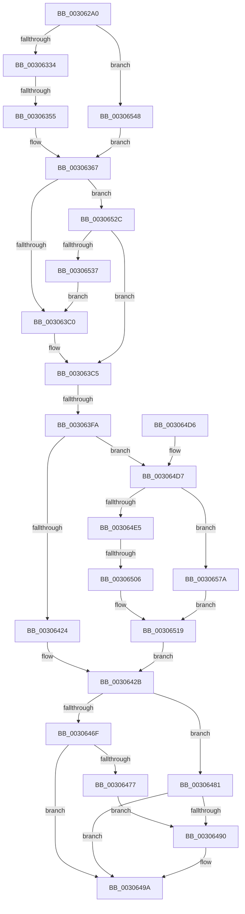

# HvlRetargetDeviceInterrupt

- RVA: `0x003062A0`–`0x003065AC` (길이 `780` bytes)
- VA: `0x00000001403062A0`
- 실행 섹션: `.text`
- PDB 이름 있음: `예`; PDB Function 태그: `예`
- unwind 정보 RVA: `0x00073748`
- 디코드: `179`개 명령, `780/780` bytes 표시
- 미해석 바이트: `0` (있으면 어셈블리에 `.byte`로 보존)

> 이 문서는 커널 이미지의 기계어와 PDB 기호를 분석해 생성했습니다. 4번과 5번은 함수 원형과 자료형을 바이너리 사용 방식에서 추정한 C 해석이며 원본 소스 복구 결과는 아닙니다.

## 1. Dependencies

- 직접 호출 지점: **12**; 고유 호출 대상: **8**
- 직접 호출자로 확인된 함수: **0**
- RIP 상대 이미지 참조: **2**

### Outgoing calls
- `0x0030631C` → [memset](../6C/memset_function_006C6C40.md) (function, `0x006C6C40`)
- `0x00306344` → [ExpInterlockedPopEntrySList](../6B/ExpInterlockedPopEntrySList_function_006BA570.md) (function, `0x006BA570`)
- `0x003063A6` → [memset](../6C/memset_function_006C6C40.md) (function, `0x006C6C40`)
- `0x003063EC` → [HvlpAffinityToHvProcessorSet](HvlpAffinityToHvProcessorSet_function_003068F4.md) (function, `0x003068F4`)
- `0x00306465` → [HvcallInitiateHypercall](../31/HvcallInitiateHypercall_function_00313630.md) (function, `0x00313630`)
- `0x00306484` → [HvlpHvToNtStatus](HvlpHvToNtStatus_function_00307BD8.md) (function, `0x00307BD8`)
- `0x00306495` → [HvlpReleaseHypercallPage](../31/HvlpReleaseHypercallPage_function_00313480.md) (function, `0x00313480`)
- `0x0030649F` → [HvlpReleaseHypercallPage](../31/HvlpReleaseHypercallPage_function_00313480.md) (function, `0x00313480`)
- `0x003064B0` → [_security_check_cookie](../6A/_security_check_cookie_function_006AC640.md) (function, `0x006AC640`)
- `0x003064F5` → [ExpInterlockedPopEntrySList](../6B/ExpInterlockedPopEntrySList_function_006BA570.md) (function, `0x006BA570`)
- `0x00306550` → [KeDisableInterrupts](../21/KeDisableInterrupts_function_00217BE0.md) (function, `0x00217BE0`)
- `0x00306582` → [KeDisableInterrupts](../21/KeDisableInterrupts_function_00217BE0.md) (function, `0x00217BE0`)

### Direct callers
- 이 함수 시작 RVA로 연결되는 직접 call은 확인되지 않았습니다. 간접 호출은 완전히 역산할 수 없습니다.

### Static image references
- `0x003062C6` → RVA `0x00E0A740` (`.data`; read)
- `0x00306321` → RVA `0x00FC6A90` (`ALMOSTRO`; read)

## 2. Other-region calls and transfers

- 다른 실행 섹션으로 향하는 call: **0**
- call이 아닌 외부 분기/꼬리 이동: **3**
  - `0x0030634F` → [sub_006E0928](../6E/Unknown_function_006E0928.md) (`tail-transfer`)
  - `0x003063F4` → [sub_006E0928 + 0x60](../6E/Unknown_function_006E0928.md) (`tail-transfer`)
  - `0x00306500` → [sub_006E0928 + 0xB9](../6E/Unknown_function_006E0928.md) (`tail-transfer`)

## 3. Assembly (complete function range)

```asm
003062A0  48 8B C4                        mov rax, rsp
003062A3  48 89 58 08                     mov qword ptr [rax + 8], rbx
003062A7  48 89 70 10                     mov qword ptr [rax + 0x10], rsi
003062AB  48 89 78 18                     mov qword ptr [rax + 0x18], rdi
003062AF  55                              push rbp
003062B0  41 54                           push r12
003062B2  41 55                           push r13
003062B4  41 56                           push r14
003062B6  41 57                           push r15
003062B8  48 8D A8 28 FE FF FF            lea rbp, [rax - 0x1d8]
003062BF  48 81 EC B0 02 00 00            sub rsp, 0x2b0
003062C6  48 8B 05 73 44 B0 00            mov rax, qword ptr [rip + 0xb04473]
003062CD  48 33 C4                        xor rax, rsp
003062D0  48 89 85 A0 01 00 00            mov qword ptr [rbp + 0x1a0], rax
003062D7  4C 8B B5 00 02 00 00            mov r14, qword ptr [rbp + 0x200]
003062DE  33 C0                           xor eax, eax
003062E0  0F 57 C0                        xorps xmm0, xmm0
003062E3  4C 89 44 24 20                  mov qword ptr [rsp + 0x20], r8
003062E8  4C 8B EA                        mov r13, rdx
003062EB  48 89 4C 24 68                  mov qword ptr [rsp + 0x68], rcx
003062F0  33 D2                           xor edx, edx
003062F2  48 89 44 24 38                  mov qword ptr [rsp + 0x38], rax
003062F7  41 B8 00 01 00 00               mov r8d, 0x100
003062FD  89 44 24 40                     mov dword ptr [rsp + 0x40], eax
00306301  48 8D 4C 24 78                  lea rcx, [rsp + 0x78]
00306306  48 89 44 24 58                  mov qword ptr [rsp + 0x58], rax
0030630B  0F 11 44 24 28                  movups xmmword ptr [rsp + 0x28], xmm0
00306310  89 44 24 60                     mov dword ptr [rsp + 0x60], eax
00306314  4D 8B E1                        mov r12, r9
00306317  0F 11 44 24 48                  movups xmmword ptr [rsp + 0x48], xmm0
0030631C  E8 1F 09 3C 00                  call 0x1406c6c40
00306321  8B 05 69 07 CC 00               mov eax, dword ptr [rip + 0xcc0769]
00306327  33 DB                           xor ebx, ebx
00306329  8D 73 01                        lea esi, [rbx + 1]
0030632C  A8 08                           test al, 8
0030632E  0F 84 14 02 00 00               je 0x140306548
00306334  65 4C 8B 3C 25 20 00 00 00      mov r15, qword ptr gs:[0x20]
0030633D  49 8D 8F C0 8B 00 00            lea rcx, [r15 + 0x8bc0]
00306344  E8 27 42 3B 00                  call 0x1406ba570
00306349  48 8B F8                        mov rdi, rax
0030634C  48 85 C0                        test rax, rax
0030634F  0F 84 D3 A5 3D 00               je 0x1406e0928
00306355  48 89 44 24 38                  mov qword ptr [rsp + 0x38], rax
0030635A  48 8B 40 10                     mov rax, qword ptr [rax + 0x10]
0030635E  89 74 24 28                     mov dword ptr [rsp + 0x28], esi
00306362  4C 89 7C 24 30                  mov qword ptr [rsp + 0x30], r15
00306367  0F 57 C0                        xorps xmm0, xmm0
0030636A  48 89 44 24 40                  mov qword ptr [rsp + 0x40], rax
0030636F  0F 11 07                        movups xmmword ptr [rdi], xmm0
00306372  33 C0                           xor eax, eax
00306374  33 D2                           xor edx, edx
00306376  0F 11 47 10                     movups xmmword ptr [rdi + 0x10], xmm0
0030637A  41 B8 00 01 00 00               mov r8d, 0x100
00306380  48 8D 4C 24 78                  lea rcx, [rsp + 0x78]
00306385  0F 11 47 20                     movups xmmword ptr [rdi + 0x20], xmm0
00306389  48 89 47 30                     mov qword ptr [rdi + 0x30], rax
0030638D  48 8B 44 24 20                  mov rax, qword ptr [rsp + 0x20]
00306392  0F 10 00                        movups xmm0, xmmword ptr [rax]
00306395  F3 0F 7F 47 28                  movdqu xmmword ptr [rdi + 0x28], xmm0
0030639A  21 5C 24 74                     and dword ptr [rsp + 0x74], ebx
0030639E  C7 44 24 70 01 00 20 00         mov dword ptr [rsp + 0x70], 0x200001
003063A6  E8 95 08 3C 00                  call 0x1406c6c40
003063AB  41 0F B7 4C 24 08               movzx ecx, word ptr [r12 + 8]
003063B1  4D 8B 04 24                     mov r8, qword ptr [r12]
003063B5  66 39 4C 24 70                  cmp word ptr [rsp + 0x70], cx
003063BA  0F 86 6C 01 00 00               jbe 0x14030652c
003063C0  4C 09 44 CC 78                  or qword ptr [rsp + rcx*8 + 0x78], r8
003063C5  41 BC 02 00 00 00               mov r12d, 2
003063CB  48 8D 57 30                     lea rdx, [rdi + 0x30]
003063CF  41 22 F4                        and sil, r12b
003063D2  48 8D 4C 24 70                  lea rcx, [rsp + 0x70]
003063D7  40 F6 DE                        neg sil
003063DA  BE C0 0F 00 00                  mov esi, 0xfc0
003063DF  45 1B C0                        sbb r8d, r8d
003063E2  41 81 E0 80 F0 FF FF            and r8d, 0xfffff080
003063E9  44 03 C6                        add r8d, esi
003063EC  E8 03 05 00 00                  call 0x1403068f4
003063F1  83 F8 FF                        cmp eax, -1
003063F4  0F 84 8E A5 3D 00               je 0x1406e0988
003063FA  44 09 67 2C                     or dword ptr [rdi + 0x2c], r12d
003063FE  8D 70 40                        lea esi, [rax + 0x40]
00306401  48 83 0F FF                     or qword ptr [rdi], 0xffffffffffffffff
00306405  45 33 FF                        xor r15d, r15d
00306408  48 8B 44 24 68                  mov rax, qword ptr [rsp + 0x68]
0030640D  48 89 47 08                     mov qword ptr [rdi + 8], rax
00306411  41 0F 10 45 00                  movups xmm0, xmmword ptr [r13]
00306416  F3 0F 7F 47 10                  movdqu xmmword ptr [rdi + 0x10], xmm0
0030641B  4D 85 F6                        test r14, r14
0030641E  0F 85 B3 00 00 00               jne 0x1403064d7
00306424  45 8B C7                        mov r8d, r15d
00306427  41 8D 47 7E                     lea eax, [r15 + 0x7e]
0030642B  48 8B 54 24 40                  mov rdx, qword ptr [rsp + 0x40]
00306430  8B CE                           mov ecx, esi
00306432  C1 E1 0E                        shl ecx, 0xe
00306435  81 E9 00 40 0C 00               sub ecx, 0xc4000
0030643B  48 89 44 24 20                  mov qword ptr [rsp + 0x20], rax
00306440  B8 00 C0 01 00                  mov eax, 0x1c000
00306445  83 FE 38                        cmp esi, 0x38
00306448  0F 46 C8                        cmovbe ecx, eax
0030644B  8B 44 24 20                     mov eax, dword ptr [rsp + 0x20]
0030644F  81 E1 00 00 FE 03               and ecx, 0x3fe0000
00306455  25 FF FF 01 FC                  and eax, 0xfc01ffff
0030645A  0B C8                           or ecx, eax
0030645C  89 4C 24 20                     mov dword ptr [rsp + 0x20], ecx
00306460  48 8B 4C 24 20                  mov rcx, qword ptr [rsp + 0x20]
00306465  E8 C6 D1 00 00                  call 0x140313630
0030646A  66 85 C0                        test ax, ax
0030646D  75 12                           jne 0x140306481
0030646F  41 8B FF                        mov edi, r15d
00306472  4D 85 F6                        test r14, r14
00306475  74 23                           je 0x14030649a
00306477  0F 10 03                        movups xmm0, xmmword ptr [rbx]
0030647A  F3 41 0F 7F 06                  movdqu xmmword ptr [r14], xmm0
0030647F  EB 0F                           jmp 0x140306490
00306481  0F B7 C8                        movzx ecx, ax
00306484  E8 4F 17 00 00                  call 0x140307bd8
00306489  8B F8                           mov edi, eax
0030648B  4D 85 F6                        test r14, r14
0030648E  74 0A                           je 0x14030649a
00306490  48 8D 4C 24 48                  lea rcx, [rsp + 0x48]
00306495  E8 E6 CF 00 00                  call 0x140313480
0030649A  48 8D 4C 24 28                  lea rcx, [rsp + 0x28]
0030649F  E8 DC CF 00 00                  call 0x140313480
003064A4  8B C7                           mov eax, edi
003064A6  48 8B 8D A0 01 00 00            mov rcx, qword ptr [rbp + 0x1a0]
003064AD  48 33 CC                        xor rcx, rsp
003064B0  E8 8B 61 3A 00                  call 0x1406ac640
003064B5  4C 8D 9C 24 B0 02 00 00         lea r11, [rsp + 0x2b0]
003064BD  49 8B 5B 30                     mov rbx, qword ptr [r11 + 0x30]
003064C1  49 8B 73 38                     mov rsi, qword ptr [r11 + 0x38]
003064C5  49 8B 7B 40                     mov rdi, qword ptr [r11 + 0x40]
003064C9  49 8B E3                        mov rsp, r11
003064CC  41 5F                           pop r15
003064CE  41 5E                           pop r14
003064D0  41 5D                           pop r13
003064D2  41 5C                           pop r12
003064D4  5D                              pop rbp
003064D5  C3                              ret
003064D6  CC                              int3
003064D7  8B 05 B3 05 CC 00               mov eax, dword ptr [rip + 0xcc05b3]
003064DD  A8 08                           test al, 8
003064DF  0F 84 95 00 00 00               je 0x14030657a
003064E5  65 48 8B 3C 25 20 00 00 00      mov rdi, qword ptr gs:[0x20]
003064EE  48 8D 8F C0 8B 00 00            lea rcx, [rdi + 0x8bc0]
003064F5  E8 76 40 3B 00                  call 0x1406ba570
003064FA  48 8B D8                        mov rbx, rax
003064FD  48 85 C0                        test rax, rax
00306500  0F 84 DB A4 3D 00               je 0x1406e09e1
00306506  B8 01 00 00 00                  mov eax, 1
0030650B  48 89 7C 24 50                  mov qword ptr [rsp + 0x50], rdi
00306510  89 44 24 48                     mov dword ptr [rsp + 0x48], eax
00306514  48 89 5C 24 58                  mov qword ptr [rsp + 0x58], rbx
00306519  4C 8B 43 10                     mov r8, qword ptr [rbx + 0x10]
0030651D  4C 89 44 24 60                  mov qword ptr [rsp + 0x60], r8
00306522  B8 7F 00 00 00                  mov eax, 0x7f
00306527  E9 FF FE FF FF                  jmp 0x14030642b
0030652C  66 39 4C 24 72                  cmp word ptr [rsp + 0x72], cx
00306531  0F 86 8E FE FF FF               jbe 0x1403063c5
00306537  B8 01 00 00 00                  mov eax, 1
0030653C  03 C1                           add eax, ecx
0030653E  66 89 44 24 70                  mov word ptr [rsp + 0x70], ax
00306543  E9 78 FE FF FF                  jmp 0x1403063c0
00306548  C7 44 24 28 04 00 00 00         mov dword ptr [rsp + 0x28], 4
00306550  E8 8B 16 F1 FF                  call 0x140217be0
00306555  88 44 24 30                     mov byte ptr [rsp + 0x30], al
00306559  65 48 8B 04 25 20 00 00 00      mov rax, qword ptr gs:[0x20]
00306562  89 74 24 34                     mov dword ptr [rsp + 0x34], esi
00306566  8B 74 24 28                     mov esi, dword ptr [rsp + 0x28]
0030656A  48 8B B8 00 8C 00 00            mov rdi, qword ptr [rax + 0x8c00]
00306571  48 8B 47 10                     mov rax, qword ptr [rdi + 0x10]
00306575  E9 ED FD FF FF                  jmp 0x140306367
0030657A  C7 44 24 48 04 00 00 00         mov dword ptr [rsp + 0x48], 4
00306582  E8 59 16 F1 FF                  call 0x140217be0
00306587  88 44 24 50                     mov byte ptr [rsp + 0x50], al
0030658B  65 48 8B 04 25 20 00 00 00      mov rax, qword ptr gs:[0x20]
00306594  44 89 64 24 54                  mov dword ptr [rsp + 0x54], r12d
00306599  48 8B 98 00 8C 00 00            mov rbx, qword ptr [rax + 0x8c00]
003065A0  48 81 C3 00 10 00 00            add rbx, 0x1000
003065A7  E9 6D FF FF FF                  jmp 0x140306519
```

## 4. C-style interpretation (structured pseudocode)

```c
__int64 __fastcall HvlRetargetDeviceInterrupt(__int64 a1, __int64 a2, __int64 a3, __int64 a4)
{
    __int64 result;
    __int64 v_r15;
    __int64 v_rbx;
    __int64 v_rsi;
    __int64 v_rsp;
    unsigned __int16 v_stack_m23E;
    unsigned __int16 v_stack_m240;
    unsigned __int64 v_stack_m250;
    unsigned __int64 v_stack_m258;
    unsigned int v_stack_m25C;
    unsigned __int64 v_stack_m260;
    unsigned int v_stack_m264;
    unsigned int v_stack_m268;
    unsigned __int64 v_stack_m270;
    unsigned int v_stack_m278;
    unsigned int v_stack_m27C;
    unsigned __int64 v_stack_m28;
    unsigned __int64 v_stack_m280;
    unsigned int v_stack_m288;
    unsigned __int64 v_stack_m290;
    unsigned int v_stack_m298;
    unsigned __int64 v_stack_m2A0;
    unsigned __int64 v_stack_m2A8;
    unsigned __int64 v_stack_m2B0;
    unsigned __int64 v_stack_m2B8;

    *(unsigned __int64 *)(v_rsp + 8) = v_rbx;
    *(unsigned __int64 *)(v_rsp + 16) = v_rsi;
    *(unsigned __int64 *)(v_rsp + 24) = v_rdi;
    v_rsp = (v_rsp) - (688);
    result = (*(unsigned __int64 *)(v_rip + 11551859)) ^ (v_rsp);
    *(unsigned __int64 *)(v_rsp - 472 + 416) = result;
    result = 0;
    v_stack_m2B8 = a3;
    v_stack_m270 = a1;
    a2 = 0;
    v_stack_m2A0 = 0;
    v_stack_m298 = 0;
    v_stack_m280 = 0;
    v_stack_m2B0 = v_xmm0;
    v_stack_m278 = 0;
    v_stack_m290 = v_xmm0;
    result = memset(v_stack_m260, a2, 256, a4);
    v_rbx = 0;
    if ((((unsigned __int8)((unsigned int)(*(unsigned int *)(v_rip + 13371241)))) & (8)) == 0) goto loc_00306548;
    result = ExpInterlockedPopEntrySList(*(unsigned __int64 *)(gs_base + (0 + 32)) + 35776, a2, 256, a4);
    v_stack_m2A0 = result;
    v_stack_m2B0 = (unsigned int)(v_rbx + 1);
    v_stack_m2A8 = *(unsigned __int64 *)(gs_base + (0 + 32));
loc_00306367:
    v_stack_m298 = *(unsigned __int64 *)(result + 16);
    *(unsigned __int64 *)(result) = v_xmm0;
    result = 0;
    a2 = 0;
    *(unsigned __int64 *)(result + 16) = v_xmm0;
    *(unsigned __int64 *)(result + 32) = v_xmm0;
    *(unsigned __int64 *)(result + 48) = 0;
    *(unsigned __int64 *)(result + 40) = v_xmm0;
    v_stack_m268 = 0x200001ULL;
    result = memset(v_stack_m260, a2, 256, a4);
    if (v_stack_m268 <= ((unsigned __int16)(*(unsigned __int16 *)(a4 + 8)))) goto loc_0030652C;
loc_003063C0:
loc_003063C5:
    v_rsi = (unsigned __int8)((v_rbx + 1) & (2));
    v_rsi = (unsigned __int8)(-(v_rsi));
    a3 = (unsigned int)((*(unsigned __int64 *)(a4)) & (0xFFFFF080ULL));
    a3 = (unsigned int)((a3) + ((unsigned int)((unsigned int)(0xFC0ULL))));
    result = HvlpAffinityToHvProcessorSet(v_stack_m268, result + 48, a3, a4);
    v_r15 = 0;
    *(unsigned __int64 *)(result + 8) = v_stack_m270;
    *(unsigned __int64 *)(result + 16) = v_xmm0;
    if (*(unsigned __int64 *)(v_rsp - 472 + 512) != 0) goto loc_003064D7;
loc_0030642B:
    a1 = (unsigned int)(((unsigned int)((unsigned int)(result + 64))) << (14));
    a1 = (unsigned int)((a1) - (0xC4000ULL));
    v_stack_m2B8 = v_r15 + 126;
    if (((unsigned int)(result + 64)) <= 56) { a1 = (unsigned int)((unsigned int)(0x1C000ULL)); }
    a1 = (unsigned int)((a1) & (0x3FE0000ULL));
    result = (unsigned int)(((unsigned int)(v_stack_m2B8)) & (0xFC01FFFFULL));
    a1 = (unsigned int)((a1) | ((unsigned int)(result)));
    v_stack_m2B8 = (unsigned int)(a1);
    result = HvcallInitiateHypercall(v_stack_m2B8, v_stack_m298, 0, a4);
    if ((unsigned __int16)(result) != 0) goto loc_00306481;
    if (*(unsigned __int64 *)(v_rsp - 472 + 512) == 0) goto loc_0030649A;
    *(unsigned __int64 *)(*(unsigned __int64 *)(v_rsp - 472 + 512)) = v_xmm0;
    goto loc_00306490;
loc_00306481:
    result = HvlpHvToNtStatus((unsigned __int16)(result), v_stack_m298, 0, a4);
    if (*(unsigned __int64 *)(v_rsp - 472 + 512) != 0) {
        a1 = v_stack_m290;
        result = HvlpReleaseHypercallPage(a1, v_stack_m298, 0, a4);
    }
    result = HvlpReleaseHypercallPage(v_stack_m2B0, v_stack_m298, 0, a4);
    a1 = (*(unsigned __int64 *)(v_rsp - 472 + 416)) ^ (v_rsp);
    result = _security_check_cookie(a1, v_stack_m298, 0, a4);
    return result;
loc_003064D7:
    if ((((unsigned __int8)((unsigned int)(*(unsigned int *)(v_rip + 13370803)))) & (8)) == 0) goto loc_0030657A;
    result = ExpInterlockedPopEntrySList(*(unsigned __int64 *)(gs_base + (0 + 32)) + 35776, v_stack_m298, 0, a4);
    v_stack_m260 = *(unsigned __int64 *)(gs_base + (0 + 32));
    v_stack_m268 = 1;
    v_stack_m258 = result;
loc_00306519:
    v_stack_m250 = *(unsigned __int64 *)(result + 16);
    goto loc_0030642B;
loc_0030652C:
    if (v_stack_m23E <= ((unsigned __int16)(*(unsigned __int64 *)(gs_base + (0 + 32)) + 35776))) goto loc_003063C5;
    result = (unsigned int)((1) + ((unsigned int)(*(unsigned __int64 *)(gs_base + (0 + 32)) + 35776)));
    v_stack_m240 = (unsigned __int16)(result);
    goto loc_003063C0;
loc_00306548:
    v_stack_m288 = 4;
    result = KeDisableInterrupts(*(unsigned __int64 *)(gs_base + (0 + 32)) + 35776, v_stack_m298, *(unsigned __int64 *)(result + 16), a4);
    v_stack_m280 = (unsigned __int8)(result);
    v_stack_m27C = (unsigned int)(*(unsigned __int64 *)(v_stack_m28 + 56));
    goto loc_00306367;
loc_0030657A:
    v_stack_m268 = 4;
    result = KeDisableInterrupts(*(unsigned __int64 *)(gs_base + (0 + 32)) + 35776, v_stack_m298, *(unsigned __int64 *)(result + 16), a4);
    v_stack_m260 = (unsigned __int8)(result);
    v_stack_m25C = 2;
    v_rbx = (*(unsigned __int64 *)(*(unsigned __int64 *)(gs_base + (0 + 32)) + 35840)) + (0x1000ULL);
    goto loc_00306519;
}
```

## 5. (Beta) C Style

```c
int64_t HvlRetargetDeviceInterrupt(int64_t Arg1, void *Arg2, int64_t Arg3, void *Arg4)
{
    uint8_t *arg2 = (uint8_t *)Arg2;
    uint8_t *arg4 = (uint8_t *)Arg4;

    int64_t result;
    int64_t local_r15;
    int64_t local_rbx;
    int64_t local_rsi;
    int64_t local_rsp;
    uint16_t v_stack_m23E;
    uint16_t v_stack_m240;
    uint64_t v_stack_m250;
    uint64_t v_stack_m258;
    uint32_t v_stack_m25C;
    uint64_t v_stack_m260;
    uint32_t v_stack_m264;
    uint32_t v_stack_m268;
    uint64_t v_stack_m270;
    uint32_t v_stack_m278;
    uint32_t v_stack_m27C;
    uint64_t v_stack_m28;
    uint64_t v_stack_m280;
    uint32_t v_stack_m288;
    uint64_t v_stack_m290;
    uint32_t v_stack_m298;
    uint64_t v_stack_m2A0;
    uint64_t v_stack_m2A8;
    uint64_t v_stack_m2B0;
    uint64_t v_stack_m2B8;

    *(uint64_t *)(local_rsp + 0x8) = local_rbx;
    *(uint64_t *)(local_rsp + 0x10) = local_rsi;
    *(uint64_t *)(local_rsp + 0x18) = local_rdi;
    local_rsp = (local_rsp) - (688);
    result = (*(uint64_t *)(v_rip + 0xB04473)) ^ (local_rsp);
    *(uint64_t *)(local_rsp - 0x1D8 + 0x1A0) = result;
    result = 0;
    v_stack_m2B8 = Arg3;
    v_stack_m270 = Arg1;
    Arg2 = 0;
    v_stack_m2A0 = 0;
    v_stack_m298 = 0;
    v_stack_m280 = 0;
    v_stack_m2B0 = v_xmm0;
    v_stack_m278 = 0;
    v_stack_m290 = v_xmm0;
    result = memset(v_stack_m260, Arg2, 256, Arg4);
    local_rbx = 0;
    if ((((uint8_t)((uint32_t)(*(uint32_t *)(v_rip + 0xCC0769)))) & (8)) == 0) goto loc_00306548;
    result = ExpInterlockedPopEntrySList(*(uint64_t *)(gs_base + (0 + 0x20)) + 35776, Arg2, 256, Arg4);
    v_stack_m2A0 = result;
    v_stack_m2B0 = (uint32_t)(local_rbx + 1);
    v_stack_m2A8 = *(uint64_t *)(gs_base + (0 + 0x20));
loc_00306367:
    v_stack_m298 = *(uint64_t *)(result + 0x10);
    *(uint64_t *)(result) = v_xmm0;
    result = 0;
    Arg2 = 0;
    *(uint64_t *)(result + 0x10) = v_xmm0;
    *(uint64_t *)(result + 0x20) = v_xmm0;
    *(uint64_t *)(result + 0x30) = 0;
    *(uint64_t *)(result + 0x28) = v_xmm0;
    v_stack_m268 = 0x200001ULL;
    result = memset(v_stack_m260, Arg2, 256, Arg4);
    if (v_stack_m268 <= ((uint16_t)(*(uint16_t *)(arg4 + 0x8)))) goto loc_0030652C;
loc_003063C0:
loc_003063C5:
    local_rsi = (uint8_t)((local_rbx + 1) & (2));
    local_rsi = (uint8_t)(-(local_rsi));
    Arg3 = (uint32_t)((*(uint64_t *)(arg4)) & (0xFFFFF080ULL));
    Arg3 = (uint32_t)((Arg3) + ((uint32_t)((uint32_t)(0xFC0ULL))));
    result = HvlpAffinityToHvProcessorSet(v_stack_m268, result + 48, Arg3, Arg4);
    local_r15 = 0;
    *(uint64_t *)(result + 0x8) = v_stack_m270;
    *(uint64_t *)(result + 0x10) = v_xmm0;
    if (*(uint64_t *)(local_rsp - 0x1D8 + 0x200) != 0) goto loc_003064D7;
loc_0030642B:
    Arg1 = (uint32_t)(((uint32_t)((uint32_t)(result + 64))) << (14));
    Arg1 = (uint32_t)((Arg1) - (0xC4000ULL));
    v_stack_m2B8 = local_r15 + 126;
    if (((uint32_t)(result + 64)) <= 56) { Arg1 = (uint32_t)((uint32_t)(0x1C000ULL)); }
    Arg1 = (uint32_t)((Arg1) & (0x3FE0000ULL));
    result = (uint32_t)(((uint32_t)(v_stack_m2B8)) & (0xFC01FFFFULL));
    Arg1 = (uint32_t)((Arg1) | ((uint32_t)(result)));
    v_stack_m2B8 = (uint32_t)(Arg1);
    result = HvcallInitiateHypercall(v_stack_m2B8, v_stack_m298, 0, Arg4);
    if ((uint16_t)(result) != 0) goto loc_00306481;
    if (*(uint64_t *)(local_rsp - 0x1D8 + 0x200) == 0) goto loc_0030649A;
    *(uint64_t *)(*(uint64_t *)(local_rsp - 0x1D8 + 0x200)) = v_xmm0;
    goto loc_00306490;
loc_00306481:
    result = HvlpHvToNtStatus((uint16_t)(result), v_stack_m298, 0, Arg4);
    if (*(uint64_t *)(local_rsp - 0x1D8 + 0x200) != 0) {
        Arg1 = v_stack_m290;
        result = HvlpReleaseHypercallPage(Arg1, v_stack_m298, 0, Arg4);
    }
    result = HvlpReleaseHypercallPage(v_stack_m2B0, v_stack_m298, 0, Arg4);
    Arg1 = (*(uint64_t *)(local_rsp - 0x1D8 + 0x1A0)) ^ (local_rsp);
    result = _security_check_cookie(Arg1, v_stack_m298, 0, Arg4);
    return result;
loc_003064D7:
    if ((((uint8_t)((uint32_t)(*(uint32_t *)(v_rip + 0xCC05B3)))) & (8)) == 0) goto loc_0030657A;
    result = ExpInterlockedPopEntrySList(*(uint64_t *)(gs_base + (0 + 0x20)) + 35776, v_stack_m298, 0, Arg4);
    v_stack_m260 = *(uint64_t *)(gs_base + (0 + 0x20));
    v_stack_m268 = 1;
    v_stack_m258 = result;
loc_00306519:
    v_stack_m250 = *(uint64_t *)(result + 0x10);
    goto loc_0030642B;
loc_0030652C:
    if (v_stack_m23E <= ((uint16_t)(*(uint64_t *)(gs_base + (0 + 0x20)) + 35776))) goto loc_003063C5;
    result = (uint32_t)((1) + ((uint32_t)(*(uint64_t *)(gs_base + (0 + 0x20)) + 35776)));
    v_stack_m240 = (uint16_t)(result);
    goto loc_003063C0;
loc_00306548:
    v_stack_m288 = 4;
    result = KeDisableInterrupts(*(uint64_t *)(gs_base + (0 + 0x20)) + 35776, v_stack_m298, *(uint64_t *)(result + 0x10), Arg4);
    v_stack_m280 = (uint8_t)(result);
    v_stack_m27C = (uint32_t)(*(uint64_t *)(v_stack_m28 + 0x38));
    goto loc_00306367;
loc_0030657A:
    v_stack_m268 = 4;
    result = KeDisableInterrupts(*(uint64_t *)(gs_base + (0 + 0x20)) + 35776, v_stack_m298, *(uint64_t *)(result + 0x10), Arg4);
    v_stack_m260 = (uint8_t)(result);
    v_stack_m25C = 2;
    local_rbx = (*(uint64_t *)(*(uint64_t *)(gs_base + (0 + 0x20)) + 0x8C00)) + (0x1000ULL);
    goto loc_00306519;
}
```

### 관측된 메모리 오프셋

구조체 형식이 확인되지 않은 접근은 인자 기준의 오프셋으로만 기록했습니다.

| 기준 인자 | 오프셋 표현 | 폭 (bit) | 접근 |
|---|---:|---:|---|
| `Arg2` | `+ 0x0` | `128` | `R` |
| `Arg4` | `+ 0x0` | `64` | `R` |
| `Arg4` | `+ 0x8` | `16` | `R` |

## 6. Execution-region graph

[열기: 2D/3D 그래프와 함수 탐색 컨트롤 패널](../../../control-panel.html?section=text&rva=0x003062A0&view=graph)

- 2D 그래프는 위에서 아래로 흐르고, 3D 그래프는 빈 공간을 드래그해 회전합니다. Shift+드래그는 이동, 휠은 확대·축소, 함수 노드 선택은 대상 보고서 이동입니다.

### Static fallback


