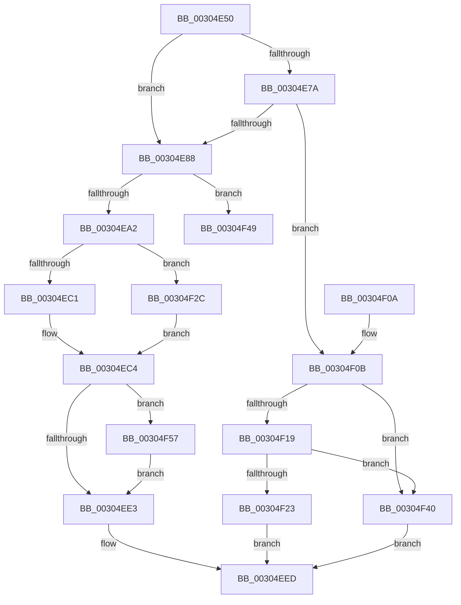

# HvlSendSyntheticClusterIpi

- RVA: `0x00304E50`–`0x00304F70` (길이 `288` bytes)
- VA: `0x0000000140304E50`
- 실행 섹션: `.text`
- PDB 이름 있음: `예`; PDB Function 태그: `예`
- unwind 정보 RVA: `0x000735D8`
- 디코드: `74`개 명령, `288/288` bytes 표시
- 미해석 바이트: `0` (있으면 어셈블리에 `.byte`로 보존)

> 이 문서는 커널 이미지의 기계어와 PDB 기호를 분석해 생성했습니다. 4번과 5번은 함수 원형과 자료형을 바이너리 사용 방식에서 추정한 C 해석이며 원본 소스 복구 결과는 아닙니다.

## 1. Dependencies

- 직접 호출 지점: **6**; 고유 호출 대상: **6**
- 직접 호출자로 확인된 함수: **1**
- RIP 상대 이미지 참조: **8**

### Outgoing calls
- `0x00304ED6` → `indirect target` (indirect, 간접 대상)
- `0x00304EF5` → [_security_check_cookie](../6A/_security_check_cookie_function_006AC640.md) (function, `0x006AC640`)
- `0x00304F25` → [HvlpFastSendSyntheticClusterIpiEx](HvlpFastSendSyntheticClusterIpiEx_function_00304F78.md) (function, `0x00304F78`)
- `0x00304F39` → [EtwGetKernelTraceTimestamp](../39/EtwGetKernelTraceTimestamp_function_0039FC50.md) (function, `0x0039FC50`)
- `0x00304F42` → [HvlpSlowSendSyntheticClusterIpiEx](HvlpSlowSendSyntheticClusterIpiEx_function_003034E0.md) (function, `0x003034E0`)
- `0x00304F66` → [EtwTraceHvHypercall](../3A/EtwTraceHvHypercall_function_003A4284.md) (function, `0x003A4284`)

### Direct callers
- [sub_0025280E](../25/Unknown_function_0025280E.md) at `0x0025287C`

### Static image references
- `0x00304E5F` → RVA `0x00E0A740` (`.data`; read)
- `0x00304E6E` → RVA `0x00FC6A90` (`ALMOSTRO`; read)
- `0x00304E7A` → RVA `0x00FC5018` (`ALMOSTRO`; read)
- `0x00304E88` → RVA `0x00FC5007` (`ALMOSTRO`; read)
- `0x00304EA2` → RVA `0x00FC6B14` (`ALMOSTRO`; read)
- `0x00304EC4` → RVA `0x01201858` (`CFGRO`; read)
- `0x00304F19` → RVA `0x00FC6AB8` (`ALMOSTRO`; read)
- `0x00304F4B` → RVA `0x00FCD263` (`ALMOSTRO`; read)

## 2. Other-region calls and transfers

- 다른 실행 섹션으로 향하는 call: **0**
- call이 아닌 외부 분기/꼬리 이동: **1**
  - `0x00304F52` → [sub_006E0684](../6E/Unknown_function_006E0684.md) (`tail-transfer`)

## 3. Assembly (complete function range)

```asm
00304E50  48 89 5C 24 18                  mov qword ptr [rsp + 0x18], rbx
00304E55  48 89 74 24 20                  mov qword ptr [rsp + 0x20], rsi
00304E5A  57                              push rdi
00304E5B  48 83 EC 50                     sub rsp, 0x50
00304E5F  48 8B 05 DA 58 B0 00            mov rax, qword ptr [rip + 0xb058da]
00304E66  48 33 C4                        xor rax, rsp
00304E69  48 89 44 24 48                  mov qword ptr [rsp + 0x48], rax
00304E6E  8B 05 1C 1C CC 00               mov eax, dword ptr [rip + 0xcc1c1c]
00304E74  8B F2                           mov esi, edx
00304E76  84 C0                           test al, al
00304E78  79 0E                           jns 0x140304e88
00304E7A  66 83 3D 96 01 CC 00 01         cmp word ptr [rip + 0xcc0196], 1
00304E82  0F 87 83 00 00 00               ja 0x140304f0b
00304E88  80 3D 78 01 CC 00 00            cmp byte ptr [rip + 0xcc0178], 0
00304E8F  48 8B 59 08                     mov rbx, qword ptr [rcx + 8]
00304E93  48 C7 44 24 20 0B 00 00 00      mov qword ptr [rsp + 0x20], 0xb
00304E9C  0F 84 A7 00 00 00               je 0x140304f49
00304EA2  8B 05 6C 1C CC 00               mov eax, dword ptr [rip + 0xcc1c6c]
00304EA8  0F 57 C0                        xorps xmm0, xmm0
00304EAB  C7 44 24 20 0B 00 01 00         mov dword ptr [rsp + 0x20], 0x1000b
00304EB3  0F 11 44 24 28                  movups xmmword ptr [rsp + 0x28], xmm0
00304EB8  0F 11 44 24 38                  movups xmmword ptr [rsp + 0x38], xmm0
00304EBD  A8 10                           test al, 0x10
00304EBF  75 6B                           jne 0x140304f2c
00304EC1  40 32 FF                        xor dil, dil
00304EC4  48 8B 05 8D C9 EF 00            mov rax, qword ptr [rip + 0xefc98d]
00304ECB  48 8B D6                        mov rdx, rsi
00304ECE  48 8B 4C 24 20                  mov rcx, qword ptr [rsp + 0x20]
00304ED3  4C 8B C3                        mov r8, rbx
00304ED6  FF D0                           call rax
00304ED8  0F 1F 00                        nop dword ptr [rax]
00304EDB  48 8B D8                        mov rbx, rax
00304EDE  40 84 FF                        test dil, dil
00304EE1  75 74                           jne 0x140304f57
00304EE3  66 F7 DB                        neg bx
00304EE6  1B C0                           sbb eax, eax
00304EE8  25 01 00 00 C0                  and eax, 0xc0000001
00304EED  48 8B 4C 24 48                  mov rcx, qword ptr [rsp + 0x48]
00304EF2  48 33 CC                        xor rcx, rsp
00304EF5  E8 46 77 3A 00                  call 0x1406ac640
00304EFA  48 8B 5C 24 70                  mov rbx, qword ptr [rsp + 0x70]
00304EFF  48 8B 74 24 78                  mov rsi, qword ptr [rsp + 0x78]
00304F04  48 83 C4 50                     add rsp, 0x50
00304F08  5F                              pop rdi
00304F09  C3                              ret
00304F0A  CC                              int3
00304F0B  C1 E8 08                        shr eax, 8
00304F0E  83 E0 0F                        and eax, 0xf
00304F11  83 C0 04                        add eax, 4
00304F14  83 F8 0E                        cmp eax, 0xe
00304F17  77 27                           ja 0x140304f40
00304F19  8B 05 99 1B CC 00               mov eax, dword ptr [rip + 0xcc1b99]
00304F1F  84 C0                           test al, al
00304F21  79 1D                           jns 0x140304f40
00304F23  8B D6                           mov edx, esi
00304F25  E8 4E 00 00 00                  call 0x140304f78
00304F2A  EB C1                           jmp 0x140304eed
00304F2C  BA 10 00 00 A0                  mov edx, 0xa0000010
00304F31  48 8D 4C 24 28                  lea rcx, [rsp + 0x28]
00304F36  40 B7 01                        mov dil, 1
00304F39  E8 12 AD 09 00                  call 0x14039fc50
00304F3E  EB 84                           jmp 0x140304ec4
00304F40  8B D6                           mov edx, esi
00304F42  E8 99 E5 FF FF                  call 0x1403034e0
00304F47  EB A4                           jmp 0x140304eed
00304F49  33 C9                           xor ecx, ecx
00304F4B  48 8D 15 11 83 CC 00            lea rdx, [rip + 0xcc8311]
00304F52  E9 2D B7 3D 00                  jmp 0x1406e0684
00304F57  45 33 C9                        xor r9d, r9d
00304F5A  48 8D 4C 24 28                  lea rcx, [rsp + 0x28]
00304F5F  41 B0 01                        mov r8b, 1
00304F62  41 8D 51 0B                     lea edx, [r9 + 0xb]
00304F66  E8 19 F3 09 00                  call 0x1403a4284
00304F6B  E9 73 FF FF FF                  jmp 0x140304ee3
```

## 4. C-style interpretation (structured pseudocode)

```c
__int64 __fastcall HvlSendSyntheticClusterIpi(__int64 a1, int a2, __int64 a3, int a4)
{
    __int64 result;
    __int64 v_rbx;
    __int64 v_rdi;
    __int64 v_rsp;
    unsigned __int64 v_stack_m10;
    unsigned __int64 v_stack_m20;
    unsigned __int64 v_stack_m30;
    unsigned __int64 v_stack_m38;
    unsigned __int64 v_stack_p18;
    unsigned __int64 v_stack_p20;
    unsigned __int64 v_stack_p28;

    v_stack_p18 = v_rbx;
    v_stack_p20 = v_rsi;
    v_rsp = (v_rsp) - (80);
    result = (*(unsigned __int64 *)(v_rip + 11557082)) ^ (v_rsp);
    v_stack_m10 = result;
    if (!sign_flag) goto loc_00304E88;
    if ((*(unsigned __int16 *)(v_rip + 13369750)) > 1) goto loc_00304F0B;
loc_00304E88:
    v_stack_m38 = 11;
    if ((*(unsigned __int8 *)(v_rip + 13369720)) == 0) goto loc_00304F49;
    v_stack_m38 = 0x1000BULL;
    v_stack_m30 = v_xmm0;
    v_stack_m20 = v_xmm0;
    if ((((unsigned __int8)((unsigned int)(*(unsigned int *)(v_rip + 13376620)))) & (16)) != 0) goto loc_00304F2C;
    v_rdi = 0;
loc_00304EC4:
    result = kernel_indirect_call(v_stack_m38, (unsigned int)(a2), *(unsigned __int64 *)(a1 + 8), a4);
    if (0 != 0) goto loc_00304F57;
loc_00304EE3:
    v_rbx = (unsigned __int16)(-(result));
    result = (unsigned int)((result) & (0xC0000001ULL));
loc_00304EED:
    a1 = (v_stack_m10) ^ (v_rsp);
    result = _security_check_cookie(a1, (unsigned int)(a2), *(unsigned __int64 *)(a1 + 8), a4);
    v_rsp = (v_rsp) + (80);
    return result;
loc_00304F0B:
    result = (unsigned int)((result) >> (8));
    result = (unsigned int)((result) & (15));
    result = (unsigned int)((result) + (4));
    if (((unsigned int)(result)) > 14) goto loc_00304F40;
    if (!sign_flag) goto loc_00304F40;
    result = HvlpFastSendSyntheticClusterIpiEx(a1, (unsigned int)((unsigned int)(v_stack_p20)), *(unsigned __int64 *)(a1 + 8), a4);
    goto loc_00304EED;
loc_00304F2C:
    result = EtwGetKernelTraceTimestamp(v_stack_p28, (unsigned int)(0xA0000010ULL), *(unsigned __int64 *)(a1 + 8), a4);
    goto loc_00304EC4;
loc_00304F40:
    result = HvlpSlowSendSyntheticClusterIpiEx(v_stack_p28, (unsigned int)((unsigned int)(v_stack_p20)), *(unsigned __int64 *)(a1 + 8), a4);
    goto loc_00304EED;
loc_00304F49:
    a1 = 0;
loc_00304F57:
    a4 = 0;
    result = EtwTraceHvHypercall(v_stack_p28, a4 + 11, 1, a4);
    goto loc_00304EE3;
}
```

## 5. (Beta) C Style

```c
int64_t HvlSendSyntheticClusterIpi(void *Arg1, int32_t Arg2, int64_t Arg3, int32_t Arg4)
{
    uint8_t *arg1 = (uint8_t *)Arg1;

    int64_t result;
    int64_t local_rbx;
    int64_t local_rdi;
    int64_t local_rsp;
    uint64_t v_stack_m10;
    uint64_t v_stack_m20;
    uint64_t v_stack_m30;
    uint64_t v_stack_m38;
    uint64_t v_stack_p18;
    uint64_t v_stack_p20;
    uint64_t v_stack_p28;

    v_stack_p18 = local_rbx;
    v_stack_p20 = local_rsi;
    local_rsp = (local_rsp) - (80);
    result = (*(uint64_t *)(v_rip + 0xB058DA)) ^ (local_rsp);
    v_stack_m10 = result;
    if (!sign_flag) goto loc_00304E88;
    if ((*(uint16_t *)(v_rip + 0xCC0196)) > 1) goto loc_00304F0B;
loc_00304E88:
    v_stack_m38 = 11;
    if ((*(uint8_t *)(v_rip + 0xCC0178)) == 0) goto loc_00304F49;
    v_stack_m38 = 0x1000BULL;
    v_stack_m30 = v_xmm0;
    v_stack_m20 = v_xmm0;
    if ((((uint8_t)((uint32_t)(*(uint32_t *)(v_rip + 0xCC1C6C)))) & (16)) != 0) goto loc_00304F2C;
    local_rdi = 0;
loc_00304EC4:
    result = kernel_indirect_call(v_stack_m38, (uint32_t)(Arg2), *(uint64_t *)(arg1 + 0x8), Arg4);
    if (0 != 0) goto loc_00304F57;
loc_00304EE3:
    local_rbx = (uint16_t)(-(result));
    result = (uint32_t)((result) & (0xC0000001ULL));
loc_00304EED:
    Arg1 = (v_stack_m10) ^ (local_rsp);
    result = _security_check_cookie(Arg1, (uint32_t)(Arg2), *(uint64_t *)(arg1 + 0x8), Arg4);
    local_rsp = (local_rsp) + (80);
    return result;
loc_00304F0B:
    result = (uint32_t)((result) >> (8));
    result = (uint32_t)((result) & (15));
    result = (uint32_t)((result) + (4));
    if (((uint32_t)(result)) > 14) goto loc_00304F40;
    if (!sign_flag) goto loc_00304F40;
    result = HvlpFastSendSyntheticClusterIpiEx(Arg1, (uint32_t)((uint32_t)(v_stack_p20)), *(uint64_t *)(arg1 + 0x8), Arg4);
    goto loc_00304EED;
loc_00304F2C:
    result = EtwGetKernelTraceTimestamp(v_stack_p28, (uint32_t)(0xA0000010ULL), *(uint64_t *)(arg1 + 0x8), Arg4);
    goto loc_00304EC4;
loc_00304F40:
    result = HvlpSlowSendSyntheticClusterIpiEx(v_stack_p28, (uint32_t)((uint32_t)(v_stack_p20)), *(uint64_t *)(arg1 + 0x8), Arg4);
    goto loc_00304EED;
loc_00304F49:
    Arg1 = 0;
loc_00304F57:
    Arg4 = 0;
    result = EtwTraceHvHypercall(v_stack_p28, Arg4 + 11, 1, Arg4);
    goto loc_00304EE3;
}
```

### 관측된 메모리 오프셋

구조체 형식이 확인되지 않은 접근은 인자 기준의 오프셋으로만 기록했습니다.

| 기준 인자 | 오프셋 표현 | 폭 (bit) | 접근 |
|---|---:|---:|---|
| `Arg1` | `+ 0x8` | `64` | `R` |

## 6. Execution-region graph

[열기: 2D/3D 그래프와 함수 탐색 컨트롤 패널](../../../control-panel.html?section=text&rva=0x00304E50&view=graph)

- 2D 그래프는 위에서 아래로 흐르고, 3D 그래프는 빈 공간을 드래그해 회전합니다. Shift+드래그는 이동, 휠은 확대·축소, 함수 노드 선택은 대상 보고서 이동입니다.

### Static fallback


