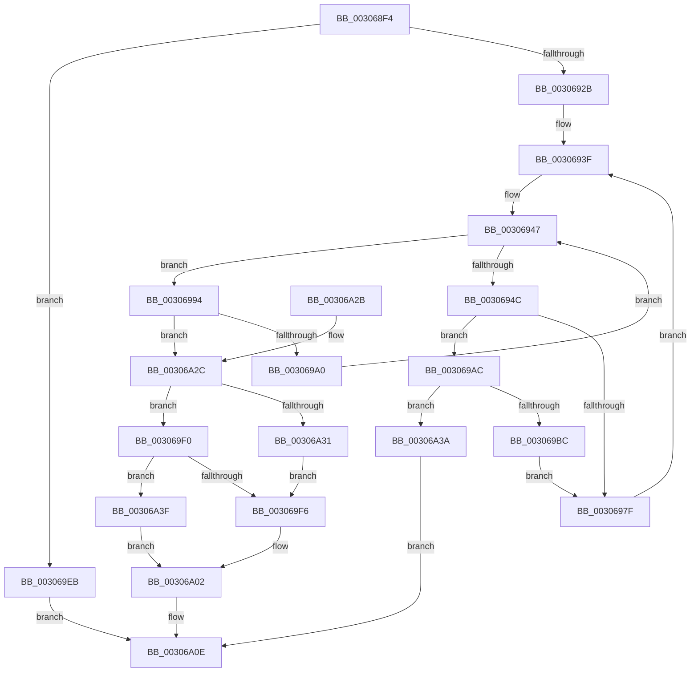

# HvlpAffinityToHvProcessorSet

- RVA: `0x003068F4`–`0x00306A45` (길이 `337` bytes)
- VA: `0x00000001403068F4`
- 실행 섹션: `.text`
- PDB 이름 있음: `예`; PDB Function 태그: `아니요`
- unwind 정보 RVA: `0x000737BC`
- 디코드: `101`개 명령, `337/337` bytes 표시
- 미해석 바이트: `0` (있으면 어셈블리에 `.byte`로 보존)

> 이 문서는 커널 이미지의 기계어와 PDB 기호를 분석해 생성했습니다. 4번과 5번은 함수 원형과 자료형을 바이너리 사용 방식에서 추정한 C 해석이며 원본 소스 복구 결과는 아닙니다.

## 1. Dependencies

- 직접 호출 지점: **1**; 고유 호출 대상: **1**
- 직접 호출자로 확인된 함수: **12**
- RIP 상대 이미지 참조: **2**

### Outgoing calls
- `0x003069D6` → [memset](../6C/memset_function_006C6C40.md) (function, `0x006C6C40`)

### Direct callers
- [HvlpSlowSendSyntheticClusterIpiEx](HvlpSlowSendSyntheticClusterIpiEx_function_003034E0.md) at `0x0030362E`
- [HvlpSlowSendSyntheticClusterIpiEx](HvlpSlowSendSyntheticClusterIpiEx_function_003034E0.md) at `0x00303663`
- [HvlpFastSendSyntheticClusterIpiEx](HvlpFastSendSyntheticClusterIpiEx_function_00304F78.md) at `0x00304FA3`
- [HvlParkedVirtualProcessors](HvlParkedVirtualProcessors_function_00305724.md) at `0x003057A0`
- [HvlRetargetDeviceInterrupt](HvlRetargetDeviceInterrupt_function_003062A0.md) at `0x003063EC`
- [HvlpFastFlushAddressSpaceTbEx](HvlpFastFlushAddressSpaceTbEx_function_003065B4.md) at `0x003065FD`
- [HvlpFastFlushListTbEx](HvlpFastFlushListTbEx_function_00306784.md) at `0x0030680C`
- [HvlpSlowFlushListTbEx](../4A/HvlpSlowFlushListTbEx_function_004AFCF8.md) at `0x004AFEF9`
- [HvlMapDeviceInterrupt](../58/HvlMapDeviceInterrupt_function_00588A90.md) at `0x00588BBD`
- [HvlMapDeviceInterrupt](../58/HvlMapDeviceInterrupt_function_00588A90.md) at `0x00588C13`
- [HvlWakeVirtualProcessors](../58/HvlWakeVirtualProcessors_function_0058AA80.md) at `0x0058AB01`
- [HvlWakeVirtualProcessors](../58/HvlWakeVirtualProcessors_function_0058AA80.md) at `0x0058AB9B`
- [HvlWakeVirtualProcessors](../58/HvlWakeVirtualProcessors_function_0058AA80.md) at `0x0058ABD0`
- [HvlpSlowFlushAddressSpaceTbEx](../6A/HvlpSlowFlushAddressSpaceTbEx_function_006A7D48.md) at `0x006A7DE4`
- [HvlpSlowFlushAddressSpaceTbEx](../6A/HvlpSlowFlushAddressSpaceTbEx_function_006A7D48.md) at `0x006A7DF6`
- [sub_006E0708](../6E/Unknown_function_006E0708.md) at `0x006E0745`
- [sub_006E0708](../6E/Unknown_function_006E0708.md) at `0x006E077D`
- [sub_006E0928](../6E/Unknown_function_006E0928.md) at `0x006E09D6`

### Static image references
- `0x0030692E` → RVA `0x00FCD260` (`ALMOSTRO`; read)
- `0x00306962` → RVA `0x00F231B8` (`.data`; read)

## 2. Other-region calls and transfers

- 다른 실행 섹션으로 향하는 call: **0**
- 별도 외부 분기/꼬리 이동을 확인하지 못했습니다.

## 3. Assembly (complete function range)

```asm
003068F4  48 89 5C 24 10                  mov qword ptr [rsp + 0x10], rbx
003068F9  48 89 6C 24 18                  mov qword ptr [rsp + 0x18], rbp
003068FE  48 89 74 24 20                  mov qword ptr [rsp + 0x20], rsi
00306903  57                              push rdi
00306904  41 54                           push r12
00306906  41 55                           push r13
00306908  41 56                           push r14
0030690A  41 57                           push r15
0030690C  48 83 EC 20                     sub rsp, 0x20
00306910  33 C0                           xor eax, eax
00306912  45 8B E8                        mov r13d, r8d
00306915  48 89 42 08                     mov qword ptr [rdx + 8], rax
00306919  48 8B DA                        mov rbx, rdx
0030691C  4C 8B F1                        mov r14, rcx
0030691F  8D 78 01                        lea edi, [rax + 1]
00306922  48 85 C9                        test rcx, rcx
00306925  0F 84 C0 00 00 00               je 0x1403069eb
0030692B  48 89 02                        mov qword ptr [rdx], rax
0030692E  4C 8D 05 2B 69 CC 00            lea r8, [rip + 0xcc692b]
00306935  48 8B 69 08                     mov rbp, qword ptr [rcx + 8]
00306939  44 8B C8                        mov r9d, eax
0030693C  0F B7 F0                        movzx esi, ax
0030693F  41 0F B7 0E                     movzx ecx, word ptr [r14]
00306943  89 44 24 50                     mov dword ptr [rsp + 0x50], eax
00306947  48 85 ED                        test rbp, rbp
0030694A  74 48                           je 0x140306994
0030694C  48 0F BC D5                     bsf rdx, rbp
00306950  0F B7 CE                        movzx ecx, si
00306953  0F B6 C2                        movzx eax, dl
00306956  48 0F B3 C5                     btr rbp, rax
0030695A  C1 E1 06                        shl ecx, 6
0030695D  0F B6 C2                        movzx eax, dl
00306960  03 C8                           add ecx, eax
00306962  48 8B 05 4F C8 C1 00            mov rax, qword ptr [rip + 0xc1c84f]
00306969  8B 0C 88                        mov ecx, dword ptr [rax + rcx*4]
0030696C  45 0F B6 3C 48                  movzx r15d, byte ptr [r8 + rcx*2]
00306971  41 8A 44 48 01                  mov al, byte ptr [r8 + rcx*2 + 1]
00306976  88 44 24 50                     mov byte ptr [rsp + 0x50], al
0030697A  45 3B F9                        cmp r15d, r9d
0030697D  73 2D                           jae 0x1403069ac
0030697F  4A 8B 4C FB 10                  mov rcx, qword ptr [rbx + r15*8 + 0x10]
00306984  0F B6 C0                        movzx eax, al
00306987  48 0F AB C1                     bts rcx, rax
0030698B  4A 89 4C FB 10                  mov qword ptr [rbx + r15*8 + 0x10], rcx
00306990  33 C0                           xor eax, eax
00306992  EB AB                           jmp 0x14030693f
00306994  66 03 F7                        add si, di
00306997  66 3B F1                        cmp si, cx
0030699A  0F 83 8C 00 00 00               jae 0x140306a2c
003069A0  0F B7 C6                        movzx eax, si
003069A3  49 8B 6C C6 08                  mov rbp, qword ptr [r14 + rax*8 + 8]
003069A8  33 C0                           xor eax, eax
003069AA  EB 9B                           jmp 0x140306947
003069AC  45 8D 67 01                     lea r12d, [r15 + 1]
003069B0  41 8B CC                        mov ecx, r12d
003069B3  48 C1 E1 03                     shl rcx, 3
003069B7  49 3B CD                        cmp rcx, r13
003069BA  77 7E                           ja 0x140306a3a
003069BC  41 8B C1                        mov eax, r9d
003069BF  45 8B C7                        mov r8d, r15d
003069C2  45 2B C1                        sub r8d, r9d
003069C5  48 83 C0 02                     add rax, 2
003069C9  44 03 C7                        add r8d, edi
003069CC  33 D2                           xor edx, edx
003069CE  49 C1 E0 03                     shl r8, 3
003069D2  48 8D 0C C3                     lea rcx, [rbx + rax*8]
003069D6  E8 65 02 3C 00                  call 0x1406c6c40
003069DB  8A 44 24 50                     mov al, byte ptr [rsp + 0x50]
003069DF  4C 8D 05 7A 68 CC 00            lea r8, [rip + 0xcc687a]
003069E6  45 8B CC                        mov r9d, r12d
003069E9  EB 94                           jmp 0x14030697f
003069EB  48 89 3A                        mov qword ptr [rdx], rdi
003069EE  EB 1E                           jmp 0x140306a0e
003069F0  41 83 F9 40                     cmp r9d, 0x40
003069F4  74 49                           je 0x140306a3f
003069F6  41 8B C9                        mov ecx, r9d
003069F9  48 8B C7                        mov rax, rdi
003069FC  48 D3 E0                        shl rax, cl
003069FF  48 2B C7                        sub rax, rdi
00306A02  48 89 43 08                     mov qword ptr [rbx + 8], rax
00306A06  42 8D 04 CD 00 00 00 00         lea eax, [r9*8]
00306A0E  48 8B 5C 24 58                  mov rbx, qword ptr [rsp + 0x58]
00306A13  48 8B 6C 24 60                  mov rbp, qword ptr [rsp + 0x60]
00306A18  48 8B 74 24 68                  mov rsi, qword ptr [rsp + 0x68]
00306A1D  48 83 C4 20                     add rsp, 0x20
00306A21  41 5F                           pop r15
00306A23  41 5E                           pop r14
00306A25  41 5D                           pop r13
00306A27  41 5C                           pop r12
00306A29  5F                              pop rdi
00306A2A  C3                              ret
00306A2B  CC                              int3
00306A2C  45 85 C9                        test r9d, r9d
00306A2F  75 BF                           jne 0x1403069f0
00306A31  48 89 43 10                     mov qword ptr [rbx + 0x10], rax
00306A35  44 8B CF                        mov r9d, edi
00306A38  EB BC                           jmp 0x1403069f6
00306A3A  83 C8 FF                        or eax, 0xffffffff
00306A3D  EB CF                           jmp 0x140306a0e
00306A3F  48 83 C8 FF                     or rax, 0xffffffffffffffff
00306A43  EB BD                           jmp 0x140306a02
```

## 4. C-style interpretation (structured pseudocode)

```c
__int64 __fastcall HvlpAffinityToHvProcessorSet(__int64 a1, __int64 a2, int a3)
{
    __int64 result;
    __int64 v_rsi;
    __int64 v_rsp;
    unsigned __int64 v_stack_p10;
    unsigned __int64 v_stack_p18;
    unsigned __int64 v_stack_p20;
    unsigned int v_stack_p8;

    v_stack_p10 = v_rbx;
    v_stack_p18 = v_rbp;
    v_stack_p20 = v_rsi;
    v_rsp = (v_rsp) - (32);
    result = 0;
    *(unsigned __int64 *)(a2 + 8) = 0;
    if (a1 == 0) goto loc_003069EB;
    *(unsigned __int64 *)(a2) = 0;
loc_0030693F:
    v_stack_p8 = 0;
loc_00306947:
    if (*(unsigned __int64 *)(a1 + 8) == 0) goto loc_00306994;
    a1 = (unsigned int)((0) << (6));
    a1 = (unsigned int)((a1) + ((unsigned int)((unsigned __int8)(a2))));
    v_stack_p8 = (unsigned __int8)(*(unsigned __int8 *)(v_rip + 13396267 + (unsigned int)(*(unsigned int *)(*(unsigned __int64 *)(v_rip + 12699727) + a1 * 4)) * 2 + 1));
    if (((unsigned int)(*(unsigned __int8 *)(v_rip + 13396267 + (unsigned int)(*(unsigned int *)(*(unsigned __int64 *)(v_rip + 12699727) + a1 * 4)) * 2))) >= 0) goto loc_003069AC;
loc_0030697F:
    *(unsigned __int64 *)(a2 + *(unsigned __int8 *)(v_rip + 13396267 + (unsigned int)(*(unsigned int *)(*(unsigned __int64 *)(v_rip + 12699727) + a1 * 4)) * 2) * 8 + 16) = *(unsigned __int64 *)(a2 + *(unsigned __int8 *)(v_rip + 13396267 + (unsigned int)(*(unsigned int *)(*(unsigned __int64 *)(v_rip + 12699727) + a1 * 4)) * 2) * 8 + 16);
    result = 0;
    goto loc_0030693F;
loc_00306994:
    v_rsi = (unsigned __int16)((0) + ((unsigned __int16)(result + 1)));
    if (((unsigned __int16)(v_rsi)) >= ((unsigned __int16)(*(unsigned __int64 *)(a2 + *(unsigned __int8 *)(v_rip + 13396267 + (unsigned int)(*(unsigned int *)(*(unsigned __int64 *)(v_rip + 12699727) + a1 * 4)) * 2) * 8 + 16)))) goto loc_00306A2C;
    result = 0;
    goto loc_00306947;
loc_003069AC:
    a1 = ((unsigned int)((unsigned int)(*(unsigned __int8 *)(v_rip + 13396267 + (unsigned int)(*(unsigned int *)(*(unsigned __int64 *)(v_rip + 12699727) + a1 * 4)) * 2) + 1))) << (3);
    if (a1 > ((unsigned int)(a3))) goto loc_00306A3A;
    a3 = (unsigned int)(((unsigned int)((unsigned int)(*(unsigned __int8 *)(v_rip + 13396267 + (unsigned int)(*(unsigned int *)(*(unsigned __int64 *)(v_rip + 12699727) + a1 * 4)) * 2)))) - (0));
    result = (0) + (2);
    a3 = (unsigned int)((a3) + ((unsigned int)(result + 1)));
    a2 = 0;
    a3 = (a3) << (3);
    result = memset(a2 + result * 8, a2, a3, 0);
    goto loc_0030697F;
loc_003069EB:
    *(unsigned __int64 *)(a2) = result + 1;
    goto loc_00306A0E;
loc_003069F0:
    if (((unsigned int)((unsigned int)((unsigned int)(*(unsigned __int8 *)(v_rip + 13396267 + (unsigned int)(*(unsigned int *)(*(unsigned __int64 *)(v_rip + 12699727) + a1 * 4)) * 2) + 1)))) == 64) goto loc_00306A3F;
loc_003069F6:
    result = (result + 1) << ((unsigned __int8)((unsigned int)((unsigned int)((unsigned int)((unsigned int)(*(unsigned __int8 *)(v_rip + 13396267 + (unsigned int)(*(unsigned int *)(*(unsigned __int64 *)(v_rip + 12699727) + a1 * 4)) * 2) + 1))))));
    result = (result) - (result + 1);
loc_00306A02:
    *(unsigned __int64 *)(a2 + 8) = result;
loc_00306A0E:
    v_rsp = (v_rsp) + (32);
    return (unsigned int)((unsigned int)(*(unsigned __int8 *)(v_rip + 13396267 + (unsigned int)(*(unsigned int *)(*(unsigned __int64 *)(v_rip + 12699727) + a1 * 4)) * 2) + 1)) * 8;
loc_00306A2C:
    if ((unsigned int)((unsigned int)((unsigned int)(*(unsigned __int8 *)(v_rip + 13396267 + (unsigned int)(*(unsigned int *)(*(unsigned __int64 *)(v_rip + 12699727) + a1 * 4)) * 2) + 1))) != 0) goto loc_003069F0;
    *(unsigned __int64 *)(v_stack_p10 + 16) = (unsigned int)((unsigned int)(*(unsigned __int8 *)(v_rip + 13396267 + (unsigned int)(*(unsigned int *)(*(unsigned __int64 *)(v_rip + 12699727) + a1 * 4)) * 2) + 1)) * 8;
    goto loc_003069F6;
loc_00306A3A:
    result = (unsigned int)(((unsigned int)((unsigned int)(*(unsigned __int8 *)(v_rip + 13396267 + (unsigned int)(*(unsigned int *)(*(unsigned __int64 *)(v_rip + 12699727) + a1 * 4)) * 2) + 1)) * 8) | (0xFFFFFFFFULL));
    goto loc_00306A0E;
loc_00306A3F:
    result = (result) | (-1);
    goto loc_00306A02;
}
```

## 5. (Beta) C Style

```c
int64_t HvlpAffinityToHvProcessorSet(void *Arg1, void *Arg2, int32_t Arg3)
{
    uint8_t *arg1 = (uint8_t *)Arg1;
    uint8_t *arg2 = (uint8_t *)Arg2;

    int64_t result;
    int64_t local_rsi;
    int64_t local_rsp;
    uint64_t v_stack_p10;
    uint64_t v_stack_p18;
    uint64_t v_stack_p20;
    uint32_t v_stack_p8;

    v_stack_p10 = local_rbx;
    v_stack_p18 = local_rbp;
    v_stack_p20 = local_rsi;
    local_rsp = (local_rsp) - (32);
    result = 0;
    *(uint64_t *)(arg2 + 0x8) = 0;
    if (Arg1 == NULL) goto loc_003069EB;
    *(uint64_t *)(arg2) = 0;
loc_0030693F:
    v_stack_p8 = 0;
loc_00306947:
    if (*(uint64_t *)(arg1 + 0x8) == 0) goto loc_00306994;
    Arg1 = (uint32_t)((0) << (6));
    Arg1 = (uint32_t)((Arg1) + ((uint32_t)((uint8_t)(Arg2))));
    v_stack_p8 = (uint8_t)(*(uint8_t *)(v_rip + 0xCC692B + (uint32_t)(*(uint32_t *)(*(uint64_t *)(v_rip + 0xC1C84F) + arg1 * 4)) * 2 + 0x1));
    if (((uint32_t)(*(uint8_t *)(v_rip + 0xCC692B + (uint32_t)(*(uint32_t *)(*(uint64_t *)(v_rip + 0xC1C84F) + arg1 * 4)) * 2))) >= 0) goto loc_003069AC;
loc_0030697F:
    *(uint64_t *)(arg2 + *(uint8_t *)(v_rip + 0xCC692B + (uint32_t)(*(uint32_t *)(*(uint64_t *)(v_rip + 0xC1C84F) + arg1 * 4)) * 2) * 8 + 0x10) = *(uint64_t *)(arg2 + *(uint8_t *)(v_rip + 0xCC692B + (uint32_t)(*(uint32_t *)(*(uint64_t *)(v_rip + 0xC1C84F) + arg1 * 4)) * 2) * 8 + 0x10);
    result = 0;
    goto loc_0030693F;
loc_00306994:
    local_rsi = (uint16_t)((0) + ((uint16_t)(result + 1)));
    if (((uint16_t)(local_rsi)) >= ((uint16_t)(*(uint64_t *)(arg2 + *(uint8_t *)(v_rip + 0xCC692B + (uint32_t)(*(uint32_t *)(*(uint64_t *)(v_rip + 0xC1C84F) + arg1 * 4)) * 2) * 8 + 0x10)))) goto loc_00306A2C;
    result = 0;
    goto loc_00306947;
loc_003069AC:
    Arg1 = ((uint32_t)((uint32_t)(*(uint8_t *)(v_rip + 0xCC692B + (uint32_t)(*(uint32_t *)(*(uint64_t *)(v_rip + 0xC1C84F) + arg1 * 4)) * 2) + 1))) << (3);
    if (Arg1 > ((uint32_t)(Arg3))) goto loc_00306A3A;
    Arg3 = (uint32_t)(((uint32_t)((uint32_t)(*(uint8_t *)(v_rip + 0xCC692B + (uint32_t)(*(uint32_t *)(*(uint64_t *)(v_rip + 0xC1C84F) + arg1 * 4)) * 2)))) - (0));
    result = (0) + (2);
    Arg3 = (uint32_t)((Arg3) + ((uint32_t)(result + 1)));
    Arg2 = 0;
    Arg3 = (Arg3) << (3);
    result = memset(Arg2 + result * 8, Arg2, Arg3, 0);
    goto loc_0030697F;
loc_003069EB:
    *(uint64_t *)(arg2) = result + 1;
    goto loc_00306A0E;
loc_003069F0:
    if (((uint32_t)((uint32_t)((uint32_t)(*(uint8_t *)(v_rip + 0xCC692B + (uint32_t)(*(uint32_t *)(*(uint64_t *)(v_rip + 0xC1C84F) + arg1 * 4)) * 2) + 1)))) == 64) goto loc_00306A3F;
loc_003069F6:
    result = (result + 1) << ((uint8_t)((uint32_t)((uint32_t)((uint32_t)((uint32_t)(*(uint8_t *)(v_rip + 0xCC692B + (uint32_t)(*(uint32_t *)(*(uint64_t *)(v_rip + 0xC1C84F) + arg1 * 4)) * 2) + 1))))));
    result = (result) - (result + 1);
loc_00306A02:
    *(uint64_t *)(arg2 + 0x8) = result;
loc_00306A0E:
    local_rsp = (local_rsp) + (32);
    return (uint32_t)((uint32_t)(*(uint8_t *)(v_rip + 0xCC692B + (uint32_t)(*(uint32_t *)(*(uint64_t *)(v_rip + 0xC1C84F) + arg1 * 4)) * 2) + 1)) * 8;
loc_00306A2C:
    if ((uint32_t)((uint32_t)((uint32_t)(*(uint8_t *)(v_rip + 0xCC692B + (uint32_t)(*(uint32_t *)(*(uint64_t *)(v_rip + 0xC1C84F) + arg1 * 4)) * 2) + 1))) != 0) goto loc_003069F0;
    *(uint64_t *)(v_stack_p10 + 0x10) = (uint32_t)((uint32_t)(*(uint8_t *)(v_rip + 0xCC692B + (uint32_t)(*(uint32_t *)(*(uint64_t *)(v_rip + 0xC1C84F) + arg1 * 4)) * 2) + 1)) * 8;
    goto loc_003069F6;
loc_00306A3A:
    result = (uint32_t)(((uint32_t)((uint32_t)(*(uint8_t *)(v_rip + 0xCC692B + (uint32_t)(*(uint32_t *)(*(uint64_t *)(v_rip + 0xC1C84F) + arg1 * 4)) * 2) + 1)) * 8) | (0xFFFFFFFFULL));
    goto loc_00306A0E;
loc_00306A3F:
    result = (result) | (-1);
    goto loc_00306A02;
}
```

### 관측된 메모리 오프셋

구조체 형식이 확인되지 않은 접근은 인자 기준의 오프셋으로만 기록했습니다.

| 기준 인자 | 오프셋 표현 | 폭 (bit) | 접근 |
|---|---:|---:|---|
| `Arg1` | `+ 0x0` | `16` | `R` |
| `Arg1` | `+ 0x8 + rax*8` | `64` | `R` |
| `Arg2` | `+ 0x0` | `64` | `W` |
| `Arg2` | `+ 0x0 + rax*8` | `64` | `R` |
| `Arg2` | `+ 0x8` | `64` | `W` |
| `Arg2` | `+ 0x10` | `64` | `W` |
| `Arg2` | `+ 0x10 + r15*8` | `64` | `R` |
| `Arg2` | `+ 0x10 + r15*8` | `64` | `W` |

## 6. Execution-region graph

[열기: 2D/3D 그래프와 함수 탐색 컨트롤 패널](../../../control-panel.html?section=text&rva=0x003068F4&view=graph)

- 2D 그래프는 위에서 아래로 흐르고, 3D 그래프는 빈 공간을 드래그해 회전합니다. Shift+드래그는 이동, 휠은 확대·축소, 함수 노드 선택은 대상 보고서 이동입니다.

### Static fallback


