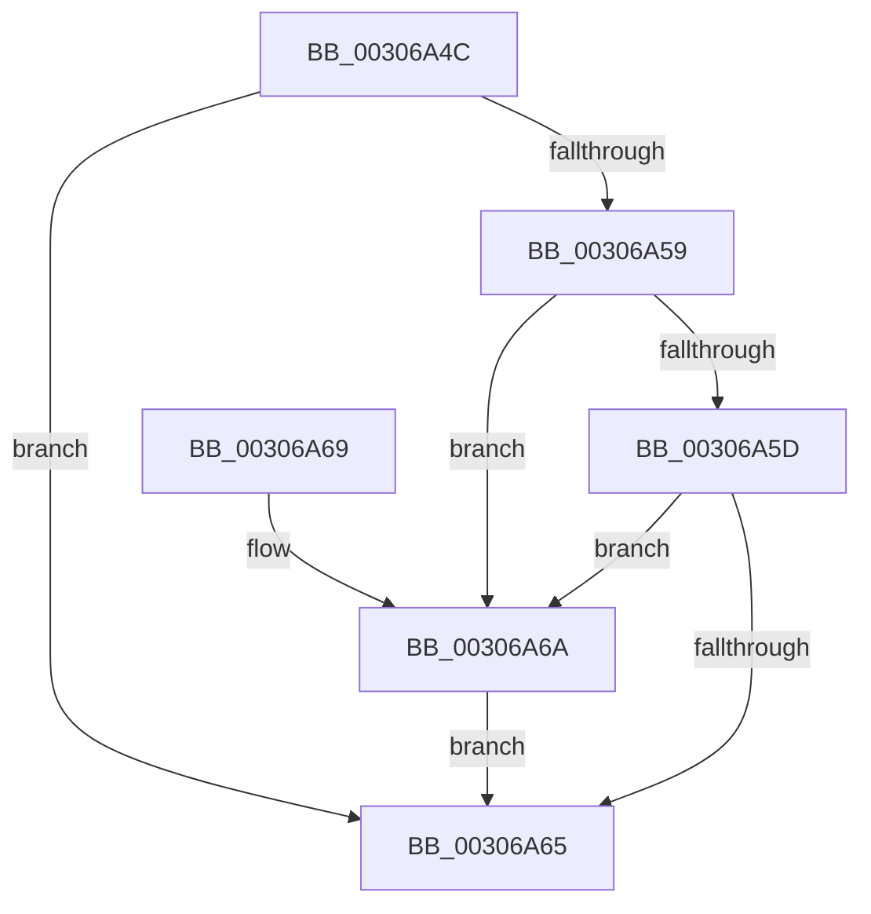

# HvlpAllowFastFlushList

- RVA: `0x00306A4C`–`0x00306A6F` (길이 `35` bytes)
- VA: `0x0000000140306A4C`
- 실행 섹션: `.text`
- PDB 이름 있음: `예`; PDB Function 태그: `아니요`
- unwind 정보 RVA: `0x000DB714`
- 디코드: `14`개 명령, `35/35` bytes 표시
- 미해석 바이트: `0` (있으면 어셈블리에 `.byte`로 보존)

> 이 문서는 커널 이미지의 기계어와 PDB 기호를 분석해 생성했습니다. 4번과 5번은 함수 원형과 자료형을 바이너리 사용 방식에서 추정한 C 해석이며 원본 소스 복구 결과는 아닙니다.

## 1. Dependencies

- 직접 호출 지점: **0**; 고유 호출 대상: **0**
- 직접 호출자로 확인된 함수: **1**
- RIP 상대 이미지 참조: **1**

### Outgoing calls
- 직접 디코드된 call 명령이 없습니다.

### Direct callers
- [HvlpFlushRangeListTbEx](HvlpFlushRangeListTbEx_function_00306670.md) at `0x003066FF`

### Static image references
- `0x00306A4C` → RVA `0x00FC6AB8` (`ALMOSTRO`; read)

## 2. Other-region calls and transfers

- 다른 실행 섹션으로 향하는 call: **0**
- 별도 외부 분기/꼬리 이동을 확인하지 못했습니다.

## 3. Assembly (complete function range)

```asm
00306A4C  8B 05 66 00 CC 00               mov eax, dword ptr [rip + 0xcc0066]
00306A52  45 33 C0                        xor r8d, r8d
00306A55  84 C0                           test al, al
00306A57  79 0C                           jns 0x140306a65
00306A59  85 C9                           test ecx, ecx
00306A5B  74 0D                           je 0x140306a6a
00306A5D  8D 42 01                        lea eax, [rdx + 1]
00306A60  83 F8 0C                        cmp eax, 0xc
00306A63  76 05                           jbe 0x140306a6a
00306A65  41 8A C0                        mov al, r8b
00306A68  C3                              ret
00306A69  CC                              int3
00306A6A  41 B0 01                        mov r8b, 1
00306A6D  EB F6                           jmp 0x140306a65
```

## 4. C-style interpretation (structured pseudocode)

```c
__int64 __fastcall HvlpAllowFastFlushList(int a1, __int64 a2, int a3)
{
    a3 = 0;
    if (!sign_flag) goto loc_00306A65;
    if (a1 == 0) goto loc_00306A6A;
    if (((unsigned int)(a2 + 1)) <= 12) goto loc_00306A6A;
loc_00306A65:
    return 0;
loc_00306A6A:
    goto loc_00306A65;
}
```

## 5. (Beta) C Style

```c
int64_t HvlpAllowFastFlushList(int32_t Arg1, void *Arg2, int32_t Arg3)
{
    uint8_t *arg2 = (uint8_t *)Arg2;

    Arg3 = 0;
    if (!sign_flag) goto loc_00306A65;
    if (Arg1 == 0) goto loc_00306A6A;
    if (((uint32_t)(Arg2 + 1)) <= 12) goto loc_00306A6A;
loc_00306A65:
    return 0;
loc_00306A6A:
    goto loc_00306A65;
}
```

### 관측된 메모리 오프셋

구조체 형식이 확인되지 않은 접근은 인자 기준의 오프셋으로만 기록했습니다.

| 기준 인자 | 오프셋 표현 | 폭 (bit) | 접근 |
|---|---:|---:|---|
| `Arg2` | `+ 0x1` | `32` | `R` |

## 6. Execution-region graph

[열기: 2D/3D 그래프와 함수 탐색 컨트롤 패널](../../../control-panel.html?section=text&rva=0x00306A4C&view=graph)

- 2D 그래프는 위에서 아래로 흐르고, 3D 그래프는 빈 공간을 드래그해 회전합니다. Shift+드래그는 이동, 휠은 확대·축소, 함수 노드 선택은 대상 보고서 이동입니다.

### Static fallback


