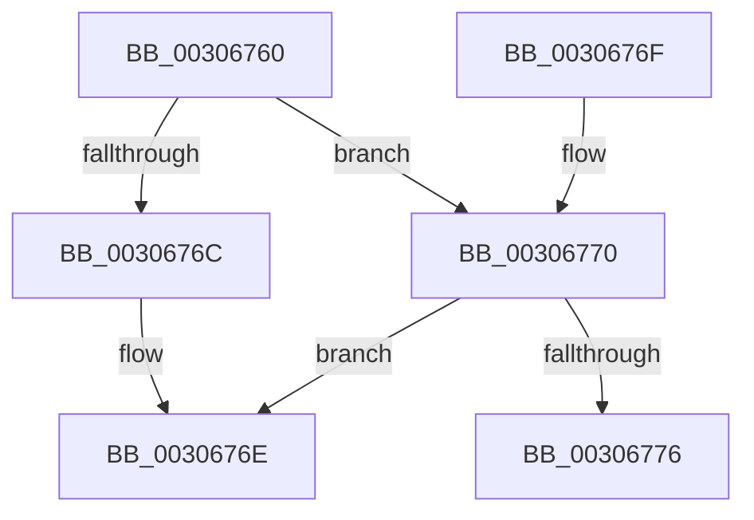

# HvlpCountFlushVaList

- RVA: `0x00306760`–`0x0030677E` (길이 `30` bytes)
- VA: `0x0000000140306760`
- 실행 섹션: `.text`
- PDB 이름 있음: `예`; PDB Function 태그: `예`
- unwind 정보 RVA: `0x000DB714`
- 디코드: `10`개 명령, `30/30` bytes 표시
- 미해석 바이트: `0` (있으면 어셈블리에 `.byte`로 보존)

> 이 문서는 커널 이미지의 기계어와 PDB 기호를 분석해 생성했습니다. 4번과 5번은 함수 원형과 자료형을 바이너리 사용 방식에서 추정한 C 해석이며 원본 소스 복구 결과는 아닙니다.

## 1. Dependencies

- 직접 호출 지점: **0**; 고유 호출 대상: **0**
- 직접 호출자로 확인된 함수: **1**
- RIP 상대 이미지 참조: **1**

### Outgoing calls
- 직접 디코드된 call 명령이 없습니다.

### Direct callers
- [HvlpFlushRangeListTbEx](HvlpFlushRangeListTbEx_function_00306670.md) at `0x003066DC`

### Static image references
- `0x00306760` → RVA `0x00FC6A90` (`ALMOSTRO`; read)

## 2. Other-region calls and transfers

- 다른 실행 섹션으로 향하는 call: **0**
- call이 아닌 외부 분기/꼬리 이동: **1**
  - `0x00306779` → `0x006E0A48` (`tail-transfer`)

## 3. Assembly (complete function range)

```asm
00306760  F7 05 26 03 CC 00 00 20 00 00   test dword ptr [rip + 0xcc0326], 0x2000
0030676A  75 04                           jne 0x140306770
0030676C  8B C1                           mov eax, ecx
0030676E  C3                              ret
0030676F  CC                              int3
00306770  33 C0                           xor eax, eax
00306772  85 C9                           test ecx, ecx
00306774  74 F8                           je 0x14030676e
00306776  44 8B C1                        mov r8d, ecx
00306779  E9 CA A2 3D 00                  jmp 0x1406e0a48
```

## 4. C-style interpretation (structured pseudocode)

```c
__int64 __fastcall HvlpCountFlushVaList(int a1)
{
    __int64 result;

    if (((*(unsigned int *)(v_rip + 13370150)) & (0x2000ULL)) != 0) goto loc_00306770;
loc_0030676E:
    return (unsigned int)(a1);
loc_00306770:
    result = 0;
    if (a1 == 0) goto loc_0030676E;
}
```

## 5. (Beta) C Style

```c
int64_t HvlpCountFlushVaList(int32_t Arg1)
{
    int64_t result;

    if (((*(uint32_t *)(v_rip + 0xCC0326)) & (0x2000ULL)) != 0) goto loc_00306770;
loc_0030676E:
    return (uint32_t)(Arg1);
loc_00306770:
    result = 0;
    if (Arg1 == 0) goto loc_0030676E;
}
```

## 6. Execution-region graph

[열기: 2D/3D 그래프와 함수 탐색 컨트롤 패널](../../../control-panel.html?section=text&rva=0x00306760&view=graph)

- 2D 그래프는 위에서 아래로 흐르고, 3D 그래프는 빈 공간을 드래그해 회전합니다. Shift+드래그는 이동, 휠은 확대·축소, 함수 노드 선택은 대상 보고서 이동입니다.

### Static fallback


