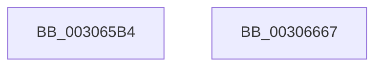

# HvlpFastFlushAddressSpaceTbEx

- RVA: `0x003065B4`–`0x00306668` (길이 `180` bytes)
- VA: `0x00000001403065B4`
- 실행 섹션: `.text`
- PDB 이름 있음: `예`; PDB Function 태그: `아니요`
- unwind 정보 RVA: `0x00073604`
- 디코드: `42`개 명령, `180/180` bytes 표시
- 미해석 바이트: `0` (있으면 어셈블리에 `.byte`로 보존)

> 이 문서는 커널 이미지의 기계어와 PDB 기호를 분석해 생성했습니다. 4번과 5번은 함수 원형과 자료형을 바이너리 사용 방식에서 추정한 C 해석이며 원본 소스 복구 결과는 아닙니다.

## 1. Dependencies

- 직접 호출 지점: **3**; 고유 호출 대상: **3**
- 직접 호출자로 확인된 함수: **3**
- RIP 상대 이미지 참조: **1**

### Outgoing calls
- `0x003065FD` → [HvlpAffinityToHvProcessorSet](HvlpAffinityToHvProcessorSet_function_003068F4.md) (function, `0x003068F4`)
- `0x0030664A` → [HvcallFastExtended](../31/HvcallFastExtended_function_003130E0.md) (function, `0x003130E0`)
- `0x0030665A` → [_security_check_cookie](../6A/_security_check_cookie_function_006AC640.md) (function, `0x006AC640`)

### Direct callers
- [KiFlushAddressSpaceTb](KiFlushAddressSpaceTb_function_00308F50.md) at `0x0030903D`
- [KeFlushCurrentTbOnly](../31/KeFlushCurrentTbOnly_function_003134EC.md) at `0x003135BB`
- [sub_00314667](../31/Unknown_function_00314667.md) at `0x00314694`

### Static image references
- `0x003065BB` → RVA `0x00E0A740` (`.data`; read)

## 2. Other-region calls and transfers

- 다른 실행 섹션으로 향하는 call: **0**
- 별도 외부 분기/꼬리 이동을 확인하지 못했습니다.

## 3. Assembly (complete function range)

```asm
003065B4  48 81 EC C8 00 00 00            sub rsp, 0xc8
003065BB  48 8B 05 7E 41 B0 00            mov rax, qword ptr [rip + 0xb0417e]
003065C2  48 33 C4                        xor rax, rsp
003065C5  48 89 84 24 B0 00 00 00         mov qword ptr [rsp + 0xb0], rax
003065CD  4C 8B CA                        mov r9, rdx
003065D0  48 89 4C 24 40                  mov qword ptr [rsp + 0x40], rcx
003065D5  41 F6 D8                        neg r8b
003065D8  41 B8 50 00 00 00               mov r8d, 0x50
003065DE  1B D2                           sbb edx, edx
003065E0  F7 D2                           not edx
003065E2  83 E2 04                        and edx, 4
003065E5  8B C2                           mov eax, edx
003065E7  83 C8 02                        or eax, 2
003065EA  48 85 C9                        test rcx, rcx
003065ED  49 8B C9                        mov rcx, r9
003065F0  0F 45 C2                        cmovne eax, edx
003065F3  48 8D 54 24 50                  lea rdx, [rsp + 0x50]
003065F8  48 89 44 24 48                  mov qword ptr [rsp + 0x48], rax
003065FD  E8 F2 02 00 00                  call 0x1403068f4
00306602  83 64 24 20 00                  and dword ptr [rsp + 0x20], 0
00306607  45 33 C9                        xor r9d, r9d
0030660A  48 C7 44 24 30 13 00 00 00      mov qword ptr [rsp + 0x30], 0x13
00306613  8D 50 07                        lea edx, [rax + 7]
00306616  C1 E2 0E                        shl edx, 0xe
00306619  44 8D 40 20                     lea r8d, [rax + 0x20]
0030661D  81 E2 00 00 FE 03               and edx, 0x3fe0000
00306623  8B CA                           mov ecx, edx
00306625  81 CA 13 00 01 00               or edx, 0x10013
0030662B  83 C9 13                        or ecx, 0x13
0030662E  89 4C 24 30                     mov dword ptr [rsp + 0x30], ecx
00306632  48 8B 4C 24 30                  mov rcx, qword ptr [rsp + 0x30]
00306637  48 89 4C 24 30                  mov qword ptr [rsp + 0x30], rcx
0030663C  89 54 24 30                     mov dword ptr [rsp + 0x30], edx
00306640  48 8D 54 24 40                  lea rdx, [rsp + 0x40]
00306645  48 8B 4C 24 30                  mov rcx, qword ptr [rsp + 0x30]
0030664A  E8 91 CA 00 00                  call 0x1403130e0
0030664F  48 8B 8C 24 B0 00 00 00         mov rcx, qword ptr [rsp + 0xb0]
00306657  48 33 CC                        xor rcx, rsp
0030665A  E8 E1 5F 3A 00                  call 0x1406ac640
0030665F  48 81 C4 C8 00 00 00            add rsp, 0xc8
00306666  C3                              ret
00306667  CC                              int3
```

## 4. C-style interpretation (structured pseudocode)

```c
__int64 __fastcall HvlpFastFlushAddressSpaceTbEx(__int64 a1, __int64 a2, unsigned __int8 a3)
{
    __int64 result;
    __int64 v_rsp;
    unsigned __int64 v_stack_m18;
    unsigned __int64 v_stack_m78;
    unsigned __int64 v_stack_m80;
    unsigned __int64 v_stack_m88;
    unsigned __int64 v_stack_m98;
    unsigned int v_stack_mA8;

    v_rsp = (v_rsp) - (200);
    result = (*(unsigned __int64 *)(v_rip + 11551102)) ^ (v_rsp);
    v_stack_m18 = result;
    v_stack_m88 = a1;
    a3 = (unsigned __int8)(-(a3));
    a2 = (unsigned int)(~(a2));
    a2 = (unsigned int)((a2) & (4));
    result = (unsigned int)(((unsigned int)((unsigned int)(a2))) | (2));
    if (a1 != 0) { result = (unsigned int)(a2); }
    v_stack_m80 = result;
    result = HvlpAffinityToHvProcessorSet(a2, v_stack_m78, 80, a2);
    a4 = 0;
    v_stack_m98 = 19;
    a2 = (unsigned int)((result + 7) << (14));
    a2 = (unsigned int)((a2) & (0x3FE0000ULL));
    a2 = (unsigned int)((a2) | (0x10013ULL));
    a1 = (unsigned int)(((unsigned int)((unsigned int)(a2))) | (19));
    v_stack_m98 = (unsigned int)(a1);
    v_stack_m98 = v_stack_m98;
    v_stack_m98 = (unsigned int)(a2);
    result = HvcallFastExtended(v_stack_m98, v_stack_m88, result + 32, a4);
    a1 = (v_stack_m18) ^ (v_rsp);
    result = _security_check_cookie(a1, v_stack_m88, result + 32, a4);
    v_rsp = (v_rsp) + (200);
    return result;
}
```

## 5. (Beta) C Style

```c
int64_t HvlpFastFlushAddressSpaceTbEx(int64_t Arg1, int64_t Arg2, uint8_t Arg3)
{
    int64_t result;
    int64_t local_rsp;
    uint64_t v_stack_m18;
    uint64_t v_stack_m78;
    uint64_t v_stack_m80;
    uint64_t v_stack_m88;
    uint64_t v_stack_m98;
    uint32_t v_stack_mA8;

    local_rsp = (local_rsp) - (200);
    result = (*(uint64_t *)(v_rip + 0xB0417E)) ^ (local_rsp);
    v_stack_m18 = result;
    v_stack_m88 = Arg1;
    Arg3 = (uint8_t)(-(Arg3));
    Arg2 = (uint32_t)(~(Arg2));
    Arg2 = (uint32_t)((Arg2) & (4));
    result = (uint32_t)(((uint32_t)((uint32_t)(Arg2))) | (2));
    if (Arg1 != 0) { result = (uint32_t)(Arg2); }
    v_stack_m80 = result;
    result = HvlpAffinityToHvProcessorSet(Arg2, v_stack_m78, 80, Arg2);
    a4 = 0;
    v_stack_m98 = 19;
    Arg2 = (uint32_t)((result + 7) << (14));
    Arg2 = (uint32_t)((Arg2) & (0x3FE0000ULL));
    Arg2 = (uint32_t)((Arg2) | (0x10013ULL));
    Arg1 = (uint32_t)(((uint32_t)((uint32_t)(Arg2))) | (19));
    v_stack_m98 = (uint32_t)(Arg1);
    v_stack_m98 = v_stack_m98;
    v_stack_m98 = (uint32_t)(Arg2);
    result = HvcallFastExtended(v_stack_m98, v_stack_m88, result + 32, a4);
    Arg1 = (v_stack_m18) ^ (local_rsp);
    result = _security_check_cookie(Arg1, v_stack_m88, result + 32, a4);
    local_rsp = (local_rsp) + (200);
    return result;
}
```

## 6. Execution-region graph

[열기: 2D/3D 그래프와 함수 탐색 컨트롤 패널](../../../control-panel.html?section=text&rva=0x003065B4&view=graph)

- 2D 그래프는 위에서 아래로 흐르고, 3D 그래프는 빈 공간을 드래그해 회전합니다. Shift+드래그는 이동, 휠은 확대·축소, 함수 노드 선택은 대상 보고서 이동입니다.

### Static fallback


