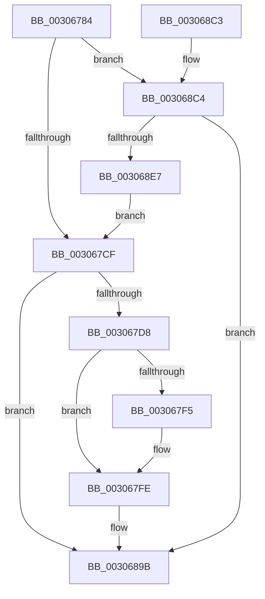

# HvlpFastFlushListTbEx

- RVA: `0x00306784`–`0x003068EC` (길이 `360` bytes)
- VA: `0x0000000140306784`
- 실행 섹션: `.text`
- PDB 이름 있음: `예`; PDB Function 태그: `아니요`
- unwind 정보 RVA: `0x00073798`
- 디코드: `83`개 명령, `360/360` bytes 표시
- 미해석 바이트: `0` (있으면 어셈블리에 `.byte`로 보존)

> 이 문서는 커널 이미지의 기계어와 PDB 기호를 분석해 생성했습니다. 4번과 5번은 함수 원형과 자료형을 바이너리 사용 방식에서 추정한 C 해석이며 원본 소스 복구 결과는 아닙니다.

## 1. Dependencies

- 직접 호출 지점: **5**; 고유 호출 대상: **5**
- 직접 호출자로 확인된 함수: **1**
- RIP 상대 이미지 참조: **2**

### Outgoing calls
- `0x0030680C` → [HvlpAffinityToHvProcessorSet](HvlpAffinityToHvProcessorSet_function_003068F4.md) (function, `0x003068F4`)
- `0x00306875` → [HvlpCopyFlushVaList](../31/HvlpCopyFlushVaList_function_00313CC0.md) (function, `0x00313CC0`)
- `0x00306896` → [HvcallFastExtended](../31/HvcallFastExtended_function_003130E0.md) (function, `0x003130E0`)
- `0x003068A6` → [_security_check_cookie](../6A/_security_check_cookie_function_006AC640.md) (function, `0x006AC640`)
- `0x003068DB` → [VslFastFlushSecureRangeList](../46/VslFastFlushSecureRangeList_function_00462168.md) (function, `0x00462168`)

### Direct callers
- [HvlpFlushRangeListTbEx](HvlpFlushRangeListTbEx_function_00306670.md) at `0x00306721`

### Static image references
- `0x00306799` → RVA `0x00E0A740` (`.data`; read)
- `0x003067D8` → RVA `0x00FC6A90` (`ALMOSTRO`; read)

## 2. Other-region calls and transfers

- 다른 실행 섹션으로 향하는 call: **0**
- 별도 외부 분기/꼬리 이동을 확인하지 못했습니다.

## 3. Assembly (complete function range)

```asm
00306784  48 89 5C 24 08                  mov qword ptr [rsp + 8], rbx
00306789  48 89 6C 24 18                  mov qword ptr [rsp + 0x18], rbp
0030678E  56                              push rsi
0030678F  57                              push rdi
00306790  41 56                           push r14
00306792  48 81 EC C0 00 00 00            sub rsp, 0xc0
00306799  48 8B 05 A0 3F B0 00            mov rax, qword ptr [rip + 0xb03fa0]
003067A0  48 33 C4                        xor rax, rsp
003067A3  48 89 84 24 B0 00 00 00         mov qword ptr [rsp + 0xb0], rax
003067AB  8B AC 24 10 01 00 00            mov ebp, dword ptr [rsp + 0x110]
003067B2  41 8A F9                        mov dil, r9b
003067B5  48 8B B4 24 08 01 00 00         mov rsi, qword ptr [rsp + 0x108]
003067BD  41 8B C0                        mov eax, r8d
003067C0  4C 8B F2                        mov r14, rdx
003067C3  48 8B D9                        mov rbx, rcx
003067C6  45 85 C0                        test r8d, r8d
003067C9  0F 85 F5 00 00 00               jne 0x1403068c4
003067CF  40 84 FF                        test dil, dil
003067D2  0F 84 C3 00 00 00               je 0x14030689b
003067D8  F7 05 AE 02 CC 00 00 20 00 00   test dword ptr [rip + 0xcc02ae], 0x2000
003067E2  48 8B 03                        mov rax, qword ptr [rbx]
003067E5  48 8B 53 08                     mov rdx, qword ptr [rbx + 8]
003067E9  48 89 44 24 40                  mov qword ptr [rsp + 0x40], rax
003067EE  48 89 54 24 48                  mov qword ptr [rsp + 0x48], rdx
003067F3  75 09                           jne 0x1403067fe
003067F5  48 83 CA 08                     or rdx, 8
003067F9  48 89 54 24 48                  mov qword ptr [rsp + 0x48], rdx
003067FE  41 B8 50 00 00 00               mov r8d, 0x50
00306804  48 8D 54 24 50                  lea rdx, [rsp + 0x50]
00306809  49 8B CE                        mov rcx, r14
0030680C  E8 E3 00 00 00                  call 0x1403068f4
00306811  8B 8C 24 00 01 00 00            mov ecx, dword ptr [rsp + 0x100]
00306818  4C 8D 4C 24 40                  lea r9, [rsp + 0x40]
0030681D  48 C7 44 24 38 14 00 00 00      mov qword ptr [rsp + 0x38], 0x14
00306826  44 8B C5                        mov r8d, ebp
00306829  48 8B D6                        mov rdx, rsi
0030682C  8D 58 20                        lea ebx, [rax + 0x20]
0030682F  83 C0 07                        add eax, 7
00306832  C1 E0 0E                        shl eax, 0xe
00306835  25 00 00 FE 03                  and eax, 0x3fe0000
0030683A  83 C8 14                        or eax, 0x14
0030683D  89 44 24 38                     mov dword ptr [rsp + 0x38], eax
00306841  48 8B 44 24 38                  mov rax, qword ptr [rsp + 0x38]
00306846  48 89 44 24 38                  mov qword ptr [rsp + 0x38], rax
0030684B  48 C1 E8 20                     shr rax, 0x20
0030684F  44 33 C0                        xor r8d, eax
00306852  41 81 E0 FF 0F 00 00            and r8d, 0xfff
00306859  44 33 C0                        xor r8d, eax
0030685C  8B C3                           mov eax, ebx
0030685E  44 89 44 24 3C                  mov dword ptr [rsp + 0x3c], r8d
00306863  4C 03 C8                        add r9, rax
00306866  44 8B 05 23 02 CC 00            mov r8d, dword ptr [rip + 0xcc0223]
0030686D  41 C1 E8 0D                     shr r8d, 0xd
00306871  41 80 E0 01                     and r8b, 1
00306875  E8 46 D4 00 00                  call 0x140313cc0
0030687A  0F BA 6C 24 38 10               bts dword ptr [rsp + 0x38], 0x10
00306880  44 8D 04 EB                     lea r8d, [rbx + rbp*8]
00306884  48 8B 4C 24 38                  mov rcx, qword ptr [rsp + 0x38]
00306889  48 8D 54 24 40                  lea rdx, [rsp + 0x40]
0030688E  83 64 24 20 00                  and dword ptr [rsp + 0x20], 0
00306893  45 33 C9                        xor r9d, r9d
00306896  E8 45 C8 00 00                  call 0x1403130e0
0030689B  48 8B 8C 24 B0 00 00 00         mov rcx, qword ptr [rsp + 0xb0]
003068A3  48 33 CC                        xor rcx, rsp
003068A6  E8 95 5D 3A 00                  call 0x1406ac640
003068AB  4C 8D 9C 24 C0 00 00 00         lea r11, [rsp + 0xc0]
003068B3  49 8B 5B 20                     mov rbx, qword ptr [r11 + 0x20]
003068B7  49 8B 6B 30                     mov rbp, qword ptr [r11 + 0x30]
003068BB  49 8B E3                        mov rsp, r11
003068BE  41 5E                           pop r14
003068C0  5F                              pop rdi
003068C1  5E                              pop rsi
003068C2  C3                              ret
003068C3  CC                              int3
003068C4  44 8B 84 24 00 01 00 00         mov r8d, dword ptr [rsp + 0x100]
003068CC  4C 8D 4C 24 30                  lea r9, [rsp + 0x30]
003068D1  48 8B D6                        mov rdx, rsi
003068D4  C6 44 24 30 00                  mov byte ptr [rsp + 0x30], 0
003068D9  8B C8                           mov ecx, eax
003068DB  E8 88 B8 15 00                  call 0x140462168
003068E0  80 7C 24 30 00                  cmp byte ptr [rsp + 0x30], 0
003068E5  75 B4                           jne 0x14030689b
003068E7  E9 E3 FE FF FF                  jmp 0x1403067cf
```

## 4. C-style interpretation (structured pseudocode)

```c
__int64 __fastcall HvlpFastFlushListTbEx(__int64 a1, __int64 a2, int a3, unsigned __int8 a4, unsigned int a5, __int64 a6, unsigned int a7)
{
    __int64 result;
    __int64 v_rsp;
    unsigned __int64 v_stack_m18;
    unsigned __int64 v_stack_m28;
    unsigned __int64 v_stack_m88;
    unsigned __int64 v_stack_m90;
    unsigned __int64 v_stack_m98;
    unsigned int v_stack_m9C;
    unsigned __int64 v_stack_mA0;
    unsigned int v_stack_mB8;
    unsigned __int64 v_stack_p18;
    unsigned __int64 v_stack_p8;

    v_stack_p8 = v_rbx;
    v_stack_p18 = v_rbp;
    v_rsp = (v_rsp) - (192);
    result = (*(unsigned __int64 *)(v_rip + 11550624)) ^ (v_rsp);
    v_stack_m28 = result;
    if (a3 != 0) goto loc_003068C4;
loc_003067CF:
    if (a4 == 0) goto loc_0030689B;
    v_stack_m98 = *(unsigned __int64 *)(a1);
    v_stack_m90 = *(unsigned __int64 *)(a1 + 8);
    if (((*(unsigned int *)(v_rip + 13370030)) & (0x2000ULL)) == 0) {
        a2 = (*(unsigned __int64 *)(a1 + 8)) | (8);
        v_stack_m90 = a2;
    }
    result = HvlpAffinityToHvProcessorSet(a2, v_stack_m88, 80, a4);
    v_stack_mA0 = 20;
    result = (unsigned int)((result) + (7));
    result = (unsigned int)((result) << (14));
    result = (unsigned int)((result) & (0x3FE0000ULL));
    result = (unsigned int)((result) | (20));
    v_stack_mA0 = (unsigned int)(result);
    v_stack_mA0 = v_stack_mA0;
    result = (v_stack_mA0) >> (32);
    a3 = (unsigned int)(((unsigned int)((unsigned int)((unsigned int)(a7)))) ^ ((unsigned int)(result)));
    a3 = (unsigned int)((a3) & (0xFFFULL));
    a3 = (unsigned int)((a3) ^ ((unsigned int)(result)));
    v_stack_m9C = a3;
    a4 = (v_stack_m98) + ((unsigned int)((unsigned int)(result + 32)));
    a3 = (unsigned int)(((unsigned int)(*(unsigned int *)(v_rip + 13369891))) >> (13));
    a3 = (unsigned __int8)((a3) & (1));
    result = HvlpCopyFlushVaList((unsigned int)(a5), a6, a3, a4);
    a4 = 0;
    result = HvcallFastExtended(v_stack_mA0, v_stack_m98, result + 32 + (unsigned int)(a7) * 8, a4);
loc_0030689B:
    a1 = (v_stack_m28) ^ (v_rsp);
    result = _security_check_cookie(a1, v_stack_m98, result + 32 + (unsigned int)(a7) * 8, a4);
    return result;
loc_003068C4:
    v_stack_m90 = 0;
    result = VslFastFlushSecureRangeList((unsigned int)((unsigned int)(result)), a6, (unsigned int)(a5), v_stack_m90);
    if (v_stack_m90 != 0) goto loc_0030689B;
    goto loc_003067CF;
}
```

## 5. (Beta) C Style

```c
int64_t HvlpFastFlushListTbEx(void *Arg1, int64_t Arg2, int32_t Arg3, uint8_t Arg4, uint32_t Arg5, int64_t Arg6, uint32_t Arg7)
{
    uint8_t *arg1 = (uint8_t *)Arg1;

    int64_t result;
    int64_t local_rsp;
    uint64_t v_stack_m18;
    uint64_t v_stack_m28;
    uint64_t v_stack_m88;
    uint64_t v_stack_m90;
    uint64_t v_stack_m98;
    uint32_t v_stack_m9C;
    uint64_t v_stack_mA0;
    uint32_t v_stack_mB8;
    uint64_t v_stack_p18;
    uint64_t v_stack_p8;

    v_stack_p8 = local_rbx;
    v_stack_p18 = local_rbp;
    local_rsp = (local_rsp) - (192);
    result = (*(uint64_t *)(v_rip + 0xB03FA0)) ^ (local_rsp);
    v_stack_m28 = result;
    if (Arg3 != 0) goto loc_003068C4;
loc_003067CF:
    if (Arg4 == 0) goto loc_0030689B;
    v_stack_m98 = *(uint64_t *)(arg1);
    v_stack_m90 = *(uint64_t *)(arg1 + 0x8);
    if (((*(uint32_t *)(v_rip + 0xCC02AE)) & (0x2000ULL)) == 0) {
        Arg2 = (*(uint64_t *)(arg1 + 0x8)) | (8);
        v_stack_m90 = Arg2;
    }
    result = HvlpAffinityToHvProcessorSet(Arg2, v_stack_m88, 80, Arg4);
    v_stack_mA0 = 20;
    result = (uint32_t)((result) + (7));
    result = (uint32_t)((result) << (14));
    result = (uint32_t)((result) & (0x3FE0000ULL));
    result = (uint32_t)((result) | (20));
    v_stack_mA0 = (uint32_t)(result);
    v_stack_mA0 = v_stack_mA0;
    result = (v_stack_mA0) >> (32);
    Arg3 = (uint32_t)(((uint32_t)((uint32_t)((uint32_t)(Arg7)))) ^ ((uint32_t)(result)));
    Arg3 = (uint32_t)((Arg3) & (0xFFFULL));
    Arg3 = (uint32_t)((Arg3) ^ ((uint32_t)(result)));
    v_stack_m9C = Arg3;
    Arg4 = (v_stack_m98) + ((uint32_t)((uint32_t)(result + 32)));
    Arg3 = (uint32_t)(((uint32_t)(*(uint32_t *)(v_rip + 0xCC0223))) >> (13));
    Arg3 = (uint8_t)((Arg3) & (1));
    result = HvlpCopyFlushVaList((uint32_t)(Arg5), Arg6, Arg3, Arg4);
    Arg4 = 0;
    result = HvcallFastExtended(v_stack_mA0, v_stack_m98, result + 32 + (uint32_t)(Arg7) * 8, Arg4);
loc_0030689B:
    Arg1 = (v_stack_m28) ^ (local_rsp);
    result = _security_check_cookie(Arg1, v_stack_m98, result + 32 + (uint32_t)(Arg7) * 8, Arg4);
    return result;
loc_003068C4:
    v_stack_m90 = 0;
    result = VslFastFlushSecureRangeList((uint32_t)((uint32_t)(result)), Arg6, (uint32_t)(Arg5), v_stack_m90);
    if (v_stack_m90 != 0) goto loc_0030689B;
    goto loc_003067CF;
}
```

### 관측된 메모리 오프셋

구조체 형식이 확인되지 않은 접근은 인자 기준의 오프셋으로만 기록했습니다.

| 기준 인자 | 오프셋 표현 | 폭 (bit) | 접근 |
|---|---:|---:|---|
| `Arg1` | `+ 0x0` | `64` | `R` |
| `Arg1` | `+ 0x8` | `64` | `R` |

## 6. Execution-region graph

[열기: 2D/3D 그래프와 함수 탐색 컨트롤 패널](../../../control-panel.html?section=text&rva=0x00306784&view=graph)

- 2D 그래프는 위에서 아래로 흐르고, 3D 그래프는 빈 공간을 드래그해 회전합니다. Shift+드래그는 이동, 휠은 확대·축소, 함수 노드 선택은 대상 보고서 이동입니다.

### Static fallback


