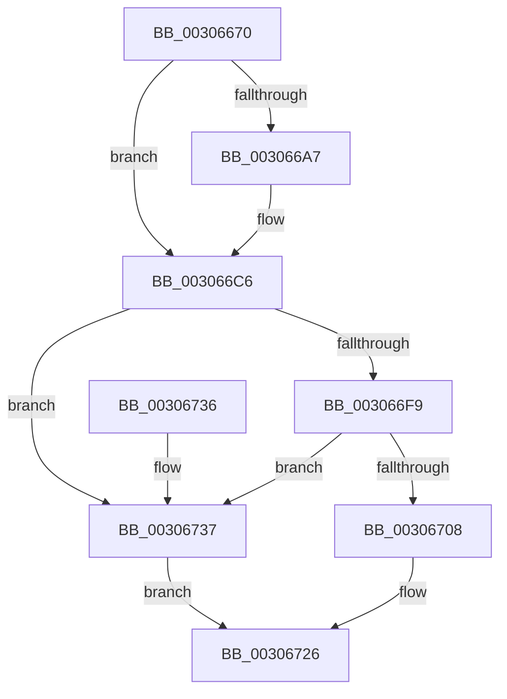

# HvlpFlushRangeListTbEx

- RVA: `0x00306670`–`0x00306757` (길이 `231` bytes)
- VA: `0x0000000140306670`
- 실행 섹션: `.text`
- PDB 이름 있음: `예`; PDB Function 태그: `아니요`
- unwind 정보 RVA: `0x00073784`
- 디코드: `63`개 명령, `231/231` bytes 표시
- 미해석 바이트: `0` (있으면 어셈블리에 `.byte`로 보존)

> 이 문서는 커널 이미지의 기계어와 PDB 기호를 분석해 생성했습니다. 4번과 5번은 함수 원형과 자료형을 바이너리 사용 방식에서 추정한 C 해석이며 원본 소스 복구 결과는 아닙니다.

## 1. Dependencies

- 직접 호출 지점: **4**; 고유 호출 대상: **4**
- 직접 호출자로 확인된 함수: **1**
- RIP 상대 이미지 참조: **1**

### Outgoing calls
- `0x003066DC` → [HvlpCountFlushVaList](HvlpCountFlushVaList_function_00306760.md) (function, `0x00306760`)
- `0x003066FF` → [HvlpAllowFastFlushList](HvlpAllowFastFlushList_function_00306A4C.md) (function, `0x00306A4C`)
- `0x00306721` → [HvlpFastFlushListTbEx](HvlpFastFlushListTbEx_function_00306784.md) (function, `0x00306784`)
- `0x00306750` → [HvlpSlowFlushListTbEx](../4A/HvlpSlowFlushListTbEx_function_004AFCF8.md) (function, `0x004AFCF8`)

### Direct callers
- [sub_00312F3E](../31/Unknown_function_00312F3E.md) at `0x00312F8D`

### Static image references
- `0x003066E1` → RVA `0x00FC6A90` (`ALMOSTRO`; read)

## 2. Other-region calls and transfers

- 다른 실행 섹션으로 향하는 call: **0**
- 별도 외부 분기/꼬리 이동을 확인하지 못했습니다.

## 3. Assembly (complete function range)

```asm
00306670  48 89 5C 24 08                  mov qword ptr [rsp + 8], rbx
00306675  48 89 74 24 10                  mov qword ptr [rsp + 0x10], rsi
0030667A  57                              push rdi
0030667B  48 83 EC 60                     sub rsp, 0x60
0030667F  48 83 64 24 40 00               and qword ptr [rsp + 0x40], 0
00306685  33 C0                           xor eax, eax
00306687  45 8B D9                        mov r11d, r9d
0030668A  48 89 44 24 58                  mov qword ptr [rsp + 0x58], rax
0030668F  44 8A 8C 24 90 00 00 00         mov r9b, byte ptr [rsp + 0x90]
00306697  0F 57 C0                        xorps xmm0, xmm0
0030669A  48 8B F2                        mov rsi, rdx
0030669D  0F 11 44 24 48                  movups xmmword ptr [rsp + 0x48], xmm0
003066A2  45 84 C9                        test r9b, r9b
003066A5  74 1F                           je 0x1403066c6
003066A7  41 F6 D8                        neg r8b
003066AA  48 89 4C 24 40                  mov qword ptr [rsp + 0x40], rcx
003066AF  1B D2                           sbb edx, edx
003066B1  F7 D2                           not edx
003066B3  83 E2 04                        and edx, 4
003066B6  8B C2                           mov eax, edx
003066B8  83 C8 02                        or eax, 2
003066BB  48 85 C9                        test rcx, rcx
003066BE  0F 45 C2                        cmovne eax, edx
003066C1  48 89 44 24 48                  mov qword ptr [rsp + 0x48], rax
003066C6  48 8B 9C 24 A0 00 00 00         mov rbx, qword ptr [rsp + 0xa0]
003066CE  44 8B 94 24 98 00 00 00         mov r10d, dword ptr [rsp + 0x98]
003066D6  48 8B D3                        mov rdx, rbx
003066D9  41 8B CA                        mov ecx, r10d
003066DC  E8 7F 00 00 00                  call 0x140306760
003066E1  8B 0D A9 03 CC 00               mov ecx, dword ptr [rip + 0xcc03a9]
003066E7  8B F8                           mov edi, eax
003066E9  C1 E9 08                        shr ecx, 8
003066EC  83 E1 0F                        and ecx, 0xf
003066EF  83 C1 05                        add ecx, 5
003066F2  03 C8                           add ecx, eax
003066F4  83 F9 0E                        cmp ecx, 0xe
003066F7  77 3E                           ja 0x140306737
003066F9  41 8B D2                        mov edx, r10d
003066FC  41 8B CB                        mov ecx, r11d
003066FF  E8 48 03 00 00                  call 0x140306a4c
00306704  84 C0                           test al, al
00306706  74 2F                           je 0x140306737
00306708  89 7C 24 30                     mov dword ptr [rsp + 0x30], edi
0030670C  48 8D 4C 24 40                  lea rcx, [rsp + 0x40]
00306711  48 89 5C 24 28                  mov qword ptr [rsp + 0x28], rbx
00306716  45 8B C3                        mov r8d, r11d
00306719  48 8B D6                        mov rdx, rsi
0030671C  44 89 54 24 20                  mov dword ptr [rsp + 0x20], r10d
00306721  E8 5E 00 00 00                  call 0x140306784
00306726  48 8B 5C 24 70                  mov rbx, qword ptr [rsp + 0x70]
0030672B  48 8B 74 24 78                  mov rsi, qword ptr [rsp + 0x78]
00306730  48 83 C4 60                     add rsp, 0x60
00306734  5F                              pop rdi
00306735  C3                              ret
00306736  CC                              int3
00306737  89 7C 24 30                     mov dword ptr [rsp + 0x30], edi
0030673B  48 8D 4C 24 40                  lea rcx, [rsp + 0x40]
00306740  48 89 5C 24 28                  mov qword ptr [rsp + 0x28], rbx
00306745  45 8B C3                        mov r8d, r11d
00306748  48 8B D6                        mov rdx, rsi
0030674B  44 89 54 24 20                  mov dword ptr [rsp + 0x20], r10d
00306750  E8 A3 95 1A 00                  call 0x1404afcf8
00306755  EB CF                           jmp 0x140306726
```

## 4. C-style interpretation (structured pseudocode)

```c
__int64 __fastcall HvlpFlushRangeListTbEx(__int64 a1, __int64 a2, unsigned __int8 a3, int a4, unsigned __int8 a5, unsigned int a6, __int64 a7)
{
    __int64 result;
    __int64 v_rsp;
    unsigned __int64 v_stack_m10;
    unsigned __int64 v_stack_m20;
    unsigned __int64 v_stack_m28;
    unsigned int v_stack_m38;
    unsigned __int64 v_stack_m40;
    unsigned int v_stack_m48;
    unsigned __int64 v_stack_p10;
    unsigned int v_stack_p20;
    unsigned __int64 v_stack_p28;
    unsigned int v_stack_p30;
    unsigned __int64 v_stack_p40;
    unsigned __int64 v_stack_p8;

    v_stack_p8 = v_rbx;
    v_stack_p10 = v_rsi;
    v_rsp = (v_rsp) - (96);
    result = 0;
    v_stack_m10 = 0;
    v_stack_m20 = v_xmm0;
    if (a5 != 0) {
        a3 = (unsigned __int8)(-(a3));
        v_stack_m28 = a1;
        a2 = (unsigned int)(~(a2));
        a2 = (unsigned int)((a2) & (4));
        result = (unsigned int)(a2);
        result = (unsigned int)((result) | (2));
        if (a1 != 0) { result = (unsigned int)(a2); }
        v_stack_m20 = result;
    }
    result = HvlpCountFlushVaList((unsigned int)((unsigned int)((unsigned int)(a6))), a7, a3, a5);
    a1 = (unsigned int)(((unsigned int)(*(unsigned int *)(v_rip + 13370281))) >> (8));
    a1 = (unsigned int)((a1) & (15));
    a1 = (unsigned int)((a1) + (5));
    a1 = (unsigned int)((a1) + ((unsigned int)(result)));
    if (((unsigned int)(a1)) > 14) goto loc_00306737;
    result = HvlpAllowFastFlushList((unsigned int)((unsigned int)((unsigned int)(a4))), (unsigned int)((unsigned int)((unsigned int)(a6))), a3, a5);
    if ((unsigned __int8)(result) == 0) goto loc_00306737;
    v_stack_m38 = (unsigned int)((unsigned int)((unsigned int)(result)));
    v_stack_m40 = a7;
    v_stack_m48 = (unsigned int)((unsigned int)(a6));
    result = HvlpFastFlushListTbEx(v_stack_m28, a2, (unsigned int)((unsigned int)((unsigned int)(a4))), a5);
loc_00306726:
    v_rsp = (v_rsp) + (96);
    return result;
loc_00306737:
    v_stack_p30 = (unsigned int)((unsigned int)((unsigned int)(result)));
    v_stack_p28 = v_stack_p8;
    v_stack_p20 = (unsigned int)((unsigned int)(a6));
    result = HvlpSlowFlushListTbEx(v_stack_p40, v_stack_p10, (unsigned int)((unsigned int)((unsigned int)(a4))), a5);
    goto loc_00306726;
}
```

## 5. (Beta) C Style

```c
int64_t HvlpFlushRangeListTbEx(int64_t Arg1, int64_t Arg2, uint8_t Arg3, int32_t Arg4, uint8_t Arg5, uint32_t Arg6, int64_t Arg7)
{
    int64_t result;
    int64_t local_rsp;
    uint64_t v_stack_m10;
    uint64_t v_stack_m20;
    uint64_t v_stack_m28;
    uint32_t v_stack_m38;
    uint64_t v_stack_m40;
    uint32_t v_stack_m48;
    uint64_t v_stack_p10;
    uint32_t v_stack_p20;
    uint64_t v_stack_p28;
    uint32_t v_stack_p30;
    uint64_t v_stack_p40;
    uint64_t v_stack_p8;

    v_stack_p8 = local_rbx;
    v_stack_p10 = local_rsi;
    local_rsp = (local_rsp) - (96);
    result = 0;
    v_stack_m10 = 0;
    v_stack_m20 = v_xmm0;
    if (Arg5 != 0) {
        Arg3 = (uint8_t)(-(Arg3));
        v_stack_m28 = Arg1;
        Arg2 = (uint32_t)(~(Arg2));
        Arg2 = (uint32_t)((Arg2) & (4));
        result = (uint32_t)(Arg2);
        result = (uint32_t)((result) | (2));
        if (Arg1 != 0) { result = (uint32_t)(Arg2); }
        v_stack_m20 = result;
    }
    result = HvlpCountFlushVaList((uint32_t)((uint32_t)((uint32_t)(Arg6))), Arg7, Arg3, Arg5);
    Arg1 = (uint32_t)(((uint32_t)(*(uint32_t *)(v_rip + 0xCC03A9))) >> (8));
    Arg1 = (uint32_t)((Arg1) & (15));
    Arg1 = (uint32_t)((Arg1) + (5));
    Arg1 = (uint32_t)((Arg1) + ((uint32_t)(result)));
    if (((uint32_t)(Arg1)) > 14) goto loc_00306737;
    result = HvlpAllowFastFlushList((uint32_t)((uint32_t)((uint32_t)(Arg4))), (uint32_t)((uint32_t)((uint32_t)(Arg6))), Arg3, Arg5);
    if ((uint8_t)(result) == 0) goto loc_00306737;
    v_stack_m38 = (uint32_t)((uint32_t)((uint32_t)(result)));
    v_stack_m40 = Arg7;
    v_stack_m48 = (uint32_t)((uint32_t)(Arg6));
    result = HvlpFastFlushListTbEx(v_stack_m28, Arg2, (uint32_t)((uint32_t)((uint32_t)(Arg4))), Arg5);
loc_00306726:
    local_rsp = (local_rsp) + (96);
    return result;
loc_00306737:
    v_stack_p30 = (uint32_t)((uint32_t)((uint32_t)(result)));
    v_stack_p28 = v_stack_p8;
    v_stack_p20 = (uint32_t)((uint32_t)(Arg6));
    result = HvlpSlowFlushListTbEx(v_stack_p40, v_stack_p10, (uint32_t)((uint32_t)((uint32_t)(Arg4))), Arg5);
    goto loc_00306726;
}
```

## 6. Execution-region graph

[열기: 2D/3D 그래프와 함수 탐색 컨트롤 패널](../../../control-panel.html?section=text&rva=0x00306670&view=graph)

- 2D 그래프는 위에서 아래로 흐르고, 3D 그래프는 빈 공간을 드래그해 회전합니다. Shift+드래그는 이동, 휠은 확대·축소, 함수 노드 선택은 대상 보고서 이동입니다.

### Static fallback


