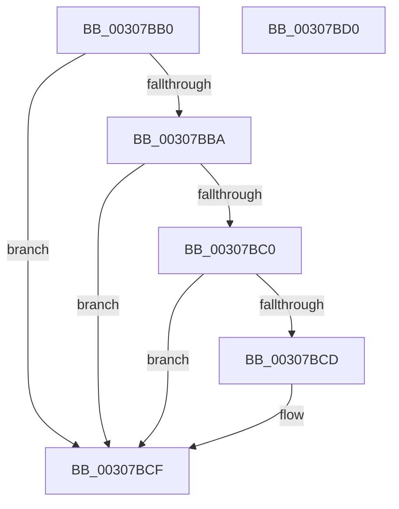

# HvlpHvStatusIsInsufficientMemory

- RVA: `0x00307BB0`–`0x00307BD1` (길이 `33` bytes)
- VA: `0x0000000140307BB0`
- 실행 섹션: `.text`
- PDB 이름 있음: `예`; PDB Function 태그: `아니요`
- unwind 정보 RVA: `0x000DB714`
- 디코드: `12`개 명령, `33/33` bytes 표시
- 미해석 바이트: `0` (있으면 어셈블리에 `.byte`로 보존)

> 이 문서는 커널 이미지의 기계어와 PDB 기호를 분석해 생성했습니다. 4번과 5번은 함수 원형과 자료형을 바이너리 사용 방식에서 추정한 C 해석이며 원본 소스 복구 결과는 아닙니다.

## 1. Dependencies

- 직접 호출 지점: **0**; 고유 호출 대상: **0**
- 직접 호출자로 확인된 함수: **18**
- RIP 상대 이미지 참조: **0**

### Outgoing calls
- 직접 디코드된 call 명령이 없습니다.

### Direct callers
- [HvlDmaMapDeviceLogicalRange](HvlDmaMapDeviceLogicalRange_function_003077D0.md) at `0x003079A9`
- [HvlDmaMapDeviceSparsePages](../47/HvlDmaMapDeviceSparsePages_function_0047A390.md) at `0x0047A4F1`
- [HvlpSetPowerProperty](../4C/HvlpSetPowerProperty_function_004C9124.md) at `0x004C9309`
- [HvlAttachPasidSpace](../58/HvlAttachPasidSpace_function_00587140.md) at `0x005871A4`
- [HvlAttachPrQueue](../58/HvlAttachPrQueue_function_005871F0.md) at `0x00587254`
- [HvlCreatePasidSpace](../58/HvlCreatePasidSpace_function_00587300.md) at `0x00587377`
- [HvlCreatePrQueue](../58/HvlCreatePrQueue_function_005873C0.md) at `0x00587466`
- [HvlDmaAllocateDeviceDomain](../58/HvlDmaAllocateDeviceDomain_function_00587630.md) at `0x005876C5`
- [HvlDmaAttachDeviceDomain](../58/HvlDmaAttachDeviceDomain_function_00587700.md) at `0x0058777F`
- [HvlDmaReserveDeviceDomainAttachment](../58/HvlDmaReserveDeviceDomainAttachment_function_00587C90.md) at `0x00587D08`
- [HvlEnablePasid](../58/HvlEnablePasid_function_00587DA0.md) at `0x00587E04`
- [HvlMapDeviceInterrupt](../58/HvlMapDeviceInterrupt_function_00588A90.md) at `0x00588C98`
- [HvlRegisterDeviceId](../58/HvlRegisterDeviceId_function_005891C0.md) at `0x00589302`
- [HvlSetDeviceCapabilities](../58/HvlSetDeviceCapabilities_function_005894C0.md) at `0x00589519`
- [HvlSetHpetConfig](../58/HvlSetHpetConfig_function_00589560.md) at `0x00589623`
- [HvlSetPasidAddressSpace](../58/HvlSetPasidAddressSpace_function_00589790.md) at `0x005897F3`
- [HvlMapDmaRanges](../58/HvlMapDmaRanges_function_0058A110.md) at `0x0058A1B5`
- [HvlpDynamicUpdateMicrocode](../../page/71/HvlpDynamicUpdateMicrocode_function_007185E8.md) at `0x00718684`

### Static image references
- 디코드된 RIP-relative 메모리 참조가 없습니다.

## 2. Other-region calls and transfers

- 다른 실행 섹션으로 향하는 call: **0**
- 별도 외부 분기/꼬리 이동을 확인하지 못했습니다.

## 3. Assembly (complete function range)

```asm
00307BB0  66 B8 01 00                     mov ax, 1
00307BB4  66 83 F9 0B                     cmp cx, 0xb
00307BB8  74 15                           je 0x140307bcf
00307BBA  66 83 F9 75                     cmp cx, 0x75
00307BBE  74 0F                           je 0x140307bcf
00307BC0  BA 81 00 00 00                  mov edx, 0x81
00307BC5  66 2B CA                        sub cx, dx
00307BC8  66 3B C8                        cmp cx, ax
00307BCB  76 02                           jbe 0x140307bcf
00307BCD  32 C0                           xor al, al
00307BCF  C3                              ret
00307BD0  CC                              int3
```

## 4. C-style interpretation (structured pseudocode)

```c
__int64 __fastcall HvlpHvStatusIsInsufficientMemory(unsigned __int16 a1)
{
    __int64 result;

    if (a1 == 11) goto loc_00307BCF;
    if (a1 == 117) goto loc_00307BCF;
    a1 = (unsigned __int16)((a1) - (129));
    result = 1;
    if (a1 >= = 1) {
        result = 0;
    }
    return result;
}
```

## 5. (Beta) C Style

```c
int64_t HvlpHvStatusIsInsufficientMemory(uint16_t Arg1)
{
    int64_t result;

    if (Arg1 == 11) goto loc_00307BCF;
    if (Arg1 == 117) goto loc_00307BCF;
    Arg1 = (uint16_t)((Arg1) - (129));
    result = 1;
    if (Arg1 >= = 1) {
        result = 0;
    }
    return result;
}
```

## 6. Execution-region graph

[열기: 2D/3D 그래프와 함수 탐색 컨트롤 패널](../../../control-panel.html?section=text&rva=0x00307BB0&view=graph)

- 2D 그래프는 위에서 아래로 흐르고, 3D 그래프는 빈 공간을 드래그해 회전합니다. Shift+드래그는 이동, 휠은 확대·축소, 함수 노드 선택은 대상 보고서 이동입니다.

### Static fallback


