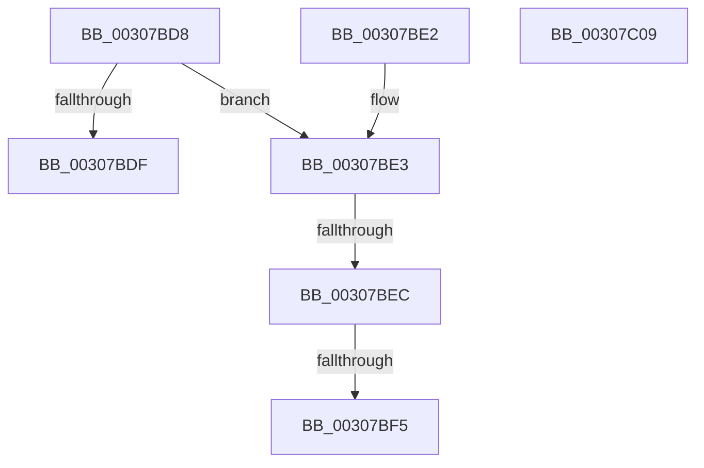

# HvlpHvToNtStatus

- RVA: `0x00307BD8`–`0x00307C0A` (길이 `50` bytes)
- VA: `0x0000000140307BD8`
- 실행 섹션: `.text`
- PDB 이름 있음: `예`; PDB Function 태그: `예`
- unwind 정보 RVA: `0x000DB714`
- 디코드: `17`개 명령, `50/50` bytes 표시
- 미해석 바이트: `0` (있으면 어셈블리에 `.byte`로 보존)

> 이 문서는 커널 이미지의 기계어와 PDB 기호를 분석해 생성했습니다. 4번과 5번은 함수 원형과 자료형을 바이너리 사용 방식에서 추정한 C 해석이며 원본 소스 복구 결과는 아닙니다.

## 1. Dependencies

- 직접 호출 지점: **0**; 고유 호출 대상: **0**
- 직접 호출자로 확인된 함수: **58**
- RIP 상대 이미지 참조: **0**

### Outgoing calls
- 직접 디코드된 call 명령이 없습니다.

### Direct callers
- [HvlRetargetDeviceInterrupt](HvlRetargetDeviceInterrupt_function_003062A0.md) at `0x00306484`
- [HvlGetSparseGpaPagesAccessState](HvlGetSparseGpaPagesAccessState_function_00306A78.md) at `0x00306C24`
- [HvlDmaUnmapDeviceLogicalRange](HvlDmaUnmapDeviceLogicalRange_function_00307390.md) at `0x00307468`
- [HvlDmaMapDeviceLogicalRange](HvlDmaMapDeviceLogicalRange_function_003077D0.md) at `0x003079B9`
- [HvlMapSparseGpaPages](../42/HvlMapSparseGpaPages_function_0042A160.md) at `0x0042A2CD`
- [HvlGetGpaPagesAccessState](../42/HvlGetGpaPagesAccessState_function_0042A3D4.md) at `0x0042A58F`
- [HvlUpdatePerformanceStateCountersForLp](../44/HvlUpdatePerformanceStateCountersForLp_function_0044D5B0.md) at `0x0044D663`
- [HvlMapGpaPages](../46/HvlMapGpaPages_function_00462934.md) at `0x00462AE7`
- [HvlDmaMapDeviceSparsePages](../47/HvlDmaMapDeviceSparsePages_function_0047A390.md) at `0x0047A501`
- [HvlDmaUnmapDeviceSparsePages](../48/HvlDmaUnmapDeviceSparsePages_function_004844C0.md) at `0x0048461C`
- [HvlpSetPowerProperty](../4C/HvlpSetPowerProperty_function_004C9124.md) at `0x004C9329`
- [HvlSetDeviceDmaEnabled](../4D/HvlSetDeviceDmaEnabled_function_004DD300.md) at `0x004DD3AA`
- [HvlGetRootVpSharedPages](../58/HvlGetRootVpSharedPages_function_0058466C.md) at `0x00584730`
- [HvlpReadPerfRegister](../58/HvlpReadPerfRegister_function_00585CBC.md) at `0x00585D14`
- [HvlpWritePerfRegister](../58/HvlpWritePerfRegister_function_00586EF0.md) at `0x00586F49`
- [HvlAcknowledgePageRequest](../58/HvlAcknowledgePageRequest_function_005870A0.md) at `0x00587108`
- [HvlAttachPasidSpace](../58/HvlAttachPasidSpace_function_00587140.md) at `0x005871C5`
- [HvlAttachPrQueue](../58/HvlAttachPrQueue_function_005871F0.md) at `0x00587275`
- [HvlClearPrqStalled](../58/HvlClearPrqStalled_function_005872A0.md) at `0x005872EB`
- [HvlCreatePasidSpace](../58/HvlCreatePasidSpace_function_00587300.md) at `0x00587398`
- [HvlCreatePrQueue](../58/HvlCreatePrQueue_function_005873C0.md) at `0x00587487`
- [HvlDeletePrQueue](../58/HvlDeletePrQueue_function_005874B0.md) at `0x005874F0`
- [HvlDetachPasidSpace](../58/HvlDetachPasidSpace_function_00587510.md) at `0x0058754D`
- [HvlDetachPrQueue](../58/HvlDetachPrQueue_function_00587560.md) at `0x0058759D`
- [HvlDisablePasid](../58/HvlDisablePasid_function_005875B0.md) at `0x00587606`
- [HvlDmaAllocateDeviceDomain](../58/HvlDmaAllocateDeviceDomain_function_00587630.md) at `0x005876E2`
- [HvlDmaAttachDeviceDomain](../58/HvlDmaAttachDeviceDomain_function_00587700.md) at `0x0058779C`
- [HvlDmaConfigureDeviceDomain](../58/HvlDmaConfigureDeviceDomain_function_005877C0.md) at `0x00587853`
- [HvlDmaDeleteDeviceDomain](../58/HvlDmaDeleteDeviceDomain_function_00587880.md) at `0x005878EA`
- [HvlDmaDetachDeviceDomain](../58/HvlDmaDetachDeviceDomain_function_00587910.md) at `0x0058795B`
- [HvlDmaFlushDeviceDomain](../58/HvlDmaFlushDeviceDomain_function_00587970.md) at `0x005879D4`
- [HvlDmaGetDmaGuardEnabled](../58/HvlDmaGetDmaGuardEnabled_function_00587A50.md) at `0x00587B1B`
- [HvlDmaGetHybridPassthroughReservedRegions](../58/HvlDmaGetHybridPassthroughReservedRegions_function_00587B50.md) at `0x00587C5A`
- [HvlDmaReserveDeviceDomainAttachment](../58/HvlDmaReserveDeviceDomainAttachment_function_00587C90.md) at `0x00587D25`
- [HvlDmaUnreserveDeviceDomainAttachment](../58/HvlDmaUnreserveDeviceDomainAttachment_function_00587D50.md) at `0x00587D8D`
- [HvlEnablePasid](../58/HvlEnablePasid_function_00587DA0.md) at `0x00587E25`
- [HvlGetDeviceCapabilities](../58/HvlGetDeviceCapabilities_function_00587EF0.md) at `0x00587FE6`
- [HvlHvDebuggerPowerHandler](../58/HvlHvDebuggerPowerHandler_function_00588770.md) at `0x005887E0`
- [HvlMapDeviceInterrupt](../58/HvlMapDeviceInterrupt_function_00588A90.md) at `0x00588CBD`
- [HvlNotifyAllProcessorsStarted](../58/HvlNotifyAllProcessorsStarted_function_00588CF4.md) at `0x00588D5A`
- [HvlRegisterDeviceId](../58/HvlRegisterDeviceId_function_005891C0.md) at `0x00589322`
- [HvlRestoreTime](../58/HvlRestoreTime_function_00589350.md) at `0x005893BC`
- [HvlSetDeviceCapabilities](../58/HvlSetDeviceCapabilities_function_005894C0.md) at `0x00589536`
- [HvlSetPasidAddressSpace](../58/HvlSetPasidAddressSpace_function_00589790.md) at `0x00589814`
- [HvlSetRootFaultReportingReady](../58/HvlSetRootFaultReportingReady_function_00589840.md) at `0x005898A0`
- [HvlUnblockDefaultDma](../58/HvlUnblockDefaultDma_function_00589A50.md) at `0x00589AB0`
- [HvlUnmapDeviceInterrupt](../58/HvlUnmapDeviceInterrupt_function_00589AE0.md) at `0x00589B63`
- [HvlUnregisterDeviceId](../58/HvlUnregisterDeviceId_function_00589B90.md) at `0x00589BCD`
- [HvlpDmaFastFlushDeviceDomainVaList](../58/HvlpDmaFastFlushDeviceDomainVaList_function_00589BE0.md) at `0x00589C93`
- [HvlpDmaSlowFlushDeviceDomainVaList](../58/HvlpDmaSlowFlushDeviceDomainVaList_function_00589CC0.md) at `0x00589DA0`
- [HvlChangeIsolatedMemoryVisibility](../58/HvlChangeIsolatedMemoryVisibility_function_00589FD0.md) at `0x0058A0DA`
- [HvlMapDmaRanges](../58/HvlMapDmaRanges_function_0058A110.md) at `0x0058A1C1`
- [HvlUnmapDmaRanges](../58/HvlUnmapDmaRanges_function_0058A210.md) at `0x0058A2F6`
- [HvlRequestProcessorHalt](../58/HvlRequestProcessorHalt_function_0058A980.md) at `0x0058A9A9`
- [HvlWakeVirtualProcessors](../58/HvlWakeVirtualProcessors_function_0058AA80.md) at `0x0058AC14`
- [HvlpAddRemovePhysicalMemory](../6A/HvlpAddRemovePhysicalMemory_function_006A7A98.md) at `0x006A7BF9`
- [HvlNotifyPageHeat](../6A/HvlNotifyPageHeat_function_006A7E60.md) at `0x006A8091`
- [HvlpDynamicUpdateMicrocode](../../page/71/HvlpDynamicUpdateMicrocode_function_007185E8.md) at `0x0071869E`

### Static image references
- 디코드된 RIP-relative 메모리 참조가 없습니다.

## 2. Other-region calls and transfers

- 다른 실행 섹션으로 향하는 call: **0**
- call이 아닌 외부 분기/꼬리 이동: **2**
  - `0x00307BE6` → `0x006E0B26` (`tail-transfer`)
  - `0x00307BEF` → `0x006E0B26` (`tail-transfer`)

## 3. Assembly (complete function range)

```asm
00307BD8  0F B7 D1                        movzx edx, cx
00307BDB  85 D2                           test edx, edx
00307BDD  75 04                           jne 0x140307be3
00307BDF  33 C0                           xor eax, eax
00307BE1  C3                              ret
00307BE2  CC                              int3
00307BE3  83 FA 0B                        cmp edx, 0xb
00307BE6  0F 84 3A 8F 3D 00               je 0x1406e0b26
00307BEC  83 FA 1D                        cmp edx, 0x1d
00307BEF  0F 84 31 8F 3D 00               je 0x1406e0b26
00307BF5  8B CA                           mov ecx, edx
00307BF7  B8 59 00 35 00                  mov eax, 0x350059
00307BFC  81 C9 00 00 35 C0               or ecx, 0xc0350000
00307C02  83 FA 59                        cmp edx, 0x59
00307C05  0F 45 C1                        cmovne eax, ecx
00307C08  C3                              ret
00307C09  CC                              int3
```

## 4. C-style interpretation (structured pseudocode)

```c
__int64 __fastcall HvlpHvToNtStatus(unsigned __int16 a1)
{
    __int64 result;

    if (a1 != 0) goto loc_00307BE3;
    result = 0;
    return result;
loc_00307BE3:
    a1 = (unsigned int)(((unsigned int)(a1)) | (0xC0350000ULL));
    result = (unsigned int)(0x350059ULL);
    if (a1 != 89) { result = a1; }
    return result;
}
```

## 5. (Beta) C Style

```c
int64_t HvlpHvToNtStatus(uint16_t Arg1)
{
    int64_t result;

    if (Arg1 != 0) goto loc_00307BE3;
    result = 0;
    return result;
loc_00307BE3:
    Arg1 = (uint32_t)(((uint32_t)(Arg1)) | (0xC0350000ULL));
    result = (uint32_t)(0x350059ULL);
    if (Arg1 != 89) { result = Arg1; }
    return result;
}
```

## 6. Execution-region graph

[열기: 2D/3D 그래프와 함수 탐색 컨트롤 패널](../../../control-panel.html?section=text&rva=0x00307BD8&view=graph)

- 2D 그래프는 위에서 아래로 흐르고, 3D 그래프는 빈 공간을 드래그해 회전합니다. Shift+드래그는 이동, 휠은 확대·축소, 함수 노드 선택은 대상 보고서 이동입니다.

### Static fallback


