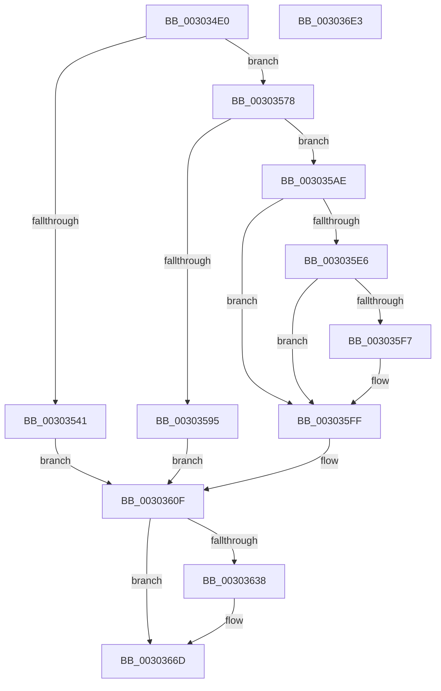

# HvlpSlowSendSyntheticClusterIpiEx

- RVA: `0x003034E0`–`0x003036E4` (길이 `516` bytes)
- VA: `0x00000001403034E0`
- 실행 섹션: `.text`
- PDB 이름 있음: `예`; PDB Function 태그: `아니요`
- unwind 정보 RVA: `0x00073414`
- 디코드: `131`개 명령, `516/516` bytes 표시
- 미해석 바이트: `0` (있으면 어셈블리에 `.byte`로 보존)

> 이 문서는 커널 이미지의 기계어와 PDB 기호를 분석해 생성했습니다. 4번과 5번은 함수 원형과 자료형을 바이너리 사용 방식에서 추정한 C 해석이며 원본 소스 복구 결과는 아닙니다.

## 1. Dependencies

- 직접 호출 지점: **11**; 고유 호출 대상: **9**
- 직접 호출자로 확인된 함수: **1**
- RIP 상대 이미지 참조: **3**

### Outgoing calls
- `0x00303549` → [KeDisableInterrupts](../21/KeDisableInterrupts_function_00217BE0.md) (function, `0x00217BE0`)
- `0x00303588` → [ExpInterlockedPopEntrySList](../6B/ExpInterlockedPopEntrySList_function_006BA570.md) (function, `0x006BA570`)
- `0x003035FA` → [KiRaiseIrqlProcessIrqlFlags](../4F/KiRaiseIrqlProcessIrqlFlags_function_004F56FC.md) (function, `0x004F56FC`)
- `0x00303602` → [MmGetPhysicalAddress](../23/MmGetPhysicalAddress_function_0023A500.md) (function, `0x0023A500`)
- `0x0030362E` → [HvlpAffinityToHvProcessorSet](HvlpAffinityToHvProcessorSet_function_003068F4.md) (function, `0x003068F4`)
- `0x0030363D` → [HvlpReleaseHypercallPage](../31/HvlpReleaseHypercallPage_function_00313480.md) (function, `0x00313480`)
- `0x00303651` → [HvlpAcquireHypercallPage](../47/HvlpAcquireHypercallPage_function_00471410.md) (function, `0x00471410`)
- `0x00303663` → [HvlpAffinityToHvProcessorSet](HvlpAffinityToHvProcessorSet_function_003068F4.md) (function, `0x003068F4`)
- `0x0030369A` → [HvcallInitiateHypercall](../31/HvcallInitiateHypercall_function_00313630.md) (function, `0x00313630`)
- `0x003036A7` → [HvlpReleaseHypercallPage](../31/HvlpReleaseHypercallPage_function_00313480.md) (function, `0x00313480`)
- `0x003036BD` → [_security_check_cookie](../6A/_security_check_cookie_function_006AC640.md) (function, `0x006AC640`)

### Direct callers
- [HvlSendSyntheticClusterIpi](HvlSendSyntheticClusterIpi_function_00304E50.md) at `0x00304F42`

### Static image references
- `0x00303503` → RVA `0x00E0A740` (`.data`; read)
- `0x00303525` → RVA `0x00FC6A90` (`ALMOSTRO`; read)
- `0x003035EE` → RVA `0x00FC6D20` (`ALMOSTRO`; read)

## 2. Other-region calls and transfers

- 다른 실행 섹션으로 향하는 call: **0**
- 별도 외부 분기/꼬리 이동을 확인하지 못했습니다.

## 3. Assembly (complete function range)

```asm
003034E0  48 8B C4                        mov rax, rsp
003034E3  48 89 58 10                     mov qword ptr [rax + 0x10], rbx
003034E7  48 89 70 18                     mov qword ptr [rax + 0x18], rsi
003034EB  48 89 78 20                     mov qword ptr [rax + 0x20], rdi
003034EF  55                              push rbp
003034F0  41 54                           push r12
003034F2  41 55                           push r13
003034F4  41 56                           push r14
003034F6  41 57                           push r15
003034F8  48 8D 68 A1                     lea rbp, [rax - 0x5f]
003034FC  48 81 EC 00 01 00 00            sub rsp, 0x100
00303503  48 8B 05 36 72 B0 00            mov rax, qword ptr [rip + 0xb07236]
0030350A  48 33 C4                        xor rax, rsp
0030350D  48 89 45 2F                     mov qword ptr [rbp + 0x2f], rax
00303511  33 C0                           xor eax, eax
00303513  45 33 E4                        xor r12d, r12d
00303516  48 89 44 24 30                  mov qword ptr [rsp + 0x30], rax
0030351B  0F 57 C0                        xorps xmm0, xmm0
0030351E  89 44 24 38                     mov dword ptr [rsp + 0x38], eax
00303522  44 8B FA                        mov r15d, edx
00303525  8B 05 65 35 CC 00               mov eax, dword ptr [rip + 0xcc3565]
0030352B  4C 8B F1                        mov r14, rcx
0030352E  41 8D 74 24 01                  lea esi, [r12 + 1]
00303533  45 8D 6C 24 02                  lea r13d, [r12 + 2]
00303538  0F 11 44 24 20                  movups xmmword ptr [rsp + 0x20], xmm0
0030353D  A8 08                           test al, 8
0030353F  75 37                           jne 0x140303578
00303541  C7 44 24 20 04 00 00 00         mov dword ptr [rsp + 0x20], 4
00303549  E8 92 46 F1 FF                  call 0x140217be0
0030354E  88 44 24 28                     mov byte ptr [rsp + 0x28], al
00303552  65 48 8B 04 25 20 00 00 00      mov rax, qword ptr gs:[0x20]
0030355B  89 74 24 2C                     mov dword ptr [rsp + 0x2c], esi
0030355F  8B 74 24 20                     mov esi, dword ptr [rsp + 0x20]
00303563  48 8B 98 00 8C 00 00            mov rbx, qword ptr [rax + 0x8c00]
0030356A  48 8B 7B 10                     mov rdi, qword ptr [rbx + 0x10]
0030356E  48 89 7C 24 38                  mov qword ptr [rsp + 0x38], rdi
00303573  E9 97 00 00 00                  jmp 0x14030360f
00303578  65 48 8B 3C 25 20 00 00 00      mov rdi, qword ptr gs:[0x20]
00303581  48 8D 8F C0 8B 00 00            lea rcx, [rdi + 0x8bc0]
00303588  E8 E3 6F 3B 00                  call 0x1406ba570
0030358D  48 8B D8                        mov rbx, rax
00303590  48 85 C0                        test rax, rax
00303593  74 19                           je 0x1403035ae
00303595  48 89 7C 24 28                  mov qword ptr [rsp + 0x28], rdi
0030359A  48 8B 78 10                     mov rdi, qword ptr [rax + 0x10]
0030359E  48 89 7C 24 38                  mov qword ptr [rsp + 0x38], rdi
003035A3  89 74 24 20                     mov dword ptr [rsp + 0x20], esi
003035A7  48 89 44 24 30                  mov qword ptr [rsp + 0x30], rax
003035AC  EB 61                           jmp 0x14030360f
003035AE  48 C7 C2 00 F0 FF FF            mov rdx, 0xfffffffffffff000
003035B5  44 89 6C 24 20                  mov dword ptr [rsp + 0x20], r13d
003035BA  48 8D 4D 86                     lea rcx, [rbp - 0x7a]
003035BE  41 8B F5                        mov esi, r13d
003035C1  48 83 E1 F8                     and rcx, 0xfffffffffffffff8
003035C5  48 8D 59 57                     lea rbx, [rcx + 0x57]
003035C9  48 8B C3                        mov rax, rbx
003035CC  48 23 DA                        and rbx, rdx
003035CF  48 33 C1                        xor rax, rcx
003035D2  48 85 C2                        test rdx, rax
003035D5  48 0F 44 D9                     cmove rbx, rcx
003035D9  44 0F 20 C0                     mov rax, cr8
003035DD  88 44 24 28                     mov byte ptr [rsp + 0x28], al
003035E1  41 3A C5                        cmp al, r13b
003035E4  73 19                           jae 0x1403035ff
003035E6  44 0F 20 C1                     mov rcx, cr8
003035EA  45 0F 22 C5                     mov cr8, r13
003035EE  44 39 25 2B 37 CC 00            cmp dword ptr [rip + 0xcc372b], r12d
003035F5  74 08                           je 0x1403035ff
003035F7  41 8A D5                        mov dl, r13b
003035FA  E8 FD 20 1F 00                  call 0x1404f56fc
003035FF  48 8B CB                        mov rcx, rbx
00303602  E8 F9 6E F3 FF                  call 0x14023a500
00303607  48 8B F8                        mov rdi, rax
0030360A  48 89 44 24 38                  mov qword ptr [rsp + 0x38], rax
0030360F  41 22 F5                        and sil, r13b
00303612  48 8D 53 08                     lea rdx, [rbx + 8]
00303616  40 F6 DE                        neg sil
00303619  49 8B CE                        mov rcx, r14
0030361C  BE E8 0F 00 00                  mov esi, 0xfe8
00303621  45 1B C0                        sbb r8d, r8d
00303624  41 81 E0 58 F0 FF FF            and r8d, 0xfffff058
0030362B  44 03 C6                        add r8d, esi
0030362E  E8 C1 32 00 00                  call 0x1403068f4
00303633  83 F8 FF                        cmp eax, -1
00303636  75 35                           jne 0x14030366d
00303638  48 8D 4C 24 20                  lea rcx, [rsp + 0x20]
0030363D  E8 3E FE 00 00                  call 0x140313480
00303642  45 33 C9                        xor r9d, r9d
00303645  48 8D 4C 24 20                  lea rcx, [rsp + 0x20]
0030364A  45 33 C0                        xor r8d, r8d
0030364D  41 8D 51 01                     lea edx, [r9 + 1]
00303651  E8 BA DD 16 00                  call 0x140471410
00303656  44 8B C6                        mov r8d, esi
00303659  49 8B CE                        mov rcx, r14
0030365C  48 8B D8                        mov rbx, rax
0030365F  48 8D 50 08                     lea rdx, [rax + 8]
00303663  E8 8C 32 00 00                  call 0x1403068f4
00303668  48 8B 7C 24 38                  mov rdi, qword ptr [rsp + 0x38]
0030366D  83 C0 07                        add eax, 7
00303670  48 C7 44 24 40 15 00 00 00      mov qword ptr [rsp + 0x40], 0x15
00303679  C1 E0 0E                        shl eax, 0xe
0030367C  45 33 C0                        xor r8d, r8d
0030367F  25 00 00 FE 03                  and eax, 0x3fe0000
00303684  44 89 63 04                     mov dword ptr [rbx + 4], r12d
00303688  83 C8 15                        or eax, 0x15
0030368B  44 89 3B                        mov dword ptr [rbx], r15d
0030368E  89 44 24 40                     mov dword ptr [rsp + 0x40], eax
00303692  48 8B D7                        mov rdx, rdi
00303695  48 8B 4C 24 40                  mov rcx, qword ptr [rsp + 0x40]
0030369A  E8 91 FF 00 00                  call 0x140313630
0030369F  48 8D 4C 24 20                  lea rcx, [rsp + 0x20]
003036A4  48 8B D8                        mov rbx, rax
003036A7  E8 D4 FD 00 00                  call 0x140313480
003036AC  66 F7 DB                        neg bx
003036AF  1B C0                           sbb eax, eax
003036B1  25 01 00 00 C0                  and eax, 0xc0000001
003036B6  48 8B 4D 2F                     mov rcx, qword ptr [rbp + 0x2f]
003036BA  48 33 CC                        xor rcx, rsp
003036BD  E8 7E 8F 3A 00                  call 0x1406ac640
003036C2  4C 8D 9C 24 00 01 00 00         lea r11, [rsp + 0x100]
003036CA  49 8B 5B 38                     mov rbx, qword ptr [r11 + 0x38]
003036CE  49 8B 73 40                     mov rsi, qword ptr [r11 + 0x40]
003036D2  49 8B 7B 48                     mov rdi, qword ptr [r11 + 0x48]
003036D6  49 8B E3                        mov rsp, r11
003036D9  41 5F                           pop r15
003036DB  41 5E                           pop r14
003036DD  41 5D                           pop r13
003036DF  41 5C                           pop r12
003036E1  5D                              pop rbp
003036E2  C3                              ret
003036E3  CC                              int3
```

## 4. C-style interpretation (structured pseudocode)

```c
__int64 __fastcall HvlpSlowSendSyntheticClusterIpiEx(__int64 a1, int a2, int a3, int a4)
{
    __int64 result;
    __int64 v_r12;
    __int64 v_rbx;
    __int64 v_rdi;
    __int64 v_rsi;
    __int64 v_rsp;
    unsigned __int8 v_stack_m100;
    unsigned __int64 v_stack_m108;
    unsigned __int64 v_stack_m28;
    unsigned __int64 v_stack_mE8;
    unsigned int v_stack_mF0;
    unsigned __int64 v_stack_mF8;
    unsigned int v_stack_mFC;

    *(unsigned __int64 *)(v_rsp + 16) = v_rbx;
    *(unsigned __int64 *)(v_rsp + 24) = v_rsi;
    *(unsigned __int64 *)(v_rsp + 32) = v_rdi;
    v_rsp = (v_rsp) - (256);
    result = (*(unsigned __int64 *)(v_rip + 11563574)) ^ (v_rsp);
    *(unsigned __int64 *)(v_rsp - 95 + 47) = result;
    result = 0;
    v_r12 = 0;
    v_stack_mF8 = 0;
    v_stack_mF0 = 0;
    v_stack_m108 = v_xmm0;
    if ((((unsigned __int8)((unsigned int)(*(unsigned int *)(v_rip + 13383013)))) & (8)) != 0) goto loc_00303578;
    v_stack_m108 = 4;
    result = KeDisableInterrupts(a1, a2, a3, a4);
    v_stack_m100 = (unsigned __int8)(result);
    v_stack_mFC = (unsigned int)(v_r12 + 1);
    v_stack_mF0 = *(unsigned __int64 *)(*(unsigned __int64 *)(*(unsigned __int64 *)(gs_base + (0 + 32)) + 35840) + 16);
    goto loc_0030360F;
loc_00303578:
    result = ExpInterlockedPopEntrySList(*(unsigned __int64 *)(gs_base + (0 + 32)) + 35776, a2, a3, a4);
    if (result == 0) goto loc_003035AE;
    v_stack_m100 = *(unsigned __int64 *)(gs_base + (0 + 32));
    v_stack_mF0 = *(unsigned __int64 *)(result + 16);
    v_stack_m108 = (unsigned int)((unsigned int)(v_stack_m108));
    v_stack_mF8 = result;
    goto loc_0030360F;
loc_003035AE:
    v_stack_m108 = (unsigned int)(v_r12 + 2);
    a1 = (v_rsp - 95 - 122) & (-8);
    v_rbx = (a1 + 87) & (0xFFFFFFFFFFFFF000ULL);
    result = (a1 + 87) ^ (a1);
    if (((0xFFFFFFFFFFFFF000ULL) & (result)) == 0) { v_rbx = a1; }
    v_stack_m100 = (unsigned __int8)(v_cr8);
    if (((unsigned __int8)(v_cr8)) >= ((unsigned __int8)(v_r12 + 2))) goto loc_003035FF;
    result = v_cr8;
    if ((*(unsigned int *)(v_rip + 13383467)) != 0) {
        a2 = (unsigned __int8)(v_r12 + 2);
        result = KiRaiseIrqlProcessIrqlFlags(v_cr8, a2, a3, a4);
    }
    result = MmGetPhysicalAddress(v_rbx, a2, a3, a4);
    v_stack_mF0 = result;
loc_0030360F:
    v_rsi = (unsigned __int8)(((unsigned int)((unsigned int)(v_r12 + 2))) & ((unsigned __int8)(v_r12 + 2)));
    v_rsi = (unsigned __int8)(-(v_rsi));
    a3 = (unsigned int)((a3) & (0xFFFFF058ULL));
    a3 = (unsigned int)((a3) + ((unsigned int)((unsigned int)(0xFE8ULL))));
    result = HvlpAffinityToHvProcessorSet(a1, v_rbx + 8, a3, a4);
    v_rdi = result;
    if (((unsigned int)(result)) == -1) {
        a1 = v_stack_m108;
        result = HvlpReleaseHypercallPage(a1, v_rbx + 8, a3, a4);
        a4 = 0;
        a1 = v_stack_m108;
        a3 = 0;
        a2 = a4 + 1;
        result = HvlpAcquireHypercallPage(a1, a2, a3, a4);
        a3 = (unsigned int)((unsigned int)(0xFE8ULL));
        a1 = a1;
        v_rbx = result;
        a2 = result + 8;
        result = HvlpAffinityToHvProcessorSet(a1, a2, a3, a4);
        v_rdi = v_stack_mF0;
    }
    result = (unsigned int)((result) + (7));
    v_stack_mE8 = 21;
    result = (unsigned int)((result) << (14));
    a3 = 0;
    result = (unsigned int)((result) & (0x3FE0000ULL));
    *(unsigned int *)(v_rbx + 4) = 0;
    result = (unsigned int)((result) | (21));
    *(unsigned int *)(v_rbx) = (unsigned int)((unsigned int)(a2));
    v_stack_mE8 = (unsigned int)(result);
    result = HvcallInitiateHypercall(v_stack_mE8, v_rdi, a3, a4);
    result = HvlpReleaseHypercallPage(v_stack_m108, v_rdi, a3, a4);
    v_rbx = (unsigned __int16)(-(result));
    result = (unsigned int)((result) & (0xC0000001ULL));
    a1 = (*(unsigned __int64 *)(v_rsp - 95 + 47)) ^ (v_rsp);
    result = _security_check_cookie(a1, v_rdi, a3, a4);
    return result;
}
```

## 5. (Beta) C Style

```c
int64_t HvlpSlowSendSyntheticClusterIpiEx(int64_t Arg1, int32_t Arg2, int32_t Arg3, int32_t Arg4)
{
    int64_t result;
    int64_t local_r12;
    int64_t local_rbx;
    int64_t local_rdi;
    int64_t local_rsi;
    int64_t local_rsp;
    uint8_t v_stack_m100;
    uint64_t v_stack_m108;
    uint64_t v_stack_m28;
    uint64_t v_stack_mE8;
    uint32_t v_stack_mF0;
    uint64_t v_stack_mF8;
    uint32_t v_stack_mFC;

    *(uint64_t *)(local_rsp + 0x10) = local_rbx;
    *(uint64_t *)(local_rsp + 0x18) = local_rsi;
    *(uint64_t *)(local_rsp + 0x20) = local_rdi;
    local_rsp = (local_rsp) - (256);
    result = (*(uint64_t *)(v_rip + 0xB07236)) ^ (local_rsp);
    *(uint64_t *)(local_rsp - 0x5F + 0x2F) = result;
    result = 0;
    local_r12 = 0;
    v_stack_mF8 = 0;
    v_stack_mF0 = 0;
    v_stack_m108 = v_xmm0;
    if ((((uint8_t)((uint32_t)(*(uint32_t *)(v_rip + 0xCC3565)))) & (8)) != 0) goto loc_00303578;
    v_stack_m108 = 4;
    result = KeDisableInterrupts(Arg1, Arg2, Arg3, Arg4);
    v_stack_m100 = (uint8_t)(result);
    v_stack_mFC = (uint32_t)(local_r12 + 1);
    v_stack_mF0 = *(uint64_t *)(*(uint64_t *)(*(uint64_t *)(gs_base + (0 + 0x20)) + 0x8C00) + 0x10);
    goto loc_0030360F;
loc_00303578:
    result = ExpInterlockedPopEntrySList(*(uint64_t *)(gs_base + (0 + 0x20)) + 35776, Arg2, Arg3, Arg4);
    if (result == 0) goto loc_003035AE;
    v_stack_m100 = *(uint64_t *)(gs_base + (0 + 0x20));
    v_stack_mF0 = *(uint64_t *)(result + 0x10);
    v_stack_m108 = (uint32_t)((uint32_t)(v_stack_m108));
    v_stack_mF8 = result;
    goto loc_0030360F;
loc_003035AE:
    v_stack_m108 = (uint32_t)(local_r12 + 2);
    Arg1 = (local_rsp - 95 - 122) & (-8);
    local_rbx = (Arg1 + 87) & (0xFFFFFFFFFFFFF000ULL);
    result = (Arg1 + 87) ^ (Arg1);
    if (((0xFFFFFFFFFFFFF000ULL) & (result)) == 0) { local_rbx = Arg1; }
    v_stack_m100 = (uint8_t)(v_cr8);
    if (((uint8_t)(v_cr8)) >= ((uint8_t)(local_r12 + 2))) goto loc_003035FF;
    result = v_cr8;
    if ((*(uint32_t *)(v_rip + 0xCC372B)) != 0) {
        Arg2 = (uint8_t)(local_r12 + 2);
        result = KiRaiseIrqlProcessIrqlFlags(v_cr8, Arg2, Arg3, Arg4);
    }
    result = MmGetPhysicalAddress(local_rbx, Arg2, Arg3, Arg4);
    v_stack_mF0 = result;
loc_0030360F:
    local_rsi = (uint8_t)(((uint32_t)((uint32_t)(local_r12 + 2))) & ((uint8_t)(local_r12 + 2)));
    local_rsi = (uint8_t)(-(local_rsi));
    Arg3 = (uint32_t)((Arg3) & (0xFFFFF058ULL));
    Arg3 = (uint32_t)((Arg3) + ((uint32_t)((uint32_t)(0xFE8ULL))));
    result = HvlpAffinityToHvProcessorSet(Arg1, local_rbx + 8, Arg3, Arg4);
    local_rdi = result;
    if (((uint32_t)(result)) == -1) {
        Arg1 = v_stack_m108;
        result = HvlpReleaseHypercallPage(Arg1, local_rbx + 8, Arg3, Arg4);
        Arg4 = 0;
        Arg1 = v_stack_m108;
        Arg3 = 0;
        Arg2 = Arg4 + 1;
        result = HvlpAcquireHypercallPage(Arg1, Arg2, Arg3, Arg4);
        Arg3 = (uint32_t)((uint32_t)(0xFE8ULL));
        Arg1 = Arg1;
        local_rbx = result;
        Arg2 = result + 8;
        result = HvlpAffinityToHvProcessorSet(Arg1, Arg2, Arg3, Arg4);
        local_rdi = v_stack_mF0;
    }
    result = (uint32_t)((result) + (7));
    v_stack_mE8 = 21;
    result = (uint32_t)((result) << (14));
    Arg3 = 0;
    result = (uint32_t)((result) & (0x3FE0000ULL));
    *(uint32_t *)(local_rbx + 0x4) = 0;
    result = (uint32_t)((result) | (21));
    *(uint32_t *)(local_rbx) = (uint32_t)((uint32_t)(Arg2));
    v_stack_mE8 = (uint32_t)(result);
    result = HvcallInitiateHypercall(v_stack_mE8, local_rdi, Arg3, Arg4);
    result = HvlpReleaseHypercallPage(v_stack_m108, local_rdi, Arg3, Arg4);
    local_rbx = (uint16_t)(-(result));
    result = (uint32_t)((result) & (0xC0000001ULL));
    Arg1 = (*(uint64_t *)(local_rsp - 0x5F + 0x2F)) ^ (local_rsp);
    result = _security_check_cookie(Arg1, local_rdi, Arg3, Arg4);
    return result;
}
```

## 6. Execution-region graph

[열기: 2D/3D 그래프와 함수 탐색 컨트롤 패널](../../../control-panel.html?section=text&rva=0x003034E0&view=graph)

- 2D 그래프는 위에서 아래로 흐르고, 3D 그래프는 빈 공간을 드래그해 회전합니다. Shift+드래그는 이동, 휠은 확대·축소, 함수 노드 선택은 대상 보고서 이동입니다.

### Static fallback


