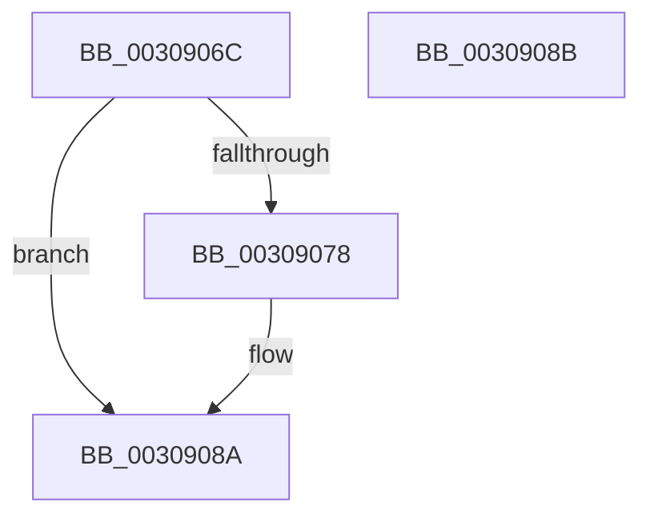

# HvlpUseExtendedProcessorSetHypercalls

- RVA: `0x0030906C`–`0x0030908C` (길이 `32` bytes)
- VA: `0x000000014030906C`
- 실행 섹션: `.text`
- PDB 이름 있음: `예`; PDB Function 태그: `아니요`
- unwind 정보 RVA: `0x000DB714`
- 디코드: `10`개 명령, `32/32` bytes 표시
- 미해석 바이트: `0` (있으면 어셈블리에 `.byte`로 보존)

> 이 문서는 커널 이미지의 기계어와 PDB 기호를 분석해 생성했습니다. 4번과 5번은 함수 원형과 자료형을 바이너리 사용 방식에서 추정한 C 해석이며 원본 소스 복구 결과는 아닙니다.

## 1. Dependencies

- 직접 호출 지점: **0**; 고유 호출 대상: **0**
- 직접 호출자로 확인된 함수: **3**
- RIP 상대 이미지 참조: **2**

### Outgoing calls
- 직접 디코드된 call 명령이 없습니다.

### Direct callers
- [KiFlushAddressSpaceTb](KiFlushAddressSpaceTb_function_00308F50.md) at `0x00308F6E`
- [KeFlushCurrentTbOnly](../31/KeFlushCurrentTbOnly_function_003134EC.md) at `0x00313589`
- [sub_003143F3](../31/Unknown_function_003143F3.md) at `0x00314466`

### Static image references
- `0x0030906C` → RVA `0x00FC6A90` (`ALMOSTRO`; read)
- `0x00309080` → RVA `0x00FC5018` (`ALMOSTRO`; read)

## 2. Other-region calls and transfers

- 다른 실행 섹션으로 향하는 call: **0**
- 별도 외부 분기/꼬리 이동을 확인하지 못했습니다.

## 3. Assembly (complete function range)

```asm
0030906C  8B 0D 1E DA CB 00               mov ecx, dword ptr [rip + 0xcbda1e]
00309072  32 C0                           xor al, al
00309074  84 C9                           test cl, cl
00309076  79 12                           jns 0x14030908a
00309078  B9 01 00 00 00                  mov ecx, 1
0030907D  0F B6 C0                        movzx eax, al
00309080  66 39 0D 91 BF CB 00            cmp word ptr [rip + 0xcbbf91], cx
00309087  0F 47 C1                        cmova eax, ecx
0030908A  C3                              ret
0030908B  CC                              int3
```

## 4. C-style interpretation (structured pseudocode)

```c
__int64 __fastcall HvlpUseExtendedProcessorSetHypercalls(void)
{
    __int64 result;

    result = 0;
    if (sign_flag) {
        a1 = 1;
        result = 0;
        if ((*(unsigned __int16 *)(v_rip + 13352849)) > ((unsigned __int16)(a1))) { result = (unsigned int)(a1); }
    }
    return result;
}
```

## 5. (Beta) C Style

```c
void HvlpUseExtendedProcessorSetHypercalls(void)
{
    int64_t result;

    result = 0;
    if (sign_flag) {
        a1 = 1;
        result = 0;
        if ((*(uint16_t *)(v_rip + 0xCBBF91)) > ((uint16_t)(a1))) { result = (uint32_t)(a1); }
    }
    return result;
}
```

## 6. Execution-region graph

[열기: 2D/3D 그래프와 함수 탐색 컨트롤 패널](../../../control-panel.html?section=text&rva=0x0030906C&view=graph)

- 2D 그래프는 위에서 아래로 흐르고, 3D 그래프는 빈 공간을 드래그해 회전합니다. Shift+드래그는 이동, 휠은 확대·축소, 함수 노드 선택은 대상 보고서 이동입니다.

### Static fallback


