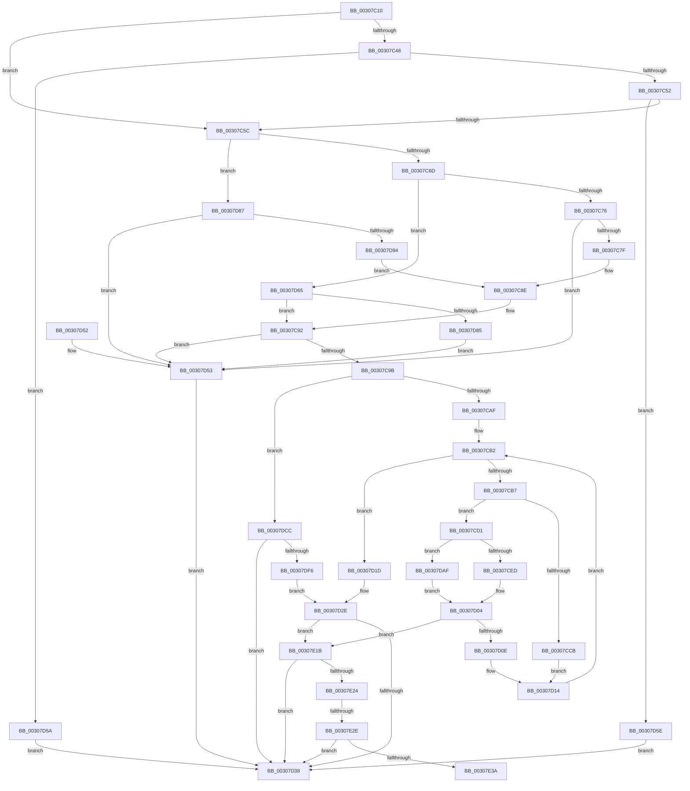

# IommuMapIdentityRangeEx

- RVA: `0x00307C10`–`0x00307E3F` (길이 `559` bytes)
- VA: `0x0000000140307C10`
- 실행 섹션: `.text`
- PDB 이름 있음: `예`; PDB Function 태그: `예`
- unwind 정보 RVA: `0x00073964`
- 디코드: `155`개 명령, `559/559` bytes 표시
- 미해석 바이트: `0` (있으면 어셈블리에 `.byte`로 보존)

> 이 문서는 커널 이미지의 기계어와 PDB 기호를 분석해 생성했습니다. 4번과 5번은 함수 원형과 자료형을 바이너리 사용 방식에서 추정한 C 해석이며 원본 소스 복구 결과는 아닙니다.

## 1. Dependencies

- 직접 호출 지점: **6**; 고유 호출 대상: **6**
- 직접 호출자로 확인된 함수: **0**
- RIP 상대 이미지 참조: **1**

### Outgoing calls
- `0x00307CFF` → [HalpBuddyAllocatorAllocateLogicalAddress](HalpBuddyAllocatorAllocateLogicalAddress_function_00307EE0.md) (function, `0x00307EE0`)
- `0x00307D29` → [HalpIommuDomainMapIdentityRange](../49/HalpIommuDomainMapIdentityRange_function_004986AC.md) (function, `0x004986AC`)
- `0x00307D8B` → [IommupValidateMdl](../56/IommupValidateMdl_function_005689D0.md) (function, `0x005689D0`)
- `0x00307DC2` → [guard_dispatch_icall](../6B/guard_dispatch_icall_function_006BAAD0.md) (function, `0x006BAAD0`)
- `0x00307DE7` → [HalpIommuDomainGetLogicalAddressRange](HalpIommuDomainGetLogicalAddressRange_function_00307E48.md) (function, `0x00307E48`)
- `0x00307E11` → [HalpIommuDomainMapLogicalRange](../55/HalpIommuDomainMapLogicalRange_function_00555064.md) (function, `0x00555064`)

### Direct callers
- 이 함수 시작 RVA로 연결되는 직접 call은 확인되지 않았습니다. 간접 호출은 완전히 역산할 수 없습니다.

### Static image references
- `0x00307CD4` → RVA `0x00307EE0` (`HalpBuddyAllocatorAllocateLogicalAddress`; read)

## 2. Other-region calls and transfers

- 다른 실행 섹션으로 향하는 call: **0**
- call이 아닌 외부 분기/꼬리 이동: **2**
  - `0x00307E28` → [sub_006E0B2E + 0x1F](../6E/Unknown_function_006E0B2E.md) (`tail-transfer`)
  - `0x00307E3A` → [sub_006E0B2E](../6E/Unknown_function_006E0B2E.md) (`tail-transfer`)

## 3. Assembly (complete function range)

```asm
00307C10  48 89 5C 24 18                  mov qword ptr [rsp + 0x18], rbx
00307C15  89 54 24 10                     mov dword ptr [rsp + 0x10], edx
00307C19  55                              push rbp
00307C1A  56                              push rsi
00307C1B  57                              push rdi
00307C1C  41 54                           push r12
00307C1E  41 55                           push r13
00307C20  41 56                           push r14
00307C22  41 57                           push r15
00307C24  48 8B EC                        mov rbp, rsp
00307C27  48 83 EC 50                     sub rsp, 0x50
00307C2B  48 83 65 F0 00                  and qword ptr [rbp - 0x10], 0
00307C30  33 DB                           xor ebx, ebx
00307C32  48 21 5D 58                     and qword ptr [rbp + 0x58], rbx
00307C36  45 33 E4                        xor r12d, r12d
00307C39  44 8B 49 08                     mov r9d, dword ptr [rcx + 8]
00307C3D  45 33 FF                        xor r15d, r15d
00307C40  4C 8B F1                        mov r14, rcx
00307C43  45 85 C9                        test r9d, r9d
00307C46  74 14                           je 0x140307c5c
00307C48  41 83 E9 01                     sub r9d, 1
00307C4C  0F 84 08 01 00 00               je 0x140307d5a
00307C52  41 83 F9 02                     cmp r9d, 2
00307C56  0F 85 02 01 00 00               jne 0x140307d5e
00307C5C  41 8B 08                        mov ecx, dword ptr [r8]
00307C5F  41 BA 00 10 00 00               mov r10d, 0x1000
00307C65  85 C9                           test ecx, ecx
00307C67  0F 84 1A 01 00 00               je 0x140307d87
00307C6D  83 E9 01                        sub ecx, 1
00307C70  0F 84 EF 00 00 00               je 0x140307d65
00307C76  83 F9 01                        cmp ecx, 1
00307C79  0F 85 D4 00 00 00               jne 0x140307d53
00307C7F  49 8B 70 10                     mov rsi, qword ptr [r8 + 0x10]
00307C83  45 32 C9                        xor r9b, r9b
00307C86  4D 8B 60 08                     mov r12, qword ptr [r8 + 8]
00307C8A  48 C1 E6 0C                     shl rsi, 0xc
00307C8E  44 88 4D 40                     mov byte ptr [rbp + 0x40], r9b
00307C92  48 85 F6                        test rsi, rsi
00307C95  0F 84 B8 00 00 00               je 0x140307d53
00307C9B  4C 8B EE                        mov r13, rsi
00307C9E  48 89 5D 58                     mov qword ptr [rbp + 0x58], rbx
00307CA2  49 C1 ED 0C                     shr r13, 0xc
00307CA6  45 84 C9                        test r9b, r9b
00307CA9  0F 85 1D 01 00 00               jne 0x140307dcc
00307CAF  49 8B DC                        mov rbx, r12
00307CB2  45 3B FD                        cmp r15d, r13d
00307CB5  7D 66                           jge 0x140307d1d
00307CB7  48 8B 03                        mov rax, qword ptr [rbx]
00307CBA  49 8B 4E 40                     mov rcx, qword ptr [r14 + 0x40]
00307CBE  48 C1 E0 0C                     shl rax, 0xc
00307CC2  48 89 45 58                     mov qword ptr [rbp + 0x58], rax
00307CC6  48 85 C9                        test rcx, rcx
00307CC9  75 06                           jne 0x140307cd1
00307CCB  48 89 45 F0                     mov qword ptr [rbp - 0x10], rax
00307CCF  EB 43                           jmp 0x140307d14
00307CD1  48 8B 01                        mov rax, qword ptr [rcx]
00307CD4  48 8D 15 05 02 00 00            lea rdx, [rip + 0x205]
00307CDB  45 33 C9                        xor r9d, r9d
00307CDE  4D 8B C2                        mov r8, r10
00307CE1  48 8B 00                        mov rax, qword ptr [rax]
00307CE4  48 3B C2                        cmp rax, rdx
00307CE7  0F 85 C2 00 00 00               jne 0x140307daf
00307CED  48 8D 45 F0                     lea rax, [rbp - 0x10]
00307CF1  48 89 44 24 28                  mov qword ptr [rsp + 0x28], rax
00307CF6  48 8D 55 58                     lea rdx, [rbp + 0x58]
00307CFA  4C 21 4C 24 20                  and qword ptr [rsp + 0x20], r9
00307CFF  E8 DC 01 00 00                  call 0x140307ee0
00307D04  8B F8                           mov edi, eax
00307D06  85 C0                           test eax, eax
00307D08  0F 88 0D 01 00 00               js 0x140307e1b
00307D0E  41 BA 00 10 00 00               mov r10d, 0x1000
00307D14  41 FF C7                        inc r15d
00307D17  48 83 C3 08                     add rbx, 8
00307D1B  EB 95                           jmp 0x140307cb2
00307D1D  8B 55 48                        mov edx, dword ptr [rbp + 0x48]
00307D20  4D 8B CD                        mov r9, r13
00307D23  4D 8B C4                        mov r8, r12
00307D26  49 8B CE                        mov rcx, r14
00307D29  E8 7E 09 19 00                  call 0x1404986ac
00307D2E  8B F8                           mov edi, eax
00307D30  85 C0                           test eax, eax
00307D32  0F 88 E3 00 00 00               js 0x140307e1b
00307D38  48 8B 9C 24 A0 00 00 00         mov rbx, qword ptr [rsp + 0xa0]
00307D40  8B C7                           mov eax, edi
00307D42  48 83 C4 50                     add rsp, 0x50
00307D46  41 5F                           pop r15
00307D48  41 5E                           pop r14
00307D4A  41 5D                           pop r13
00307D4C  41 5C                           pop r12
00307D4E  5F                              pop rdi
00307D4F  5E                              pop rsi
00307D50  5D                              pop rbp
00307D51  C3                              ret
00307D52  CC                              int3
00307D53  BF F1 00 00 C0                  mov edi, 0xc00000f1
00307D58  EB DE                           jmp 0x140307d38
00307D5A  33 FF                           xor edi, edi
00307D5C  EB DA                           jmp 0x140307d38
00307D5E  BF EF 00 00 C0                  mov edi, 0xc00000ef
00307D63  EB D3                           jmp 0x140307d38
00307D65  49 8B 58 08                     mov rbx, qword ptr [r8 + 8]
00307D69  41 B1 01                        mov r9b, 1
00307D6C  49 8B 70 10                     mov rsi, qword ptr [r8 + 0x10]
00307D70  48 8B C3                        mov rax, rbx
00307D73  48 99                           cqo
00307D75  44 88 4D 40                     mov byte ptr [rbp + 0x40], r9b
00307D79  49 F7 FA                        idiv r10
00307D7C  48 85 D2                        test rdx, rdx
00307D7F  0F 84 0D FF FF FF               je 0x140307c92
00307D85  EB CC                           jmp 0x140307d53
00307D87  49 8B 48 08                     mov rcx, qword ptr [r8 + 8]
00307D8B  E8 40 0C 26 00                  call 0x1405689d0
00307D90  84 C0                           test al, al
00307D92  74 BF                           je 0x140307d53
00307D94  44 8B 61 2C                     mov r12d, dword ptr [rcx + 0x2c]
00307D98  45 32 C9                        xor r9b, r9b
00307D9B  8B 71 28                        mov esi, dword ptr [rcx + 0x28]
00307D9E  49 C1 EC 0C                     shr r12, 0xc
00307DA2  49 83 C4 06                     add r12, 6
00307DA6  4E 8D 24 E1                     lea r12, [rcx + r12*8]
00307DAA  E9 DF FE FF FF                  jmp 0x140307c8e
00307DAF  48 8D 55 F0                     lea rdx, [rbp - 0x10]
00307DB3  48 89 54 24 28                  mov qword ptr [rsp + 0x28], rdx
00307DB8  48 8D 55 58                     lea rdx, [rbp + 0x58]
00307DBC  48 83 64 24 20 00               and qword ptr [rsp + 0x20], 0
00307DC2  E8 09 2D 3B 00                  call 0x1406baad0
00307DC7  E9 38 FF FF FF                  jmp 0x140307d04
00307DCC  48 8D 45 F0                     lea rax, [rbp - 0x10]
00307DD0  45 33 C9                        xor r9d, r9d
00307DD3  48 89 44 24 28                  mov qword ptr [rsp + 0x28], rax
00307DD8  48 8D 55 58                     lea rdx, [rbp + 0x58]
00307DDC  4C 21 7C 24 20                  and qword ptr [rsp + 0x20], r15
00307DE1  4C 8B C6                        mov r8, rsi
00307DE4  49 8B CE                        mov rcx, r14
00307DE7  E8 5C 00 00 00                  call 0x140307e48
00307DEC  8B F8                           mov edi, eax
00307DEE  85 C0                           test eax, eax
00307DF0  0F 88 42 FF FF FF               js 0x140307d38
00307DF6  48 8B 45 58                     mov rax, qword ptr [rbp + 0x58]
00307DFA  4C 8B CE                        mov r9, rsi
00307DFD  8B 55 48                        mov edx, dword ptr [rbp + 0x48]
00307E00  4C 8B C3                        mov r8, rbx
00307E03  49 8B CE                        mov rcx, r14
00307E06  48 89 44 24 20                  mov qword ptr [rsp + 0x20], rax
00307E0B  41 BF 01 00 00 00               mov r15d, 1
00307E11  E8 4E D2 24 00                  call 0x140555064
00307E16  E9 13 FF FF FF                  jmp 0x140307d2e
00307E1B  45 85 FF                        test r15d, r15d
00307E1E  0F 8E 14 FF FF FF               jle 0x140307d38
00307E24  80 7D 40 00                     cmp byte ptr [rbp + 0x40], 0
00307E28  0F 85 1F 8D 3D 00               jne 0x1406e0b4d
00307E2E  49 63 DF                        movsxd rbx, r15d
00307E31  45 85 FF                        test r15d, r15d
00307E34  0F 88 FE FE FF FF               js 0x140307d38
00307E3A  E9 EF 8C 3D 00                  jmp 0x1406e0b2e
```

## 4. C-style interpretation (structured pseudocode)

```c
__int64 __fastcall IommuMapIdentityRangeEx(__int64 a1, int a2, __int64 a3)
{
    __int64 result;
    __int64 v_r12;
    __int64 v_r13;
    __int64 v_r15;
    __int64 v_rbx;
    __int64 v_rdi;
    __int64 v_rsi;
    __int64 v_rsp;
    unsigned __int64 v_stack_m48;
    unsigned __int64 v_stack_m60;
    unsigned __int64 v_stack_m68;
    unsigned int v_stack_p10;
    unsigned __int64 v_stack_p18;
    unsigned __int64 v_stack_p20;
    unsigned __int64 v_stack_p28;
    unsigned __int8 v_stack_p8;

    v_stack_p18 = v_rbx;
    v_stack_p10 = a2;
    v_rsp = (v_rsp) - (80);
    v_rbx = 0;
    v_r12 = 0;
    v_r15 = 0;
    if ((unsigned int)((unsigned int)(*(unsigned int *)(a1 + 8))) == 0) goto loc_00307C5C;
    a4 = (unsigned int)(((unsigned int)(*(unsigned int *)(a1 + 8))) - (1));
    if (condition_is_equal) goto loc_00307D5A;
    if (((unsigned int)(a4)) != 2) goto loc_00307D5E;
loc_00307C5C:
    if ((unsigned int)((unsigned int)(*(unsigned int *)(a3))) == 0) goto loc_00307D87;
    a1 = (unsigned int)(((unsigned int)(*(unsigned int *)(a3))) - (1));
    if (condition_is_equal) goto loc_00307D65;
    if (((unsigned int)(a1)) != 1) goto loc_00307D53;
    a4 = 0;
    v_rsi = (*(unsigned __int64 *)(a3 + 16)) << (12);
loc_00307C8E:
    v_stack_p8 = 0;
loc_00307C92:
    if (v_rsi == 0) goto loc_00307D53;
    v_stack_p20 = 0;
    v_r13 = (v_rsi) >> (12);
    if (0 != 0) goto loc_00307DCC;
loc_00307CB2:
    if (0 >= ((unsigned int)(v_r13))) goto loc_00307D1D;
    result = (*(unsigned __int64 *)(*(unsigned __int64 *)(a3 + 8))) << (12);
    v_stack_p20 = result;
    if (*(unsigned __int64 *)(a1 + 64) != 0) goto loc_00307CD1;
    v_stack_m48 = result;
    goto loc_00307D14;
loc_00307CD1:
    a4 = 0;
    if ((*(unsigned __int64 *)(*(unsigned __int64 *)(*(unsigned __int64 *)(a1 + 64)))) != (v_rip + 517)) goto loc_00307DAF;
    v_stack_m60 = v_stack_m48;
    result = HalpBuddyAllocatorAllocateLogicalAddress(*(unsigned __int64 *)(a1 + 64), v_stack_p20, (unsigned int)(0x1000ULL), a4);
loc_00307D04:
    if (sign_flag) goto loc_00307E1B;
loc_00307D14:
    v_r15 = (unsigned int)((v_r15) + 1);
    v_rbx = (*(unsigned __int64 *)(a3 + 8)) + (8);
    goto loc_00307CB2;
loc_00307D1D:
    result = HalpIommuDomainMapIdentityRange(a1, (unsigned int)(v_stack_p10), *(unsigned __int64 *)(a3 + 8), v_r13);
loc_00307D2E:
    if (sign_flag) goto loc_00307E1B;
loc_00307D38:
    v_rsp = (v_rsp) + (80);
    return (unsigned int)((unsigned int)((unsigned int)((unsigned int)(result))));
loc_00307D53:
    goto loc_00307D38;
loc_00307D5A:
    v_rdi = 0;
    goto loc_00307D38;
loc_00307D5E:
    goto loc_00307D38;
loc_00307D65:
    v_stack_p8 = 1;
    if ((unsigned int)(v_stack_p10) == 0) goto loc_00307C92;
    goto loc_00307D53;
loc_00307D87:
    result = IommupValidateMdl(*(unsigned __int64 *)(*(unsigned __int64 *)(a3 + 8) + 8), (unsigned int)(v_stack_p10), *(unsigned __int64 *)(a3 + 8), 1);
    if ((unsigned __int8)(result) == 0) goto loc_00307D53;
    a4 = 0;
    v_r12 = ((unsigned int)(*(unsigned int *)(*(unsigned __int64 *)(*(unsigned __int64 *)(a3 + 8) + 8) + 44))) >> (12);
    v_r12 = (v_r12) + (6);
    goto loc_00307C8E;
loc_00307DAF:
    v_stack_p28 = v_stack_m48;
    result = guard_dispatch_icall(*(unsigned __int64 *)(*(unsigned __int64 *)(a3 + 8) + 8), v_stack_p20, *(unsigned __int64 *)(a3 + 8), a4);
    goto loc_00307D04;
loc_00307DCC:
    a4 = 0;
    v_stack_p28 = v_stack_m48;
    result = HalpIommuDomainGetLogicalAddressRange(a1, v_stack_p20, (unsigned int)(*(unsigned int *)(*(unsigned __int64 *)(*(unsigned __int64 *)(a3 + 8) + 8) + 40)), a4);
    if (sign_flag) goto loc_00307D38;
    v_stack_p20 = v_stack_p20;
    result = HalpIommuDomainMapLogicalRange(a1, (unsigned int)(v_stack_p10), *(unsigned __int64 *)(*(unsigned __int64 *)(a3 + 8) + 8), (unsigned int)(*(unsigned int *)(*(unsigned __int64 *)(*(unsigned __int64 *)(a3 + 8) + 8) + 40)));
    goto loc_00307D2E;
loc_00307E1B:
    if (condition_is_less_or_equal) goto loc_00307D38;
    if (sign_flag) goto loc_00307D38;
}
```

## 5. (Beta) C Style

```c
int64_t IommuMapIdentityRangeEx(void *Arg1, int32_t Arg2, void *Arg3)
{
    uint8_t *arg1 = (uint8_t *)Arg1;
    uint8_t *arg3 = (uint8_t *)Arg3;

    int64_t result;
    int64_t local_r12;
    int64_t local_r13;
    int64_t local_r15;
    int64_t local_rbx;
    int64_t local_rdi;
    int64_t local_rsi;
    int64_t local_rsp;
    uint64_t v_stack_m48;
    uint64_t v_stack_m60;
    uint64_t v_stack_m68;
    uint32_t v_stack_p10;
    uint64_t v_stack_p18;
    uint64_t v_stack_p20;
    uint64_t v_stack_p28;
    uint8_t v_stack_p8;

    v_stack_p18 = local_rbx;
    v_stack_p10 = Arg2;
    local_rsp = (local_rsp) - (80);
    local_rbx = 0;
    local_r12 = 0;
    local_r15 = 0;
    if ((uint32_t)((uint32_t)(*(uint32_t *)(arg1 + 0x8))) == 0) goto loc_00307C5C;
    a4 = (uint32_t)(((uint32_t)(*(uint32_t *)(arg1 + 0x8))) - (1));
    if (condition_is_equal) goto loc_00307D5A;
    if (((uint32_t)(a4)) != 2) goto loc_00307D5E;
loc_00307C5C:
    if ((uint32_t)((uint32_t)(*(uint32_t *)(arg3))) == 0) goto loc_00307D87;
    Arg1 = (uint32_t)(((uint32_t)(*(uint32_t *)(arg3))) - (1));
    if (condition_is_equal) goto loc_00307D65;
    if (((uint32_t)(Arg1)) != 1) goto loc_00307D53;
    a4 = 0;
    local_rsi = (*(uint64_t *)(arg3 + 0x10)) << (12);
loc_00307C8E:
    v_stack_p8 = 0;
loc_00307C92:
    if (local_rsi == 0) goto loc_00307D53;
    v_stack_p20 = 0;
    local_r13 = (local_rsi) >> (12);
    if (0 != 0) goto loc_00307DCC;
loc_00307CB2:
    if (0 >= ((uint32_t)(local_r13))) goto loc_00307D1D;
    result = (*(uint64_t *)(*(uint64_t *)(arg3 + 0x8))) << (12);
    v_stack_p20 = result;
    if (*(uint64_t *)(arg1 + 0x40) != 0) goto loc_00307CD1;
    v_stack_m48 = result;
    goto loc_00307D14;
loc_00307CD1:
    a4 = 0;
    if ((*(uint64_t *)(*(uint64_t *)(*(uint64_t *)(arg1 + 0x40)))) != (v_rip + 517)) goto loc_00307DAF;
    v_stack_m60 = v_stack_m48;
    result = HalpBuddyAllocatorAllocateLogicalAddress(*(uint64_t *)(arg1 + 0x40), v_stack_p20, (uint32_t)(0x1000ULL), a4);
loc_00307D04:
    if (sign_flag) goto loc_00307E1B;
loc_00307D14:
    local_r15 = (uint32_t)((local_r15) + 1);
    local_rbx = (*(uint64_t *)(arg3 + 0x8)) + (8);
    goto loc_00307CB2;
loc_00307D1D:
    result = HalpIommuDomainMapIdentityRange(Arg1, (uint32_t)(v_stack_p10), *(uint64_t *)(arg3 + 0x8), local_r13);
loc_00307D2E:
    if (sign_flag) goto loc_00307E1B;
loc_00307D38:
    local_rsp = (local_rsp) + (80);
    return (uint32_t)((uint32_t)((uint32_t)((uint32_t)(result))));
loc_00307D53:
    goto loc_00307D38;
loc_00307D5A:
    local_rdi = 0;
    goto loc_00307D38;
loc_00307D5E:
    goto loc_00307D38;
loc_00307D65:
    v_stack_p8 = 1;
    if ((uint32_t)(v_stack_p10) == 0) goto loc_00307C92;
    goto loc_00307D53;
loc_00307D87:
    result = IommupValidateMdl(*(uint64_t *)(*(uint64_t *)(arg3 + 0x8) + 0x8), (uint32_t)(v_stack_p10), *(uint64_t *)(arg3 + 0x8), 1);
    if ((uint8_t)(result) == 0) goto loc_00307D53;
    a4 = 0;
    local_r12 = ((uint32_t)(*(uint32_t *)(*(uint64_t *)(*(uint64_t *)(arg3 + 0x8) + 0x8) + 0x2C))) >> (12);
    local_r12 = (local_r12) + (6);
    goto loc_00307C8E;
loc_00307DAF:
    v_stack_p28 = v_stack_m48;
    result = guard_dispatch_icall(*(uint64_t *)(*(uint64_t *)(arg3 + 0x8) + 0x8), v_stack_p20, *(uint64_t *)(arg3 + 0x8), a4);
    goto loc_00307D04;
loc_00307DCC:
    a4 = 0;
    v_stack_p28 = v_stack_m48;
    result = HalpIommuDomainGetLogicalAddressRange(Arg1, v_stack_p20, (uint32_t)(*(uint32_t *)(*(uint64_t *)(*(uint64_t *)(arg3 + 0x8) + 0x8) + 0x28)), a4);
    if (sign_flag) goto loc_00307D38;
    v_stack_p20 = v_stack_p20;
    result = HalpIommuDomainMapLogicalRange(Arg1, (uint32_t)(v_stack_p10), *(uint64_t *)(*(uint64_t *)(arg3 + 0x8) + 0x8), (uint32_t)(*(uint32_t *)(*(uint64_t *)(*(uint64_t *)(arg3 + 0x8) + 0x8) + 0x28)));
    goto loc_00307D2E;
loc_00307E1B:
    if (condition_is_less_or_equal) goto loc_00307D38;
    if (sign_flag) goto loc_00307D38;
}
```

### 관측된 메모리 오프셋

구조체 형식이 확인되지 않은 접근은 인자 기준의 오프셋으로만 기록했습니다.

| 기준 인자 | 오프셋 표현 | 폭 (bit) | 접근 |
|---|---:|---:|---|
| `Arg1` | `+ 0x8` | `32` | `R` |
| `Arg1` | `+ 0x40` | `64` | `R` |
| `Arg3` | `+ 0x0` | `32` | `R` |
| `Arg3` | `+ 0x8` | `64` | `R` |
| `Arg3` | `+ 0x10` | `64` | `R` |

## 6. Execution-region graph

[열기: 2D/3D 그래프와 함수 탐색 컨트롤 패널](../../../control-panel.html?section=text&rva=0x00307C10&view=graph)

- 2D 그래프는 위에서 아래로 흐르고, 3D 그래프는 빈 공간을 드래그해 회전합니다. Shift+드래그는 이동, 휠은 확대·축소, 함수 노드 선택은 대상 보고서 이동입니다.

### Static fallback


