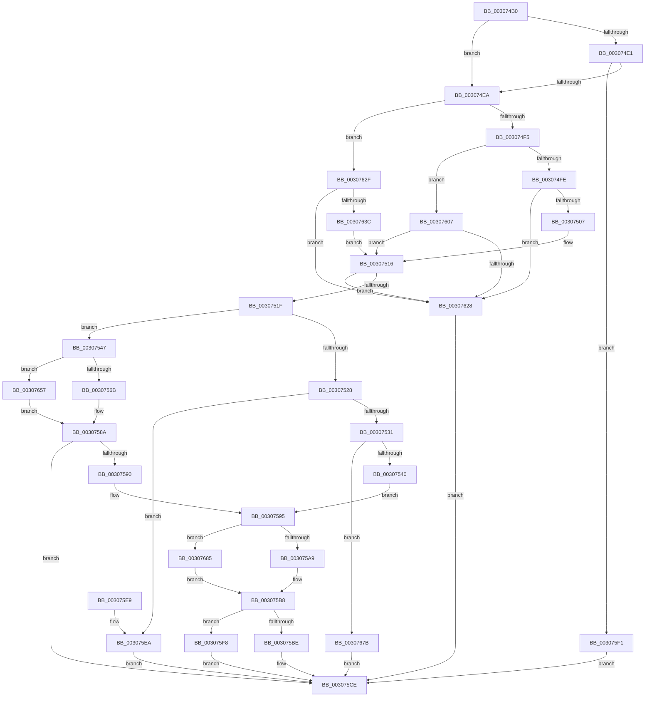

# IommuMapLogicalRangeEx

- RVA: `0x003074B0`–`0x00307695` (길이 `485` bytes)
- VA: `0x00000001403074B0`
- 실행 섹션: `.text`
- PDB 이름 있음: `예`; PDB Function 태그: `아니요`
- unwind 정보 RVA: `0x000738D8`
- 디코드: `130`개 명령, `485/485` bytes 표시
- 미해석 바이트: `0` (있으면 어셈블리에 `.byte`로 보존)

> 이 문서는 커널 이미지의 기계어와 PDB 기호를 분석해 생성했습니다. 4번과 5번은 함수 원형과 자료형을 바이너리 사용 방식에서 추정한 C 해석이며 원본 소스 복구 결과는 아닙니다.

## 1. Dependencies

- 직접 호출 지점: **6**; 고유 호출 대상: **6**
- 직접 호출자로 확인된 함수: **0**
- RIP 상대 이미지 참조: **1**

### Outgoing calls
- `0x00307585` → [HalpBuddyAllocatorAllocateLogicalAddress](HalpBuddyAllocatorAllocateLogicalAddress_function_00307EE0.md) (function, `0x00307EE0`)
- `0x003075B3` → [HalpIommuDomainMapLogical](HalpIommuDomainMapLogical_function_0030769C.md) (function, `0x0030769C`)
- `0x00307600` → [HalpIommuDomainFreeLogicalAddressRange](HalpIommuDomainFreeLogicalAddressRange_function_003070EC.md) (function, `0x003070EC`)
- `0x00307633` → [IommupValidateMdl](../56/IommupValidateMdl_function_005689D0.md) (function, `0x005689D0`)
- `0x00307671` → [guard_dispatch_icall](../6B/guard_dispatch_icall_function_006BAAD0.md) (function, `0x006BAAD0`)
- `0x0030768B` → [HalpIommuDomainMapLogicalRange](../55/HalpIommuDomainMapLogicalRange_function_00555064.md) (function, `0x00555064`)

### Direct callers
- 이 함수 시작 RVA로 연결되는 직접 call은 확인되지 않았습니다. 간접 호출은 완전히 역산할 수 없습니다.

### Static image references
- `0x0030754A` → RVA `0x00307EE0` (`HalpBuddyAllocatorAllocateLogicalAddress`; read)

## 2. Other-region calls and transfers

- 다른 실행 섹션으로 향하는 call: **0**
- 별도 외부 분기/꼬리 이동을 확인하지 못했습니다.

## 3. Assembly (complete function range)

```asm
003074B0  48 89 5C 24 10                  mov qword ptr [rsp + 0x10], rbx
003074B5  48 89 6C 24 18                  mov qword ptr [rsp + 0x18], rbp
003074BA  56                              push rsi
003074BB  57                              push rdi
003074BC  41 54                           push r12
003074BE  41 56                           push r14
003074C0  41 57                           push r15
003074C2  48 83 EC 40                     sub rsp, 0x40
003074C6  48 83 64 24 70 00               and qword ptr [rsp + 0x70], 0
003074CC  33 DB                           xor ebx, ebx
003074CE  8B 41 08                        mov eax, dword ptr [rcx + 8]
003074D1  45 33 FF                        xor r15d, r15d
003074D4  4D 8B D9                        mov r11, r9
003074D7  44 8B E2                        mov r12d, edx
003074DA  48 8B E9                        mov rbp, rcx
003074DD  85 C0                           test eax, eax
003074DF  74 09                           je 0x1403074ea
003074E1  83 F8 03                        cmp eax, 3
003074E4  0F 85 07 01 00 00               jne 0x1403075f1
003074EA  41 8B 08                        mov ecx, dword ptr [r8]
003074ED  85 C9                           test ecx, ecx
003074EF  0F 84 3A 01 00 00               je 0x14030762f
003074F5  83 E9 01                        sub ecx, 1
003074F8  0F 84 09 01 00 00               je 0x140307607
003074FE  83 F9 01                        cmp ecx, 1
00307501  0F 85 21 01 00 00               jne 0x140307628
00307507  49 8B 70 10                     mov rsi, qword ptr [r8 + 0x10]
0030750B  45 32 F6                        xor r14b, r14b
0030750E  4D 8B 78 08                     mov r15, qword ptr [r8 + 8]
00307512  48 C1 E6 0C                     shl rsi, 0xc
00307516  48 85 F6                        test rsi, rsi
00307519  0F 84 09 01 00 00               je 0x140307628
0030751F  4C 8B 55 40                     mov r10, qword ptr [rbp + 0x40]
00307523  4D 85 D2                        test r10, r10
00307526  75 1F                           jne 0x140307547
00307528  4D 85 DB                        test r11, r11
0030752B  0F 84 B9 00 00 00               je 0x1403075ea
00307531  49 8B 01                        mov rax, qword ptr [r9]
00307534  48 A9 FF 0F 00 00               test rax, 0xfff
0030753A  0F 85 3B 01 00 00               jne 0x14030767b
00307540  48 89 44 24 70                  mov qword ptr [rsp + 0x70], rax
00307545  EB 4E                           jmp 0x140307595
00307547  49 8B 02                        mov rax, qword ptr [r10]
0030754A  48 8D 0D 8F 09 00 00            lea rcx, [rip + 0x98f]
00307551  4C 8B 8C 24 90 00 00 00         mov r9, qword ptr [rsp + 0x90]
00307559  4C 8B C6                        mov r8, rsi
0030755C  49 8B D3                        mov rdx, r11
0030755F  48 8B 00                        mov rax, qword ptr [rax]
00307562  48 3B C1                        cmp rax, rcx
00307565  0F 85 EC 00 00 00               jne 0x140307657
0030756B  48 8D 44 24 70                  lea rax, [rsp + 0x70]
00307570  49 8B CA                        mov rcx, r10
00307573  48 89 44 24 28                  mov qword ptr [rsp + 0x28], rax
00307578  48 8B 84 24 98 00 00 00         mov rax, qword ptr [rsp + 0x98]
00307580  48 89 44 24 20                  mov qword ptr [rsp + 0x20], rax
00307585  E8 56 09 00 00                  call 0x140307ee0
0030758A  8B F8                           mov edi, eax
0030758C  85 C0                           test eax, eax
0030758E  78 3E                           js 0x1403075ce
00307590  48 8B 44 24 70                  mov rax, qword ptr [rsp + 0x70]
00307595  48 89 44 24 20                  mov qword ptr [rsp + 0x20], rax
0030759A  41 8B D4                        mov edx, r12d
0030759D  48 8B CD                        mov rcx, rbp
003075A0  45 84 F6                        test r14b, r14b
003075A3  0F 85 DC 00 00 00               jne 0x140307685
003075A9  48 C1 EE 0C                     shr rsi, 0xc
003075AD  4D 8B C7                        mov r8, r15
003075B0  4C 8B CE                        mov r9, rsi
003075B3  E8 E4 00 00 00                  call 0x14030769c
003075B8  8B F8                           mov edi, eax
003075BA  85 C0                           test eax, eax
003075BC  78 3A                           js 0x1403075f8
003075BE  48 8B 8C 24 A0 00 00 00         mov rcx, qword ptr [rsp + 0xa0]
003075C6  48 8B 44 24 70                  mov rax, qword ptr [rsp + 0x70]
003075CB  48 89 01                        mov qword ptr [rcx], rax
003075CE  4C 8D 5C 24 40                  lea r11, [rsp + 0x40]
003075D3  8B C7                           mov eax, edi
003075D5  49 8B 5B 38                     mov rbx, qword ptr [r11 + 0x38]
003075D9  49 8B 6B 40                     mov rbp, qword ptr [r11 + 0x40]
003075DD  49 8B E3                        mov rsp, r11
003075E0  41 5F                           pop r15
003075E2  41 5E                           pop r14
003075E4  41 5C                           pop r12
003075E6  5F                              pop rdi
003075E7  5E                              pop rsi
003075E8  C3                              ret
003075E9  CC                              int3
003075EA  BF BB 00 00 C0                  mov edi, 0xc00000bb
003075EF  EB DD                           jmp 0x1403075ce
003075F1  BF EF 00 00 C0                  mov edi, 0xc00000ef
003075F6  EB D6                           jmp 0x1403075ce
003075F8  48 8B 54 24 70                  mov rdx, qword ptr [rsp + 0x70]
003075FD  48 8B CD                        mov rcx, rbp
00307600  E8 E7 FA FF FF                  call 0x1403070ec
00307605  EB C7                           jmp 0x1403075ce
00307607  49 8B 58 08                     mov rbx, qword ptr [r8 + 8]
0030760B  B9 00 10 00 00                  mov ecx, 0x1000
00307610  49 8B 70 10                     mov rsi, qword ptr [r8 + 0x10]
00307614  48 8B C3                        mov rax, rbx
00307617  48 99                           cqo
00307619  41 B6 01                        mov r14b, 1
0030761C  48 F7 F9                        idiv rcx
0030761F  48 85 D2                        test rdx, rdx
00307622  0F 84 EE FE FF FF               je 0x140307516
00307628  BF F1 00 00 C0                  mov edi, 0xc00000f1
0030762D  EB 9F                           jmp 0x1403075ce
0030762F  49 8B 48 08                     mov rcx, qword ptr [r8 + 8]
00307633  E8 98 13 26 00                  call 0x1405689d0
00307638  84 C0                           test al, al
0030763A  74 EC                           je 0x140307628
0030763C  44 8B 79 2C                     mov r15d, dword ptr [rcx + 0x2c]
00307640  45 32 F6                        xor r14b, r14b
00307643  8B 71 28                        mov esi, dword ptr [rcx + 0x28]
00307646  49 C1 EF 0C                     shr r15, 0xc
0030764A  49 83 C7 06                     add r15, 6
0030764E  4E 8D 3C F9                     lea r15, [rcx + r15*8]
00307652  E9 BF FE FF FF                  jmp 0x140307516
00307657  48 8D 4C 24 70                  lea rcx, [rsp + 0x70]
0030765C  48 89 4C 24 28                  mov qword ptr [rsp + 0x28], rcx
00307661  48 8B 8C 24 98 00 00 00         mov rcx, qword ptr [rsp + 0x98]
00307669  48 89 4C 24 20                  mov qword ptr [rsp + 0x20], rcx
0030766E  49 8B CA                        mov rcx, r10
00307671  E8 5A 34 3B 00                  call 0x1406baad0
00307676  E9 0F FF FF FF                  jmp 0x14030758a
0030767B  BF F0 00 00 C0                  mov edi, 0xc00000f0
00307680  E9 49 FF FF FF                  jmp 0x1403075ce
00307685  4C 8B CE                        mov r9, rsi
00307688  4C 8B C3                        mov r8, rbx
0030768B  E8 D4 D9 24 00                  call 0x140555064
00307690  E9 23 FF FF FF                  jmp 0x1403075b8
```

## 4. C-style interpretation (structured pseudocode)

```c
__int64 __fastcall IommuMapLogicalRangeEx(__int64 a1, int a2, __int64 a3, __int64 a4, __int64 a5, __int64 a6, __int64 a7)
{
    __int64 result;
    __int64 v_r14;
    __int64 v_r15;
    __int64 v_rbx;
    __int64 v_rsi;
    __int64 v_rsp;
    unsigned __int64 v_stack_m18;
    unsigned __int64 v_stack_m20;
    unsigned __int64 v_stack_m28;
    unsigned __int64 v_stack_m40;
    unsigned __int64 v_stack_m48;
    unsigned __int64 v_stack_p10;
    unsigned __int64 v_stack_p18;
    unsigned __int64 v_stack_p30;
    unsigned __int64 v_stack_p8;

    v_stack_p10 = v_rbx;
    v_stack_p18 = v_rbp;
    v_rsp = (v_rsp) - (64);
    v_rbx = 0;
    v_r15 = 0;
    if ((unsigned int)((unsigned int)(*(unsigned int *)(a1 + 8))) == 0) goto loc_003074EA;
    if (((unsigned int)((unsigned int)(*(unsigned int *)(a1 + 8)))) != 3) goto loc_003075F1;
loc_003074EA:
    if ((unsigned int)((unsigned int)(*(unsigned int *)(a3))) == 0) goto loc_0030762F;
    a1 = (unsigned int)(((unsigned int)(*(unsigned int *)(a3))) - (1));
    if (condition_is_equal) goto loc_00307607;
    if (((unsigned int)(a1)) != 1) goto loc_00307628;
    v_r14 = 0;
    v_rsi = (*(unsigned __int64 *)(a3 + 16)) << (12);
loc_00307516:
    if (v_rsi == 0) goto loc_00307628;
    if (*(unsigned __int64 *)(a1 + 64) != 0) goto loc_00307547;
    if (a4 == 0) goto loc_003075EA;
    if (((*(unsigned __int64 *)(a4)) & (0xFFFULL)) != 0) goto loc_0030767B;
    v_stack_p8 = *(unsigned __int64 *)(a4);
    goto loc_00307595;
loc_00307547:
    if ((*(unsigned __int64 *)(*(unsigned __int64 *)(*(unsigned __int64 *)(a1 + 64)))) != (v_rip + 2447)) goto loc_00307657;
    v_stack_m40 = v_stack_p8;
    v_stack_m48 = a6;
    result = HalpBuddyAllocatorAllocateLogicalAddress(*(unsigned __int64 *)(a1 + 64), a4, v_rsi, a5);
loc_0030758A:
    if (sign_flag) goto loc_003075CE;
loc_00307595:
    v_stack_m48 = v_stack_p8;
    if (0 != 0) goto loc_00307685;
    v_rsi = (v_rsi) >> (12);
    result = HalpIommuDomainMapLogical(a1, (unsigned int)((unsigned int)((unsigned int)(a2))), *(unsigned __int64 *)(a3 + 8), v_rsi);
loc_003075B8:
    if (sign_flag) goto loc_003075F8;
    *(unsigned __int64 *)(a7) = v_stack_p8;
loc_003075CE:
    return (unsigned int)((unsigned int)((unsigned int)((unsigned int)(result))));
loc_003075EA:
    goto loc_003075CE;
loc_003075F1:
    goto loc_003075CE;
loc_003075F8:
    result = HalpIommuDomainFreeLogicalAddressRange(*(unsigned __int64 *)(v_stack_m28 + 64), v_stack_p30, *(unsigned __int64 *)(a3 + 8), v_rsi);
    goto loc_003075CE;
loc_00307607:
    if (v_stack_p30 == 0) goto loc_00307516;
loc_00307628:
    goto loc_003075CE;
loc_0030762F:
    result = IommupValidateMdl(*(unsigned __int64 *)(*(unsigned __int64 *)(a3 + 8) + 8), v_stack_p30, *(unsigned __int64 *)(a3 + 8), v_rsi);
    if ((unsigned __int8)(result) == 0) goto loc_00307628;
    v_r14 = 0;
    v_r15 = ((unsigned int)(*(unsigned int *)(*(unsigned __int64 *)(*(unsigned __int64 *)(a3 + 8) + 8) + 44))) >> (12);
    v_r15 = (v_r15) + (6);
    goto loc_00307516;
loc_00307657:
    v_stack_m18 = v_stack_p30;
    v_stack_m20 = a6;
    result = guard_dispatch_icall(*(unsigned __int64 *)(a1 + 64), v_stack_p30, *(unsigned __int64 *)(a3 + 8), v_rsi);
    goto loc_0030758A;
loc_0030767B:
    goto loc_003075CE;
loc_00307685:
    result = HalpIommuDomainMapLogicalRange(*(unsigned __int64 *)(a1 + 64), v_stack_p30, *(unsigned __int64 *)(*(unsigned __int64 *)(a3 + 8) + 8), (unsigned int)(*(unsigned int *)(*(unsigned __int64 *)(*(unsigned __int64 *)(a3 + 8) + 8) + 40)));
    goto loc_003075B8;
}
```

## 5. (Beta) C Style

```c
int64_t IommuMapLogicalRangeEx(void *Arg1, int32_t Arg2, void *Arg3, int64_t Arg4, int64_t Arg5, int64_t Arg6, void *Arg7)
{
    uint8_t *arg1 = (uint8_t *)Arg1;
    uint8_t *arg3 = (uint8_t *)Arg3;
    uint8_t *arg7 = (uint8_t *)Arg7;

    int64_t result;
    int64_t local_r14;
    int64_t local_r15;
    int64_t local_rbx;
    int64_t local_rsi;
    int64_t local_rsp;
    uint64_t v_stack_m18;
    uint64_t v_stack_m20;
    uint64_t v_stack_m28;
    uint64_t v_stack_m40;
    uint64_t v_stack_m48;
    uint64_t v_stack_p10;
    uint64_t v_stack_p18;
    uint64_t v_stack_p30;
    uint64_t v_stack_p8;

    v_stack_p10 = local_rbx;
    v_stack_p18 = local_rbp;
    local_rsp = (local_rsp) - (64);
    local_rbx = 0;
    local_r15 = 0;
    if ((uint32_t)((uint32_t)(*(uint32_t *)(arg1 + 0x8))) == 0) goto loc_003074EA;
    if (((uint32_t)((uint32_t)(*(uint32_t *)(arg1 + 0x8)))) != 3) goto loc_003075F1;
loc_003074EA:
    if ((uint32_t)((uint32_t)(*(uint32_t *)(arg3))) == 0) goto loc_0030762F;
    Arg1 = (uint32_t)(((uint32_t)(*(uint32_t *)(arg3))) - (1));
    if (condition_is_equal) goto loc_00307607;
    if (((uint32_t)(Arg1)) != 1) goto loc_00307628;
    local_r14 = 0;
    local_rsi = (*(uint64_t *)(arg3 + 0x10)) << (12);
loc_00307516:
    if (local_rsi == 0) goto loc_00307628;
    if (*(uint64_t *)(arg1 + 0x40) != 0) goto loc_00307547;
    if (Arg4 == 0) goto loc_003075EA;
    if (((*(uint64_t *)(Arg4)) & (0xFFFULL)) != 0) goto loc_0030767B;
    v_stack_p8 = *(uint64_t *)(Arg4);
    goto loc_00307595;
loc_00307547:
    if ((*(uint64_t *)(*(uint64_t *)(*(uint64_t *)(arg1 + 0x40)))) != (v_rip + 2447)) goto loc_00307657;
    v_stack_m40 = v_stack_p8;
    v_stack_m48 = Arg6;
    result = HalpBuddyAllocatorAllocateLogicalAddress(*(uint64_t *)(arg1 + 0x40), Arg4, local_rsi, Arg5);
loc_0030758A:
    if (sign_flag) goto loc_003075CE;
loc_00307595:
    v_stack_m48 = v_stack_p8;
    if (0 != 0) goto loc_00307685;
    local_rsi = (local_rsi) >> (12);
    result = HalpIommuDomainMapLogical(Arg1, (uint32_t)((uint32_t)((uint32_t)(Arg2))), *(uint64_t *)(arg3 + 0x8), local_rsi);
loc_003075B8:
    if (sign_flag) goto loc_003075F8;
    *(uint64_t *)(arg7) = v_stack_p8;
loc_003075CE:
    return (uint32_t)((uint32_t)((uint32_t)((uint32_t)(result))));
loc_003075EA:
    goto loc_003075CE;
loc_003075F1:
    goto loc_003075CE;
loc_003075F8:
    result = HalpIommuDomainFreeLogicalAddressRange(*(uint64_t *)(v_stack_m28 + 0x40), v_stack_p30, *(uint64_t *)(arg3 + 0x8), local_rsi);
    goto loc_003075CE;
loc_00307607:
    if (v_stack_p30 == 0) goto loc_00307516;
loc_00307628:
    goto loc_003075CE;
loc_0030762F:
    result = IommupValidateMdl(*(uint64_t *)(*(uint64_t *)(arg3 + 0x8) + 0x8), v_stack_p30, *(uint64_t *)(arg3 + 0x8), local_rsi);
    if ((uint8_t)(result) == 0) goto loc_00307628;
    local_r14 = 0;
    local_r15 = ((uint32_t)(*(uint32_t *)(*(uint64_t *)(*(uint64_t *)(arg3 + 0x8) + 0x8) + 0x2C))) >> (12);
    local_r15 = (local_r15) + (6);
    goto loc_00307516;
loc_00307657:
    v_stack_m18 = v_stack_p30;
    v_stack_m20 = Arg6;
    result = guard_dispatch_icall(*(uint64_t *)(arg1 + 0x40), v_stack_p30, *(uint64_t *)(arg3 + 0x8), local_rsi);
    goto loc_0030758A;
loc_0030767B:
    goto loc_003075CE;
loc_00307685:
    result = HalpIommuDomainMapLogicalRange(*(uint64_t *)(arg1 + 0x40), v_stack_p30, *(uint64_t *)(*(uint64_t *)(arg3 + 0x8) + 0x8), (uint32_t)(*(uint32_t *)(*(uint64_t *)(*(uint64_t *)(arg3 + 0x8) + 0x8) + 0x28)));
    goto loc_003075B8;
}
```

### 관측된 메모리 오프셋

구조체 형식이 확인되지 않은 접근은 인자 기준의 오프셋으로만 기록했습니다.

| 기준 인자 | 오프셋 표현 | 폭 (bit) | 접근 |
|---|---:|---:|---|
| `Arg1` | `+ 0x8` | `32` | `R` |
| `Arg1` | `+ 0x40` | `64` | `R` |
| `Arg3` | `+ 0x0` | `32` | `R` |
| `Arg3` | `+ 0x8` | `64` | `R` |
| `Arg3` | `+ 0x10` | `64` | `R` |
| `Arg7` | `+ 0x0` | `64` | `W` |

## 6. Execution-region graph

[열기: 2D/3D 그래프와 함수 탐색 컨트롤 패널](../../../control-panel.html?section=text&rva=0x003074B0&view=graph)

- 2D 그래프는 위에서 아래로 흐르고, 3D 그래프는 빈 공간을 드래그해 회전합니다. Shift+드래그는 이동, 휠은 확대·축소, 함수 노드 선택은 대상 보고서 이동입니다.

### Static fallback


