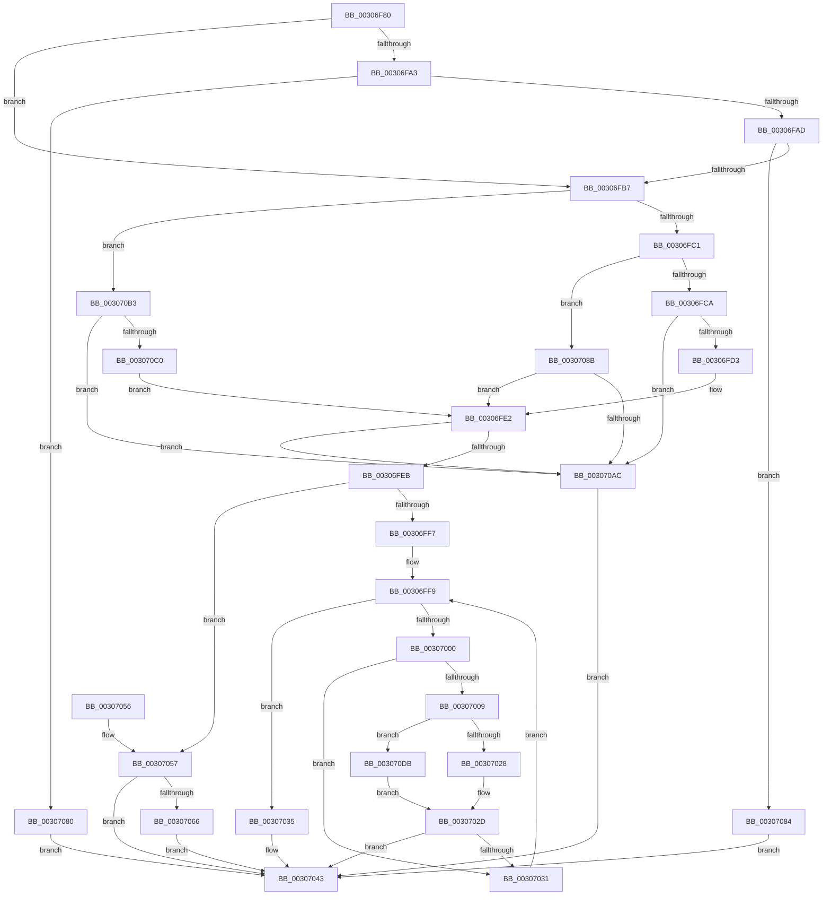

# IommuUnmapIdentityRangeEx

- RVA: `0x00306F80`–`0x003070E5` (길이 `357` bytes)
- VA: `0x0000000140306F80`
- 실행 섹션: `.text`
- PDB 이름 있음: `예`; PDB Function 태그: `아니요`
- unwind 정보 RVA: `0x0007384C`
- 디코드: `104`개 명령, `357/357` bytes 표시
- 미해석 바이트: `0` (있으면 어셈블리에 `.byte`로 보존)

> 이 문서는 커널 이미지의 기계어와 PDB 기호를 분석해 생성했습니다. 4번과 5번은 함수 원형과 자료형을 바이너리 사용 방식에서 추정한 C 해석이며 원본 소스 복구 결과는 아닙니다.

## 1. Dependencies

- 직접 호출 지점: **6**; 고유 호출 대상: **6**
- 직접 호출자로 확인된 함수: **0**
- RIP 상대 이미지 참조: **1**

### Outgoing calls
- `0x00307028` → [HalpBuddyAllocatorFreeLogicalAddress](HalpBuddyAllocatorFreeLogicalAddress_function_00307140.md) (function, `0x00307140`)
- `0x0030703E` → [HalpIommuDomainUnmapIdentityRange](../4A/HalpIommuDomainUnmapIdentityRange_function_004A0070.md) (function, `0x004A0070`)
- `0x0030705D` → [HalpIommuDomainFreeLogicalAddressRange](HalpIommuDomainFreeLogicalAddressRange_function_003070EC.md) (function, `0x003070EC`)
- `0x00307079` → [HalpIommuDomainUnmapLogicalRange](HalpIommuDomainUnmapLogicalRange_function_00307258.md) (function, `0x00307258`)
- `0x003070B7` → [IommupValidateMdl](../56/IommupValidateMdl_function_005689D0.md) (function, `0x005689D0`)
- `0x003070DB` → [guard_dispatch_icall](../6B/guard_dispatch_icall_function_006BAAD0.md) (function, `0x006BAAD0`)

### Direct callers
- 이 함수 시작 RVA로 연결되는 직접 call은 확인되지 않았습니다. 간접 호출은 완전히 역산할 수 없습니다.

### Static image references
- `0x0030700C` → RVA `0x00307140` (`HalpBuddyAllocatorFreeLogicalAddress`; read)

## 2. Other-region calls and transfers

- 다른 실행 섹션으로 향하는 call: **0**
- 별도 외부 분기/꼬리 이동을 확인하지 못했습니다.

## 3. Assembly (complete function range)

```asm
00306F80  48 89 5C 24 10                  mov qword ptr [rsp + 0x10], rbx
00306F85  48 89 6C 24 18                  mov qword ptr [rsp + 0x18], rbp
00306F8A  56                              push rsi
00306F8B  57                              push rdi
00306F8C  41 56                           push r14
00306F8E  48 83 EC 20                     sub rsp, 0x20
00306F92  44 8B 41 08                     mov r8d, dword ptr [rcx + 8]
00306F96  33 DB                           xor ebx, ebx
00306F98  45 33 F6                        xor r14d, r14d
00306F9B  48 8B F1                        mov rsi, rcx
00306F9E  45 85 C0                        test r8d, r8d
00306FA1  74 14                           je 0x140306fb7
00306FA3  41 83 E8 01                     sub r8d, 1
00306FA7  0F 84 D3 00 00 00               je 0x140307080
00306FAD  41 83 F8 02                     cmp r8d, 2
00306FB1  0F 85 CD 00 00 00               jne 0x140307084
00306FB7  8B 0A                           mov ecx, dword ptr [rdx]
00306FB9  85 C9                           test ecx, ecx
00306FBB  0F 84 F2 00 00 00               je 0x1403070b3
00306FC1  83 E9 01                        sub ecx, 1
00306FC4  0F 84 C1 00 00 00               je 0x14030708b
00306FCA  83 F9 01                        cmp ecx, 1
00306FCD  0F 85 D9 00 00 00               jne 0x1403070ac
00306FD3  48 8B 7A 10                     mov rdi, qword ptr [rdx + 0x10]
00306FD7  45 32 C0                        xor r8b, r8b
00306FDA  4C 8B 72 08                     mov r14, qword ptr [rdx + 8]
00306FDE  48 C1 E7 0C                     shl rdi, 0xc
00306FE2  48 85 FF                        test rdi, rdi
00306FE5  0F 84 C1 00 00 00               je 0x1403070ac
00306FEB  48 8B EF                        mov rbp, rdi
00306FEE  48 C1 ED 0C                     shr rbp, 0xc
00306FF2  45 84 C0                        test r8b, r8b
00306FF5  75 60                           jne 0x140307057
00306FF7  33 DB                           xor ebx, ebx
00306FF9  8B D3                           mov edx, ebx
00306FFB  48 3B D5                        cmp rdx, rbp
00306FFE  73 35                           jae 0x140307035
00307000  48 8B 4E 40                     mov rcx, qword ptr [rsi + 0x40]
00307004  48 85 C9                        test rcx, rcx
00307007  74 28                           je 0x140307031
00307009  48 8B 01                        mov rax, qword ptr [rcx]
0030700C  4C 8D 05 2D 01 00 00            lea r8, [rip + 0x12d]
00307013  49 8B 14 DE                     mov rdx, qword ptr [r14 + rbx*8]
00307017  48 C1 E2 0C                     shl rdx, 0xc
0030701B  48 8B 40 08                     mov rax, qword ptr [rax + 8]
0030701F  49 3B C0                        cmp rax, r8
00307022  0F 85 B3 00 00 00               jne 0x1403070db
00307028  E8 13 01 00 00                  call 0x140307140
0030702D  85 C0                           test eax, eax
0030702F  78 12                           js 0x140307043
00307031  FF C3                           inc ebx
00307033  EB C4                           jmp 0x140306ff9
00307035  4C 8B C5                        mov r8, rbp
00307038  49 8B D6                        mov rdx, r14
0030703B  48 8B CE                        mov rcx, rsi
0030703E  E8 2D 90 19 00                  call 0x1404a0070
00307043  48 8B 5C 24 48                  mov rbx, qword ptr [rsp + 0x48]
00307048  48 8B 6C 24 50                  mov rbp, qword ptr [rsp + 0x50]
0030704D  48 83 C4 20                     add rsp, 0x20
00307051  41 5E                           pop r14
00307053  5F                              pop rdi
00307054  5E                              pop rsi
00307055  C3                              ret
00307056  CC                              int3
00307057  48 8B D3                        mov rdx, rbx
0030705A  48 8B CE                        mov rcx, rsi
0030705D  E8 8A 00 00 00                  call 0x1403070ec
00307062  85 C0                           test eax, eax
00307064  78 DD                           js 0x140307043
00307066  45 33 C9                        xor r9d, r9d
00307069  48 89 7C 24 40                  mov qword ptr [rsp + 0x40], rdi
0030706E  4C 8D 44 24 40                  lea r8, [rsp + 0x40]
00307073  48 8B D3                        mov rdx, rbx
00307076  48 8B CE                        mov rcx, rsi
00307079  E8 DA 01 00 00                  call 0x140307258
0030707E  EB C3                           jmp 0x140307043
00307080  33 C0                           xor eax, eax
00307082  EB BF                           jmp 0x140307043
00307084  B8 EF 00 00 C0                  mov eax, 0xc00000ef
00307089  EB B8                           jmp 0x140307043
0030708B  48 8B 5A 08                     mov rbx, qword ptr [rdx + 8]
0030708F  B9 00 10 00 00                  mov ecx, 0x1000
00307094  48 8B 7A 10                     mov rdi, qword ptr [rdx + 0x10]
00307098  48 8B C3                        mov rax, rbx
0030709B  48 99                           cqo
0030709D  41 B0 01                        mov r8b, 1
003070A0  48 F7 F9                        idiv rcx
003070A3  48 85 D2                        test rdx, rdx
003070A6  0F 84 36 FF FF FF               je 0x140306fe2
003070AC  B8 F0 00 00 C0                  mov eax, 0xc00000f0
003070B1  EB 90                           jmp 0x140307043
003070B3  48 8B 4A 08                     mov rcx, qword ptr [rdx + 8]
003070B7  E8 14 19 26 00                  call 0x1405689d0
003070BC  84 C0                           test al, al
003070BE  74 EC                           je 0x1403070ac
003070C0  44 8B 71 2C                     mov r14d, dword ptr [rcx + 0x2c]
003070C4  45 32 C0                        xor r8b, r8b
003070C7  8B 79 28                        mov edi, dword ptr [rcx + 0x28]
003070CA  49 C1 EE 0C                     shr r14, 0xc
003070CE  49 83 C6 06                     add r14, 6
003070D2  4E 8D 34 F1                     lea r14, [rcx + r14*8]
003070D6  E9 07 FF FF FF                  jmp 0x140306fe2
003070DB  E8 F0 39 3B 00                  call 0x1406baad0
003070E0  E9 48 FF FF FF                  jmp 0x14030702d
```

## 4. C-style interpretation (structured pseudocode)

```c
__int64 __fastcall IommuUnmapIdentityRangeEx(__int64 a1, __int64 a2, __int64 a3, int a4)
{
    __int64 result;
    __int64 v_r14;
    __int64 v_rbp;
    __int64 v_rbx;
    __int64 v_rdi;
    __int64 v_rsp;
    unsigned __int64 v_stack_p10;
    unsigned __int64 v_stack_p18;
    unsigned __int64 v_stack_p40;

    v_stack_p10 = v_rbx;
    v_stack_p18 = v_rbp;
    v_rsp = (v_rsp) - (32);
    v_rbx = 0;
    v_r14 = 0;
    if ((unsigned int)((unsigned int)(*(unsigned int *)(a1 + 8))) == 0) goto loc_00306FB7;
    a3 = (unsigned int)(((unsigned int)(*(unsigned int *)(a1 + 8))) - (1));
    if (condition_is_equal) goto loc_00307080;
    if (((unsigned int)(a3)) != 2) goto loc_00307084;
loc_00306FB7:
    if ((unsigned int)((unsigned int)(*(unsigned int *)(a2))) == 0) goto loc_003070B3;
    a1 = (unsigned int)(((unsigned int)(*(unsigned int *)(a2))) - (1));
    if (condition_is_equal) goto loc_0030708B;
    if (((unsigned int)(a1)) != 1) goto loc_003070AC;
    a3 = 0;
    v_rdi = (*(unsigned __int64 *)(a2 + 16)) << (12);
loc_00306FE2:
    if (v_rdi == 0) goto loc_003070AC;
    v_rbp = (v_rdi) >> (12);
    if (0 != 0) goto loc_00307057;
    v_rbx = 0;
loc_00306FF9:
    if (0 >= v_rbp) goto loc_00307035;
    if (*(unsigned __int64 *)(a1 + 64) == 0) goto loc_00307031;
    a2 = (*(unsigned __int64 *)(*(unsigned __int64 *)(a2 + 8) + v_rbx * 8)) << (12);
    if ((*(unsigned __int64 *)(*(unsigned __int64 *)(*(unsigned __int64 *)(a1 + 64)) + 8)) != (v_rip + 301)) goto loc_003070DB;
    result = HalpBuddyAllocatorFreeLogicalAddress(*(unsigned __int64 *)(a1 + 64), a2, v_rip + 301, a4);
loc_0030702D:
    if (sign_flag) goto loc_00307043;
loc_00307031:
    v_rbx = (unsigned int)((v_rbx) + 1);
    goto loc_00306FF9;
loc_00307035:
    result = HalpIommuDomainUnmapIdentityRange(a1, *(unsigned __int64 *)(a2 + 8), v_rbp, a4);
loc_00307043:
    v_rsp = (v_rsp) + (32);
    return result;
loc_00307057:
    result = HalpIommuDomainFreeLogicalAddressRange(a1, v_stack_p10, v_rbp, a4);
    if (sign_flag) goto loc_00307043;
    a4 = 0;
    v_stack_p40 = v_rdi;
    result = HalpIommuDomainUnmapLogicalRange(a1, v_stack_p10, v_stack_p40, a4);
    goto loc_00307043;
loc_00307080:
    result = 0;
    goto loc_00307043;
loc_00307084:
    goto loc_00307043;
loc_0030708B:
    if (v_stack_p10 == 0) goto loc_00306FE2;
loc_003070AC:
    goto loc_00307043;
loc_003070B3:
    result = IommupValidateMdl(*(unsigned __int64 *)(v_stack_p10 + 8), v_stack_p10, 1, a4);
    if ((unsigned __int8)(result) == 0) goto loc_003070AC;
    a3 = 0;
    v_r14 = ((unsigned int)(*(unsigned int *)(*(unsigned __int64 *)(v_stack_p10 + 8) + 44))) >> (12);
    v_r14 = (v_r14) + (6);
    goto loc_00306FE2;
loc_003070DB:
    result = guard_dispatch_icall(*(unsigned __int64 *)(v_stack_p10 + 8), v_stack_p10, a3, a4);
    goto loc_0030702D;
}
```

## 5. (Beta) C Style

```c
int64_t IommuUnmapIdentityRangeEx(void *Arg1, void *Arg2, int64_t Arg3, int32_t Arg4)
{
    uint8_t *arg1 = (uint8_t *)Arg1;
    uint8_t *arg2 = (uint8_t *)Arg2;

    int64_t result;
    int64_t local_r14;
    int64_t local_rbp;
    int64_t local_rbx;
    int64_t local_rdi;
    int64_t local_rsp;
    uint64_t v_stack_p10;
    uint64_t v_stack_p18;
    uint64_t v_stack_p40;

    v_stack_p10 = local_rbx;
    v_stack_p18 = local_rbp;
    local_rsp = (local_rsp) - (32);
    local_rbx = 0;
    local_r14 = 0;
    if ((uint32_t)((uint32_t)(*(uint32_t *)(arg1 + 0x8))) == 0) goto loc_00306FB7;
    Arg3 = (uint32_t)(((uint32_t)(*(uint32_t *)(arg1 + 0x8))) - (1));
    if (condition_is_equal) goto loc_00307080;
    if (((uint32_t)(Arg3)) != 2) goto loc_00307084;
loc_00306FB7:
    if ((uint32_t)((uint32_t)(*(uint32_t *)(arg2))) == 0) goto loc_003070B3;
    Arg1 = (uint32_t)(((uint32_t)(*(uint32_t *)(arg2))) - (1));
    if (condition_is_equal) goto loc_0030708B;
    if (((uint32_t)(Arg1)) != 1) goto loc_003070AC;
    Arg3 = 0;
    local_rdi = (*(uint64_t *)(arg2 + 0x10)) << (12);
loc_00306FE2:
    if (local_rdi == 0) goto loc_003070AC;
    local_rbp = (local_rdi) >> (12);
    if (0 != 0) goto loc_00307057;
    local_rbx = 0;
loc_00306FF9:
    if (0 >= local_rbp) goto loc_00307035;
    if (*(uint64_t *)(arg1 + 0x40) == 0) goto loc_00307031;
    Arg2 = (*(uint64_t *)(*(uint64_t *)(arg2 + 0x8) + local_rbx * 8)) << (12);
    if ((*(uint64_t *)(*(uint64_t *)(*(uint64_t *)(arg1 + 0x40)) + 0x8)) != (v_rip + 301)) goto loc_003070DB;
    result = HalpBuddyAllocatorFreeLogicalAddress(*(uint64_t *)(arg1 + 0x40), Arg2, v_rip + 301, Arg4);
loc_0030702D:
    if (sign_flag) goto loc_00307043;
loc_00307031:
    local_rbx = (uint32_t)((local_rbx) + 1);
    goto loc_00306FF9;
loc_00307035:
    result = HalpIommuDomainUnmapIdentityRange(Arg1, *(uint64_t *)(arg2 + 0x8), local_rbp, Arg4);
loc_00307043:
    local_rsp = (local_rsp) + (32);
    return result;
loc_00307057:
    result = HalpIommuDomainFreeLogicalAddressRange(Arg1, v_stack_p10, local_rbp, Arg4);
    if (sign_flag) goto loc_00307043;
    Arg4 = 0;
    v_stack_p40 = local_rdi;
    result = HalpIommuDomainUnmapLogicalRange(Arg1, v_stack_p10, v_stack_p40, Arg4);
    goto loc_00307043;
loc_00307080:
    result = 0;
    goto loc_00307043;
loc_00307084:
    goto loc_00307043;
loc_0030708B:
    if (v_stack_p10 == 0) goto loc_00306FE2;
loc_003070AC:
    goto loc_00307043;
loc_003070B3:
    result = IommupValidateMdl(*(uint64_t *)(v_stack_p10 + 0x8), v_stack_p10, 1, Arg4);
    if ((uint8_t)(result) == 0) goto loc_003070AC;
    Arg3 = 0;
    local_r14 = ((uint32_t)(*(uint32_t *)(*(uint64_t *)(v_stack_p10 + 0x8) + 0x2C))) >> (12);
    local_r14 = (local_r14) + (6);
    goto loc_00306FE2;
loc_003070DB:
    result = guard_dispatch_icall(*(uint64_t *)(v_stack_p10 + 0x8), v_stack_p10, Arg3, Arg4);
    goto loc_0030702D;
}
```

### 관측된 메모리 오프셋

구조체 형식이 확인되지 않은 접근은 인자 기준의 오프셋으로만 기록했습니다.

| 기준 인자 | 오프셋 표현 | 폭 (bit) | 접근 |
|---|---:|---:|---|
| `Arg1` | `+ 0x8` | `32` | `R` |
| `Arg1` | `+ 0x40` | `64` | `R` |
| `Arg2` | `+ 0x0` | `32` | `R` |
| `Arg2` | `+ 0x8` | `64` | `R` |
| `Arg2` | `+ 0x10` | `64` | `R` |

## 6. Execution-region graph

[열기: 2D/3D 그래프와 함수 탐색 컨트롤 패널](../../../control-panel.html?section=text&rva=0x00306F80&view=graph)

- 2D 그래프는 위에서 아래로 흐르고, 3D 그래프는 빈 공간을 드래그해 회전합니다. Shift+드래그는 이동, 휠은 확대·축소, 함수 노드 선택은 대상 보고서 이동입니다.

### Static fallback


