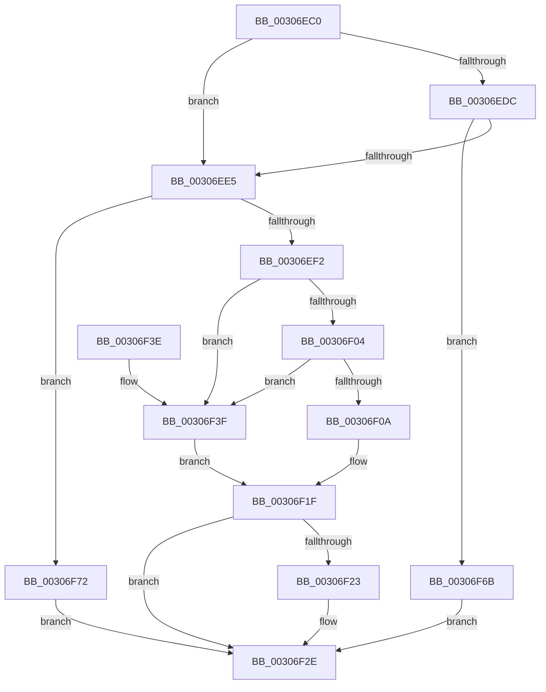

# IommuUnmapLogicalRange

- RVA: `0x00306EC0`–`0x00306F79` (길이 `185` bytes)
- VA: `0x0000000140306EC0`
- 실행 섹션: `.text`
- PDB 이름 있음: `예`; PDB Function 태그: `아니요`
- unwind 정보 RVA: `0x00073838`
- 디코드: `52`개 명령, `185/185` bytes 표시
- 미해석 바이트: `0` (있으면 어셈블리에 `.byte`로 보존)

> 이 문서는 커널 이미지의 기계어와 PDB 기호를 분석해 생성했습니다. 4번과 5번은 함수 원형과 자료형을 바이너리 사용 방식에서 추정한 C 해석이며 원본 소스 복구 결과는 아닙니다.

## 1. Dependencies

- 직접 호출 지점: **4**; 고유 호출 대상: **4**
- 직접 호출자로 확인된 함수: **1**
- RIP 상대 이미지 참조: **1**

### Outgoing calls
- `0x00306F18` → [IommupHvUnmapDeviceLogicalRange](IommupHvUnmapDeviceLogicalRange_function_0030730C.md) (function, `0x0030730C`)
- `0x00306F29` → [HalpIommuDomainFreeLogicalAddressRange](HalpIommuDomainFreeLogicalAddressRange_function_003070EC.md) (function, `0x003070EC`)
- `0x00306F4B` → [HalpIommuUnmapLogicalRange](HalpIommuUnmapLogicalRange_function_00308660.md) (function, `0x00308660`)
- `0x00306F5D` → [HalpIommuFlushDomainTbs](HalpIommuFlushDomainTbs_function_003085C0.md) (function, `0x003085C0`)

### Direct callers
- [HalpPutScatterGatherListDmarThin](HalpPutScatterGatherListDmarThin_function_00306DB4.md) at `0x00306E8B`

### Static image references
- `0x00306EF6` → RVA `0x00FC1710` (`.data`; read)

## 2. Other-region calls and transfers

- 다른 실행 섹션으로 향하는 call: **0**
- 별도 외부 분기/꼬리 이동을 확인하지 못했습니다.

## 3. Assembly (complete function range)

```asm
00306EC0  48 89 5C 24 10                  mov qword ptr [rsp + 0x10], rbx
00306EC5  48 89 74 24 18                  mov qword ptr [rsp + 0x18], rsi
00306ECA  57                              push rdi
00306ECB  48 83 EC 20                     sub rsp, 0x20
00306ECF  8B 41 08                        mov eax, dword ptr [rcx + 8]
00306ED2  48 8B FA                        mov rdi, rdx
00306ED5  48 8B D9                        mov rbx, rcx
00306ED8  85 C0                           test eax, eax
00306EDA  74 09                           je 0x140306ee5
00306EDC  83 F8 03                        cmp eax, 3
00306EDF  0F 85 86 00 00 00               jne 0x140306f6b
00306EE5  48 F7 C7 FF 0F 00 00            test rdi, 0xfff
00306EEC  0F 85 80 00 00 00               jne 0x140306f72
00306EF2  49 C1 E0 0C                     shl r8, 0xc
00306EF6  80 3D 13 A8 CB 00 00            cmp byte ptr [rip + 0xcba813], 0
00306EFD  4C 89 44 24 30                  mov qword ptr [rsp + 0x30], r8
00306F02  74 3B                           je 0x140306f3f
00306F04  80 79 34 00                     cmp byte ptr [rcx + 0x34], 0
00306F08  75 35                           jne 0x140306f3f
00306F0A  49 C1 E8 0C                     shr r8, 0xc
00306F0E  4C 89 44 24 48                  mov qword ptr [rsp + 0x48], r8
00306F13  4C 8D 44 24 48                  lea r8, [rsp + 0x48]
00306F18  E8 EF 03 00 00                  call 0x14030730c
00306F1D  8B F0                           mov esi, eax
00306F1F  85 F6                           test esi, esi
00306F21  78 0B                           js 0x140306f2e
00306F23  48 8B D7                        mov rdx, rdi
00306F26  48 8B CB                        mov rcx, rbx
00306F29  E8 BE 01 00 00                  call 0x1403070ec
00306F2E  48 8B 5C 24 38                  mov rbx, qword ptr [rsp + 0x38]
00306F33  48 8B 74 24 40                  mov rsi, qword ptr [rsp + 0x40]
00306F38  48 83 C4 20                     add rsp, 0x20
00306F3C  5F                              pop rdi
00306F3D  C3                              ret
00306F3E  CC                              int3
00306F3F  48 8B 49 28                     mov rcx, qword ptr [rcx + 0x28]
00306F43  48 8D 54 24 30                  lea rdx, [rsp + 0x30]
00306F48  4C 8B C7                        mov r8, rdi
00306F4B  E8 10 17 00 00                  call 0x140308660
00306F50  4C 8B 44 24 30                  mov r8, qword ptr [rsp + 0x30]
00306F55  48 8B D7                        mov rdx, rdi
00306F58  48 8B CB                        mov rcx, rbx
00306F5B  8B F0                           mov esi, eax
00306F5D  E8 5E 16 00 00                  call 0x1403085c0
00306F62  85 F6                           test esi, esi
00306F64  0F 49 F0                        cmovns esi, eax
00306F67  8B C6                           mov eax, esi
00306F69  EB B4                           jmp 0x140306f1f
00306F6B  B8 EF 00 00 C0                  mov eax, 0xc00000ef
00306F70  EB BC                           jmp 0x140306f2e
00306F72  B8 F0 00 00 C0                  mov eax, 0xc00000f0
00306F77  EB B5                           jmp 0x140306f2e
```

## 4. C-style interpretation (structured pseudocode)

```c
__int64 __fastcall IommuUnmapLogicalRange(__int64 a1, __int64 a2, __int64 a3)
{
    __int64 result;
    __int64 v_rsi;
    __int64 v_rsp;
    unsigned __int64 v_stack_p10;
    unsigned __int64 v_stack_p18;
    unsigned __int64 v_stack_p20;
    unsigned __int64 v_stack_p30;
    unsigned __int64 v_stack_p8;

    v_stack_p10 = v_rbx;
    v_stack_p18 = v_rsi;
    v_rsp = (v_rsp) - (32);
    if ((unsigned int)((unsigned int)(*(unsigned int *)(a1 + 8))) == 0) goto loc_00306EE5;
    if (((unsigned int)((unsigned int)(*(unsigned int *)(a1 + 8)))) != 3) goto loc_00306F6B;
loc_00306EE5:
    if (((a2) & (0xFFFULL)) != 0) goto loc_00306F72;
    a3 = (a3) << (12);
    v_stack_p8 = a3;
    if ((*(unsigned __int8 *)(v_rip + 13346835)) == 0) goto loc_00306F3F;
    if ((*(unsigned __int8 *)(a1 + 52)) != 0) goto loc_00306F3F;
    a3 = (a3) >> (12);
    v_stack_p20 = a3;
    result = IommupHvUnmapDeviceLogicalRange(a1, a2, v_stack_p20, a4);
loc_00306F1F:
    if (!(sign_flag)) {
        a2 = a2;
        a1 = a1;
        result = HalpIommuDomainFreeLogicalAddressRange(a1, a2, v_stack_p20, a4);
    }
    v_rsp = (v_rsp) + (32);
    return result;
loc_00306F3F:
    result = HalpIommuUnmapLogicalRange(*(unsigned __int64 *)(a1 + 40), v_stack_p30, a2, a4);
    result = HalpIommuFlushDomainTbs(v_stack_p10, a2, v_stack_p30, a4);
    v_rsi = (unsigned int)((unsigned int)(result));
    if (!sign_flag) { v_rsi = (unsigned int)(result); }
    goto loc_00306F1F;
loc_00306F6B:
    goto loc_00306F2E;
loc_00306F72:
    goto loc_00306F2E;
}
```

## 5. (Beta) C Style

```c
int64_t IommuUnmapLogicalRange(void *Arg1, int64_t Arg2, int64_t Arg3)
{
    uint8_t *arg1 = (uint8_t *)Arg1;

    int64_t result;
    int64_t local_rsi;
    int64_t local_rsp;
    uint64_t v_stack_p10;
    uint64_t v_stack_p18;
    uint64_t v_stack_p20;
    uint64_t v_stack_p30;
    uint64_t v_stack_p8;

    v_stack_p10 = local_rbx;
    v_stack_p18 = local_rsi;
    local_rsp = (local_rsp) - (32);
    if ((uint32_t)((uint32_t)(*(uint32_t *)(arg1 + 0x8))) == 0) goto loc_00306EE5;
    if (((uint32_t)((uint32_t)(*(uint32_t *)(arg1 + 0x8)))) != 3) goto loc_00306F6B;
loc_00306EE5:
    if (((Arg2) & (0xFFFULL)) != 0) goto loc_00306F72;
    Arg3 = (Arg3) << (12);
    v_stack_p8 = Arg3;
    if ((*(uint8_t *)(v_rip + 0xCBA813)) == 0) goto loc_00306F3F;
    if ((*(uint8_t *)(arg1 + 0x34)) != 0) goto loc_00306F3F;
    Arg3 = (Arg3) >> (12);
    v_stack_p20 = Arg3;
    result = IommupHvUnmapDeviceLogicalRange(Arg1, Arg2, v_stack_p20, a4);
loc_00306F1F:
    if (!(sign_flag)) {
        Arg2 = Arg2;
        Arg1 = Arg1;
        result = HalpIommuDomainFreeLogicalAddressRange(Arg1, Arg2, v_stack_p20, a4);
    }
    local_rsp = (local_rsp) + (32);
    return result;
loc_00306F3F:
    result = HalpIommuUnmapLogicalRange(*(uint64_t *)(arg1 + 0x28), v_stack_p30, Arg2, a4);
    result = HalpIommuFlushDomainTbs(v_stack_p10, Arg2, v_stack_p30, a4);
    local_rsi = (uint32_t)((uint32_t)(result));
    if (!sign_flag) { local_rsi = (uint32_t)(result); }
    goto loc_00306F1F;
loc_00306F6B:
    goto loc_00306F2E;
loc_00306F72:
    goto loc_00306F2E;
}
```

### 관측된 메모리 오프셋

구조체 형식이 확인되지 않은 접근은 인자 기준의 오프셋으로만 기록했습니다.

| 기준 인자 | 오프셋 표현 | 폭 (bit) | 접근 |
|---|---:|---:|---|
| `Arg1` | `+ 0x8` | `32` | `R` |
| `Arg1` | `+ 0x28` | `64` | `R` |
| `Arg1` | `+ 0x34` | `8` | `R` |

## 6. Execution-region graph

[열기: 2D/3D 그래프와 함수 탐색 컨트롤 패널](../../../control-panel.html?section=text&rva=0x00306EC0&view=graph)

- 2D 그래프는 위에서 아래로 흐르고, 3D 그래프는 빈 공간을 드래그해 회전합니다. Shift+드래그는 이동, 휠은 확대·축소, 함수 노드 선택은 대상 보고서 이동입니다.

### Static fallback


