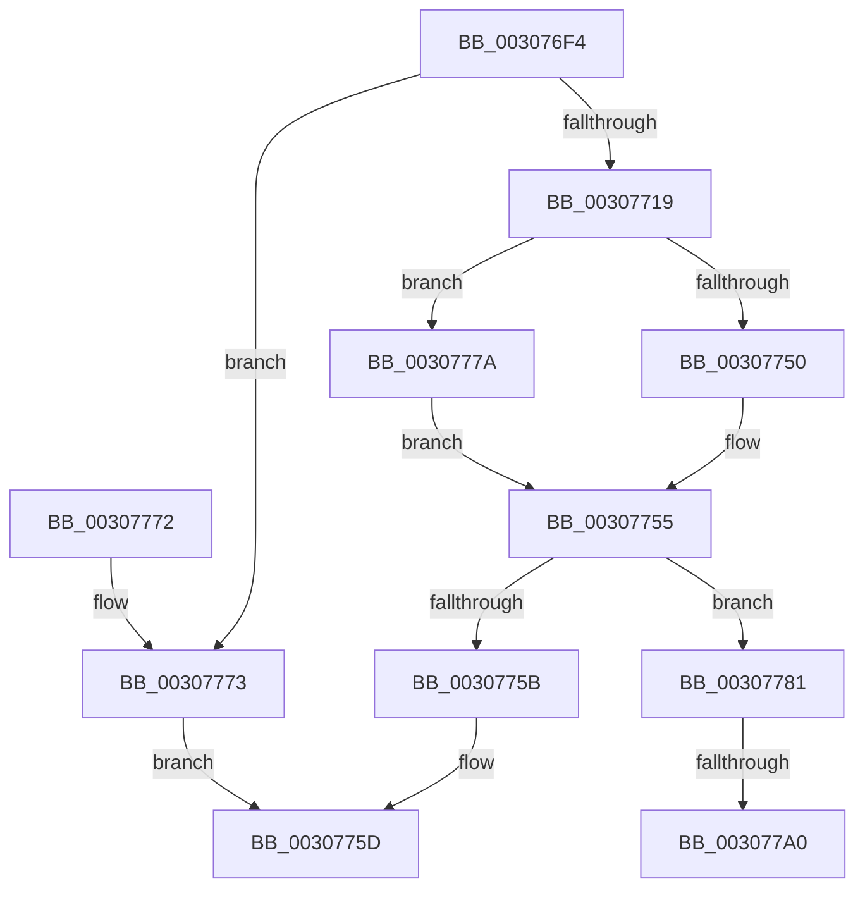

# IommupHvMapDeviceLogical

- RVA: `0x003076F4`–`0x003077BB` (길이 `199` bytes)
- VA: `0x00000001403076F4`
- 실행 섹션: `.text`
- PDB 이름 있음: `예`; PDB Function 태그: `예`
- unwind 정보 RVA: `0x00073900`
- 디코드: `54`개 명령, `199/199` bytes 표시
- 미해석 바이트: `0` (있으면 어셈블리에 `.byte`로 보존)

> 이 문서는 커널 이미지의 기계어와 PDB 기호를 분석해 생성했습니다. 4번과 5번은 함수 원형과 자료형을 바이너리 사용 방식에서 추정한 C 해석이며 원본 소스 복구 결과는 아닙니다.

## 1. Dependencies

- 직접 호출 지점: **4**; 고유 호출 대상: **3**
- 직접 호출자로 확인된 함수: **1**
- RIP 상대 이미지 참조: **3**

### Outgoing calls
- `0x00307750` → [HvlDmaMapDeviceLogicalRange](HvlDmaMapDeviceLogicalRange_function_003077D0.md) (function, `0x003077D0`)
- `0x0030777A` → [guard_dispatch_icall](../6B/guard_dispatch_icall_function_006BAAD0.md) (function, `0x006BAAD0`)
- `0x00307793` → [guard_dispatch_icall](../6B/guard_dispatch_icall_function_006BAAD0.md) (function, `0x006BAAD0`)
- `0x003077B5` → [KeBugCheckEx](../4F/KeBugCheckEx_function_004FD660.md) (function, `0x004FD660`)

### Direct callers
- [HalpIommuDomainMapLogical](HalpIommuDomainMapLogical_function_0030769C.md) at `0x003076C3`

### Static image references
- `0x00307724` → RVA `0x003077D0` (`HvlDmaMapDeviceLogicalRange`; read)
- `0x00307732` → RVA `0x00FC1E28` (`.data`; read)
- `0x00307781` → RVA `0x00FC1E30` (`.data`; read)

## 2. Other-region calls and transfers

- 다른 실행 섹션으로 향하는 call: **0**
- call이 아닌 외부 분기/꼬리 이동: **1**
  - `0x0030779A` → [sub_006E0A6A](../6E/Unknown_function_006E0A6A.md) (`tail-transfer`)

## 3. Assembly (complete function range)

```asm
003076F4  4C 8B DC                        mov r11, rsp
003076F7  49 89 5B 10                     mov qword ptr [r11 + 0x10], rbx
003076FB  49 89 6B 18                     mov qword ptr [r11 + 0x18], rbp
003076FF  49 89 73 20                     mov qword ptr [r11 + 0x20], rsi
00307703  57                              push rdi
00307704  48 83 EC 40                     sub rsp, 0x40
00307708  49 83 63 08 00                  and qword ptr [r11 + 8], 0
0030770D  49 8B D9                        mov rbx, r9
00307710  80 79 34 00                     cmp byte ptr [rcx + 0x34], 0
00307714  48 8B E9                        mov rbp, rcx
00307717  75 5A                           jne 0x140307773
00307719  8B 41 30                        mov eax, dword ptr [rcx + 0x30]
0030771C  4D 8B C8                        mov r9, r8
0030771F  48 8B 74 24 70                  mov rsi, qword ptr [rsp + 0x70]
00307724  48 8D 0D A5 00 00 00            lea rcx, [rip + 0xa5]
0030772B  89 44 24 50                     mov dword ptr [rsp + 0x50], eax
0030772F  4C 8B C6                        mov r8, rsi
00307732  48 8B 05 EF A6 CB 00            mov rax, qword ptr [rip + 0xcba6ef]
00307739  48 3B C1                        cmp rax, rcx
0030773C  C6 44 24 28 00                  mov byte ptr [rsp + 0x28], 0
00307741  49 8D 4B 08                     lea rcx, [r11 + 8]
00307745  C6 44 24 54 00                  mov byte ptr [rsp + 0x54], 0
0030774A  49 89 5B D8                     mov qword ptr [r11 - 0x28], rbx
0030774E  75 2A                           jne 0x14030777a
00307750  E8 7B 00 00 00                  call 0x1403077d0
00307755  8B F8                           mov edi, eax
00307757  85 C0                           test eax, eax
00307759  78 26                           js 0x140307781
0030775B  8B C7                           mov eax, edi
0030775D  48 8B 5C 24 58                  mov rbx, qword ptr [rsp + 0x58]
00307762  48 8B 6C 24 60                  mov rbp, qword ptr [rsp + 0x60]
00307767  48 8B 74 24 68                  mov rsi, qword ptr [rsp + 0x68]
0030776C  48 83 C4 40                     add rsp, 0x40
00307770  5F                              pop rdi
00307771  C3                              ret
00307772  CC                              int3
00307773  B8 0D 00 00 C0                  mov eax, 0xc000000d
00307778  EB E3                           jmp 0x14030775d
0030777A  E8 51 33 3B 00                  call 0x1406baad0
0030777F  EB D4                           jmp 0x140307755
00307781  48 8B 05 A8 A6 CB 00            mov rax, qword ptr [rip + 0xcba6a8]
00307788  48 8D 4C 24 50                  lea rcx, [rsp + 0x50]
0030778D  4C 8B C3                        mov r8, rbx
00307790  48 8B D6                        mov rdx, rsi
00307793  E8 38 33 3B 00                  call 0x1406baad0
00307798  85 C0                           test eax, eax
0030779A  0F 89 CA 92 3D 00               jns 0x1406e0a6a
003077A0  4C 63 C0                        movsxd r8, eax
003077A3  4C 8B CD                        mov r9, rbp
003077A6  BA 01 00 00 00                  mov edx, 1
003077AB  48 89 74 24 20                  mov qword ptr [rsp + 0x20], rsi
003077B0  B9 D9 01 00 00                  mov ecx, 0x1d9
003077B5  E8 A6 5E 1F 00                  call 0x1404fd660
003077BA  CC                              int3
```

## 4. C-style interpretation (structured pseudocode)

```c
__int64 __fastcall IommupHvMapDeviceLogical(__int64 a1, __int64 a2, __int64 a3, __int64 a4, __int64 a5)
{
    __int64 result;
    __int64 v_rsp;
    unsigned __int8 v_stack_m20;
    unsigned __int64 v_stack_p10;
    unsigned __int64 v_stack_p18;
    unsigned __int64 v_stack_p20;
    unsigned __int64 v_stack_p50;
    unsigned int v_stack_p8;
    unsigned __int8 v_stack_pC;

    *(unsigned __int64 *)(v_rsp + 16) = v_rbx;
    *(unsigned __int64 *)(v_rsp + 24) = v_rbp;
    *(unsigned __int64 *)(v_rsp + 32) = v_rsi;
    v_rsp = (v_rsp) - (64);
    if ((*(unsigned __int8 *)(a1 + 52)) != 0) goto loc_00307773;
    v_stack_p8 = (unsigned int)((unsigned int)(*(unsigned int *)(a1 + 48)));
    v_stack_m20 = 0;
    v_stack_pC = 0;
    *(unsigned __int64 *)(v_rsp - 40) = a4;
    if ((*(unsigned __int64 *)(v_rip + 13346543)) != (v_rip + 165)) goto loc_0030777A;
    result = HvlDmaMapDeviceLogicalRange(v_rsp + 8, a2, a5, a3);
loc_00307755:
    if (sign_flag) goto loc_00307781;
loc_0030775D:
    v_rsp = (v_rsp) + (64);
    return (unsigned int)((unsigned int)((unsigned int)((unsigned int)(result))));
loc_00307773:
    goto loc_0030775D;
loc_0030777A:
    result = guard_dispatch_icall(v_rsp + 8, a2, a5, a3);
    goto loc_00307755;
loc_00307781:
    result = guard_dispatch_icall(v_stack_p50, v_stack_p20, v_stack_p10, a3);
    v_stack_p20 = v_stack_p20;
    result = KeBugCheckEx(473, 1, (int)((unsigned int)(result)), v_stack_p18);
    return result;
}
```

## 5. (Beta) C Style

```c
int64_t IommupHvMapDeviceLogical(void *Arg1, int64_t Arg2, int64_t Arg3, int64_t Arg4, int64_t Arg5)
{
    uint8_t *arg1 = (uint8_t *)Arg1;

    int64_t result;
    int64_t local_rsp;
    uint8_t v_stack_m20;
    uint64_t v_stack_p10;
    uint64_t v_stack_p18;
    uint64_t v_stack_p20;
    uint64_t v_stack_p50;
    uint32_t v_stack_p8;
    uint8_t v_stack_pC;

    *(uint64_t *)(local_rsp + 0x10) = local_rbx;
    *(uint64_t *)(local_rsp + 0x18) = local_rbp;
    *(uint64_t *)(local_rsp + 0x20) = local_rsi;
    local_rsp = (local_rsp) - (64);
    if ((*(uint8_t *)(arg1 + 0x34)) != 0) goto loc_00307773;
    v_stack_p8 = (uint32_t)((uint32_t)(*(uint32_t *)(arg1 + 0x30)));
    v_stack_m20 = 0;
    v_stack_pC = 0;
    *(uint64_t *)(local_rsp - 0x28) = Arg4;
    if ((*(uint64_t *)(v_rip + 0xCBA6EF)) != (v_rip + 165)) goto loc_0030777A;
    result = HvlDmaMapDeviceLogicalRange(local_rsp + 8, Arg2, Arg5, Arg3);
loc_00307755:
    if (sign_flag) goto loc_00307781;
loc_0030775D:
    local_rsp = (local_rsp) + (64);
    return (uint32_t)((uint32_t)((uint32_t)((uint32_t)(result))));
loc_00307773:
    goto loc_0030775D;
loc_0030777A:
    result = guard_dispatch_icall(local_rsp + 8, Arg2, Arg5, Arg3);
    goto loc_00307755;
loc_00307781:
    result = guard_dispatch_icall(v_stack_p50, v_stack_p20, v_stack_p10, Arg3);
    v_stack_p20 = v_stack_p20;
    result = KeBugCheckEx(473, 1, (int32_t)((uint32_t)(result)), v_stack_p18);
    return result;
}
```

### 관측된 메모리 오프셋

구조체 형식이 확인되지 않은 접근은 인자 기준의 오프셋으로만 기록했습니다.

| 기준 인자 | 오프셋 표현 | 폭 (bit) | 접근 |
|---|---:|---:|---|
| `Arg1` | `+ 0x30` | `32` | `R` |
| `Arg1` | `+ 0x34` | `8` | `R` |

## 6. Execution-region graph

[열기: 2D/3D 그래프와 함수 탐색 컨트롤 패널](../../../control-panel.html?section=text&rva=0x003076F4&view=graph)

- 2D 그래프는 위에서 아래로 흐르고, 3D 그래프는 빈 공간을 드래그해 회전합니다. Shift+드래그는 이동, 휠은 확대·축소, 함수 노드 선택은 대상 보고서 이동입니다.

### Static fallback


