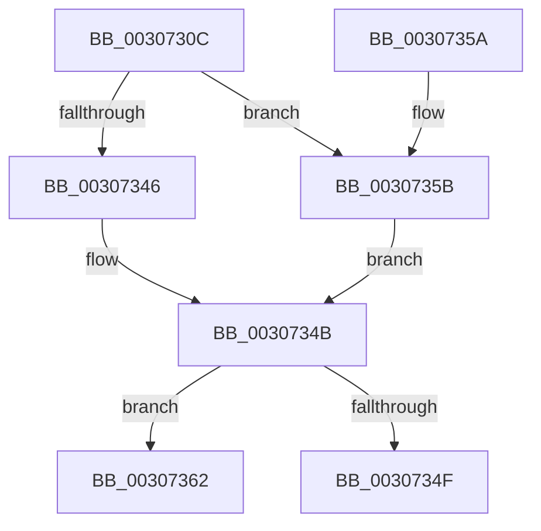

# IommupHvUnmapDeviceLogicalRange

- RVA: `0x0030730C`–`0x0030737D` (길이 `113` bytes)
- VA: `0x000000014030730C`
- 실행 섹션: `.text`
- PDB 이름 있음: `예`; PDB Function 태그: `아니요`
- unwind 정보 RVA: `0x000738A4`
- 디코드: `31`개 명령, `113/113` bytes 표시
- 미해석 바이트: `0` (있으면 어셈블리에 `.byte`로 보존)

> 이 문서는 커널 이미지의 기계어와 PDB 기호를 분석해 생성했습니다. 4번과 5번은 함수 원형과 자료형을 바이너리 사용 방식에서 추정한 C 해석이며 원본 소스 복구 결과는 아닙니다.

## 1. Dependencies

- 직접 호출 지점: **3**; 고유 호출 대상: **3**
- 직접 호출자로 확인된 함수: **2**
- RIP 상대 이미지 참조: **2**

### Outgoing calls
- `0x00307346` → [HvlDmaUnmapDeviceLogicalRange](HvlDmaUnmapDeviceLogicalRange_function_00307390.md) (function, `0x00307390`)
- `0x0030735B` → [guard_dispatch_icall](../6B/guard_dispatch_icall_function_006BAAD0.md) (function, `0x006BAAD0`)
- `0x00307377` → [KeBugCheckEx](../4F/KeBugCheckEx_function_004FD660.md) (function, `0x004FD660`)

### Direct callers
- [IommuUnmapLogicalRange](IommuUnmapLogicalRange_function_00306EC0.md) at `0x00306F18`
- [HalpIommuDomainUnmapLogicalRange](HalpIommuDomainUnmapLogicalRange_function_00307258.md) at `0x003072A9`

### Static image references
- `0x00307322` → RVA `0x00307390` (`HvlDmaUnmapDeviceLogicalRange`; read)
- `0x00307330` → RVA `0x00FC1E30` (`.data`; read)

## 2. Other-region calls and transfers

- 다른 실행 섹션으로 향하는 call: **0**
- 별도 외부 분기/꼬리 이동을 확인하지 못했습니다.

## 3. Assembly (complete function range)

```asm
0030730C  48 89 5C 24 10                  mov qword ptr [rsp + 0x10], rbx
00307311  57                              push rdi
00307312  48 83 EC 30                     sub rsp, 0x30
00307316  8B 41 30                        mov eax, dword ptr [rcx + 0x30]
00307319  48 8B F9                        mov rdi, rcx
0030731C  48 83 64 24 40 00               and qword ptr [rsp + 0x40], 0
00307322  48 8D 0D 67 00 00 00            lea rcx, [rip + 0x67]
00307329  89 44 24 40                     mov dword ptr [rsp + 0x40], eax
0030732D  48 8B DA                        mov rbx, rdx
00307330  48 8B 05 F9 AA CB 00            mov rax, qword ptr [rip + 0xcbaaf9]
00307337  48 3B C1                        cmp rax, rcx
0030733A  C6 44 24 44 00                  mov byte ptr [rsp + 0x44], 0
0030733F  48 8D 4C 24 40                  lea rcx, [rsp + 0x40]
00307344  75 15                           jne 0x14030735b
00307346  E8 45 00 00 00                  call 0x140307390
0030734B  85 C0                           test eax, eax
0030734D  78 13                           js 0x140307362
0030734F  48 8B 5C 24 48                  mov rbx, qword ptr [rsp + 0x48]
00307354  48 83 C4 30                     add rsp, 0x30
00307358  5F                              pop rdi
00307359  C3                              ret
0030735A  CC                              int3
0030735B  E8 70 37 3B 00                  call 0x1406baad0
00307360  EB E9                           jmp 0x14030734b
00307362  4C 63 C0                        movsxd r8, eax
00307365  4C 8B CF                        mov r9, rdi
00307368  BA 01 00 00 00                  mov edx, 1
0030736D  48 89 5C 24 20                  mov qword ptr [rsp + 0x20], rbx
00307372  B9 D9 01 00 00                  mov ecx, 0x1d9
00307377  E8 E4 62 1F 00                  call 0x1404fd660
0030737C  CC                              int3
```

## 4. C-style interpretation (structured pseudocode)

```c
__int64 __fastcall IommupHvUnmapDeviceLogicalRange(__int64 a1, __int64 a2)
{
    __int64 result;
    __int64 v_rsp;
    unsigned __int64 v_stack_p10;
    unsigned __int64 v_stack_p20;
    unsigned __int64 v_stack_p8;
    unsigned __int8 v_stack_pC;

    v_stack_p10 = v_rbx;
    v_rsp = (v_rsp) - (48);
    v_stack_p8 = (unsigned int)((unsigned int)(*(unsigned int *)(a1 + 48)));
    v_stack_pC = 0;
    if ((*(unsigned __int64 *)(v_rip + 13347577)) != (v_rip + 103)) goto loc_0030735B;
    result = HvlDmaUnmapDeviceLogicalRange(v_stack_p8, a2, a3, a4);
loc_0030734B:
    if (sign_flag) goto loc_00307362;
    v_rsp = (v_rsp) + (48);
    return result;
loc_0030735B:
    result = guard_dispatch_icall(v_stack_p8, a2, a3, a4);
    goto loc_0030734B;
loc_00307362:
    v_stack_p20 = v_stack_p10;
    result = KeBugCheckEx(473, 1, (int)((unsigned int)(result)), a1);
    return result;
}
```

## 5. (Beta) C Style

```c
int64_t IommupHvUnmapDeviceLogicalRange(void *Arg1, int64_t Arg2)
{
    uint8_t *arg1 = (uint8_t *)Arg1;

    int64_t result;
    int64_t local_rsp;
    uint64_t v_stack_p10;
    uint64_t v_stack_p20;
    uint64_t v_stack_p8;
    uint8_t v_stack_pC;

    v_stack_p10 = local_rbx;
    local_rsp = (local_rsp) - (48);
    v_stack_p8 = (uint32_t)((uint32_t)(*(uint32_t *)(arg1 + 0x30)));
    v_stack_pC = 0;
    if ((*(uint64_t *)(v_rip + 0xCBAAF9)) != (v_rip + 103)) goto loc_0030735B;
    result = HvlDmaUnmapDeviceLogicalRange(v_stack_p8, Arg2, a3, a4);
loc_0030734B:
    if (sign_flag) goto loc_00307362;
    local_rsp = (local_rsp) + (48);
    return result;
loc_0030735B:
    result = guard_dispatch_icall(v_stack_p8, Arg2, a3, a4);
    goto loc_0030734B;
loc_00307362:
    v_stack_p20 = v_stack_p10;
    result = KeBugCheckEx(473, 1, (int32_t)((uint32_t)(result)), Arg1);
    return result;
}
```

### 관측된 메모리 오프셋

구조체 형식이 확인되지 않은 접근은 인자 기준의 오프셋으로만 기록했습니다.

| 기준 인자 | 오프셋 표현 | 폭 (bit) | 접근 |
|---|---:|---:|---|
| `Arg1` | `+ 0x30` | `32` | `R` |

## 6. Execution-region graph

[열기: 2D/3D 그래프와 함수 탐색 컨트롤 패널](../../../control-panel.html?section=text&rva=0x0030730C&view=graph)

- 2D 그래프는 위에서 아래로 흐르고, 3D 그래프는 빈 공간을 드래그해 회전합니다. Shift+드래그는 이동, 휠은 확대·축소, 함수 노드 선택은 대상 보고서 이동입니다.

### Static fallback


