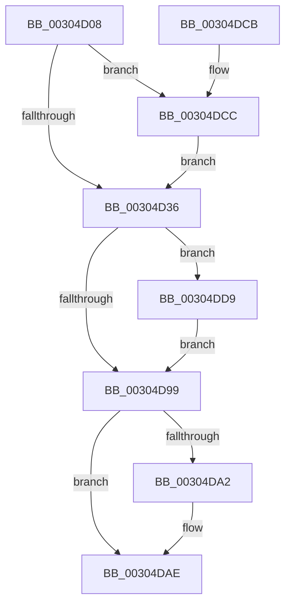

# KeChangeMemoryAttributes

- RVA: `0x00304D08`–`0x00304E03` (길이 `251` bytes)
- VA: `0x0000000140304D08`
- 실행 섹션: `.text`
- PDB 이름 있음: `예`; PDB Function 태그: `아니요`
- unwind 정보 RVA: `0x000735C0`
- 디코드: `59`개 명령, `251/251` bytes 표시
- 미해석 바이트: `0` (있으면 어셈블리에 `.byte`로 보존)

> 이 문서는 커널 이미지의 기계어와 PDB 기호를 분석해 생성했습니다. 4번과 5번은 함수 원형과 자료형을 바이너리 사용 방식에서 추정한 C 해석이며 원본 소스 복구 결과는 아닙니다.

## 1. Dependencies

- 직접 호출 지점: **8**; 고유 호출 대상: **8**
- 직접 호출자로 확인된 함수: **2**
- RIP 상대 이미지 참조: **2**

### Outgoing calls
- `0x00304D6E` → [memset](../6C/memset_function_006C6C40.md) (function, `0x006C6C40`)
- `0x00304D7D` → [KiCopyAffinityEx](../2C/KiCopyAffinityEx_function_002CE860.md) (function, `0x002CE860`)
- `0x00304D88` → [KeRemoveProcessorAffinityEx](KeRemoveProcessorAffinityEx_function_00304E10.md) (function, `0x00304E10`)
- `0x00304D90` → [KeCountSetBitsAffinityEx](../2C/KeCountSetBitsAffinityEx_function_002CE6E0.md) (function, `0x002CE6E0`)
- `0x00304DA9` → [KiLowerIrqlProcessIrqlFlags](../4F/KiLowerIrqlProcessIrqlFlags_function_004F5698.md) (function, `0x004F5698`)
- `0x00304DCF` → [KiRaiseIrqlProcessIrqlFlags](../4F/KiRaiseIrqlProcessIrqlFlags_function_004F56FC.md) (function, `0x004F56FC`)
- `0x00304DF4` → [KiIpiSendPacket](../47/KiIpiSendPacket_function_004711DC.md) (function, `0x004711DC`)
- `0x00304DFC` → [KiIpiStallOnPacketTargetsPrcb](../2C/KiIpiStallOnPacketTargetsPrcb_function_002CE670.md) (function, `0x002CE670`)

### Direct callers
- [MiInsertPhysicalPteMapping](../2A/MiInsertPhysicalPteMapping_function_002AE26C.md) at `0x002AE4A5`
- [NtSetInformationProcess](../../page/AE/NtSetInformationProcess_function_00AE5370.md) at `0x00AE9FAE`

### Static image references
- `0x00304D29` → RVA `0x00FC6D20` (`ALMOSTRO`; read)
- `0x00304DDF` → RVA `0x004CDDF0` (`KiRollbackSlistPops`; read)

## 2. Other-region calls and transfers

- 다른 실행 섹션으로 향하는 call: **0**
- 별도 외부 분기/꼬리 이동을 확인하지 못했습니다.

## 3. Assembly (complete function range)

```asm
00304D08  48 89 5C 24 08                  mov qword ptr [rsp + 8], rbx
00304D0D  48 89 6C 24 10                  mov qword ptr [rsp + 0x10], rbp
00304D12  48 89 74 24 18                  mov qword ptr [rsp + 0x18], rsi
00304D17  57                              push rdi
00304D18  48 83 EC 30                     sub rsp, 0x30
00304D1C  44 0F 20 C7                     mov rdi, cr8
00304D20  BA 0C 00 00 00                  mov edx, 0xc
00304D25  44 0F 22 C2                     mov cr8, rdx
00304D29  83 3D F0 1F CC 00 00            cmp dword ptr [rip + 0xcc1ff0], 0
00304D30  0F 85 96 00 00 00               jne 0x140304dcc
00304D36  65 48 8B 2C 25 20 00 00 00      mov rbp, qword ptr gs:[0x20]
00304D3F  33 D2                           xor edx, edx
00304D41  41 B8 00 01 00 00               mov r8d, 0x100
00304D47  48 8B 45 08                     mov rax, qword ptr [rbp + 8]
00304D4B  48 8D B5 B8 2D 00 00            lea rsi, [rbp + 0x2db8]
00304D52  48 8B 88 B8 00 00 00            mov rcx, qword ptr [rax + 0xb8]
00304D59  48 8B 99 80 00 00 00            mov rbx, qword ptr [rcx + 0x80]
00304D60  48 8D 4E 08                     lea rcx, [rsi + 8]
00304D64  83 66 04 00                     and dword ptr [rsi + 4], 0
00304D68  C7 06 01 00 20 00               mov dword ptr [rsi], 0x200001
00304D6E  E8 CD 1E 3C 00                  call 0x1406c6c40
00304D73  0F B7 56 02                     movzx edx, word ptr [rsi + 2]
00304D77  4C 8B C3                        mov r8, rbx
00304D7A  48 8B CE                        mov rcx, rsi
00304D7D  E8 DE 9A FC FF                  call 0x1402ce860
00304D82  8B 55 24                        mov edx, dword ptr [rbp + 0x24]
00304D85  48 8B CE                        mov rcx, rsi
00304D88  E8 83 00 00 00                  call 0x140304e10
00304D8D  48 8B CE                        mov rcx, rsi
00304D90  E8 4B 99 FC FF                  call 0x1402ce6e0
00304D95  85 C0                           test eax, eax
00304D97  75 40                           jne 0x140304dd9
00304D99  83 3D 80 1F CC 00 00            cmp dword ptr [rip + 0xcc1f80], 0
00304DA0  74 0C                           je 0x140304dae
00304DA2  44 0F 20 C1                     mov rcx, cr8
00304DA6  40 8A D7                        mov dl, dil
00304DA9  E8 EA 08 1F 00                  call 0x1404f5698
00304DAE  40 0F B6 C7                     movzx eax, dil
00304DB2  44 0F 22 C0                     mov cr8, rax
00304DB6  48 8B 5C 24 40                  mov rbx, qword ptr [rsp + 0x40]
00304DBB  48 8B 6C 24 48                  mov rbp, qword ptr [rsp + 0x48]
00304DC0  48 8B 74 24 50                  mov rsi, qword ptr [rsp + 0x50]
00304DC5  48 83 C4 30                     add rsp, 0x30
00304DC9  5F                              pop rdi
00304DCA  C3                              ret
00304DCB  CC                              int3
00304DCC  40 8A CF                        mov cl, dil
00304DCF  E8 28 09 1F 00                  call 0x1404f56fc
00304DD4  E9 5D FF FF FF                  jmp 0x140304d36
00304DD9  48 83 64 24 28 00               and qword ptr [rsp + 0x28], 0
00304DDF  4C 8D 05 0A 90 1C 00            lea r8, [rip + 0x1c900a]
00304DE6  48 83 64 24 20 00               and qword ptr [rsp + 0x20], 0
00304DEC  45 33 C9                        xor r9d, r9d
00304DEF  48 8B D6                        mov rdx, rsi
00304DF2  33 C9                           xor ecx, ecx
00304DF4  E8 E3 C3 16 00                  call 0x1404711dc
00304DF9  48 8B D5                        mov rdx, rbp
00304DFC  E8 6F 98 FC FF                  call 0x1402ce670
00304E01  EB 96                           jmp 0x140304d99
```

## 4. C-style interpretation (structured pseudocode)

```c
__int64 __fastcall KeChangeMemoryAttributes(__int64 a1, __int64 a2, __int64 a3, int a4)
{
    __int64 result;
    __int64 v_rsp;
    unsigned __int64 v_stack_p10;
    unsigned __int64 v_stack_p18;
    unsigned __int64 v_stack_p20;
    unsigned __int64 v_stack_p28;
    unsigned __int64 v_stack_p8;

    v_stack_p8 = v_rbx;
    v_stack_p10 = v_rbp;
    v_stack_p18 = v_rsi;
    v_rsp = (v_rsp) - (48);
    if ((*(unsigned int *)(v_rip + 13377520)) != 0) goto loc_00304DCC;
loc_00304D36:
    a2 = 0;
    *(unsigned int *)(*(unsigned __int64 *)(gs_base + (0 + 32)) + 11704) = 0x200001ULL;
    result = memset(*(unsigned __int64 *)(gs_base + (0 + 32)) + 11704 + 8, a2, 256, a4);
    result = KiCopyAffinityEx(*(unsigned __int64 *)(gs_base + (0 + 32)) + 11704, *(unsigned __int16 *)(*(unsigned __int64 *)(gs_base + (0 + 32)) + 11704 + 2), *(unsigned __int64 *)(*(unsigned __int64 *)(*(unsigned __int64 *)(*(unsigned __int64 *)(gs_base + (0 + 32)) + 8) + 184) + 128), a4);
    result = KeRemoveProcessorAffinityEx(*(unsigned __int64 *)(gs_base + (0 + 32)) + 11704, (unsigned int)(*(unsigned int *)(*(unsigned __int64 *)(gs_base + (0 + 32)) + 36)), *(unsigned __int64 *)(*(unsigned __int64 *)(*(unsigned __int64 *)(*(unsigned __int64 *)(gs_base + (0 + 32)) + 8) + 184) + 128), a4);
    result = KeCountSetBitsAffinityEx(*(unsigned __int64 *)(gs_base + (0 + 32)) + 11704, (unsigned int)(*(unsigned int *)(*(unsigned __int64 *)(gs_base + (0 + 32)) + 36)), *(unsigned __int64 *)(*(unsigned __int64 *)(*(unsigned __int64 *)(*(unsigned __int64 *)(gs_base + (0 + 32)) + 8) + 184) + 128), a4);
    if ((unsigned int)(result) != 0) goto loc_00304DD9;
loc_00304D99:
    if ((*(unsigned int *)(v_rip + 13377408)) != 0) {
        a1 = 12;
        a2 = (unsigned __int8)(v_cr8);
        result = KiLowerIrqlProcessIrqlFlags(a1, a2, *(unsigned __int64 *)(*(unsigned __int64 *)(*(unsigned __int64 *)(*(unsigned __int64 *)(gs_base + (0 + 32)) + 8) + 184) + 128), a4);
    }
    v_rsp = (v_rsp) + (48);
    return (unsigned __int8)(v_cr8);
loc_00304DCC:
    result = KiRaiseIrqlProcessIrqlFlags((unsigned __int8)(v_cr8), a2, *(unsigned __int64 *)(*(unsigned __int64 *)(*(unsigned __int64 *)(*(unsigned __int64 *)(gs_base + (0 + 32)) + 8) + 184) + 128), a4);
    goto loc_00304D36;
loc_00304DD9:
    a4 = 0;
    a1 = 0;
    result = KiIpiSendPacket(a1, v_stack_p18, v_rip + 1871882, a4);
    result = KiIpiStallOnPacketTargetsPrcb(a1, v_stack_p10, v_rip + 1871882, a4);
    goto loc_00304D99;
}
```

## 5. (Beta) C Style

```c
int64_t KeChangeMemoryAttributes(int64_t Arg1, int64_t Arg2, int64_t Arg3, int32_t Arg4)
{
    int64_t result;
    int64_t local_rsp;
    uint64_t v_stack_p10;
    uint64_t v_stack_p18;
    uint64_t v_stack_p20;
    uint64_t v_stack_p28;
    uint64_t v_stack_p8;

    v_stack_p8 = local_rbx;
    v_stack_p10 = local_rbp;
    v_stack_p18 = local_rsi;
    local_rsp = (local_rsp) - (48);
    if ((*(uint32_t *)(v_rip + 0xCC1FF0)) != 0) goto loc_00304DCC;
loc_00304D36:
    Arg2 = 0;
    *(uint32_t *)(*(uint64_t *)(gs_base + (0 + 0x20)) + 0x2DB8) = 0x200001ULL;
    result = memset(*(uint64_t *)(gs_base + (0 + 0x20)) + 11704 + 8, Arg2, 256, Arg4);
    result = KiCopyAffinityEx(*(uint64_t *)(gs_base + (0 + 0x20)) + 11704, *(uint16_t *)(*(uint64_t *)(gs_base + (0 + 0x20)) + 0x2DB8 + 0x2), *(uint64_t *)(*(uint64_t *)(*(uint64_t *)(*(uint64_t *)(gs_base + (0 + 0x20)) + 0x8) + 0xB8) + 0x80), Arg4);
    result = KeRemoveProcessorAffinityEx(*(uint64_t *)(gs_base + (0 + 0x20)) + 11704, (uint32_t)(*(uint32_t *)(*(uint64_t *)(gs_base + (0 + 0x20)) + 0x24)), *(uint64_t *)(*(uint64_t *)(*(uint64_t *)(*(uint64_t *)(gs_base + (0 + 0x20)) + 0x8) + 0xB8) + 0x80), Arg4);
    result = KeCountSetBitsAffinityEx(*(uint64_t *)(gs_base + (0 + 0x20)) + 11704, (uint32_t)(*(uint32_t *)(*(uint64_t *)(gs_base + (0 + 0x20)) + 0x24)), *(uint64_t *)(*(uint64_t *)(*(uint64_t *)(*(uint64_t *)(gs_base + (0 + 0x20)) + 0x8) + 0xB8) + 0x80), Arg4);
    if ((uint32_t)(result) != 0) goto loc_00304DD9;
loc_00304D99:
    if ((*(uint32_t *)(v_rip + 0xCC1F80)) != 0) {
        Arg1 = 12;
        Arg2 = (uint8_t)(v_cr8);
        result = KiLowerIrqlProcessIrqlFlags(Arg1, Arg2, *(uint64_t *)(*(uint64_t *)(*(uint64_t *)(*(uint64_t *)(gs_base + (0 + 0x20)) + 0x8) + 0xB8) + 0x80), Arg4);
    }
    local_rsp = (local_rsp) + (48);
    return (uint8_t)(v_cr8);
loc_00304DCC:
    result = KiRaiseIrqlProcessIrqlFlags((uint8_t)(v_cr8), Arg2, *(uint64_t *)(*(uint64_t *)(*(uint64_t *)(*(uint64_t *)(gs_base + (0 + 0x20)) + 0x8) + 0xB8) + 0x80), Arg4);
    goto loc_00304D36;
loc_00304DD9:
    Arg4 = 0;
    Arg1 = 0;
    result = KiIpiSendPacket(Arg1, v_stack_p18, v_rip + 1871882, Arg4);
    result = KiIpiStallOnPacketTargetsPrcb(Arg1, v_stack_p10, v_rip + 1871882, Arg4);
    goto loc_00304D99;
}
```

## 6. Execution-region graph

[열기: 2D/3D 그래프와 함수 탐색 컨트롤 패널](../../../control-panel.html?section=text&rva=0x00304D08&view=graph)

- 2D 그래프는 위에서 아래로 흐르고, 3D 그래프는 빈 공간을 드래그해 회전합니다. Shift+드래그는 이동, 휠은 확대·축소, 함수 노드 선택은 대상 보고서 이동입니다.

### Static fallback


