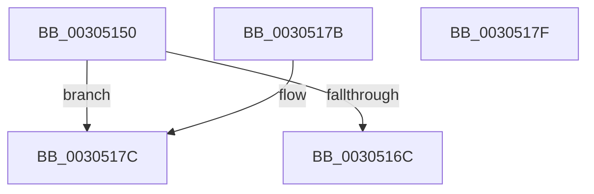

# KeCheckProcessorAffinityEx

- RVA: `0x00305150`–`0x00305180` (길이 `48` bytes)
- VA: `0x0000000140305150`
- 실행 섹션: `.text`
- PDB 이름 있음: `예`; PDB Function 태그: `아니요`
- unwind 정보 RVA: `0x000DB714`
- 디코드: `18`개 명령, `48/48` bytes 표시
- 미해석 바이트: `0` (있으면 어셈블리에 `.byte`로 보존)

> 이 문서는 커널 이미지의 기계어와 PDB 기호를 분석해 생성했습니다. 4번과 5번은 함수 원형과 자료형을 바이너리 사용 방식에서 추정한 C 해석이며 원본 소스 복구 결과는 아닙니다.

## 1. Dependencies

- 직접 호출 지점: **0**; 고유 호출 대상: **0**
- 직접 호출자로 확인된 함수: **32**
- RIP 상대 이미지 참조: **1**

### Outgoing calls
- 직접 디코드된 call 명령이 없습니다.

### Direct callers
- [PpmParkReportParkedCore](../2D/PpmParkReportParkedCore_function_002D8488.md) at `0x002D84B0`
- [PpmParkReportParkedCore](../2D/PpmParkReportParkedCore_function_002D8488.md) at `0x002D84C6`
- [sub_002D95FE](../2D/Unknown_function_002D95FE.md) at `0x002D9633`
- [sub_002D9684](../2D/Unknown_function_002D9684.md) at `0x002D9691`
- [KiStopProfileTarget](KiStopProfileTarget_function_00304510.md) at `0x0030457D`
- [PpmUpdatePlatformIdleVeto](PpmUpdatePlatformIdleVeto_function_003047E0.md) at `0x003048AE`
- [KiCheckKeepAlive](KiCheckKeepAlive_function_00305058.md) at `0x003050D3`
- [KiCheckKeepAlive](KiCheckKeepAlive_function_00305058.md) at `0x003050E8`
- [KiUpdateGlobalCpuSetConfiguration](KiUpdateGlobalCpuSetConfiguration_function_00305AB8.md) at `0x00305CF9`
- [KiRescheduleThreadAfterAffinityChange](KiRescheduleThreadAfterAffinityChange_function_0030C9E8.md) at `0x0030CCC1`
- [PpmParkReportSoftParkChange](../35/PpmParkReportSoftParkChange_function_003526DC.md) at `0x00352709`
- [PpmParkReportSoftParkChange](../35/PpmParkReportSoftParkChange_function_003526DC.md) at `0x003527A8`
- [KiComputeThreadAffinity](../39/KiComputeThreadAffinity_function_00399DE0.md) at `0x0039A06F`
- [PpmHeteroUpdateHgsConfiguration](../3B/PpmHeteroUpdateHgsConfiguration_function_003BF344.md) at `0x003BF9AA`
- [KiProcessProfileList](../4A/KiProcessProfileList_function_004A351C.md) at `0x004A359E`
- [EmonEnableMonitoringEnhanced](../55/EmonEnableMonitoringEnhanced_function_0055C8E0.md) at `0x0055C974`
- [EmonEnableMonitoringOriginal](../55/EmonEnableMonitoringOriginal_function_0055CA40.md) at `0x0055CAD4`
- [EmonRemoveProfileSourceEnhanced](../55/EmonRemoveProfileSourceEnhanced_function_0055F1C0.md) at `0x0055F205`
- [EmonRemoveProfileSourceOriginal](../55/EmonRemoveProfileSourceOriginal_function_0055F2C0.md) at `0x0055F305`
- [Amd64EnableMonitoring](../56/Amd64EnableMonitoring_function_0056C360.md) at `0x0056C3CA`
- [Amd64RemoveProfileSource](../56/Amd64RemoveProfileSource_function_0056D900.md) at `0x0056D946`
- [KeUpdateProcessorRestrictionsEx](../5B/KeUpdateProcessorRestrictionsEx_function_005B64E8.md) at `0x005B6771`
- [KiGetNextClockOwner](../5B/KiGetNextClockOwner_function_005BB5D4.md) at `0x005BB63F`
- [KiGetNextTimerExpirationDueTime](../5B/KiGetNextTimerExpirationDueTime_function_005BCF60.md) at `0x005BD084`
- [PpmIdleCheckCoordinatedDependency](../5C/PpmIdleCheckCoordinatedDependency_function_005CF72C.md) at `0x005CF7A4`
- [PpmTestAndLockProcessor](../5D/PpmTestAndLockProcessor_function_005D08B4.md) at `0x005D0991`
- [PpmParkReportForceParkChange](../5D/PpmParkReportForceParkChange_function_005DBE30.md) at `0x005DBE5D`
- [PpmParkReportForceParkChange](../5D/PpmParkReportForceParkChange_function_005DBE30.md) at `0x005DBE82`
- [PpmParkCalculateCoreParkingMaskEx](../5D/PpmParkCalculateCoreParkingMaskEx_function_005DFBE0.md) at `0x005DFFCD`
- [PpmParkCalculateCoreParkingMaskEx](../5D/PpmParkCalculateCoreParkingMaskEx_function_005DFBE0.md) at `0x005DFFDF`
- [PpmParkCalculateCoreParkingMaskEx](../5D/PpmParkCalculateCoreParkingMaskEx_function_005DFBE0.md) at `0x005E0115`
- [sub_006DD378](../6D/Unknown_function_006DD378.md) at `0x006DD42D`
- [sub_006E5F76](../6E/Unknown_function_006E5F76.md) at `0x006E5F85`
- [sub_006F962E](../6F/Unknown_function_006F962E.md) at `0x006F976C`
- [sub_006F962E](../6F/Unknown_function_006F962E.md) at `0x006F97C7`
- [PnpReplacePartitionUnit](../../page/73/PnpReplacePartitionUnit_function_00738550.md) at `0x00738E3C`
- [PpmRegisterPerfStates](../../page/75/PpmRegisterPerfStates_function_0075B084.md) at `0x0075B387`
- [PpmRegisterPerfStates](../../page/75/PpmRegisterPerfStates_function_0075B084.md) at `0x0075BC01`
- [KiSetCacheInformationAmd](../../pagelk/B6/KiSetCacheInformationAmd_function_00B69CBC.md) at `0x00B69DDB`
- [PopReadLegacySimulatedArchitecturalClasses](../../init/C4/PopReadLegacySimulatedArchitecturalClasses_function_00C41138.md) at `0x00C41242`

### Static image references
- `0x00305155` → RVA `0x00F231B0` (`.data`; read)

## 2. Other-region calls and transfers

- 다른 실행 섹션으로 향하는 call: **0**
- 별도 외부 분기/꼬리 이동을 확인하지 못했습니다.

## 3. Assembly (complete function range)

```asm
00305150  8B C2                           mov eax, edx
00305152  4C 8B C1                        mov r8, rcx
00305155  48 8B 0D 54 E0 C1 00            mov rcx, qword ptr [rip + 0xc1e054]
0030515C  8B 0C 81                        mov ecx, dword ptr [rcx + rax*4]
0030515F  8B D1                           mov edx, ecx
00305161  41 0F B7 00                     movzx eax, word ptr [r8]
00305165  C1 EA 06                        shr edx, 6
00305168  3B D0                           cmp edx, eax
0030516A  73 10                           jae 0x14030517c
0030516C  49 8B 44 D0 08                  mov rax, qword ptr [r8 + rdx*8 + 8]
00305171  83 E1 3F                        and ecx, 0x3f
00305174  48 D3 E8                        shr rax, cl
00305177  83 E0 01                        and eax, 1
0030517A  C3                              ret
0030517B  CC                              int3
0030517C  33 C0                           xor eax, eax
0030517E  C3                              ret
0030517F  CC                              int3
```

## 4. C-style interpretation (structured pseudocode)

```c
__int64 __fastcall KeCheckProcessorAffinityEx(__int64 a1, int a2)
{
    __int64 result;

    a2 = (unsigned int)(((unsigned int)((unsigned int)((unsigned int)(*(unsigned int *)(*(unsigned __int64 *)(v_rip + 12705876) + (unsigned int)(a2) * 4))))) >> (6));
    if (a2 >= ((unsigned int)(*(unsigned __int16 *)(a1)))) goto loc_0030517C;
    a1 = (unsigned int)(((unsigned int)(*(unsigned int *)(*(unsigned __int64 *)(v_rip + 12705876) + (unsigned int)(a2) * 4))) & (63));
    result = (*(unsigned __int64 *)(a1 + a2 * 8 + 8)) >> ((unsigned __int8)(a1));
    result = (unsigned int)((result) & (1));
    return result;
loc_0030517C:
    result = 0;
    return result;
}
```

## 5. (Beta) C Style

```c
int64_t KeCheckProcessorAffinityEx(void *Arg1, int32_t Arg2)
{
    uint8_t *arg1 = (uint8_t *)Arg1;

    int64_t result;

    Arg2 = (uint32_t)(((uint32_t)((uint32_t)((uint32_t)(*(uint32_t *)(*(uint64_t *)(v_rip + 0xC1E054) + (uint32_t)(Arg2) * 4))))) >> (6));
    if (Arg2 >= ((uint32_t)(*(uint16_t *)(arg1)))) goto loc_0030517C;
    Arg1 = (uint32_t)(((uint32_t)(*(uint32_t *)(*(uint64_t *)(v_rip + 0xC1E054) + (uint32_t)(Arg2) * 4))) & (63));
    result = (*(uint64_t *)(arg1 + Arg2 * 8 + 0x8)) >> ((uint8_t)(Arg1));
    result = (uint32_t)((result) & (1));
    return result;
loc_0030517C:
    result = 0;
    return result;
}
```

### 관측된 메모리 오프셋

구조체 형식이 확인되지 않은 접근은 인자 기준의 오프셋으로만 기록했습니다.

| 기준 인자 | 오프셋 표현 | 폭 (bit) | 접근 |
|---|---:|---:|---|
| `Arg1` | `+ 0x0` | `16` | `R` |
| `Arg1` | `+ 0x8 + rdx*8` | `64` | `R` |

## 6. Execution-region graph

[열기: 2D/3D 그래프와 함수 탐색 컨트롤 패널](../../../control-panel.html?section=text&rva=0x00305150&view=graph)

- 2D 그래프는 위에서 아래로 흐르고, 3D 그래프는 빈 공간을 드래그해 회전합니다. Shift+드래그는 이동, 휠은 확대·축소, 함수 노드 선택은 대상 보고서 이동입니다.

### Static fallback


