# KeCpuSetReportParkedProcessors

- RVA: `0x003052B0`–`0x003055F9` (길이 `841` bytes)
- VA: `0x00000001403052B0`
- 실행 섹션: `.text`
- PDB 이름 있음: `예`; PDB Function 태그: `예`
- unwind 정보 RVA: `0x00073648`
- 디코드: `209`개 명령, `841/841` bytes 표시
- 미해석 바이트: `0` (있으면 어셈블리에 `.byte`로 보존)

> 이 문서는 커널 이미지의 기계어와 PDB 기호를 분석해 생성했습니다. 4번과 5번은 함수 원형과 자료형을 바이너리 사용 방식에서 추정한 C 해석이며 원본 소스 복구 결과는 아닙니다.

## 1. Dependencies

- 직접 호출 지점: **6**; 고유 호출 대상: **6**
- 직접 호출자로 확인된 함수: **2**
- RIP 상대 이미지 참조: **9**

### Outgoing calls
- `0x00305316` → [KeAcquireSpinLockAtDpcLevel](../20/KeAcquireSpinLockAtDpcLevel_function_00208430.md) (function, `0x00208430`)
- `0x0030541E` → [memcpy](../6C/memcpy_function_006C6840.md) (function, `0x006C6840`)
- `0x00305439` → [KiUpdateGlobalCpuSetConfiguration](KiUpdateGlobalCpuSetConfiguration_function_00305AB8.md) (function, `0x00305AB8`)
- `0x00305445` → [KxReleaseSpinLock](../20/KxReleaseSpinLock_function_00206670.md) (function, `0x00206670`)
- `0x0030545B` → [KiProcessDeferredReadyList](../25/KiProcessDeferredReadyList_function_00250800.md) (function, `0x00250800`)
- `0x00305467` → [_security_check_cookie](../6A/_security_check_cookie_function_006AC640.md) (function, `0x006AC640`)

### Direct callers
- [KiModifySystemAllowedCpuSetsWithLock](KiModifySystemAllowedCpuSetsWithLock_function_00304278.md) at `0x003043DD`
- [PpmParkReportMask](PpmParkReportMask_function_00305190.md) at `0x00305213`

### Static image references
- `0x003052D4` → RVA `0x00E0A740` (`.data`; read)
- `0x003052E2` → RVA `0x00FC5018` (`ALMOSTRO`; read)
- `0x003052EA` → RVA `0x00FC6E18` (`ALMOSTRO`; read)
- `0x003052FE` → RVA `0x00FC6E20` (`ALMOSTRO`; read)
- `0x0030530F` → RVA `0x00F23440` (`.data`; read)
- `0x00305326` → RVA `0x00000000` (`image boundary/outside`; read)
- `0x003053C0` → RVA `0x00FC6BF8` (`ALMOSTRO`; read)
- `0x00305409` → RVA `0x00FC6FD4` (`ALMOSTRO`; read)
- `0x00305432` → RVA `0x00FC6BF8` (`ALMOSTRO`; write)

## 2. Other-region calls and transfers

- 다른 실행 섹션으로 향하는 call: **0**
- call이 아닌 외부 분기/꼬리 이동: **1**
  - `0x003055F4` → [sub_006E06B6](../6E/Unknown_function_006E06B6.md) (`tail-transfer`)

## 3. Assembly (complete function range)

```asm
003052B0  48 89 5C 24 10                  mov qword ptr [rsp + 0x10], rbx
003052B5  48 89 74 24 18                  mov qword ptr [rsp + 0x18], rsi
003052BA  48 89 7C 24 20                  mov qword ptr [rsp + 0x20], rdi
003052BF  55                              push rbp
003052C0  41 54                           push r12
003052C2  41 55                           push r13
003052C4  41 56                           push r14
003052C6  41 57                           push r15
003052C8  48 8D 6C 24 A0                  lea rbp, [rsp - 0x60]
003052CD  48 81 EC 60 01 00 00            sub rsp, 0x160
003052D4  48 8B 05 65 54 B0 00            mov rax, qword ptr [rip + 0xb05465]
003052DB  48 33 C4                        xor rax, rsp
003052DE  48 89 45 50                     mov qword ptr [rbp + 0x50], rax
003052E2  44 0F B7 25 2E FD CB 00         movzx r12d, word ptr [rip + 0xcbfd2e]
003052EA  48 8B 05 27 1B CC 00            mov rax, qword ptr [rip + 0xcc1b27]
003052F1  44 89 64 24 24                  mov dword ptr [rsp + 0x24], r12d
003052F6  48 89 4C 24 28                  mov qword ptr [rsp + 0x28], rcx
003052FB  0F 0D 08                        prefetchw byte ptr [rax]
003052FE  48 8B 05 1B 1B CC 00            mov rax, qword ptr [rip + 0xcc1b1b]
00305305  0F 0D 08                        prefetchw byte ptr [rax]
00305308  33 DB                           xor ebx, ebx
0030530A  48 85 C9                        test rcx, rcx
0030530D  74 11                           je 0x140305320
0030530F  48 8D 0D 2A E1 C1 00            lea rcx, [rip + 0xc1e12a]
00305316  E8 15 31 F0 FF                  call 0x140208430
0030531B  48 8B 4C 24 28                  mov rcx, qword ptr [rsp + 0x28]
00305320  89 5C 24 20                     mov dword ptr [rsp + 0x20], ebx
00305324  8B C3                           mov eax, ebx
00305326  4C 8D 3D D3 AC CF FF            lea r15, [rip - 0x30532d]
0030532D  0F B7 F3                        movzx esi, bx
00305330  BA 01 00 00 00                  mov edx, 1
00305335  45 85 E4                        test r12d, r12d
00305338  74 7D                           je 0x1403053b7
0030533A  8B FB                           mov edi, ebx
0030533C  44 0F B7 DE                     movzx r11d, si
00305340  4F 8B B4 DF 28 71 FC 00         mov r14, qword ptr [r15 + r11*8 + 0xfc7128]
00305348  48 85 C9                        test rcx, rcx
0030534B  0F 84 5E 02 00 00               je 0x1403055af
00305351  66 3B 31                        cmp si, word ptr [rcx]
00305354  0F 83 86 02 00 00               jae 0x1403055e0
0030535A  4E 8B 54 D9 08                  mov r10, qword ptr [rcx + r11*8 + 8]
0030535F  4D 33 D6                        xor r10, r14
00305362  4E 89 54 DC 50                  mov qword ptr [rsp + r11*8 + 0x50], r10
00305367  4F 39 94 DF C0 81 FC 00         cmp qword ptr [r15 + r11*8 + 0xfc81c0], r10
0030536F  0F 84 13 02 00 00               je 0x140305588
00305375  4D 8B C2                        mov r8, r10
00305378  89 54 24 20                     mov dword ptr [rsp + 0x20], edx
0030537C  4D 23 C6                        and r8, r14
0030537F  8B C2                           mov eax, edx
00305381  4D 8B C8                        mov r9, r8
00305384  4D 33 CE                        xor r9, r14
00305387  4D 85 C0                        test r8, r8
0030538A  0F 85 FE 00 00 00               jne 0x14030548e
00305390  4D 85 C9                        test r9, r9
00305393  0F 85 40 01 00 00               jne 0x1403054d9
00305399  48 8B 4C 24 28                  mov rcx, qword ptr [rsp + 0x28]
0030539E  4C 8D 3D 5B AC CF FF            lea r15, [rip - 0x3053a5]
003053A5  66 03 F2                        add si, dx
003053A8  0F B7 FE                        movzx edi, si
003053AB  41 3B FC                        cmp edi, r12d
003053AE  72 8C                           jb 0x14030533c
003053B0  4C 8D 3D 49 AC CF FF            lea r15, [rip - 0x3053b7]
003053B7  48 89 5C 24 28                  mov qword ptr [rsp + 0x28], rbx
003053BC  85 C0                           test eax, eax
003053BE  74 7E                           je 0x14030543e
003053C0  0F 0D 0D 31 18 CC 00            prefetchw byte ptr [rip + 0xcc1831]
003053C7  48 8B 05 2A 18 CC 00            mov rax, qword ptr [rip + 0xcc182a]
003053CE  48 8D 48 01                     lea rcx, [rax + 1]
003053D2  84 C2                           test dl, al
003053D4  0F 85 C7 01 00 00               jne 0x1403055a1
003053DA  F0 48 0F B1 0D 15 18 CC 00      lock cmpxchg qword ptr [rip + 0xcc1815], rcx
003053E3  0F 85 BF 01 00 00               jne 0x1403055a8
003053E9  45 85 E4                        test r12d, r12d
003053EC  74 1B                           je 0x140305409
003053EE  0F B7 CB                        movzx ecx, bx
003053F1  66 03 DA                        add bx, dx
003053F4  48 8B 44 CC 50                  mov rax, qword ptr [rsp + rcx*8 + 0x50]
003053F9  49 89 84 CF C0 81 FC 00         mov qword ptr [r15 + rcx*8 + 0xfc81c0], rax
00305401  0F B7 C3                        movzx eax, bx
00305404  41 3B C4                        cmp eax, r12d
00305407  72 E5                           jb 0x1403053ee
00305409  44 8B 05 C4 1B CC 00            mov r8d, dword ptr [rip + 0xcc1bc4]
00305410  48 8B 15 09 1A CC 00            mov rdx, qword ptr [rip + 0xcc1a09]
00305417  48 8B 0D FA 19 CC 00            mov rcx, qword ptr [rip + 0xcc19fa]
0030541E  E8 1D 14 3C 00                  call 0x1406c6840
00305423  48 8B 05 CE 17 CC 00            mov rax, qword ptr [rip + 0xcc17ce]
0030542A  48 8D 4C 24 28                  lea rcx, [rsp + 0x28]
0030542F  48 FF C0                        inc rax
00305432  48 89 05 BF 17 CC 00            mov qword ptr [rip + 0xcc17bf], rax
00305439  E8 7A 06 00 00                  call 0x140305ab8
0030543E  48 8D 0D FB DF C1 00            lea rcx, [rip + 0xc1dffb]
00305445  E8 26 12 F0 FF                  call 0x140206670
0030544A  65 48 8B 0C 25 20 00 00 00      mov rcx, qword ptr gs:[0x20]
00305453  48 8D 54 24 28                  lea rdx, [rsp + 0x28]
00305458  41 B0 02                        mov r8b, 2
0030545B  E8 A0 B3 F4 FF                  call 0x140250800
00305460  48 8B 4D 50                     mov rcx, qword ptr [rbp + 0x50]
00305464  48 33 CC                        xor rcx, rsp
00305467  E8 D4 71 3A 00                  call 0x1406ac640
0030546C  4C 8D 9C 24 60 01 00 00         lea r11, [rsp + 0x160]
00305474  49 8B 5B 38                     mov rbx, qword ptr [r11 + 0x38]
00305478  49 8B 73 40                     mov rsi, qword ptr [r11 + 0x40]
0030547C  49 8B 7B 48                     mov rdi, qword ptr [r11 + 0x48]
00305480  49 8B E3                        mov rsp, r11
00305483  41 5F                           pop r15
00305485  41 5E                           pop r14
00305487  41 5D                           pop r13
00305489  41 5C                           pop r12
0030548B  5D                              pop rbp
0030548C  C3                              ret
0030548D  CC                              int3
0030548E  44 8B FF                        mov r15d, edi
00305491  41 BC 01 00 00 00               mov r12d, 1
00305497  41 C1 E7 06                     shl r15d, 6
0030549B  49 0F BC C0                     bsf rax, r8
0030549F  49 8B D4                        mov rdx, r12
003054A2  8B C8                           mov ecx, eax
003054A4  89 44 24 30                     mov dword ptr [rsp + 0x30], eax
003054A8  48 D3 E2                        shl rdx, cl
003054AB  4C 33 C2                        xor r8, rdx
003054AE  41 8D 0C 07                     lea ecx, [r15 + rax]
003054B2  48 8B 05 67 19 CC 00            mov rax, qword ptr [rip + 0xcc1967]
003054B9  48 89 14 C8                     mov qword ptr [rax + rcx*8], rdx
003054BD  75 DC                           jne 0x14030549b
003054BF  44 8B 64 24 24                  mov r12d, dword ptr [rsp + 0x24]
003054C4  4C 8D 3D 35 AB CF FF            lea r15, [rip - 0x3054cb]
003054CB  8B 44 24 20                     mov eax, dword ptr [rsp + 0x20]
003054CF  BA 01 00 00 00                  mov edx, 1
003054D4  E9 B7 FE FF FF                  jmp 0x140305390
003054D9  49 8B C3                        mov rax, r11
003054DC  48 C1 E0 05                     shl rax, 5
003054E0  4A 8B 94 38 28 88 FC 00         mov rdx, qword ptr [rax + r15 + 0xfc8828]
003054E8  4C 8B C2                        mov r8, rdx
003054EB  4D 33 C6                        xor r8, r14
003054EE  4C 85 D2                        test rdx, r10
003054F1  0F 95 C1                        setne cl
003054F4  4D 85 D0                        test r8, r10
003054F7  0F 95 C0                        setne al
003054FA  22 C8                           and cl, al
003054FC  8A C1                           mov al, cl
003054FE  F6 D8                           neg al
00305500  48 8D 05 F9 AA CF FF            lea rax, [rip - 0x305507]
00305507  4D 1B FF                        sbb r15, r15
0030550A  4C 23 FA                        and r15, rdx
0030550D  49 8B D2                        mov rdx, r10
00305510  F6 D9                           neg cl
00305512  4D 1B ED                        sbb r13, r13
00305515  4D 03 DB                        add r11, r11
00305518  4D 23 E8                        and r13, r8
0030551B  4D 8B C6                        mov r8, r14
0030551E  4C 89 6C 24 40                  mov qword ptr [rsp + 0x40], r13
00305523  4E 33 84 D8 20 83 FC 00         xor r8, qword ptr [rax + r11*8 + 0xfc8320]
0030552B  49 23 D0                        and rdx, r8
0030552E  4D 85 C0                        test r8, r8
00305531  0F 85 8A 00 00 00               jne 0x1403055c1
00305537  48 F7 D2                        not rdx
0030553A  49 23 D6                        and rdx, r14
0030553D  4C 85 D2                        test rdx, r10
00305540  49 0F 44 D6                     cmove rdx, r14
00305544  C1 E7 06                        shl edi, 6
00305547  49 0F BC C9                     bsf rcx, r9
0030554B  4C 8B C2                        mov r8, rdx
0030554E  8B C1                           mov eax, ecx
00305550  49 0F B3 C1                     btr r9, rax
00305554  89 4C 24 38                     mov dword ptr [rsp + 0x38], ecx
00305558  8B C1                           mov eax, ecx
0030555A  49 0F A3 C7                     bt r15, rax
0030555E  72 31                           jb 0x140305591
00305560  49 8B C5                        mov rax, r13
00305563  49 23 C2                        and rax, r10
00305566  48 85 C2                        test rdx, rax
00305569  74 06                           je 0x140305571
0030556B  4D 8B C5                        mov r8, r13
0030556E  4C 23 C2                        and r8, rdx
00305571  48 8B 05 A8 18 CC 00            mov rax, qword ptr [rip + 0xcc18a8]
00305578  03 CF                           add ecx, edi
0030557A  4C 89 04 C8                     mov qword ptr [rax + rcx*8], r8
0030557E  4D 85 C9                        test r9, r9
00305581  75 C4                           jne 0x140305547
00305583  BA 01 00 00 00                  mov edx, 1
00305588  8B 44 24 20                     mov eax, dword ptr [rsp + 0x20]
0030558C  E9 08 FE FF FF                  jmp 0x140305399
00305591  49 8B C7                        mov rax, r15
00305594  49 23 C2                        and rax, r10
00305597  48 85 C2                        test rdx, rax
0030559A  74 D5                           je 0x140305571
0030559C  4D 8B C7                        mov r8, r15
0030559F  EB CD                           jmp 0x14030556e
003055A1  48 8B 05 50 16 CC 00            mov rax, qword ptr [rip + 0xcc1650]
003055A8  F3 90                           pause
003055AA  E9 1F FE FF FF                  jmp 0x1403053ce
003055AF  4F 8B 94 DF C0 81 FC 00         mov r10, qword ptr [r15 + r11*8 + 0xfc81c0]
003055B7  4E 89 54 DC 50                  mov qword ptr [rsp + r11*8 + 0x50], r10
003055BC  E9 B4 FD FF FF                  jmp 0x140305375
003055C1  48 85 D2                        test rdx, rdx
003055C4  0F 84 6D FF FF FF               je 0x140305537
003055CA  4D 23 C1                        and r8, r9
003055CD  4D 33 C8                        xor r9, r8
003055D0  4D 85 C0                        test r8, r8
003055D3  75 13                           jne 0x1403055e8
003055D5  4D 85 C9                        test r9, r9
003055D8  0F 85 59 FF FF FF               jne 0x140305537
003055DE  EB A3                           jmp 0x140305583
003055E0  4C 8B D3                        mov r10, rbx
003055E3  E9 77 FD FF FF                  jmp 0x14030535f
003055E8  4C 8B 64 24 40                  mov r12, qword ptr [rsp + 0x40]
003055ED  44 8B EF                        mov r13d, edi
003055F0  41 C1 E5 06                     shl r13d, 6
003055F4  E9 BD B0 3D 00                  jmp 0x1406e06b6
```

## 4. C-style interpretation (structured pseudocode)

```c
__int64 __fastcall KeCpuSetReportParkedProcessors(__int64 a1)
{
    __int64 result;
    __int64 v_r10;
    __int64 v_r11;
    __int64 v_r13;
    __int64 v_r15;
    __int64 v_rbx;
    __int64 v_rdi;
    __int64 v_rsi;
    __int64 v_rsp;
    unsigned __int64 v_stack_m120;
    unsigned int v_stack_m128;
    unsigned int v_stack_m130;
    unsigned int v_stack_m13C;
    unsigned int v_stack_m140;
    unsigned __int64 v_stack_m160;
    unsigned int v_stack_m164;
    unsigned int v_stack_m168;
    unsigned __int64 v_stack_m28;
    unsigned __int64 v_stack_m38;
    unsigned __int64 v_stack_m88;
    unsigned __int64 v_stack_p10;
    unsigned __int64 v_stack_p18;
    unsigned __int64 v_stack_p20;

    v_stack_p10 = v_rbx;
    v_stack_p18 = v_rsi;
    v_stack_p20 = v_rdi;
    v_rsp = (v_rsp) - (352);
    result = (*(unsigned __int64 *)(v_rip + 11555941)) ^ (v_rsp);
    v_stack_m38 = result;
    v_stack_m164 = (unsigned int)(*(unsigned __int16 *)(v_rip + 13368622));
    v_stack_m160 = a1;
    v_rbx = 0;
    result = *(unsigned __int64 *)(v_rip + 13376283);
    if (a1 != 0) {
        a1 = v_rip + 12706090;
        result = KeAcquireSpinLockAtDpcLevel(a1, a2, a3, a4);
        a1 = v_stack_m160;
    }
    v_stack_m168 = 0;
    if ((unsigned int)(*(unsigned __int16 *)(v_rip + 13368622)) == 0) goto loc_003053B7;
loc_0030533C:
    if (a1 == 0) goto loc_003055AF;
    if (0 >= (*(unsigned __int16 *)(a1))) goto loc_003055E0;
loc_0030535F:
    v_r10 = (*(unsigned __int64 *)(a1 + 0 * 8 + 8)) ^ (*(unsigned __int64 *)(v_rip - 3167021 + 0 * 8 + 16544040));
    *(unsigned __int64 *)(v_rsp + 0 * 8 + 80) = v_r10;
    if ((*(unsigned __int64 *)(v_rip - 3167021 + 0 * 8 + 16548288)) == v_r10) goto loc_00305588;
loc_00305375:
    v_stack_m168 = 1;
    a3 = (v_r10) & (*(unsigned __int64 *)(v_rip - 3167021 + 0 * 8 + 16544040));
    a4 = (a3) ^ (*(unsigned __int64 *)(v_rip - 3167021 + 0 * 8 + 16544040));
    if (a3 != 0) goto loc_0030548E;
loc_00305390:
    if (a4 != 0) goto loc_003054D9;
loc_00305399:
    v_rsi = (unsigned __int16)((0) + (1));
    if (((unsigned int)((unsigned __int16)(v_rsi))) < ((unsigned int)(*(unsigned __int16 *)(v_rip + 13368622)))) goto loc_0030533C;
loc_003053B7:
    v_stack_m160 = 0;
    if (1 == 0) goto loc_0030543E;
loc_003053CE:
    if (((1) & ((unsigned __int8)(*(unsigned __int64 *)(v_rip + 13375530)))) != 0) goto loc_003055A1;
    if (((1) & ((unsigned __int8)(*(unsigned __int64 *)(v_rip + 13375530)))) != 0) goto loc_003055A8;
    if ((unsigned int)(*(unsigned __int16 *)(v_rip + 13368622)) == 0) goto loc_00305409;
loc_003053EE:
    v_rbx = (unsigned __int16)((v_rbx) + (1));
    *(unsigned __int64 *)(v_rip - 3167159 + 0 * 8 + 16548288) = *(unsigned __int64 *)(v_rsp + 0 * 8 + 80);
    if (((unsigned int)((unsigned __int16)(v_rbx))) < ((unsigned int)(*(unsigned __int16 *)(v_rip + 13368622)))) goto loc_003053EE;
loc_00305409:
    result = memcpy(*(unsigned __int64 *)(v_rip + 13375994), *(unsigned __int64 *)(v_rip + 13376009), (unsigned int)(*(unsigned int *)(v_rip + 13376452)), a4);
    result = (*(unsigned __int64 *)(v_rip + 13375438)) + 1;
    *(unsigned __int64 *)(v_rip + 13375423) = result;
    result = KiUpdateGlobalCpuSetConfiguration(v_stack_m160, *(unsigned __int64 *)(v_rip + 13376009), (unsigned int)(*(unsigned int *)(v_rip + 13376452)), a4);
loc_0030543E:
    result = KxReleaseSpinLock(v_rip + 12705787, *(unsigned __int64 *)(v_rip + 13376009), (unsigned int)(*(unsigned int *)(v_rip + 13376452)), a4);
    result = KiProcessDeferredReadyList(*(unsigned __int64 *)(gs_base + (0 + 32)), v_stack_m160, 2, a4);
    a1 = (v_stack_m38) ^ (v_rsp);
    result = _security_check_cookie(a1, v_stack_m160, 2, a4);
    return result;
loc_0030548E:
    v_r15 = (unsigned int)(((unsigned int)((unsigned int)(*(unsigned __int64 *)(v_stack_m28 + 72)))) << (6));
loc_0030549B:
    v_stack_m130 = (unsigned int)(result);
    a2 = (1) << ((unsigned __int8)((unsigned int)((unsigned int)(result))));
    a3 = (2) ^ (a2);
    *(unsigned __int64 *)(*(unsigned __int64 *)(v_rip + 13375847) + v_r15 + result * 1 * 8) = a2;
    if (condition_is_not_equal) goto loc_0030549B;
    goto loc_00305390;
loc_003054D9:
    result = (v_stack_m28) << (5);
    a3 = (*(unsigned __int64 *)(result + v_rip - 3167435 * 1 + 16549928)) ^ (*(unsigned __int64 *)(v_rip - 3167021 + 0 * 8 + 16544040));
    a1 = (((*(unsigned __int64 *)(result + v_rip - 3167435 * 1 + 16549928)) & (v_r10)) != 0) ? 1 : 0;
    result = (((a3) & (v_r10)) != 0) ? 1 : 0;
    a1 = (unsigned __int8)((a1) & ((unsigned __int8)(result)));
    result = (unsigned __int8)(-((unsigned __int8)(a1)));
    v_r15 = (v_rip - 3167435) & (*(unsigned __int64 *)(result + v_rip - 3167435 * 1 + 16549928));
    a1 = (unsigned __int8)(-(a1));
    v_r11 = (v_stack_m28) + (v_stack_m28);
    v_r13 = (v_r13) & (a3);
    v_stack_m120 = v_r13;
    a3 = (*(unsigned __int64 *)(v_rip - 3167021 + 0 * 8 + 16544040)) ^ (*(unsigned __int64 *)(v_rip - 3167495 + v_r11 * 8 + 16548640));
    a2 = (v_r10) & (a3);
    if (a3 != 0) goto loc_003055C1;
loc_00305537:
    a2 = ~(a2);
    a2 = (a2) & (*(unsigned __int64 *)(v_rip - 3167021 + 0 * 8 + 16544040));
    if (((a2) & (v_r10)) == 0) { a2 = *(unsigned __int64 *)(v_rip - 3167021 + 0 * 8 + 16544040); }
    v_rdi = (unsigned int)((*(unsigned __int64 *)(v_stack_m28 + 72)) << (6));
loc_00305547:
    v_stack_m128 = (unsigned int)(a1);
    if (condition_is_below) goto loc_00305591;
    result = (v_r13) & (v_r10);
    if (((a2) & (result)) == 0) goto loc_00305571;
loc_0030556E:
    a3 = (v_r13) & (a2);
loc_00305571:
    a1 = (unsigned int)((a1) + ((unsigned int)(v_rdi)));
    *(unsigned __int64 *)(*(unsigned __int64 *)(v_rip + 13375656) + a1 * 8) = a3;
    if (a4 != 0) goto loc_00305547;
loc_00305583:
loc_00305588:
    goto loc_00305399;
loc_00305591:
    result = (v_r15) & (v_r10);
    if (((1) & (result)) == 0) goto loc_00305571;
    goto loc_0030556E;
loc_003055A1:
loc_003055A8:
    goto loc_003053CE;
loc_003055AF:
    *(unsigned __int64 *)(v_stack_m28 + v_r11 * 8 + 80) = *(unsigned __int64 *)(v_r15 + v_r11 * 8 + 16548288);
    goto loc_00305375;
loc_003055C1:
    if (1 == 0) goto loc_00305537;
    a3 = (v_r15) & (a4);
    a4 = (a4) ^ (a3);
    if (a3 != 0) goto loc_003055E8;
    if (a4 != 0) goto loc_00305537;
    goto loc_00305583;
loc_003055E0:
    goto loc_0030535F;
loc_003055E8:
    v_r13 = (unsigned int)(((unsigned int)((unsigned int)(v_rdi))) << (6));
}
```

## 5. (Beta) C Style

```c
int64_t KeCpuSetReportParkedProcessors(int64_t Arg1)
{
    int64_t result;
    int64_t local_r10;
    int64_t local_r11;
    int64_t local_r13;
    int64_t local_r15;
    int64_t local_rbx;
    int64_t local_rdi;
    int64_t local_rsi;
    int64_t local_rsp;
    uint64_t v_stack_m120;
    uint32_t v_stack_m128;
    uint32_t v_stack_m130;
    uint32_t v_stack_m13C;
    uint32_t v_stack_m140;
    uint64_t v_stack_m160;
    uint32_t v_stack_m164;
    uint32_t v_stack_m168;
    uint64_t v_stack_m28;
    uint64_t v_stack_m38;
    uint64_t v_stack_m88;
    uint64_t v_stack_p10;
    uint64_t v_stack_p18;
    uint64_t v_stack_p20;

    v_stack_p10 = local_rbx;
    v_stack_p18 = local_rsi;
    v_stack_p20 = local_rdi;
    local_rsp = (local_rsp) - (352);
    result = (*(uint64_t *)(v_rip + 0xB05465)) ^ (local_rsp);
    v_stack_m38 = result;
    v_stack_m164 = (uint32_t)(*(uint16_t *)(v_rip + 0xCBFD2E));
    v_stack_m160 = Arg1;
    local_rbx = 0;
    result = *(uint64_t *)(v_rip + 0xCC1B1B);
    if (Arg1 != 0) {
        Arg1 = v_rip + 12706090;
        result = KeAcquireSpinLockAtDpcLevel(Arg1, a2, a3, a4);
        Arg1 = v_stack_m160;
    }
    v_stack_m168 = 0;
    if ((uint32_t)(*(uint16_t *)(v_rip + 0xCBFD2E)) == 0) goto loc_003053B7;
loc_0030533C:
    if (Arg1 == 0) goto loc_003055AF;
    if (0 >= (*(uint16_t *)(Arg1))) goto loc_003055E0;
loc_0030535F:
    local_r10 = (*(uint64_t *)(Arg1 + 0x0 * 8 + 0x8)) ^ (*(uint64_t *)(v_rip - 0x30532D + 0x0 * 8 + 0xFC7128));
    *(uint64_t *)(local_rsp + 0x0 * 8 + 0x50) = local_r10;
    if ((*(uint64_t *)(v_rip - 0x30532D + 0x0 * 8 + 0xFC81C0)) == local_r10) goto loc_00305588;
loc_00305375:
    v_stack_m168 = 1;
    a3 = (local_r10) & (*(uint64_t *)(v_rip - 0x30532D + 0x0 * 8 + 0xFC7128));
    a4 = (a3) ^ (*(uint64_t *)(v_rip - 0x30532D + 0x0 * 8 + 0xFC7128));
    if (a3 != 0) goto loc_0030548E;
loc_00305390:
    if (a4 != 0) goto loc_003054D9;
loc_00305399:
    local_rsi = (uint16_t)((0) + (1));
    if (((uint32_t)((uint16_t)(local_rsi))) < ((uint32_t)(*(uint16_t *)(v_rip + 0xCBFD2E)))) goto loc_0030533C;
loc_003053B7:
    v_stack_m160 = 0;
    if (1 == 0) goto loc_0030543E;
loc_003053CE:
    if (((1) & ((uint8_t)(*(uint64_t *)(v_rip + 0xCC182A)))) != 0) goto loc_003055A1;
    if (((1) & ((uint8_t)(*(uint64_t *)(v_rip + 0xCC182A)))) != 0) goto loc_003055A8;
    if ((uint32_t)(*(uint16_t *)(v_rip + 0xCBFD2E)) == 0) goto loc_00305409;
loc_003053EE:
    local_rbx = (uint16_t)((local_rbx) + (1));
    *(uint64_t *)(v_rip - 0x3053B7 + 0x0 * 8 + 0xFC81C0) = *(uint64_t *)(local_rsp + 0x0 * 8 + 0x50);
    if (((uint32_t)((uint16_t)(local_rbx))) < ((uint32_t)(*(uint16_t *)(v_rip + 0xCBFD2E)))) goto loc_003053EE;
loc_00305409:
    result = memcpy(*(uint64_t *)(v_rip + 0xCC19FA), *(uint64_t *)(v_rip + 0xCC1A09), (uint32_t)(*(uint32_t *)(v_rip + 0xCC1BC4)), a4);
    result = (*(uint64_t *)(v_rip + 0xCC17CE)) + 1;
    *(uint64_t *)(v_rip + 0xCC17BF) = result;
    result = KiUpdateGlobalCpuSetConfiguration(v_stack_m160, *(uint64_t *)(v_rip + 0xCC1A09), (uint32_t)(*(uint32_t *)(v_rip + 0xCC1BC4)), a4);
loc_0030543E:
    result = KxReleaseSpinLock(v_rip + 12705787, *(uint64_t *)(v_rip + 0xCC1A09), (uint32_t)(*(uint32_t *)(v_rip + 0xCC1BC4)), a4);
    result = KiProcessDeferredReadyList(*(uint64_t *)(gs_base + (0 + 0x20)), v_stack_m160, 2, a4);
    Arg1 = (v_stack_m38) ^ (local_rsp);
    result = _security_check_cookie(Arg1, v_stack_m160, 2, a4);
    return result;
loc_0030548E:
    local_r15 = (uint32_t)(((uint32_t)((uint32_t)(*(uint64_t *)(v_stack_m28 + 0x48)))) << (6));
loc_0030549B:
    v_stack_m130 = (uint32_t)(result);
    a2 = (1) << ((uint8_t)((uint32_t)((uint32_t)(result))));
    a3 = (2) ^ (a2);
    *(uint64_t *)(*(uint64_t *)(v_rip + 0xCC1967) + local_r15 + result * 1 * 8) = a2;
    if (condition_is_not_equal) goto loc_0030549B;
    goto loc_00305390;
loc_003054D9:
    result = (v_stack_m28) << (5);
    a3 = (*(uint64_t *)(result + v_rip - 0x3054CB * 1 + 0xFC8828)) ^ (*(uint64_t *)(v_rip - 0x30532D + 0x0 * 8 + 0xFC7128));
    Arg1 = (((*(uint64_t *)(result + v_rip - 0x3054CB * 1 + 0xFC8828)) & (local_r10)) != 0) ? 1 : 0;
    result = (((a3) & (local_r10)) != 0) ? 1 : 0;
    Arg1 = (uint8_t)((Arg1) & ((uint8_t)(result)));
    result = (uint8_t)(-((uint8_t)(Arg1)));
    local_r15 = (v_rip - 3167435) & (*(uint64_t *)(result + v_rip - 0x3054CB * 1 + 0xFC8828));
    Arg1 = (uint8_t)(-(Arg1));
    local_r11 = (v_stack_m28) + (v_stack_m28);
    local_r13 = (local_r13) & (a3);
    v_stack_m120 = local_r13;
    a3 = (*(uint64_t *)(v_rip - 0x30532D + 0x0 * 8 + 0xFC7128)) ^ (*(uint64_t *)(v_rip - 0x305507 + local_r11 * 8 + 0xFC8320));
    a2 = (local_r10) & (a3);
    if (a3 != 0) goto loc_003055C1;
loc_00305537:
    a2 = ~(a2);
    a2 = (a2) & (*(uint64_t *)(v_rip - 0x30532D + 0x0 * 8 + 0xFC7128));
    if (((a2) & (local_r10)) == 0) { a2 = *(uint64_t *)(v_rip - 0x30532D + 0x0 * 8 + 0xFC7128); }
    local_rdi = (uint32_t)((*(uint64_t *)(v_stack_m28 + 0x48)) << (6));
loc_00305547:
    v_stack_m128 = (uint32_t)(Arg1);
    if (condition_is_below) goto loc_00305591;
    result = (local_r13) & (local_r10);
    if (((a2) & (result)) == 0) goto loc_00305571;
loc_0030556E:
    a3 = (local_r13) & (a2);
loc_00305571:
    Arg1 = (uint32_t)((Arg1) + ((uint32_t)(local_rdi)));
    *(uint64_t *)(*(uint64_t *)(v_rip + 0xCC18A8) + Arg1 * 8) = a3;
    if (a4 != 0) goto loc_00305547;
loc_00305583:
loc_00305588:
    goto loc_00305399;
loc_00305591:
    result = (local_r15) & (local_r10);
    if (((1) & (result)) == 0) goto loc_00305571;
    goto loc_0030556E;
loc_003055A1:
loc_003055A8:
    goto loc_003053CE;
loc_003055AF:
    *(uint64_t *)(v_stack_m28 + local_r11 * 8 + 0x50) = *(uint64_t *)(local_r15 + local_r11 * 8 + 0xFC81C0);
    goto loc_00305375;
loc_003055C1:
    if (1 == 0) goto loc_00305537;
    a3 = (local_r15) & (a4);
    a4 = (a4) ^ (a3);
    if (a3 != 0) goto loc_003055E8;
    if (a4 != 0) goto loc_00305537;
    goto loc_00305583;
loc_003055E0:
    goto loc_0030535F;
loc_003055E8:
    local_r13 = (uint32_t)(((uint32_t)((uint32_t)(local_rdi))) << (6));
}
```

## 6. Execution-region graph

[열기: 2D/3D 그래프와 함수 탐색 컨트롤 패널](../../../control-panel.html?section=text&rva=0x003052B0&view=graph)

- 2D 그래프는 위에서 아래로 흐르고, 3D 그래프는 빈 공간을 드래그해 회전합니다. Shift+드래그는 이동, 휠은 확대·축소, 함수 노드 선택은 대상 보고서 이동입니다.

### Static fallback

```mermaid
flowchart TD
  bb_003052B0[BB_003052B0]
  bb_0030530F[BB_0030530F]
  bb_00305320[BB_00305320]
  bb_0030533A[BB_0030533A]
  bb_0030533C[BB_0030533C]
  bb_00305351[BB_00305351]
  bb_0030535A[BB_0030535A]
  bb_0030535F[BB_0030535F]
  bb_00305375[BB_00305375]
  bb_00305390[BB_00305390]
  bb_00305399[BB_00305399]
  bb_003053B0[BB_003053B0]
  bb_003053B7[BB_003053B7]
  bb_003053C0[BB_003053C0]
  bb_003053CE[BB_003053CE]
  bb_003053DA[BB_003053DA]
  bb_003053E9[BB_003053E9]
  bb_003053EE[BB_003053EE]
  bb_00305409[BB_00305409]
  bb_0030543E[BB_0030543E]
  bb_0030548D[BB_0030548D]
  bb_0030548E[BB_0030548E]
  bb_0030549B[BB_0030549B]
  bb_003054BF[BB_003054BF]
  bb_003054D9[BB_003054D9]
  bb_00305537[BB_00305537]
  bb_00305547[BB_00305547]
  bb_00305560[BB_00305560]
  bb_0030556B[BB_0030556B]
  bb_0030556E[BB_0030556E]
  bb_00305571[BB_00305571]
  bb_00305583[BB_00305583]
  bb_00305588[BB_00305588]
  bb_00305591[BB_00305591]
  bb_0030559C[BB_0030559C]
  bb_003055A1[BB_003055A1]
  bb_003055A8[BB_003055A8]
  bb_003055AF[BB_003055AF]
  bb_003055C1[BB_003055C1]
  bb_003055CA[BB_003055CA]
  bb_003055D5[BB_003055D5]
  bb_003055DE[BB_003055DE]
  bb_003055E0[BB_003055E0]
  bb_003055E8[BB_003055E8]
  bb_003052B0 -->|branch| bb_00305320
  bb_003052B0 -->|fallthrough| bb_0030530F
  bb_0030530F -->|flow| bb_00305320
  bb_00305320 -->|branch| bb_003053B7
  bb_00305320 -->|fallthrough| bb_0030533A
  bb_0030533A -->|flow| bb_0030533C
  bb_0030533C -->|branch| bb_003055AF
  bb_0030533C -->|fallthrough| bb_00305351
  bb_00305351 -->|branch| bb_003055E0
  bb_00305351 -->|fallthrough| bb_0030535A
  bb_0030535A -->|flow| bb_0030535F
  bb_0030535F -->|branch| bb_00305588
  bb_0030535F -->|fallthrough| bb_00305375
  bb_00305375 -->|branch| bb_0030548E
  bb_00305375 -->|fallthrough| bb_00305390
  bb_00305390 -->|branch| bb_003054D9
  bb_00305390 -->|fallthrough| bb_00305399
  bb_00305399 -->|branch| bb_0030533C
  bb_00305399 -->|fallthrough| bb_003053B0
  bb_003053B0 -->|flow| bb_003053B7
  bb_003053B7 -->|branch| bb_0030543E
  bb_003053B7 -->|fallthrough| bb_003053C0
  bb_003053C0 -->|flow| bb_003053CE
  bb_003053CE -->|branch| bb_003055A1
  bb_003053CE -->|fallthrough| bb_003053DA
  bb_003053DA -->|branch| bb_003055A8
  bb_003053DA -->|fallthrough| bb_003053E9
  bb_003053E9 -->|branch| bb_00305409
  bb_003053E9 -->|fallthrough| bb_003053EE
  bb_003053EE -->|branch| bb_003053EE
  bb_003053EE -->|fallthrough| bb_00305409
  bb_00305409 -->|flow| bb_0030543E
  bb_0030548D -->|flow| bb_0030548E
  bb_0030548E -->|flow| bb_0030549B
  bb_0030549B -->|branch| bb_0030549B
  bb_0030549B -->|fallthrough| bb_003054BF
  bb_003054BF -->|branch| bb_00305390
  bb_003054D9 -->|branch| bb_003055C1
  bb_003054D9 -->|fallthrough| bb_00305537
  bb_00305537 -->|flow| bb_00305547
  bb_00305547 -->|branch| bb_00305591
  bb_00305547 -->|fallthrough| bb_00305560
  bb_00305560 -->|branch| bb_00305571
  bb_00305560 -->|fallthrough| bb_0030556B
  bb_0030556B -->|flow| bb_0030556E
  bb_0030556E -->|flow| bb_00305571
  bb_00305571 -->|branch| bb_00305547
  bb_00305571 -->|fallthrough| bb_00305583
  bb_00305583 -->|flow| bb_00305588
  bb_00305588 -->|branch| bb_00305399
  bb_00305591 -->|branch| bb_00305571
  bb_00305591 -->|fallthrough| bb_0030559C
  bb_0030559C -->|branch| bb_0030556E
  bb_003055A1 -->|flow| bb_003055A8
  bb_003055A8 -->|branch| bb_003053CE
  bb_003055AF -->|branch| bb_00305375
  bb_003055C1 -->|branch| bb_00305537
  bb_003055C1 -->|fallthrough| bb_003055CA
  bb_003055CA -->|branch| bb_003055E8
  bb_003055CA -->|fallthrough| bb_003055D5
  bb_003055D5 -->|branch| bb_00305537
  bb_003055D5 -->|fallthrough| bb_003055DE
  bb_003055DE -->|branch| bb_00305583
  bb_003055E0 -->|branch| bb_0030535F
```


